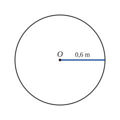
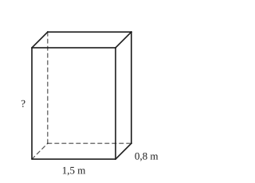

# Đề kiểm tra số 6

**Thời gian làm bài:** 60 phút. **Thang điểm:** mỗi câu 1 điểm, tổng 10 điểm.

## Đề bài

**Câu 1 (Tổng tỉ ba số).** Tổng của ba số là 120. Số thứ nhất bằng $\dfrac{1}{2}$ số thứ hai, số thứ hai bằng $\dfrac{2}{3}$ số thứ ba. Tìm ba số.

**Câu 2 (So sánh số thập phân).** Tìm chữ số $x$ để $3{,}x5 < 3{,}25$.

**Câu 3 (Tìm x).** a) $x : 0{,}25 = 12{,}8$; b) $(x + 1{,}5) \times 4 = 14$.

**Câu 4 (Lãi suất).** Bác Lan gửi tiết kiệm 20 000 000 đồng với lãi suất $0{,}6\%$ một tháng. Hỏi sau một tháng bác được bao nhiêu tiền lãi?

**Câu 5 (Diện tích ruộng đất).** Một khu đất rộng $0{,}5$ ha được chia thành 4 mảnh có diện tích bằng nhau. Hỏi mỗi mảnh rộng bao nhiêu mét vuông?

**Câu 6 (Hình tròn).** Một mặt bàn hình tròn có bán kính $0{,}6$ m. Tính chu vi và diện tích mặt bàn.

**Câu 7 (Tìm chiều cao).** Một bể nước hình hộp chữ nhật có thể tích $2{,}4 \text{ m}^3$, đáy dài $1{,}5$ m, rộng $0{,}8$ m. Tính chiều cao của bể.

**Câu 8 (Vận tốc).** Một người đi xe đạp được 60 km trong 2 giờ 30 phút. Tính vận tốc của người đó theo km/giờ và theo m/phút.

**Câu 9 (Bản đồ).** Trên bản đồ tỉ lệ $1 : 2\,000\,000$, khoảng cách giữa hai thành phố là $7{,}5$ cm. Tính khoảng cách thật.

**Câu 10 (Biểu đồ hình quạt).** Biểu đồ hình quạt về phương tiện đến trường của 200 học sinh có ba phần: đi bộ 30%, xe đạp 25%, xe buýt 20%, và phần còn lại là "bố mẹ đưa". Hỏi phần "bố mẹ đưa" chiếm bao nhiêu phần trăm và gồm bao nhiêu học sinh?

---

## Lời giải chi tiết

### Câu 1
Coi số thứ ba là 3 phần thì số thứ hai là 2 phần, số thứ nhất là 1 phần. Tổng 6 phần ứng với 120, một phần là 20.
Ba số: 20; 40; 60.

### Câu 2
Phần nguyên bằng nhau, so sánh phần thập phân: $0{,}x5 < 0{,}25$ khi chữ số hàng phần mười $x < 2$ (nếu $x = 2$ thì $3{,}25 = 3{,}25$, không thỏa mãn). Vậy $x = 0$ hoặc $x = 1$.

### Câu 3
a) $x = 12{,}8 \times 0{,}25 = 3{,}2$. b) $x + 1{,}5 = 14 : 4 = 3{,}5$, nên $x = 2$.

### Câu 4
$20\,000\,000 \times 0{,}6 : 100 = 120\,000$ (đồng).

### Câu 5
$0{,}5 \text{ ha} = 5\,000 \text{ m}^2$. Mỗi mảnh: $5\,000 : 4 = 1\,250 \text{ (m}^2)$.

### Câu 6

*Hình: Mặt bàn hình tròn bán kính 0,6 m.*

$C = 0{,}6 \times 2 \times 3{,}14 = 3{,}768$ (m). $S = 0{,}6 \times 0{,}6 \times 3{,}14 = 1{,}1304 \text{ (m}^2)$.

### Câu 7

*Hình: Hình hộp chữ nhật đáy 1,5 m × 0,8 m.*

Diện tích đáy: $1{,}5 \times 0{,}8 = 1{,}2 \text{ (m}^2)$. Chiều cao: $2{,}4 : 1{,}2 = 2$ (m).

### Câu 8
2 giờ 30 phút $= 2{,}5$ giờ. $v = 60 : 2{,}5 = 24$ (km/giờ) $= 24\,000 : 60 = 400$ (m/phút).

### Câu 9
$7{,}5 \times 2\,000\,000 = 15\,000\,000$ (cm) $= 150$ km.

### Câu 10
$100\% - 30\% - 25\% - 20\% = 25\%$. Số học sinh: $200 \times 25 : 100 = 50$ (em).
