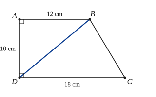
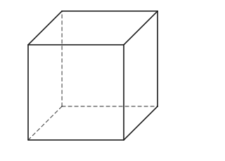

# Đề kiểm tra số 7

**Thời gian làm bài:** 60 phút. **Thang điểm:** mỗi câu 1 điểm, tổng 10 điểm.

## Đề bài

**Câu 1 (Hiệu tỉ).** Kho A có số thóc gấp 3 lần kho B. Nếu chuyển 20 tấn từ kho A sang kho B thì số thóc hai kho bằng nhau. Hỏi mỗi kho có bao nhiêu tấn thóc?

**Câu 2 (So sánh).** Sắp xếp theo thứ tự từ bé đến lớn: $\dfrac{7}{8}$; $0{,}85$; $87\%$; $0{,}8$.

**Câu 3 (Tính thuận tiện).** Tính: $1{,}25 \times 0{,}8 + 2{,}75 \times 0{,}8$.

**Câu 4 (Phần trăm).** Một trường có 600 học sinh, trong đó học sinh nữ chiếm 52%. Hỏi trường có bao nhiêu học sinh nam?

**Câu 5 (Thời gian).** Một người thợ làm một sản phẩm hết 3 giờ 40 phút. Hỏi làm 3 sản phẩm như thế hết bao nhiêu thời gian?

**Câu 6 (Hình thang vuông).** Hình thang vuông $ABCD$ (góc $A$ và góc $D$ vuông) có $AB = 12$ cm, $DC = 18$ cm, $AD = 10$ cm. Tính diện tích hình thang và diện tích tam giác $ABD$.

**Câu 7 (Hình lập phương).** Một hình lập phương có thể tích $64 \text{ cm}^3$. Tính diện tích toàn phần của hình lập phương đó.

**Câu 8 (Đuổi nhau).** Lúc 7 giờ, một người đi xe đạp từ A với vận tốc 15 km/giờ. Lúc 8 giờ 30 phút, một người đi xe máy cũng từ A đuổi theo với vận tốc 40 km/giờ. Hỏi xe máy đuổi kịp xe đạp lúc mấy giờ?

**Câu 9 (Rút về đơn vị).** Một đội 8 người dự định làm xong một công việc trong 15 ngày. Làm được 5 ngày thì đội được bổ sung thêm 2 người. Hỏi cả đội làm xong công việc sau tất cả bao nhiêu ngày? (Năng suất mỗi người như nhau.)

**Câu 10 (Tỉ số lặp lại).** Người ta gieo thử 200 hạt giống thì có 170 hạt nảy mầm. Viết tỉ số phần trăm mô tả số hạt nảy mầm.

---

## Lời giải chi tiết

### Câu 1
Chuyển 20 tấn thì hai kho bằng nhau, nên kho A hơn kho B $20 \times 2 = 40$ (tấn).
Kho B 1 phần, kho A 3 phần, hiệu 2 phần ứng với 40 tấn. Kho B: 20 tấn; kho A: 60 tấn.

### Câu 2
$\dfrac{7}{8} = 0{,}875$; $87\% = 0{,}87$. Thứ tự: $0{,}8 < 0{,}85 < 87\% < \dfrac{7}{8}$.

### Câu 3
$(1{,}25 + 2{,}75) \times 0{,}8 = 4 \times 0{,}8 = 3{,}2$.

### Câu 4
Học sinh nam chiếm $100\% - 52\% = 48\%$: $600 \times 48 : 100 = 288$ (em).

### Câu 5
$3 \text{ giờ } 40 \text{ phút} \times 3 = 9 \text{ giờ } 120 \text{ phút} = 11$ giờ.

### Câu 6

*Hình: Hình thang vuông ABCD, góc A và D vuông, AB = 12 cm, DC = 18 cm, AD = 10 cm.*

$S_{ABCD} = (12 + 18) \times 10 : 2 = 150 \text{ (cm}^2)$.
Tam giác $ABD$ vuông tại $A$: $S = 12 \times 10 : 2 = 60 \text{ (cm}^2)$.

### Câu 7

*Hình: Hình lập phương có thể tích 64 cm³.*

$4 \times 4 \times 4 = 64$ nên cạnh là 4 cm. $S_{tp} = 4 \times 4 \times 6 = 96 \text{ (cm}^2)$.

### Câu 8
Xe đạp đi trước 1 giờ 30 phút = $1{,}5$ giờ, được $15 \times 1{,}5 = 22{,}5$ (km).
Thời gian đuổi kịp: $22{,}5 : (40 - 15) = 0{,}9$ (giờ) $= 54$ phút.
Xe máy đuổi kịp lúc $8 \text{ giờ } 30 \text{ phút} + 54 \text{ phút} = 9 \text{ giờ } 24 \text{ phút}$.

### Câu 9
Công việc cần $8 \times 15 = 120$ (ngày công). Sau 5 ngày còn $120 - 40 = 80$ (ngày công).
10 người làm nốt trong $80 : 10 = 8$ (ngày). Tổng cộng: $5 + 8 = 13$ (ngày).

### Câu 10
$170 : 200 = 0{,}85 = 85\%$.
