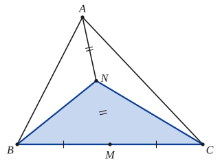
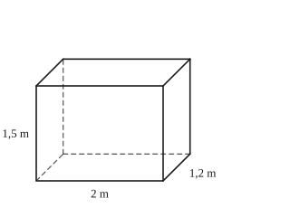

# Đề kiểm tra số 8

**Thời gian làm bài:** 60 phút. **Thang điểm:** mỗi câu 1 điểm, tổng 10 điểm.

## Đề bài

**Câu 1 (Bài toán tuổi).** Năm nay tuổi con bằng $\dfrac{1}{3}$ tuổi bố. Sau 12 năm nữa, tuổi con bằng $\dfrac{1}{2}$ tuổi bố. Tính tuổi mỗi người năm nay.

**Câu 2 (Dịch dấu phẩy).** Một số thập phân, nếu dời dấu phẩy sang phải một chữ số thì được số mới lớn hơn số cũ $21{,}6$ đơn vị. Tìm số thập phân đó.

**Câu 3 (Tính nhanh).** Tính: $0{,}1 + 0{,}2 + 0{,}3 + \dots + 1{,}8 + 1{,}9$.

**Câu 4 (Giảm giá hai lần).** Một món hàng được giảm giá 10%, sau đó giảm tiếp 20% trên giá mới. Hỏi so với giá ban đầu, món hàng giảm tất cả bao nhiêu phần trăm?

**Câu 5 (Thời gian).** Một vòi nước mỗi phút chảy được 15 lít. Hỏi vòi đó chảy đầy một bể chứa được $1{,}2 \text{ m}^3$ nước trong bao lâu?

**Câu 6 (Tam giác).** Tam giác $ABC$ có $M$ là trung điểm của $BC$, $N$ là trung điểm của $AM$. Biết diện tích tam giác $ABM$ là $24 \text{ cm}^2$. Tính diện tích tam giác $ABC$ và tam giác $NBC$.

**Câu 7 (Bể nước).** Một bể nước hình hộp chữ nhật dài 2 m, rộng $1{,}2$ m, cao $1{,}5$ m. Lượng nước trong bể chiếm 60% thể tích bể. Hỏi trong bể có bao nhiêu lít nước và mực nước cao bao nhiêu mét?

**Câu 8 (Ngược chiều).** Hai xe đi ngược chiều từ A và B cùng lúc, sau $1{,}5$ giờ thì gặp nhau. Quãng đường $AB$ dài 135 km. Xe đi từ A nhanh hơn xe đi từ B 10 km/giờ. Tính vận tốc mỗi xe.

**Câu 9 (Diện tích từ bản đồ).** Trên bản đồ tỉ lệ $1 : 1\,000$, một khu đất hình chữ nhật có chiều dài 8 cm, chiều rộng 5 cm. Tính diện tích thật của khu đất theo mét vuông và theo héc-ta.

**Câu 10 (Tỉ số lặp lại).** Gieo một con xúc xắc 60 lần, kết quả: mặt 1 chấm 10 lần, 2 chấm 9 lần, 3 chấm 11 lần, 4 chấm 8 lần, 5 chấm 12 lần, 6 chấm 10 lần. Viết tỉ số mô tả số lần xuất hiện mặt có số chấm lớn hơn 4.

---

## Lời giải chi tiết

### Câu 1
Hiệu số tuổi không đổi. Năm nay con 1 phần, bố 3 phần, hiệu bằng 2 lần tuổi con năm nay.
Sau 12 năm, con bằng $\dfrac{1}{2}$ bố, nên hiệu bằng đúng tuổi con lúc đó.
Vậy tuổi con sau 12 năm gấp 2 lần tuổi con năm nay: tuổi con năm nay là 12 tuổi.
Tuổi bố năm nay: $12 \times 3 = 36$ (tuổi).

**Đáp số:** con 12 tuổi, bố 36 tuổi. Thử lại: sau 12 năm, con 24 tuổi, bố 48 tuổi.

### Câu 2
Dời dấu phẩy sang phải một chữ số thì số đó gấp 10 lần. Số mới hơn số cũ 9 lần số cũ: $21{,}6 : 9 = 2{,}4$.

**Đáp số:** $2{,}4$.

### Câu 3
Dãy có 19 số hạng cách đều $0{,}1$. Ghép số đầu với số cuối: $0{,}1 + 1{,}9 = 2$.
Tổng: $(0{,}1 + 1{,}9) \times 19 : 2 = 19$.

### Câu 4
Sau lần một, giá còn 90%. Sau lần hai, giá còn $90\% \times 80 : 100 = 72\%$. Giảm tất cả $28\%$.

### Câu 5
$1{,}2 \text{ m}^3 = 1\,200$ lít. Thời gian: $1\,200 : 15 = 80$ (phút) = 1 giờ 20 phút.

### Câu 6

*Hình: Tam giác ABC, M là trung điểm BC, N là trung điểm AM.*

$AM$ là trung tuyến nên $S_{ABC} = 2 \times S_{ABM} = 48 \text{ (cm}^2)$.
$S_{NBM} = \dfrac{1}{2} S_{ABM}$ và $S_{NCM} = \dfrac{1}{2} S_{ACM}$ (chung chiều cao, đáy $NM = \dfrac{1}{2} AM$), nên $S_{NBC} = \dfrac{1}{2} S_{ABC} = 24 \text{ (cm}^2)$.

### Câu 7

*Hình: Bể nước hình hộp chữ nhật dài 2 m, rộng 1,2 m, cao 1,5 m.*

Thể tích bể: $2 \times 1{,}2 \times 1{,}5 = 3{,}6 \text{ (m}^3)$. Nước: $3{,}6 \times 60 : 100 = 2{,}16 \text{ (m}^3) = 2\,160$ lít.
Mực nước: $2{,}16 : (2 \times 1{,}2) = 0{,}9$ (m).

### Câu 8
Tổng vận tốc: $135 : 1{,}5 = 90$ (km/giờ). Xe từ A: $(90 + 10) : 2 = 50$ (km/giờ). Xe từ B: 40 km/giờ.

### Câu 9
Chiều dài thật: $8 \times 1\,000 = 8\,000$ cm $= 80$ m. Chiều rộng thật: 50 m.
Diện tích: $80 \times 50 = 4\,000 \text{ (m}^2) = 0{,}4$ ha.

### Câu 10
Mặt 5 chấm và 6 chấm: $12 + 10 = 22$ (lần). Tỉ số: $\dfrac{22}{60} = \dfrac{11}{30}$.
