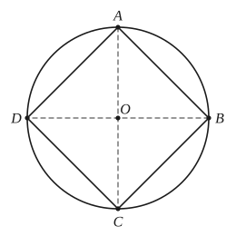
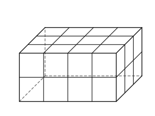

# Đề kiểm tra số 9

**Thời gian làm bài:** 60 phút. **Thang điểm:** mỗi câu 1 điểm, tổng 10 điểm.

## Đề bài

**Câu 1 (Phân số).** Tìm phân số bằng $\dfrac{4}{5}$, biết tổng của tử số và mẫu số là 81.

**Câu 2 (Số thập phân).** Viết tất cả các số thập phân $x$ có hai chữ số ở phần thập phân sao cho $0{,}1 < x < 0{,}15$.

**Câu 3 (Tìm x).** $x \times 4{,}5 + x \times 5{,}5 = 37$.

**Câu 4 (Phần trăm).** Sau khi giảm giá 20%, một chiếc cặp có giá 320 000 đồng. Hỏi giá ban đầu của chiếc cặp là bao nhiêu?

**Câu 5 (Thời gian).** Tính: $3 \text{ giờ } 25 \text{ phút} + 2 \text{ giờ } 50 \text{ phút} + 1 \text{ giờ } 45 \text{ phút}$.

**Câu 6 (Hình tròn và hình vuông).** Cho hình tròn tâm $O$ bán kính 6 cm. Hình vuông $ABCD$ có bốn đỉnh nằm trên đường tròn. Tính diện tích hình vuông và diện tích phần hình tròn nằm ngoài hình vuông.

**Câu 7 (Hình hộp ghép).** Người ta xếp các hình lập phương nhỏ cạnh 1 cm thành một hình hộp chữ nhật dài 4 cm, rộng 3 cm, cao 2 cm rồi sơn tất cả các mặt ngoài.
a) Cần bao nhiêu hình lập phương nhỏ? b) Có bao nhiêu hình lập phương nhỏ được sơn đúng 3 mặt? Đúng 2 mặt?

**Câu 8 (Đi và về).** Một ô tô đi từ A đến B với vận tốc 45 km/giờ rồi quay về A với vận tốc 36 km/giờ. Cả đi và về hết $4{,}5$ giờ. Tính quãng đường $AB$.

**Câu 9 (Tỉ lệ nghịch).** Trên cùng một quãng đường, nếu vận tốc tăng thêm 25% thì thời gian đi giảm bao nhiêu phần trăm?

**Câu 10 (Gộp phần trăm).** Lớp 5A có 40 học sinh, trong đó 25% thích vẽ. Lớp 5B có 60 học sinh, trong đó 40% thích vẽ. Hỏi số học sinh thích vẽ chiếm bao nhiêu phần trăm tổng số học sinh hai lớp?

---

## Lời giải chi tiết

### Câu 1
Tử 4 phần, mẫu 5 phần, tổng 9 phần ứng với 81. Một phần: 9. Phân số: $\dfrac{36}{45}$.

### Câu 2
$0{,}1 = 0{,}10$, $0{,}15$. Các số: $0{,}11$; $0{,}12$; $0{,}13$; $0{,}14$.

### Câu 3
$x \times (4{,}5 + 5{,}5) = 37$, $x \times 10 = 37$, $x = 3{,}7$.

### Câu 4
Giá sau khi giảm bằng 80% giá ban đầu. Giá ban đầu: $320\,000 : 80 \times 100 = 400\,000$ (đồng).

### Câu 5
$6 \text{ giờ } 120 \text{ phút} = 8$ giờ.

### Câu 6

*Hình: Hình vuông ABCD nội tiếp hình tròn tâm O bán kính 6 cm.*

Hai đường chéo $AC$, $BD$ của hình vuông là hai đường kính, dài 12 cm và vuông góc với nhau. Đường chéo $AC$ chia hình vuông thành hai tam giác có đáy 12 cm, chiều cao 6 cm.
$S_{ABCD} = 12 \times 6 : 2 \times 2 = 72 \text{ (cm}^2)$.
$S_{\text{tròn}} = 6 \times 6 \times 3{,}14 = 113{,}04 \text{ (cm}^2)$. Phần ngoài: $113{,}04 - 72 = 41{,}04 \text{ (cm}^2)$.

### Câu 7

*Hình: Hình hộp chữ nhật 4 cm × 3 cm × 2 cm ghép từ các hình lập phương cạnh 1 cm.*

a) $4 \times 3 \times 2 = 24$ (hình).
b) Sơn 3 mặt: 8 hình ở 8 đỉnh. Sơn 2 mặt: các hình trên cạnh, không ở đỉnh. Cạnh dài 4 cm có $4 - 2 = 2$ hình, có 4 cạnh như vậy: 8 hình. Cạnh dài 3 cm có 1 hình, có 4 cạnh: 4 hình. Cạnh dài 2 cm không có hình nào. Tổng: $8 + 4 = 12$ hình.

**Đáp số:** a) 24; b) 8 hình và 12 hình.

### Câu 8
Đi 1 km hết $\dfrac{1}{45}$ giờ, về 1 km hết $\dfrac{1}{36}$ giờ. Cả đi và về 1 km: $\dfrac{1}{45} + \dfrac{1}{36} = \dfrac{4}{180} + \dfrac{5}{180} = \dfrac{1}{20}$ (giờ).
Quãng đường: $4{,}5 : \dfrac{1}{20} = 90$ (km).

### Câu 9
Vận tốc mới bằng $125\% = \dfrac{5}{4}$ vận tốc cũ, nên thời gian mới bằng $\dfrac{4}{5} = 80\%$ thời gian cũ. Thời gian giảm 20%.

### Câu 10
Lớp 5A: $40 \times 25 : 100 = 10$ (em). Lớp 5B: $60 \times 40 : 100 = 24$ (em).
$(10 + 24) : (40 + 60) = 34 : 100 = 34\%$.
