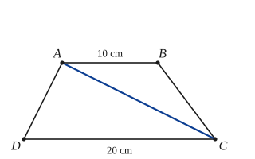
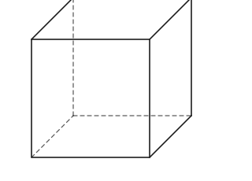

# Đề kiểm tra số 10

**Thời gian làm bài:** 60 phút. **Thang điểm:** mỗi câu 1 điểm, tổng 10 điểm.

## Đề bài

**Câu 1 (Tuổi ba người).** Tổng số tuổi của bố, mẹ và con là 77 tuổi. Tuổi con bằng $\dfrac{1}{4}$ tuổi bố, mẹ kém bố 4 tuổi. Tính tuổi mỗi người.

**Câu 2 (Bỏ dấu phẩy).** Một số thập phân có một chữ số ở phần thập phân. Nếu bỏ dấu phẩy của số đó thì được số mới lớn hơn số cũ $340{,}2$ đơn vị. Tìm số thập phân đó.

**Câu 3 (Tính nhanh).** Tính: $2{,}5 \times 7{,}2 \times 4 + 0{,}28 \times 25 \times 4$.

**Câu 4 (Phần trăm).** Lớp 5A có 40 học sinh. Cuối học kỳ I có 30% học sinh đạt danh hiệu học sinh xuất sắc. Cuối năm, số học sinh xuất sắc tăng thêm 4 bạn. Hỏi cuối năm số học sinh xuất sắc chiếm bao nhiêu phần trăm số học sinh cả lớp?

**Câu 5 (Thời gian, năng suất).** Một người làm việc từ 7 giờ 30 phút đến 11 giờ 15 phút, mỗi giờ làm được 8 sản phẩm. Hỏi người đó làm được bao nhiêu sản phẩm?

**Câu 6 (Hình thang).** Hình thang $ABCD$ có đáy $AB = 10$ cm, đáy $CD = 20$ cm, chiều cao 8 cm. Đường chéo $AC$ chia hình thang thành hai tam giác. Tính diện tích hai tam giác đó.

**Câu 7 (Hình lập phương).** Một hình lập phương có diện tích xung quanh $100 \text{ cm}^2$. Tính thể tích hình lập phương đó.

**Câu 8 (Gặp nhau).** Hai thành phố cách nhau 180 km. Lúc 7 giờ, một xe đi từ thành phố thứ nhất với vận tốc 40 km/giờ. Lúc 7 giờ 30 phút, một xe khác đi từ thành phố thứ hai về phía thành phố thứ nhất với vận tốc 60 km/giờ. Hỏi hai xe gặp nhau lúc mấy giờ?

**Câu 9 (Hai bánh xe).** Một chiếc xe có bánh trước chu vi $1{,}5$ m, bánh sau chu vi $2{,}5$ m. Trên một quãng đường, bánh trước quay nhiều hơn bánh sau 100 vòng. Tính quãng đường đó.

**Câu 10 (Dự đoán).** Một hộp có bi đỏ và bi xanh. An lấy ra một viên, ghi màu rồi trả lại, làm như vậy 50 lần thì có 32 lần lấy được bi đỏ.
a) Viết tỉ số phần trăm mô tả số lần lấy được bi đỏ. b) Nếu An làm 200 lần thì có thể dự đoán khoảng bao nhiêu lần lấy được bi đỏ?

---

## Lời giải chi tiết

### Câu 1
Coi tuổi con là 1 phần thì tuổi bố là 4 phần, tuổi mẹ là 4 phần bớt 4 tuổi.
Tổng: 9 phần bớt 4 tuổi bằng 77, nên 9 phần là 81 tuổi, một phần là 9 tuổi.
Con 9 tuổi, bố 36 tuổi, mẹ 32 tuổi.

### Câu 2
Số đó có một chữ số ở phần thập phân, bỏ dấu phẩy thì số đó gấp 10 lần. Số mới hơn số cũ 9 lần số cũ: $340{,}2 : 9 = 37{,}8$.

**Đáp số:** $37{,}8$.

### Câu 3
$(2{,}5 \times 4) \times 7{,}2 + 0{,}28 \times (25 \times 4) = 10 \times 7{,}2 + 0{,}28 \times 100 = 72 + 28 = 100$.

### Câu 4
Cuối học kỳ I: $40 \times 30 : 100 = 12$ (em). Cuối năm: $12 + 4 = 16$ (em). Tỉ số: $16 : 40 = 40\%$.

### Câu 5
Thời gian làm việc: $11 \text{ giờ } 15 \text{ phút} - 7 \text{ giờ } 30 \text{ phút} = 3 \text{ giờ } 45 \text{ phút} = 3{,}75$ giờ.
Số sản phẩm: $8 \times 3{,}75 = 30$ (sản phẩm).

### Câu 6

*Hình: Hình thang ABCD có AB = 10 cm, CD = 20 cm, chiều cao 8 cm.*

Hai tam giác có chiều cao bằng chiều cao hình thang.
$S_{ABC} = 10 \times 8 : 2 = 40 \text{ (cm}^2)$; $S_{ACD} = 20 \times 8 : 2 = 80 \text{ (cm}^2)$.
(Thử lại: $40 + 80 = 120 = (10 + 20) \times 8 : 2$.)

### Câu 7

*Hình: Hình lập phương có diện tích xung quanh 100 cm².*

Một mặt: $100 : 4 = 25 \text{ (cm}^2)$, cạnh 5 cm. Thể tích: $5 \times 5 \times 5 = 125 \text{ (cm}^3)$.

### Câu 8
Đến 7 giờ 30 phút, xe thứ nhất đi được $40 \times 0{,}5 = 20$ (km). Hai xe còn cách nhau 160 km.
Thời gian để gặp: $160 : (40 + 60) = 1{,}6$ (giờ) = 1 giờ 36 phút.
Hai xe gặp nhau lúc $7 \text{ giờ } 30 \text{ phút} + 1 \text{ giờ } 36 \text{ phút} = 9 \text{ giờ } 6 \text{ phút}$.

### Câu 9
Đi 1 m thì bánh trước quay $\dfrac{1}{1{,}5} = \dfrac{2}{3}$ vòng, bánh sau quay $\dfrac{1}{2{,}5} = \dfrac{2}{5}$ vòng. Mỗi mét bánh trước quay nhiều hơn $\dfrac{2}{3} - \dfrac{2}{5} = \dfrac{4}{15}$ (vòng).
Quãng đường: $100 : \dfrac{4}{15} = 375$ (m).

*Thử lại:* bánh trước quay $375 : 1{,}5 = 250$ vòng, bánh sau quay $375 : 2{,}5 = 150$ vòng, hơn nhau 100 vòng.

### Câu 10
a) $32 : 50 = 0{,}64 = 64\%$.
b) Khoảng $200 \times 64 : 100 = 128$ lần (đây là dự đoán, kết quả thật có thể chênh lệch một chút).
