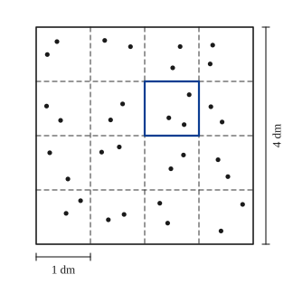

# Chủ đề 3. Chia hết, chia có dư, nguyên lý Dirichlet

> Đề thi vào lớp 6 hay có câu điền chữ số để được số chia hết, câu tìm số theo số dư, và câu "chứng tỏ luôn có hai ... giống nhau" dùng nguyên lý Dirichlet. Chủ đề này cũng là nền móng cho số học ở lớp 6.

## I. Kiến thức cần nắm

> **Ý tưởng xuyên suốt:** muốn biết một số lớn có chia hết hay không, ta không cần chia. Chỉ cần nhìn **chữ số tận cùng** hoặc **tổng các chữ số**. Còn nguyên lý Dirichlet giúp chứng tỏ có điều gì đó xảy ra mà không cần chỉ ra cụ thể.

### 1. Dấu hiệu chia hết
| Chia hết cho | Dấu hiệu |
|---|---|
| $2$ | chữ số tận cùng là $0, 2, 4, 6, 8$ |
| $5$ | chữ số tận cùng là $0$ hoặc $5$ |
| $10$ | chữ số tận cùng là $0$ |
| $3$ | tổng các chữ số chia hết cho $3$ |
| $9$ | tổng các chữ số chia hết cho $9$ |
| $4$ (hoặc $25$) | số tạo bởi **hai** chữ số tận cùng chia hết cho $4$ (hoặc $25$) |
| $8$ (hoặc $125$) | số tạo bởi **ba** chữ số tận cùng chia hết cho $8$ (hoặc $125$) |

*Vì sao dấu hiệu chia hết cho 9 đúng?* Lấy ví dụ $\overline{abc} = 100a + 10b + c = (99a + 9b) + (a + b + c)$. Phần $99a + 9b$ luôn chia hết cho $9$. Vậy $\overline{abc}$ chia hết cho $9$ khi và chỉ khi $a + b + c$ chia hết cho $9$. Lý luận y hệt cho $3$ (vì $99$ và $9$ cũng chia hết cho $3$).

**Hệ quả quan trọng:** một số và tổng các chữ số của nó có **cùng số dư** khi chia cho $9$ (và khi chia cho $3$).

*Ví dụ:* $2357$ có tổng chữ số $17$, mà $17$ chia $9$ dư $8$, nên $2357$ chia $9$ dư $8$.

*Vì sao dấu hiệu chia hết cho 4 đúng?* $\overline{abcd} = \overline{ab} \times 100 + \overline{cd}$, mà $100$ chia hết cho $4$, nên chỉ cần xét $\overline{cd}$.

### 2. Chia hết cho số "ghép"
- Chia hết cho $2$ và $5$ thì chia hết cho $10$ (tận cùng là $0$).
- Chia hết cho $2$ và $9$ thì chia hết cho $18$; chia hết cho $5$ và $9$ thì chia hết cho $45$; chia hết cho $4$ và $9$ thì chia hết cho $36$.
- **Không được** ghép hai số có chung thừa số: chia hết cho $4$ và $6$ chưa chắc chia hết cho $24$ (ví dụ $12$).

**Tính chất của tổng, hiệu, tích:**
- Nếu từng số hạng đều chia hết cho $m$ thì tổng và hiệu chia hết cho $m$.
- Nếu một thừa số chia hết cho $m$ thì tích chia hết cho $m$.
- Số $\overline{abcabc} = \overline{abc} \times 1001$, mà $1001 = 7 \times 11 \times 13$.

*Ví dụ:* điền chữ số vào $\overline{4a5b}$ để số chia hết cho $2$, $5$ và $9$. Chia hết cho $2$ và $5$ nên $b = 0$. Tổng chữ số $4 + a + 5 + 0 = 9 + a$ chia hết cho $9$, nên $a = 0$ hoặc $a = 9$. Có hai số: $4050$ và $4950$.

### 3. Phép chia có dư
Chia $a$ cho $b$ được thương $q$ và số dư $r$:
$$a = b \times q + r, \qquad 0 \le r < b.$$
- **Số dư luôn nhỏ hơn số chia.** Chia cho $7$ chỉ có $7$ số dư: $0, 1, 2, \dots, 6$.
- Số dư lớn nhất bằng số chia trừ $1$.
- Nếu $a$ chia $b$ dư $r$ thì $a - r$ chia hết cho $b$.
- Nếu $a$ chia $b$ dư $b - 1$ thì $a + 1$ chia hết cho $b$.

**Số dư của tổng và tích:** muốn biết tổng (hoặc tích) chia cho $m$ dư bao nhiêu, chỉ cần cộng (hoặc nhân) các số dư rồi lấy số dư của kết quả.

*Ví dụ:* một số chia $12$ dư $7$, tức là số đó bằng $12 \times q + 7$. Vì $12$ chia hết cho $4$ nên số đó chia $4$ có cùng số dư với $7$, là $3$.

### 4. Tìm số khi biết số dư khi chia cho nhiều số
- **Các số dư "thiếu" như nhau:** chia $2$ dư $1$, chia $3$ dư $2$, chia $4$ dư $3$ ... thì số đó **thêm $1$** sẽ chia hết cho cả $2, 3, 4, \dots$
- **Các số dư bằng nhau:** chia $2$, $5$, $9$ đều dư $1$ thì số đó **bớt $1$** sẽ chia hết cho cả ba số.
- **Số dư khác nhau, không có quy luật:** liệt kê các số thỏa mãn điều kiện có số chia lớn nhất, rồi lọc dần theo các điều kiện còn lại.

### 5. Chữ số tận cùng và số chữ số 0 tận cùng
- Tích có một thừa số tận cùng $0$ thì tích tận cùng $0$.
- Tích của các số lẻ mà có một thừa số tận cùng $5$ thì tích tận cùng $5$ (lẻ nhân $5$ luôn tận cùng $5$).
- Mỗi chữ số $0$ ở cuối tích ứng với một cặp thừa số $2 \times 5$. Trong tích $1 \times 2 \times 3 \times \dots \times n$, thừa số $2$ luôn nhiều hơn thừa số $5$, nên **số chữ số 0 tận cùng bằng số thừa số 5**.

*Ví dụ:* $1 \times 2 \times \dots \times 20$ có các số chia hết cho $5$ là $5, 10, 15, 20$, mỗi số góp một thừa số $5$. Tích tận cùng $4$ chữ số $0$.

### 6. Nguyên lý Dirichlet ("nguyên lý chuồng thỏ")
**Phát biểu:** nhốt $n + 1$ con thỏ vào $n$ chuồng thì có ít nhất một chuồng chứa từ $2$ con trở lên.

**Dạng mở rộng:** nhốt $k \times n + 1$ con thỏ vào $n$ chuồng thì có ít nhất một chuồng chứa từ $k + 1$ con trở lên.

*Vì sao đúng?* Giả sử ngược lại, chuồng nào cũng có không quá $k$ con. Khi đó $n$ chuồng có không quá $k \times n$ con, ít hơn số thỏ đã nhốt. Vô lý.

**Cách dùng:** xác định đâu là "thỏ", đâu là "chuồng".
- Học sinh là thỏ, tháng sinh là chuồng ($12$ chuồng).
- Các số là thỏ, **số dư** khi chia cho $m$ là chuồng ($m$ chuồng). Hai số cùng số dư thì **hiệu chia hết cho $m$**.
- Các điểm là thỏ, các ô nhỏ chia từ hình lớn là chuồng.

**Bài bốc bi "chắc chắn":** tính trường hợp **xui nhất** (lấy được nhiều bi nhất mà vẫn chưa đạt yêu cầu), rồi cộng thêm $1$.

*Ví dụ:* túi có bi của $3$ màu, mỗi màu nhiều viên. Lấy $4$ viên thì chắc chắn có $2$ viên cùng màu: xui nhất là $3$ viên đầu có $3$ màu khác nhau, viên thứ tư phải trùng màu với một viên đã lấy.

### 7. Sai lầm hay gặp
- Nhầm dấu hiệu: chia hết cho $3$ xét **tổng chữ số**, chia hết cho $4$ xét **hai chữ số tận cùng**, không phải ngược lại.
- Ghép "chia hết cho $4$ và $6$ thì chia hết cho $24$" là sai.
- Quên điều kiện số dư nhỏ hơn số chia khi tìm số bị chia.
- Bài bốc bi: tính trường hợp may mắn thay cho trường hợp xui nhất.

---

## II. Bài tập vận dụng

**Bài 1.** Tìm các chữ số $a$, $b$ để số $\overline{6a49b}$ chia hết cho $45$.

**Bài 2.** Tìm số $\overline{a37b}$, biết số đó chia cho $2$, cho $5$ và cho $9$ đều dư $1$.

**Bài 3.** Viết liên tiếp các số tự nhiên từ $1$ đến $100$ thành một số rất lớn $A = 123456789101112\dots99100$. Số $A$ chia cho $9$ dư bao nhiêu? Chia cho $3$ dư bao nhiêu?

**Bài 4.** a) Không thực hiện phép chia, giải thích vì sao số $1\underbrace{00\dots0}_{2024 \text{ chữ số } 0}8$ chia hết cho $18$.
b) Chứng tỏ mọi số có dạng $\overline{abcabc}$ đều chia hết cho $7$, $11$ và $13$.

**Bài 5.** Trong một phép chia có thương là $6$ và số dư là $3$. Tổng của số bị chia, số chia, thương và số dư là $194$. Tìm số bị chia và số chia.

**Bài 6.** Tìm số tự nhiên nhỏ nhất khác $0$, biết số đó chia cho $2$ dư $1$, chia cho $3$ dư $2$, chia cho $4$ dư $3$, chia cho $5$ dư $4$ và chia cho $6$ dư $5$.

**Bài 7.** Tìm số tự nhiên nhỏ nhất, biết số đó chia cho $3$ dư $2$, chia cho $5$ dư $3$ và chia cho $7$ dư $4$.

**Bài 8.** a) Tích $1 \times 3 \times 5 \times 7 \times \dots \times 97 \times 99$ có chữ số tận cùng là chữ số nào?
b) Tích $1 \times 2 \times 3 \times \dots \times 49 \times 50$ có tận cùng bao nhiêu chữ số $0$?

**Bài 9 (Dirichlet).** Một trường có $40$ học sinh cùng sinh năm $2014$ tham gia đội tuyển. Chứng tỏ có ít nhất $4$ học sinh sinh cùng một tháng.

**Bài 10 (bốc bi).** Một hộp có $10$ viên bi đỏ, $8$ viên bi xanh và $5$ viên bi vàng. Không nhìn vào hộp, phải lấy ra ít nhất bao nhiêu viên bi để chắc chắn có:
a) $3$ viên bi cùng màu;
b) đủ cả ba màu.

**Bài 11 (Dirichlet).** Chứng tỏ trong $6$ số tự nhiên bất kỳ luôn có hai số mà hiệu của chúng chia hết cho $5$.

**Bài 12 (Dirichlet, hình học).** Trong một hình vuông cạnh $4$ dm có $33$ điểm. Chứng tỏ có $3$ điểm nằm trong (hoặc trên cạnh của) một hình vuông nhỏ cạnh $1$ dm.

**Bài 13 (khó).** Chứng tỏ có một số gồm toàn chữ số $1$ (như $1$, $11$, $111$, ...) chia hết cho $2023$.

---

## III. Lời giải chi tiết

### Bài 1
$45 = 5 \times 9$, nên $\overline{6a49b}$ phải chia hết cho cả $5$ và $9$.
Chia hết cho $5$ nên $b = 0$ hoặc $b = 5$.
- Nếu $b = 0$: tổng chữ số $6 + a + 4 + 9 + 0 = 19 + a$ chia hết cho $9$, nên $a = 8$. Được số $68490$.
- Nếu $b = 5$: tổng chữ số $24 + a$ chia hết cho $9$, nên $a = 3$. Được số $63495$.

**Đáp số:** $a = 8, b = 0$ (số $68490$) hoặc $a = 3, b = 5$ (số $63495$).

### Bài 2
Số đó chia $2$ dư $1$ và chia $5$ dư $1$ nên bớt $1$ thì chia hết cho $10$, tức là chữ số tận cùng của nó là $1$. Vậy $b = 1$.
Số $\overline{a371}$ chia $9$ dư $1$ nên tổng chữ số $a + 3 + 7 + 1 = a + 11$ chia $9$ dư $1$, tức là $a + 10$ chia hết cho $9$. Vì $a$ là chữ số khác $0$ nên $a = 8$.
*Thử lại:* $8371$ lẻ, tận cùng $1$, tổng chữ số $19$ chia $9$ dư $1$.

**Đáp số:** $8371$.

### Bài 3
$A$ chia $9$ có cùng số dư với tổng các chữ số của $A$. Ta tính tổng các chữ số.
- Các số từ $1$ đến $9$: tổng chữ số $1 + 2 + \dots + 9 = 45$.
- Các số từ $10$ đến $99$: mỗi chữ số $1, 2, \dots, 9$ đứng ở hàng chục đúng $10$ lần, nên tổng chữ số hàng chục là $45 \times 10 = 450$. Ở hàng đơn vị, mỗi chữ số $0, 1, \dots, 9$ xuất hiện $9$ lần, tổng là $45 \times 9 = 405$.
- Số $100$: tổng chữ số là $1$.

Tổng các chữ số của $A$: $45 + 450 + 405 + 1 = 901$. Ta có $901 = 9 \times 100 + 1$, nên $A$ chia $9$ dư $1$.
Tương tự, $901 = 3 \times 300 + 1$, nên $A$ chia $3$ dư $1$.

**Đáp số:** chia $9$ dư $1$; chia $3$ dư $1$.

### Bài 4
a) $18 = 2 \times 9$. Số đã cho tận cùng là $8$ nên chia hết cho $2$. Tổng các chữ số là $1 + 8 = 9$ nên chia hết cho $9$. Vậy số đó chia hết cho $18$.

b) Ta có $\overline{abcabc} = \overline{abc} \times 1000 + \overline{abc} = \overline{abc} \times 1001$. Mà $1001 = 7 \times 11 \times 13$, nên $\overline{abcabc} = \overline{abc} \times 7 \times 11 \times 13$ chia hết cho $7$, $11$ và $13$.

### Bài 5
Số bị chia $=$ số chia $\times 6 + 3$. Coi số chia là $1$ phần thì số bị chia là $6$ phần cộng $3$.
Tổng của bốn số: $(6 \text{ phần} + 3) + 1 \text{ phần} + 6 + 3 = 7 \text{ phần} + 12 = 194$.
Vậy $7$ phần $= 182$, $1$ phần $= 26$.
Số chia là $26$, số bị chia là $26 \times 6 + 3 = 159$. Số dư $3 < 26$, hợp lệ.
*Thử lại:* $159 + 26 + 6 + 3 = 194$.

**Đáp số:** số bị chia $159$, số chia $26$.

### Bài 6
Mỗi số dư đều kém số chia $1$ đơn vị. Vậy nếu thêm $1$ vào số cần tìm thì được số chia hết cho $2$, $3$, $4$, $5$, $6$.
Số nhỏ nhất khác $0$ chia hết cho cả $4$, $3$ và $5$ là $60$ (chia hết cho $4$ thì chia hết cho $2$; chia hết cho $3$ và $2$ thì chia hết cho $6$).
Số cần tìm là $60 - 1 = 59$.
*Thử lại:* $59 = 2 \times 29 + 1 = 3 \times 19 + 2 = 4 \times 14 + 3 = 5 \times 11 + 4 = 6 \times 9 + 5$.

**Đáp số:** $59$.

*Nhận xét:* khi các số dư đều "thiếu $1$" so với số chia, hãy **thêm $1$** để đưa về bài toán chia hết.

### Bài 7
Các số dư không có quy luật chung, ta liệt kê và lọc dần.
Các số chia $7$ dư $4$: $4,\ 11,\ 18,\ 25,\ 32,\ 39,\ 46,\ 53,\ \dots$
Trong đó các số chia $5$ dư $3$ (tận cùng là $3$ hoặc $8$): $18,\ 53,\ \dots$
- $18$ chia hết cho $3$, loại.
- $53 = 3 \times 17 + 2$, chia $3$ dư $2$, nhận.

**Đáp số:** $53$.

*Nhận xét:* bắt đầu liệt kê từ điều kiện có **số chia lớn nhất** thì danh sách ngắn nhất.

### Bài 8
a) Tích chỉ gồm các số lẻ nên là số lẻ. Tích có thừa số $5$, nên chia hết cho $5$. Một số lẻ chia hết cho $5$ thì tận cùng là $5$.

b) Mỗi chữ số $0$ tận cùng ứng với một cặp $2 \times 5$. Thừa số $2$ có rất nhiều (mọi số chẵn), nên chỉ cần đếm thừa số $5$.
- Các số chia hết cho $5$ từ $1$ đến $50$: $5, 10, \dots, 50$, có $10$ số, mỗi số góp ít nhất một thừa số $5$.
- Các số $25$ và $50$ chia hết cho $25 = 5 \times 5$, mỗi số góp thêm một thừa số $5$ nữa.

Tổng số thừa số $5$: $10 + 2 = 12$. Tích tận cùng $12$ chữ số $0$.

**Đáp số:** a) chữ số $5$; b) $12$ chữ số $0$.

### Bài 9
Năm có $12$ tháng. Coi $12$ tháng là $12$ "chuồng", $40$ học sinh là "thỏ".
Ta có $40 = 12 \times 3 + 4$. Nếu tháng nào cũng có không quá $3$ học sinh thì cả đội có không quá $12 \times 3 = 36$ học sinh, ít hơn $40$. Vô lý.
Vậy có ít nhất một tháng có từ $4$ học sinh trở lên.

### Bài 10
a) **Xui nhất:** mỗi màu lấy được $2$ viên mà chưa có màu nào đủ $3$ viên, tức là $2 + 2 + 2 = 6$ viên. Lấy thêm $1$ viên nữa, viên đó thuộc một trong ba màu và làm màu đó có đủ $3$ viên.
Cần lấy ít nhất $7$ viên. (Lấy $6$ viên thì chưa chắc, như trường hợp xui nhất ở trên.)

b) **Xui nhất:** lấy hết bi của hai màu nhiều nhất mà vẫn thiếu màu thứ ba, tức là $10 + 8 = 18$ viên đỏ và xanh. Lấy thêm $1$ viên nữa thì chắc chắn là bi vàng.
Cần lấy ít nhất $19$ viên.

**Đáp số:** a) $7$ viên; b) $19$ viên.

*Nhận xét:* "chắc chắn" nghĩa là đúng cả trong trường hợp xui nhất. Đáp số luôn bằng số bi của trường hợp xui nhất cộng $1$.

### Bài 11
Một số chia cho $5$ chỉ có thể dư $0$, $1$, $2$, $3$ hoặc $4$, tức là có $5$ số dư. Coi $5$ số dư là $5$ "chuồng", $6$ số là $6$ "thỏ".
Theo nguyên lý Dirichlet, có hai số cùng số dư khi chia cho $5$. Giả sử hai số đó là $5 \times p + r$ và $5 \times q + r$ (số lớn hơn viết trước). Hiệu của chúng là $5 \times p - 5 \times q = 5 \times (p - q)$, chia hết cho $5$.

### Bài 12

*Hình: Hình vuông cạnh 4 dm chia thành 16 ô vuông cạnh 1 dm.*

Chia mỗi cạnh của hình vuông thành $4$ đoạn dài $1$ dm rồi kẻ các đường song song với cạnh. Hình vuông lớn được chia thành $4 \times 4 = 16$ hình vuông nhỏ cạnh $1$ dm.
Coi $16$ hình vuông nhỏ là "chuồng", $33$ điểm là "thỏ" (điểm nằm trên đường kẻ chung thì xếp vào một ô bất kỳ chứa nó). Ta có $33 = 16 \times 2 + 1$.
Nếu ô nào cũng chứa không quá $2$ điểm thì cả hình có không quá $32$ điểm, vô lý. Vậy có một ô vuông nhỏ chứa ít nhất $3$ điểm.

*Nhận xét:* trong bài Dirichlet hình học, cần tự **chia hình** thành số "chuồng" thích hợp. Ở đây $33 = 16 \times 2 + 1$ gợi ý chia thành $16$ ô.

### Bài 13
Xét $2024$ số: $1,\ 11,\ 111,\ \dots,\ \underbrace{11\dots1}_{2024 \text{ chữ số } 1}$.
Khi chia cho $2023$, mỗi số có một số dư từ $0$ đến $2022$, tức là có $2023$ số dư có thể. Có $2024$ số mà chỉ có $2023$ số dư, nên theo nguyên lý Dirichlet có hai số cùng số dư.

Lấy số dài hơn trừ số ngắn hơn (cùng số dư nên hiệu chia hết cho $2023$). Hiệu có dạng
$$\underbrace{11\dots1}_{k \text{ chữ số } 1}\underbrace{00\dots0}_{m \text{ chữ số } 0} = \underbrace{11\dots1}_{k \text{ chữ số } 1} \times 1\underbrace{00\dots0}_{m \text{ chữ số } 0}.$$
Ví dụ: $11111 - 111 = 11000 = 11 \times 1000$.

Số $1\underbrace{0\dots0}_{m}$ là tích của $m$ thừa số $10 = 2 \times 5$, nên chỉ gồm các thừa số $2$ và $5$. Còn $2023 = 7 \times 17 \times 17$ không có thừa số $2$ hay $5$ nào. Vì vậy, để tích trên chia hết cho $2023$, số $\underbrace{11\dots1}_{k}$ phải chia hết cho $2023$.

Vậy có một số gồm toàn chữ số $1$ chia hết cho $2023$.

*Nhận xét:* bài không yêu cầu chỉ ra số đó (thực ra số nhỏ nhất như vậy có tới $816$ chữ số $1$). Nguyên lý Dirichlet cho phép **chứng tỏ có** mà không cần tìm cụ thể.
