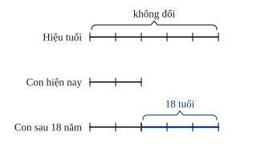
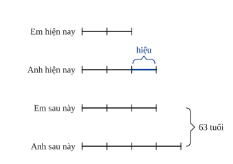

# Chủ đề 5. Tổng tỉ, hiệu tỉ và bài toán tuổi nâng cao

> Bài toán tổng tỉ, hiệu tỉ là "xương sống" của toán có lời văn lớp 5. Ở đề thi vào lớp 6, tổng, hiệu hoặc tỉ thường bị **giấu đi** hoặc **thay đổi** giữa chừng, nhất là trong bài toán tuổi. Công cụ chính là sơ đồ đoạn thẳng.

## I. Kiến thức cần nắm

> **Ý tưởng xuyên suốt:** khi tỉ số thay đổi, hãy tìm **đại lượng không đổi** (tổng không đổi, hiệu không đổi, hay một số không đổi) và so sánh mọi thứ với nó. Trong bài toán tuổi, **hiệu số tuổi của hai người không bao giờ thay đổi**.

### 1. Tỉ số và sơ đồ đoạn thẳng
Số thứ nhất bằng $\frac mn$ số thứ hai nghĩa là: chia số thứ hai thành $n$ phần bằng nhau thì số thứ nhất bằng $m$ phần như thế. Trên sơ đồ, số thứ nhất vẽ $m$ đoạn, số thứ hai vẽ $n$ đoạn bằng nhau.
- "Số lớn gấp $4$ lần số bé": số bé $1$ phần, số lớn $4$ phần.
- "Số bé bằng $\frac25$ số lớn": số bé $2$ phần, số lớn $5$ phần.
- "Tỉ số của $a$ và $b$ là $3 : 7$": $a$ có $3$ phần, $b$ có $7$ phần.

### 2. Hai bài toán gốc
**Tìm hai số khi biết tổng và tỉ $\frac mn$:**
$$\text{Giá trị một phần} = \text{tổng} : (m + n), \qquad \text{số bé} = \text{một phần} \times m, \qquad \text{số lớn} = \text{tổng} - \text{số bé}.$$

**Tìm hai số khi biết hiệu và tỉ $\frac mn$ (với $m < n$):**
$$\text{Giá trị một phần} = \text{hiệu} : (n - m), \qquad \text{số bé} = \text{một phần} \times m, \qquad \text{số lớn} = \text{số bé} + \text{hiệu}.$$

*Vì sao?* Tổng của hai số ứng với tất cả $m + n$ phần trên sơ đồ, hiệu ứng với phần dôi ra $n - m$ phần. Biết một số ứng với bao nhiêu phần thì tìm được giá trị một phần.

*Ví dụ:* hai số có tổng $96$, số bé bằng $\frac35$ số lớn. Tổng số phần $3 + 5 = 8$, một phần là $96 : 8 = 12$. Số bé $36$, số lớn $60$.

**Bước trình bày một bài:** (1) vẽ sơ đồ; (2) tìm tổng (hoặc hiệu) số phần; (3) tìm giá trị một phần; (4) tìm từng số; (5) thử lại, ghi đáp số.

### 3. Khi tổng, hiệu hay tỉ bị "giấu"
| Đề bài nói | Hiểu là |
|---|---|
| Trung bình cộng hai số là $a$ | Tổng là $a \times 2$ |
| Hình chữ nhật có chu vi $P$ | Nửa chu vi (tổng dài và rộng) là $P : 2$ |
| Viết thêm $0$ vào bên phải số bé thì được số lớn | Số lớn gấp $10$ lần số bé |
| Dời dấu phẩy sang phải một hàng | Gấp $10$ lần |
| $\frac23$ số $A$ bằng $\frac34$ số $B$ | Quy đồng tử: $\frac69 A = \frac68 B$, nên $A$ có $9$ phần, $B$ có $8$ phần |

*Vì sao quy đồng tử?* $\frac69$ số $A$ bằng $\frac68$ số $B$, tức là $6$ phần của $A$ (khi chia $A$ thành $9$ phần) bằng $6$ phần của $B$ (khi chia $B$ thành $8$ phần). Vậy mỗi phần của $A$ bằng mỗi phần của $B$, nên $A$ có $9$ phần, $B$ có $8$ phần bằng nhau.

### 4. Tỉ số thay đổi: tìm đại lượng không đổi
| Tình huống | Đại lượng không đổi |
|---|---|
| Chuyển từ $A$ sang $B$ (cho, tặng, chuyển kho) | **Tổng** $A + B$ |
| Cùng thêm (hoặc cùng bớt) vào $A$ và $B$ một số như nhau | **Hiệu** $A - B$ |
| Hai người cùng thêm tuổi theo năm | **Hiệu** số tuổi |
| Chỉ thêm, bớt ở $A$ | **Số $B$** |

**Phương pháp:** viết mỗi tỉ số dưới dạng **phân số của đại lượng không đổi**, rồi so sánh.

*Ví dụ:* lúc đầu $A$ bằng $\frac13$ tổng, sau khi được thêm $10$ thì $A$ bằng $\frac12$ tổng (tổng không đổi). Phần tăng lên là $\frac12 - \frac13 = \frac16$ tổng, ứng với $10$, nên tổng là $60$.

*Cách khác:* có thể làm việc ngay trên sơ đồ, nếu chuyển tổng (hoặc hiệu) ở hai thời điểm về cùng số phần.

### 5. Bài toán tuổi
- **Hiệu số tuổi không đổi** theo thời gian. Đây là chìa khóa của hầu hết bài toán tuổi.
- Sau $n$ năm, mỗi người thêm $n$ tuổi. Tổng tuổi của $k$ người tăng thêm $k \times n$.
- "Khi tuổi em bằng tuổi anh hiện nay": khoảng thời gian từ nay đến lúc đó **bằng hiệu số tuổi**.
- "Khi tuổi anh bằng tuổi em hiện nay": lúc đó là **cách đây** một khoảng thời gian bằng hiệu số tuổi.

*Ví dụ:* hiện nay mẹ $36$ tuổi, con $8$ tuổi. Bao nhiêu năm nữa tuổi mẹ gấp $3$ lần tuổi con? Hiệu là $28$ tuổi, không đổi. Lúc đó con $1$ phần, mẹ $3$ phần, hiệu $2$ phần $= 28$, nên con $14$ tuổi. Vậy sau $14 - 8 = 6$ năm.

### 6. Bài toán có ba đại lượng
Chọn một đại lượng làm "chuẩn" và biểu diễn hai đại lượng còn lại theo cùng một loại phần. Nếu $A = \frac23 B$ và $B = \frac34 C$, chọn $B$ có $3$ phần thì $A$ có $2$ phần và $C$ có $4$ phần.

### 7. Sai lầm hay gặp
- Dùng tổng (hoặc hiệu) ở thời điểm này với tỉ số ở thời điểm khác. Mỗi tỉ số chỉ đúng ở **một thời điểm**.
- Trong bài toán tuổi, quên rằng **cả hai người** đều thêm tuổi: sau $5$ năm, tổng tuổi hai mẹ con tăng $10$, không phải $5$.
- Nhầm "$A$ bằng $\frac25$ $B$" thành "$A$ bằng $\frac25$ tổng".
- Với tỉ $\frac23 A = \frac34 B$, kết luận vội "$A$ có $2$ phần, $B$ có $3$ phần" là sai. Phải quy đồng tử.

---

## II. Bài tập vận dụng

**Bài 1.** a) Tìm hai số, biết tổng của chúng là $2024$ và số thứ nhất bằng $\frac35$ số thứ hai.
b) Tìm hai số, biết hiệu của chúng là $168$ và số bé bằng $\frac25$ số lớn.

**Bài 2.** Trung bình cộng của hai số là $143$. Nếu viết thêm chữ số $0$ vào bên phải số bé thì được số lớn. Tìm hai số đó.

**Bài 3.** Một mảnh vườn hình chữ nhật có chu vi $96$ m, chiều rộng bằng $\frac35$ chiều dài. Tính diện tích mảnh vườn.

**Bài 4.** Tổng của ba số là $1980$. Số thứ nhất bằng $\frac23$ số thứ hai, số thứ hai bằng $\frac34$ số thứ ba. Tìm ba số đó.

**Bài 5.** Hiện nay tổng số tuổi của hai mẹ con là $46$ tuổi. Cách đây $3$ năm, tuổi mẹ gấp $4$ lần tuổi con. Tính tuổi của mỗi người hiện nay.

**Bài 6.** Mẹ hơn con $28$ tuổi. Hiện nay tuổi con bằng $\frac15$ tuổi mẹ.
a) Tính tuổi của mỗi người hiện nay.
b) Sau bao nhiêu năm nữa thì tuổi con bằng $\frac13$ tuổi mẹ?

**Bài 7.** Hai kho có tất cả $360$ tấn thóc. Nếu chuyển $20$ tấn từ kho thứ nhất sang kho thứ hai thì số thóc ở kho thứ hai bằng $\frac45$ số thóc ở kho thứ nhất. Hỏi lúc đầu mỗi kho có bao nhiêu tấn thóc?

**Bài 8.** Hai thùng có tất cả $170$ lít dầu. Biết $\frac23$ số dầu ở thùng thứ nhất bằng $\frac34$ số dầu ở thùng thứ hai. Tính số dầu ở mỗi thùng.

**Bài 9.** Thùng thứ nhất có nhiều hơn thùng thứ hai $12$ lít nước. Nếu lấy ra $\frac25$ số nước ở thùng thứ nhất và $\frac13$ số nước ở thùng thứ hai thì số nước còn lại ở hai thùng bằng nhau. Hỏi lúc đầu mỗi thùng có bao nhiêu lít nước?

**Bài 10.** Lúc đầu số bi của An bằng $\frac35$ số bi của Bình. Sau khi Bình cho An $6$ viên bi thì số bi của An bằng $\frac57$ số bi của Bình. Hỏi lúc đầu mỗi bạn có bao nhiêu viên bi?

**Bài 11.** Năm nay tuổi con bằng $\frac27$ tuổi bố. Sau $18$ năm nữa, tuổi con bằng $\frac12$ tuổi bố. Tính tuổi của mỗi người năm nay.

**Bài 12.** Tổng số tuổi của ông, bố và cháu là $120$ tuổi. Cháu bao nhiêu ngày thì bố bấy nhiêu tuần, cháu bao nhiêu tháng thì ông bấy nhiêu năm. Tính tuổi của mỗi người.

**Bài 13 (khó).** Khi tuổi anh bằng tuổi em hiện nay thì tuổi anh gấp đôi tuổi em. Khi tuổi em bằng tuổi anh hiện nay thì tổng số tuổi của hai anh em là $63$ tuổi. Tính tuổi của mỗi người hiện nay.

---

## III. Lời giải chi tiết

### Bài 1
a) Số thứ nhất $3$ phần, số thứ hai $5$ phần. Tổng số phần: $3 + 5 = 8$. Một phần: $2024 : 8 = 253$.
Số thứ nhất: $253 \times 3 = 759$. Số thứ hai: $2024 - 759 = 1265$.

b) Số bé $2$ phần, số lớn $5$ phần. Hiệu số phần: $5 - 2 = 3$. Một phần: $168 : 3 = 56$.
Số bé: $56 \times 2 = 112$. Số lớn: $112 + 168 = 280$.

**Đáp số:** a) $759$ và $1265$; b) $112$ và $280$.

### Bài 2
Tổng hai số: $143 \times 2 = 286$.
Viết thêm $0$ vào bên phải số bé thì được số lớn, nên số lớn gấp $10$ lần số bé. Số bé $1$ phần, số lớn $10$ phần, tổng $11$ phần.
Số bé: $286 : 11 = 26$. Số lớn: $26 \times 10 = 260$.

**Đáp số:** $26$ và $260$.

### Bài 3
Nửa chu vi (tổng chiều dài và chiều rộng): $96 : 2 = 48$ (m).
Chiều rộng $3$ phần, chiều dài $5$ phần, tổng $8$ phần. Một phần: $48 : 8 = 6$ (m).
Chiều rộng: $6 \times 3 = 18$ (m). Chiều dài: $6 \times 5 = 30$ (m).
Diện tích: $30 \times 18 = 540$ (m²).

**Đáp số:** $540$ m².

### Bài 4
Số thứ hai liên quan đến cả hai số kia, chọn số thứ hai có $3$ phần.
- Số thứ nhất bằng $\frac23$ số thứ hai, nên có $2$ phần.
- Số thứ hai bằng $\frac34$ số thứ ba, nên số thứ ba có $4$ phần.

Tổng số phần: $2 + 3 + 4 = 9$. Một phần: $1980 : 9 = 220$.
Ba số lần lượt là $440$, $660$, $880$.
*Thử lại:* $\frac23 \times 660 = 440$; $\frac34 \times 880 = 660$; $440 + 660 + 880 = 1980$.

**Đáp số:** $440$; $660$; $880$.

### Bài 5
Cách đây $3$ năm, mỗi người kém hiện nay $3$ tuổi, nên tổng tuổi hai mẹ con lúc đó là $46 - 3 \times 2 = 40$ (tuổi).
Lúc đó con $1$ phần, mẹ $4$ phần, tổng $5$ phần. Tuổi con lúc đó: $40 : 5 = 8$ (tuổi), tuổi mẹ lúc đó: $32$ tuổi.
Hiện nay con $8 + 3 = 11$ tuổi, mẹ $32 + 3 = 35$ tuổi.

**Đáp số:** mẹ $35$ tuổi, con $11$ tuổi.

*Nhận xét:* tỉ số "gấp $4$ lần" là của **cách đây $3$ năm**, nên phải dùng tổng tuổi của **cùng thời điểm đó**.

### Bài 6
a) Con $1$ phần, mẹ $5$ phần, hiệu $4$ phần $= 28$ tuổi. Một phần: $7$ tuổi.
Con $7$ tuổi, mẹ $35$ tuổi.

b) Hiệu số tuổi luôn là $28$. Khi tuổi con bằng $\frac13$ tuổi mẹ: con $1$ phần, mẹ $3$ phần, hiệu $2$ phần $= 28$. Lúc đó con $14$ tuổi.
Số năm cần tìm: $14 - 7 = 7$ (năm).
*Thử lại:* sau $7$ năm, con $14$ tuổi, mẹ $42$ tuổi, $42 = 14 \times 3$.

**Đáp số:** a) mẹ $35$ tuổi, con $7$ tuổi; b) sau $7$ năm.

### Bài 7
Chuyển thóc từ kho này sang kho kia thì tổng số thóc không đổi, vẫn là $360$ tấn.
Sau khi chuyển: kho thứ hai $4$ phần, kho thứ nhất $5$ phần, tổng $9$ phần. Một phần: $360 : 9 = 40$ (tấn).
Sau khi chuyển, kho thứ nhất có $200$ tấn, kho thứ hai có $160$ tấn.
Lúc đầu: kho thứ nhất có $200 + 20 = 220$ (tấn), kho thứ hai có $160 - 20 = 140$ (tấn).

**Đáp số:** kho thứ nhất $220$ tấn, kho thứ hai $140$ tấn.

### Bài 8
Quy đồng tử số: $\frac23 = \frac69$ và $\frac34 = \frac68$. Vậy $\frac69$ thùng thứ nhất bằng $\frac68$ thùng thứ hai.
Nếu chia thùng thứ nhất thành $9$ phần bằng nhau và thùng thứ hai thành $8$ phần bằng nhau thì $6$ phần của thùng này bằng $6$ phần của thùng kia, nên mỗi phần của hai thùng bằng nhau.
Thùng thứ nhất $9$ phần, thùng thứ hai $8$ phần, tổng $17$ phần. Một phần: $170 : 17 = 10$ (lít).
Thùng thứ nhất: $90$ lít; thùng thứ hai: $80$ lít.
*Thử lại:* $\frac23 \times 90 = 60$ và $\frac34 \times 80 = 60$.

**Đáp số:** $90$ lít và $80$ lít.

*Nhận xét:* với tỉ dạng "$\frac ab$ của số này bằng $\frac cd$ của số kia", hãy **quy đồng tử số** để thấy ngay tỉ số của hai số.

### Bài 9
Lấy ra $\frac25$ thì thùng thứ nhất còn $\frac35$; lấy ra $\frac13$ thì thùng thứ hai còn $\frac23$. Theo đề bài, $\frac35$ thùng thứ nhất bằng $\frac23$ thùng thứ hai.
Quy đồng tử số: $\frac35 = \frac{6}{10}$ và $\frac23 = \frac69$. Vậy thùng thứ nhất $10$ phần, thùng thứ hai $9$ phần.
Hiệu $1$ phần $= 12$ lít. Thùng thứ nhất $120$ lít, thùng thứ hai $108$ lít.
*Thử lại:* $120 - 48 = 72$ và $108 - 36 = 72$.

**Đáp số:** thùng thứ nhất $120$ lít, thùng thứ hai $108$ lít.

### Bài 10
Bình cho An thì tổng số bi của hai bạn không đổi. Ta so sánh số bi của An với **tổng số bi**.
- Lúc đầu: An $3$ phần, Bình $5$ phần, nên số bi của An bằng $\frac38$ tổng.
- Lúc sau: An $5$ phần, Bình $7$ phần, nên số bi của An bằng $\frac{5}{12}$ tổng.

Số bi của An tăng thêm $\frac{5}{12} - \frac38 = \frac{10}{24} - \frac{9}{24} = \frac{1}{24}$ tổng, ứng với $6$ viên.
Tổng số bi: $6 \times 24 = 144$ (viên).
Lúc đầu An có $144 \times \frac38 = 54$ (viên), Bình có $144 - 54 = 90$ (viên).
*Thử lại:* sau khi cho, An $60$ viên, Bình $84$ viên, $\frac{60}{84} = \frac57$.

**Đáp số:** An $54$ viên, Bình $90$ viên.

*Nhận xét:* hai tỉ số $\frac35$ và $\frac57$ là của hai thời điểm khác nhau, không so sánh trực tiếp được. Đổi cả hai về phân số của **tổng** (không đổi) thì so sánh được.

### Bài 11

*Hình: Sơ đồ lấy hiệu tuổi bố và con làm đơn vị.*

Hiệu số tuổi của bố và con không đổi. Ta so sánh tuổi con với **hiệu số tuổi**.
- Năm nay: con $2$ phần, bố $7$ phần, hiệu $5$ phần. Tuổi con bằng $\frac25$ hiệu.
- Sau $18$ năm: con $1$ phần, bố $2$ phần, hiệu $1$ phần. Tuổi con bằng hiệu, tức là $\frac55$ hiệu.

Chia hiệu thành $5$ phần bằng nhau như sơ đồ. Tuổi con tăng từ $2$ phần lên $5$ phần, tức là tăng $3$ phần, ứng với $18$ tuổi. Một phần: $18 : 3 = 6$ (tuổi).
Năm nay con $6 \times 2 = 12$ tuổi, bố $6 \times 7 = 42$ tuổi.
*Thử lại:* sau $18$ năm, con $30$ tuổi, bố $60$ tuổi, $30 = \frac12 \times 60$.

**Đáp số:** bố $42$ tuổi, con $12$ tuổi.

### Bài 12
- Cháu bao nhiêu ngày thì bố bấy nhiêu tuần. Một tuần có $7$ ngày, nên tuổi bố gấp $7$ lần tuổi cháu.
- Cháu bao nhiêu tháng thì ông bấy nhiêu năm. Một năm có $12$ tháng, nên tuổi ông gấp $12$ lần tuổi cháu.

Tuổi cháu $1$ phần, bố $7$ phần, ông $12$ phần, tổng $20$ phần $= 120$ tuổi. Một phần: $6$ tuổi.
Cháu $6$ tuổi, bố $42$ tuổi, ông $72$ tuổi.

**Đáp số:** ông $72$ tuổi, bố $42$ tuổi, cháu $6$ tuổi.

*Nhận xét:* nếu cháu sống được $N$ ngày thì bố sống được $N$ tuần, tức là $N \times 7$ ngày. Cùng đổi ra một đơn vị (ngày) thì thấy bố gấp $7$ lần cháu.

### Bài 13

*Hình: Sơ đồ tuổi hai anh em, mỗi phần bằng hiệu tuổi.*

Hiệu số tuổi của hai anh em không đổi. Gọi hiệu đó là **một phần**.

**Thời điểm trước** (khi tuổi anh bằng tuổi em hiện nay): lúc đó cách đây đúng một phần (số năm bằng hiệu tuổi). Tuổi em lúc đó kém tuổi anh lúc đó một phần. Theo đề bài, tuổi anh lúc đó gấp đôi tuổi em lúc đó, nên em lúc đó $1$ phần, anh lúc đó $2$ phần.
Vậy tuổi em hiện nay (bằng tuổi anh lúc đó) là $2$ phần, tuổi anh hiện nay là $2 + 1 = 3$ phần.

**Thời điểm sau** (khi tuổi em bằng tuổi anh hiện nay): em $3$ phần, anh $3 + 1 = 4$ phần. Tổng $7$ phần $= 63$ tuổi, một phần là $9$ tuổi.

Hiện nay em $9 \times 2 = 18$ tuổi, anh $9 \times 3 = 27$ tuổi.
*Thử lại:* cách đây $9$ năm anh $18$ tuổi (bằng tuổi em hiện nay), em $9$ tuổi, $18 = 9 \times 2$. Sau $9$ năm em $27$ tuổi (bằng tuổi anh hiện nay), anh $36$ tuổi, $27 + 36 = 63$.

**Đáp số:** anh $27$ tuổi, em $18$ tuổi.

*Nhận xét:* "khi tuổi em bằng tuổi anh hiện nay" luôn là sau một khoảng thời gian **bằng hiệu số tuổi**. Chọn hiệu tuổi làm một phần thì mọi thời điểm đều vẽ được trên cùng một sơ đồ.
