# Chủ đề 9. Hình học: diện tích

> Hình học trong đề thi vào lớp 6 chất lượng cao xoay quanh diện tích: so sánh diện tích các tam giác chung đáy hoặc chung chiều cao, các tam giác trong hình thang, và diện tích các hình có phần hình tròn. Công cụ chính chỉ là các công thức lớp 5, nhưng phải biết **chọn đúng cặp tam giác** để so sánh.

## I. Kiến thức cần nắm

### 1. Hai tính chất then chốt

- **Chung chiều cao** (hoặc chiều cao bằng nhau): tỉ số diện tích **bằng tỉ số hai đáy**.
- **Chung đáy** (hoặc đáy bằng nhau): tỉ số diện tích **bằng tỉ số hai chiều cao**.

*Vì sao:* $S = \text{đáy} \times \text{cao} : 2$. Giữ nguyên một thừa số thì diện tích tỉ lệ với thừa số còn lại.

**Hệ quả hay dùng:**
- Điểm $M$ trên $BC$ với $BM = k \times MC$ thì $S_{ABM} = k \times S_{AMC}$.
- Trung tuyến chia tam giác thành hai phần có diện tích bằng nhau.
- Đường thẳng song song: mọi điểm trên đường thẳng song song với đáy cách đáy cùng một khoảng, nên các tam giác có đỉnh trên đường đó và chung đáy có diện tích bằng nhau.

### 2. Các tam giác trong hình thang

Hình thang $ABCD$ ($AB \parallel CD$), hai đường chéo cắt nhau tại $O$:
- $S_{ACD} = S_{BCD}$ (chung đáy $CD$, chiều cao bằng chiều cao hình thang). Bớt đi $S_{OCD}$ được $S_{AOD} = S_{BOC}$.
- $S_{ABD} : S_{CBD} = AB : CD$ (chiều cao bằng nhau). Từ đó $OA : OC = AB : CD$ (so sánh hai tam giác $ABD$ và $CBD$ chung đáy $BD$).

### 3. Hình chữ nhật, hình bình hành

Tam giác có một cạnh là một cạnh của hình chữ nhật và đỉnh thứ ba nằm trên cạnh đối diện thì có diện tích bằng **nửa** hình chữ nhật.

### 4. Hình có phần hình tròn

- Phần tư hình tròn bán kính $r$: $r \times r \times 3{,}14 : 4$.
- **Hình viên phân** (phần giữa cung tròn và dây cung) $=$ hình quạt $-$ tam giác.
- **Hình lá** tạo bởi hai phần tư hình tròn trong hình vuông cạnh $a$: $2 \times$ (phần tư hình tròn $-$ nửa hình vuông).

### 5. Thay đổi kích thước

- Bán kính tăng $k$ lần thì diện tích hình tròn tăng $k \times k$ lần.
- Mở rộng một đáy hình thang thêm $m$ (chiều cao giữ nguyên) thì diện tích tăng $m \times h : 2$.

### 6. Sai lầm hay gặp

- So sánh hai tam giác không thật sự chung chiều cao (đỉnh không cùng nằm trên một đường thẳng song song với đáy).
- Hình viên phân: quên trừ tam giác.
- Tỉ số diện tích là tỉ số độ dài chỉ khi chung chiều cao (hoặc chung đáy).

## II. Bài tập vận dụng

**Bài 1.** Cho tam giác $ABC$ có diện tích $60 \text{ cm}^2$. Điểm $M$ trên cạnh $BC$ sao cho $BM = 2 \times MC$. Tính diện tích các tam giác $ABM$ và $AMC$.

**Bài 2.** Cho tam giác $ABC$ có diện tích $90 \text{ cm}^2$. $M$ là trung điểm của $AB$, $N$ nằm trên $AC$ sao cho $AN = \dfrac{2}{3} AC$. Tính diện tích tam giác $AMN$.

**Bài 3.** Cho hình thang $ABCD$ có hai đáy $AB$ và $CD$. Hai đường chéo $AC$ và $BD$ cắt nhau tại $O$. Chứng tỏ rằng diện tích tam giác $AOD$ bằng diện tích tam giác $BOC$.

**Bài 4.** Hình thang $ABCD$ có đáy bé $AB = 6$ cm, đáy lớn $CD = 12$ cm. Diện tích tam giác $ABC$ là $18 \text{ cm}^2$. Tính diện tích hình thang.

**Bài 5.** Hình thang $ABCD$ có đáy $AB$ bằng $\dfrac{1}{3}$ đáy $CD$. Hai đường chéo cắt nhau tại $O$. Biết diện tích tam giác $AOB$ là $2 \text{ cm}^2$. Tính diện tích hình thang $ABCD$.

**Bài 6.** Cho hình vuông $ABCD$ cạnh 4 cm. Lấy mỗi đỉnh làm tâm, vẽ phần tư hình tròn bán kính 2 cm nằm trong hình vuông (xem hình). Tính diện tích phần hình vuông nằm ngoài bốn phần tư hình tròn.

**Bài 7 (hình lá).** Cho hình vuông $ABCD$ cạnh 10 cm. Vẽ hai phần tư hình tròn: một cái tâm $A$, một cái tâm $C$, cùng bán kính 10 cm. Hai cung tròn tạo thành một "hình lá" nối $B$ với $D$ (xem hình). Tính diện tích hình lá.

**Bài 8.** Nếu bán kính một hình tròn tăng thêm 10% thì diện tích hình tròn tăng thêm bao nhiêu phần trăm?

**Bài 9.** Hình chữ nhật $ABCD$ có chiều dài 12 cm, chiều rộng 8 cm. $M$ là một điểm bất kỳ trên cạnh $CD$. Tính diện tích tam giác $ABM$.

**Bài 10.** Cho tam giác $ABC$ có diện tích $80 \text{ cm}^2$. $D$ là một điểm trên cạnh $BC$, $E$ là trung điểm của $AD$. Tính diện tích tam giác $EBC$.

**Bài 11.** Hình thang $ABCD$ có đáy $AB = 20$ cm, đáy $CD = 30$ cm, chiều cao 16 cm. $M$ là trung điểm của $CD$. Tính diện tích tam giác $ABM$ và diện tích hình thang.

**Bài 12.** Một thửa ruộng hình thang có đáy lớn 120 m, đáy bé 80 m. Nếu kéo dài đáy lớn thêm 10 m (chiều cao giữ nguyên) thì diện tích thửa ruộng tăng thêm $300 \text{ m}^2$. Tính diện tích thửa ruộng lúc đầu.

**Bài 13 (khó).** Cho tam giác $ABC$ có diện tích $90 \text{ cm}^2$. Trên $AB$ lấy $M$ với $AM = \dfrac{1}{3} AB$, trên $AC$ lấy $N$ với $AN = \dfrac{1}{3} AC$. $BN$ cắt $CM$ tại $O$. Tính diện tích tam giác $OBC$.

---

## III. Lời giải chi tiết

### Bài 1
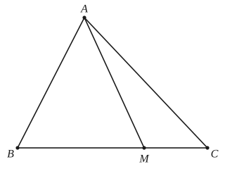
*Hình: Tam giác ABC, M trên BC với BM gấp đôi MC.*

Hai tam giác $ABM$ và $AMC$ chung chiều cao hạ từ $A$ xuống $BC$, đáy $BM = 2 \times MC$, nên $S_{ABM} = 2 \times S_{AMC}$.
Coi $S_{AMC}$ là 1 phần, $S_{ABM}$ là 2 phần, tổng 3 phần là $60 \text{ cm}^2$.
$S_{AMC} = 60 : 3 = 20 \text{ (cm}^2)$, $S_{ABM} = 40 \text{ cm}^2$.

**Đáp số:** $40 \text{ cm}^2$ và $20 \text{ cm}^2$.

### Bài 2
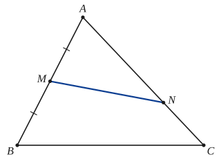
*Hình: Tam giác ABC, M là trung điểm AB, N trên AC.*

Tam giác $ABN$ và $ABC$ chung chiều cao hạ từ $B$ xuống $AC$, đáy $AN = \dfrac{2}{3} AC$: $S_{ABN} = 90 \times \dfrac{2}{3} = 60 \text{ (cm}^2)$.
Tam giác $AMN$ và $ABN$ chung chiều cao hạ từ $N$ xuống $AB$, đáy $AM = \dfrac{1}{2} AB$: $S_{AMN} = 60 : 2 = 30 \text{ (cm}^2)$.

**Đáp số:** $30 \text{ cm}^2$.

### Bài 3
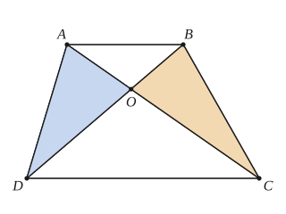
*Hình: Hình thang ABCD có hai đường chéo cắt nhau tại O.*

Tam giác $ACD$ và $BCD$ có chung đáy $CD$; chiều cao của mỗi tam giác (hạ từ $A$ và từ $B$ xuống $CD$) đều bằng chiều cao hình thang. Vậy $S_{ACD} = S_{BCD}$.
Hai tam giác này có chung phần tam giác $OCD$. Bớt đi phần chung:
$$S_{AOD} = S_{ACD} - S_{OCD} = S_{BCD} - S_{OCD} = S_{BOC}.$$

### Bài 4
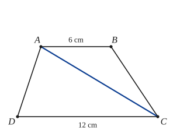
*Hình: Hình thang ABCD có đáy AB = 6 cm, CD = 12 cm.*

Tam giác $ABC$ có đáy $AB$, chiều cao hạ từ $C$ bằng chiều cao hình thang.
Chiều cao hình thang: $18 \times 2 : 6 = 6$ (cm).
Diện tích hình thang: $(6 + 12) \times 6 : 2 = 54 \text{ (cm}^2)$.

**Đáp số:** $54 \text{ cm}^2$.

### Bài 5
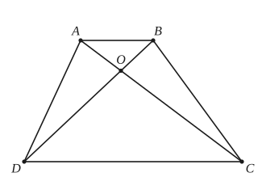
*Hình: Hình thang ABCD có AB bằng một phần ba CD, hai đường chéo cắt nhau tại O.*

- Tam giác $ABD$ và $CBD$ có chiều cao bằng nhau (bằng chiều cao hình thang), đáy $AB = \dfrac{1}{3} CD$, nên $S_{ABD} = \dfrac{1}{3} S_{CBD}$. Hai tam giác này chung đáy $BD$, nên chiều cao hạ từ $A$ xuống $BD$ bằng $\dfrac{1}{3}$ chiều cao hạ từ $C$ xuống $BD$.
- Do đó tam giác $AOB$ và $COB$ (chung đáy $OB$) có $S_{AOB} = \dfrac{1}{3} S_{COB}$, nên $S_{BOC} = 2 \times 3 = 6 \text{ (cm}^2)$.
- Theo bài 3, $S_{AOD} = S_{BOC} = 6 \text{ cm}^2$.
- Tương tự, tam giác $AOD$ và $COD$ chung đáy $OD$ nên $S_{COD} = 3 \times S_{AOD} = 18 \text{ (cm}^2)$.

Diện tích hình thang: $2 + 6 + 6 + 18 = 32 \text{ (cm}^2)$.

**Đáp số:** $32 \text{ cm}^2$.

### Bài 6
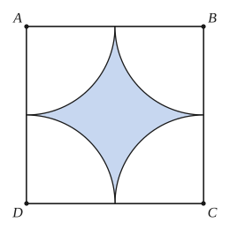
*Hình: Hình vuông cạnh 4 cm với bốn phần tư hình tròn bán kính 2 cm ở bốn góc.*

Bốn phần tư hình tròn cùng bán kính 2 cm ghép lại thành một hình tròn bán kính 2 cm: $2 \times 2 \times 3{,}14 = 12{,}56 \text{ (cm}^2)$.
Diện tích hình vuông: $4 \times 4 = 16 \text{ (cm}^2)$.
Phần còn lại: $16 - 12{,}56 = 3{,}44 \text{ (cm}^2)$.

**Đáp số:** $3{,}44 \text{ cm}^2$.

### Bài 7
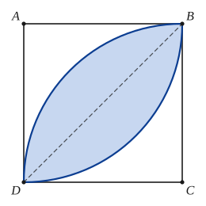
*Hình: Hình lá tạo bởi hai phần tư hình tròn trong hình vuông cạnh 10 cm.*

Đường chéo $BD$ chia hình lá thành hai hình viên phân bằng nhau.
Mỗi phần tư hình tròn bán kính 10 cm có diện tích $10 \times 10 \times 3{,}14 : 4 = 78{,}5 \text{ (cm}^2)$.
Tam giác vuông (nửa hình vuông) có diện tích $10 \times 10 : 2 = 50 \text{ (cm}^2)$.
Mỗi hình viên phân: $78{,}5 - 50 = 28{,}5 \text{ (cm}^2)$.
Hình lá: $28{,}5 \times 2 = 57 \text{ (cm}^2)$.

**Đáp số:** $57 \text{ cm}^2$.

### Bài 8
Bán kính mới bằng $110\% = \dfrac{11}{10}$ bán kính cũ. Diện tích mới bằng $\dfrac{11}{10} \times \dfrac{11}{10} = \dfrac{121}{100} = 121\%$ diện tích cũ.
Diện tích tăng thêm $21\%$.

**Đáp số:** 21% (không phải 10% hay 20%).

### Bài 9
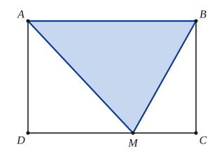
*Hình: Hình chữ nhật ABCD và điểm M trên cạnh CD.*

Tam giác $ABM$ có đáy $AB = 12$ cm, chiều cao hạ từ $M$ xuống $AB$ bằng chiều rộng 8 cm (dù $M$ ở đâu trên $CD$).
$S_{ABM} = 12 \times 8 : 2 = 48 \text{ (cm}^2)$, bằng nửa hình chữ nhật.

**Đáp số:** $48 \text{ cm}^2$.

### Bài 10
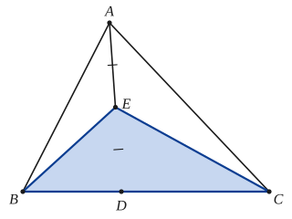
*Hình: Tam giác ABC, D trên BC, E là trung điểm AD.*

Tam giác $EBD$ và $ABD$ chung chiều cao hạ từ $B$ xuống $AD$, đáy $ED = \dfrac{1}{2} AD$: $S_{EBD} = \dfrac{1}{2} S_{ABD}$.
Tương tự $S_{ECD} = \dfrac{1}{2} S_{ACD}$.
Cộng lại: $S_{EBC} = S_{EBD} + S_{ECD} = \dfrac{1}{2}(S_{ABD} + S_{ACD}) = \dfrac{1}{2} S_{ABC} = 40 \text{ (cm}^2)$.

**Đáp số:** $40 \text{ cm}^2$.

### Bài 11
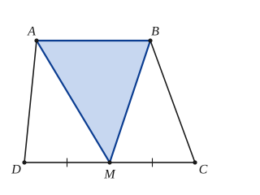
*Hình: Hình thang ABCD, M là trung điểm CD.*

Tam giác $ABM$ có đáy $AB = 20$ cm, chiều cao hạ từ $M$ bằng chiều cao hình thang 16 cm:
$S_{ABM} = 20 \times 16 : 2 = 160 \text{ (cm}^2)$.
Diện tích hình thang: $(20 + 30) \times 16 : 2 = 400 \text{ (cm}^2)$.

**Đáp số:** $160 \text{ cm}^2$; $400 \text{ cm}^2$.

### Bài 12
Phần tăng thêm là một tam giác có đáy 10 m và chiều cao bằng chiều cao thửa ruộng.
Chiều cao: $300 \times 2 : 10 = 60$ (m).
Diện tích lúc đầu: $(120 + 80) \times 60 : 2 = 6\,000 \text{ (m}^2)$.

**Đáp số:** $6\,000 \text{ m}^2$.

### Bài 13
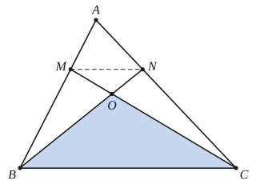
*Hình: Tam giác ABC, AM bằng một phần ba AB, AN bằng một phần ba AC, BN cắt CM tại O.*

**Bước 1.** $S_{ABN} = \dfrac{1}{3} S_{ABC} = 30$ (chung chiều cao từ $B$, $AN = \dfrac{1}{3} AC$). Tương tự $S_{ACM} = 30$, nên $S_{BMC} = 90 - 30 = 60$ và $S_{BNC} = 90 - 30 = 60 \text{ (cm}^2)$.

**Bước 2.** $S_{AMN} = \dfrac{1}{3} S_{ABN} = 10$ (chung chiều cao từ $N$, $AM = \dfrac{1}{3} AB$). Suy ra $S_{CMN} = S_{ACM} - S_{AMN} = 30 - 10 = 20 \text{ (cm}^2)$.

**Bước 3.** Tam giác $BMC$ và $NMC$ chung đáy $MC$, nên tỉ số diện tích bằng tỉ số chiều cao hạ từ $B$ và từ $N$ xuống $MC$: $60 : 20 = 3$. Hai chiều cao đó cũng là chiều cao của tam giác $BOC$ và $NOC$ (chung đáy $OC$), nên $S_{BOC} = 3 \times S_{NOC}$.

**Bước 4.** $S_{BOC} + S_{NOC} = S_{BNC} = 60$, gồm $3 + 1 = 4$ phần. $S_{BOC} = 60 : 4 \times 3 = 45 \text{ (cm}^2)$.

**Đáp số:** $45 \text{ cm}^2$.

*Nhận xét:* bài toán dùng liên tiếp "chung chiều cao" và "chung đáy". Mẹo: tìm hai tam giác có chung một cạnh chứa $O$ để suy ra tỉ số các đoạn.
