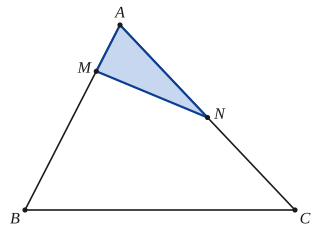

# Đề thi thử số 1

**Thời gian làm bài:** 90 phút. **Thang điểm:** mỗi câu 1 điểm, tổng 10 điểm.

## Đề bài

**Câu 1 (Tính nhanh).** Tính bằng cách hợp lý: $1{,}25 \times 3{,}6 \times 8$.

**Câu 2 (Cấu tạo số).** Một số thập phân, nếu dời dấu phẩy sang trái một chữ số thì được số mới kém số cũ $37{,}8$ đơn vị. Tìm số đó.

**Câu 3 (Chia hết).** Tìm các chữ số $a, b$ để số $\overline{7a4b}$ chia hết cho cả 2, 5 và 9.

**Câu 4 (So sánh phân số).** So sánh $\dfrac{2023}{2024}$ và $\dfrac{2024}{2025}$.

**Câu 5 (Tổng tỉ).** Trung bình cộng của hai số là 125. Số lớn gấp 4 lần số bé. Tìm hai số.

**Câu 6 (Lãi, lỗ).** Một người bán hai chiếc quạt, mỗi chiếc được 300 000 đồng. Chiếc thứ nhất lãi 20% so với giá vốn, chiếc thứ hai lỗ 20% so với giá vốn. Hỏi tính chung người đó lãi hay lỗ bao nhiêu tiền?

**Câu 7 (Dòng nước).** Một ca nô đi xuôi dòng từ A đến B hết 2 giờ và đi ngược dòng từ B về A hết 3 giờ. Vận tốc dòng nước là 3 km/giờ. Tính quãng sông $AB$.

**Câu 8 (Công việc chung).** Người thứ nhất làm một mình xong công việc trong 15 ngày, người thứ hai trong 10 ngày. Hỏi hai người cùng làm thì xong trong bao nhiêu ngày?

**Câu 9 (Diện tích).** Tam giác $ABC$ có diện tích $80 \text{ cm}^2$. $M$ nằm trên $AB$ với $AM = \dfrac{1}{4} AB$, $N$ nằm trên $AC$ với $AN = \dfrac{1}{2} AC$. Tính diện tích tam giác $AMN$ và diện tích tứ giác $BMNC$.

**Câu 10 (Đếm).** Có bao nhiêu số có ba chữ số mà cả ba chữ số đều lẻ?

---

## Lời giải chi tiết

### Câu 1
$(1{,}25 \times 8) \times 3{,}6 = 10 \times 3{,}6 = 36$.

### Câu 2
Dời dấu phẩy sang trái một chữ số thì số đó giảm 10 lần. Phần giảm đi bằng $\dfrac{9}{10}$ số cũ. Số cũ: $37{,}8 : 9 \times 10 = 42$.

**Đáp số:** 42. Thử lại: $42 - 4{,}2 = 37{,}8$.

### Câu 3
Chia hết cho 2 và 5 nên $b = 0$. Chia hết cho 9 nên $7 + a + 4 = 11 + a$ chia hết cho 9, suy ra $a = 7$.

**Đáp số:** $a = 7$, $b = 0$ (số 7 740).

### Câu 4
Phần bù đến 1: $\dfrac{1}{2024} > \dfrac{1}{2025}$, nên $\dfrac{2023}{2024} < \dfrac{2024}{2025}$.

### Câu 5
Tổng hai số: $125 \times 2 = 250$. Số bé 1 phần, số lớn 4 phần, tổng 5 phần. Số bé: 50; số lớn: 200.

### Câu 6
Chiếc thứ nhất: giá bán bằng 120% giá vốn, giá vốn $300\,000 : 120 \times 100 = 250\,000$ (đồng).
Chiếc thứ hai: giá bán bằng 80% giá vốn, giá vốn $300\,000 : 80 \times 100 = 375\,000$ (đồng).
Tổng vốn: $625\,000$ đồng; tổng bán: $600\,000$ đồng. Người đó **lỗ** $25\,000$ đồng.

*Nhận xét:* lãi 20% và lỗ 20% không bù trừ nhau, vì hai phần trăm tính trên hai giá vốn khác nhau.

### Câu 7
Vận tốc xuôi hơn vận tốc ngược $3 \times 2 = 6$ (km/giờ).
Mỗi giờ xuôi đi được $\dfrac{1}{2}$ quãng sông, ngược đi được $\dfrac{1}{3}$ quãng sông, chênh $\dfrac{1}{6}$ quãng sông, ứng với 6 km.
Quãng sông: $6 \times 6 = 36$ (km).

### Câu 8
Mỗi ngày hai người làm được $\dfrac{1}{15} + \dfrac{1}{10} = \dfrac{2}{30} + \dfrac{3}{30} = \dfrac{1}{6}$ (công việc). Cùng làm xong trong 6 ngày.

### Câu 9

*Hình: Tam giác ABC, M trên AB, N trên AC.*

$S_{ABN} = \dfrac{1}{2} S_{ABC} = 40$ (chung chiều cao từ $B$). $S_{AMN} = \dfrac{1}{4} S_{ABN} = 10 \text{ (cm}^2)$ (chung chiều cao từ $N$).
$S_{BMNC} = 80 - 10 = 70 \text{ (cm}^2)$.

### Câu 10
Mỗi chữ số có 5 cách chọn (1, 3, 5, 7, 9): $5 \times 5 \times 5 = 125$ (số).
