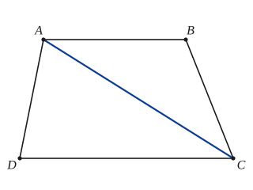

# Đề thi thử số 2

**Thời gian làm bài:** 90 phút. **Thang điểm:** mỗi câu 1 điểm, tổng 10 điểm.

## Đề bài

**Câu 1 (Tính nhanh).** Tính: $\dfrac{1}{2} + \dfrac{1}{4} + \dfrac{1}{8} + \dfrac{1}{16} + \dfrac{1}{32} + \dfrac{1}{64} + \dfrac{1}{128} + \dfrac{1}{256}$.

**Câu 2 (Cấu tạo số).** Tìm số có hai chữ số, biết số đó gấp 7 lần chữ số hàng đơn vị của nó.

**Câu 3 (Dirichlet).** Chứng tỏ rằng trong 11 số tự nhiên bất kỳ luôn có hai số mà hiệu của chúng chia hết cho 10.

**Câu 4 (Phân số).** Tìm phân số bằng $0{,}75$ biết tích của tử số và mẫu số là 300.

**Câu 5 (Tuổi).** Mẹ hơn con 30 tuổi. Cách đây 3 năm, tuổi con bằng $\dfrac{1}{6}$ tuổi mẹ. Tính tuổi mỗi người hiện nay.

**Câu 6 (Nồng độ).** Có 500 g nước muối nồng độ 8%. Đổ thêm 300 g nước lọc vào. Hỏi nồng độ muối lúc sau là bao nhiêu?

**Câu 7 (Kim đồng hồ).** Bây giờ là 6 giờ đúng. Hỏi sau ít nhất bao nhiêu phút nữa thì kim giờ và kim phút vuông góc với nhau?

**Câu 8 (Vòi nước).** Hai vòi cùng chảy vào một bể cạn thì sau 6 giờ đầy bể. Vòi thứ nhất chảy nhanh gấp đôi vòi thứ hai. Hỏi mỗi vòi chảy một mình thì sau bao lâu đầy bể?

**Câu 9 (Diện tích).** Hình thang $ABCD$ có đáy $AB$ bằng $\dfrac{2}{3}$ đáy $CD$, diện tích $100 \text{ cm}^2$. Tính diện tích tam giác $ACD$.

**Câu 10 (Suy luận).** Có ba hộp bi: một hộp chỉ có bi đỏ, một hộp chỉ có bi xanh, một hộp có cả bi đỏ và bi xanh. Nhãn trên ba hộp ghi "Đỏ", "Xanh", "Đỏ và xanh", nhưng **cả ba nhãn đều ghi sai**. Chỉ được lấy ra một viên bi từ một hộp (không nhìn vào trong). Phải lấy từ hộp nào để biết chắc mỗi hộp chứa gì?

---

## Lời giải chi tiết

### Câu 1
Gọi tổng là $S$. $S \times 2 = 1 + \dfrac{1}{2} + \dots + \dfrac{1}{128}$. Trừ: $S = 1 - \dfrac{1}{256} = \dfrac{255}{256}$.

### Câu 2
Gọi số đó là $\overline{ab}$: $a \times 10 + b = b \times 7$, nên $a \times 10 = b \times 6$, tức là $a \times 5 = b \times 3$.
Vì $a, b$ là chữ số, $a \ne 0$: $a = 3$, $b = 5$.

**Đáp số:** 35. Thử lại: $35 = 7 \times 5$.

### Câu 3
Chia một số tự nhiên cho 10, số dư chính là chữ số hàng đơn vị, có 10 khả năng (0 đến 9). Có 11 số nên có hai số cùng chữ số tận cùng. Hiệu của hai số đó có tận cùng là 0, chia hết cho 10.

### Câu 4
$0{,}75 = \dfrac{3}{4}$. Phân số cần tìm có dạng $\dfrac{3 \times k}{4 \times k}$, tích tử và mẫu là $12 \times k \times k = 300$, nên $k \times k = 25$, $k = 5$.

**Đáp số:** $\dfrac{15}{20}$.

### Câu 5
Cách đây 3 năm: con 1 phần, mẹ 6 phần, hiệu 5 phần ứng với 30 tuổi. Tuổi con lúc đó: 6 tuổi; tuổi mẹ: 36 tuổi.
Hiện nay: con 9 tuổi, mẹ 39 tuổi.

### Câu 6
Muối: $500 \times 8 : 100 = 40$ (g). Dung dịch mới: 800 g. Nồng độ: $40 : 800 = 5\%$.

### Câu 7
Lúc 6 giờ, kim phút ở vạch 0, kim giờ ở vạch 30: hai kim cách nhau 30 vạch (góc bẹt).
Hai kim vuông góc khi cách nhau 15 vạch. Kim phút cần đuổi gần thêm $30 - 15 = 15$ (vạch).
Mỗi phút kim phút gần thêm $\dfrac{11}{12}$ vạch. Thời gian: $15 : \dfrac{11}{12} = \dfrac{180}{11} = 16\dfrac{4}{11}$ (phút).

**Đáp số:** $16\dfrac{4}{11}$ phút.

### Câu 8
Mỗi giờ hai vòi chảy được $\dfrac{1}{6}$ bể, gồm 3 phần (vòi một 2 phần, vòi hai 1 phần).
Vòi thứ nhất mỗi giờ chảy $\dfrac{1}{6} \times \dfrac{2}{3} = \dfrac{1}{9}$ bể: đầy bể sau 9 giờ.
Vòi thứ hai mỗi giờ chảy $\dfrac{1}{18}$ bể: đầy bể sau 18 giờ.

### Câu 9

*Hình: Hình thang ABCD có AB bằng hai phần ba CD, đường chéo AC.*

Đường chéo $AC$ chia hình thang thành tam giác $ABC$ (đáy $AB$) và $ACD$ (đáy $CD$), có chiều cao bằng nhau (bằng chiều cao hình thang).
$S_{ABC} : S_{ACD} = AB : CD = 2 : 3$. Tổng 5 phần là $100 \text{ cm}^2$. $S_{ACD} = 100 : 5 \times 3 = 60 \text{ (cm}^2)$.

### Câu 10
Lấy một viên từ hộp ghi nhãn **"Đỏ và xanh"**. Vì nhãn sai, hộp này chỉ có một màu.
- Nếu lấy được bi đỏ: hộp này là hộp **đỏ**. Hộp ghi "Xanh" không thể là xanh (nhãn sai) và không còn là đỏ, nên là hộp **đỏ và xanh**. Hộp ghi "Đỏ" là hộp **xanh**.
- Nếu lấy được bi xanh: tương tự, hộp này là hộp **xanh**, hộp ghi "Đỏ" là hộp **đỏ và xanh**, hộp ghi "Xanh" là hộp **đỏ**.
