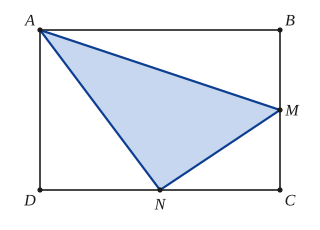

# Đề thi thử số 3

**Thời gian làm bài:** 90 phút. **Thang điểm:** mỗi câu 1 điểm, tổng 10 điểm.

## Đề bài

**Câu 1 (Tính nhanh).** Tính: $0{,}5 + 1{,}5 + 2{,}5 + \dots + 8{,}5 + 9{,}5$.

**Câu 2 (Cấu tạo số).** Tìm số có hai chữ số, biết rằng nếu viết thêm chữ số 0 vào giữa hai chữ số của nó thì được số mới gấp 7 lần số đã cho.

**Câu 3 (Chia có dư).** Tìm số tự nhiên nhỏ nhất chia cho 3 dư 2, chia cho 4 dư 3 và chia cho 5 dư 4.

**Câu 4 (Tổng phân số).** Tính: $\dfrac{1}{2 \times 3} + \dfrac{1}{3 \times 4} + \dfrac{1}{4 \times 5} + \dots + \dfrac{1}{9 \times 10}$.

**Câu 5 (Tổng tỉ ba số).** Ba lớp quyên góp được 360 quyển sách. Số sách lớp 5A bằng $\dfrac{2}{3}$ số sách lớp 5B, số sách lớp 5C bằng $\dfrac{4}{3}$ số sách lớp 5B. Tính số sách mỗi lớp.

**Câu 6 (Hạt tươi, hạt khô).** 300 kg hạt tươi có tỉ lệ nước là 40%. Sau khi phơi khô, tỉ lệ nước còn 10%. Hỏi số hạt đã phơi khô nặng bao nhiêu ki-lô-gam?

**Câu 7 (Gặp nhau hai lần).** Hai xe xuất phát cùng lúc từ A và B, đi ngược chiều nhau và gặp nhau lần thứ nhất tại điểm cách A 30 km. Mỗi xe đến đầu kia thì quay lại ngay và chúng gặp nhau lần thứ hai tại điểm cách B 15 km. Tính quãng đường $AB$.

**Câu 8 (Công việc).** Một người làm một mình trong 4 ngày được $\dfrac{1}{3}$ công việc. Sau đó có thêm người thứ hai cùng làm và hai người làm xong phần còn lại trong 4 ngày. Hỏi người thứ hai làm một mình thì xong cả công việc trong bao nhiêu ngày?

**Câu 9 (Diện tích).** Hình chữ nhật $ABCD$ có $AB = 12$ cm, $BC = 8$ cm. $M$ là trung điểm của $BC$, $N$ là trung điểm của $CD$. Tính diện tích tam giác $AMN$.

**Câu 10 (Xếp chỗ).** Có 4 bạn An, Bình, Chi, Dũng ngồi vào 4 ghế xếp thành một hàng ngang.
a) Có bao nhiêu cách xếp? b) Có bao nhiêu cách xếp mà An và Bình ngồi cạnh nhau?

---

## Lời giải chi tiết

### Câu 1
Dãy có 10 số hạng cách đều 1. Tổng: $(0{,}5 + 9{,}5) \times 10 : 2 = 50$.

### Câu 2
Gọi số đó là $\overline{ab}$, số mới là $\overline{a0b} = a \times 100 + b$. Ta có $a \times 100 + b = (a \times 10 + b) \times 7 = a \times 70 + b \times 7$.
Suy ra $a \times 30 = b \times 6$, tức $b = a \times 5$. Vì $b \le 9$ nên $a = 1$, $b = 5$.

**Đáp số:** 15. Thử lại: $105 = 7 \times 15$.

### Câu 3
Số cần tìm thêm 1 thì chia hết cho 3, 4, 5, tức là chia hết cho 60. Số nhỏ nhất: $60 - 1 = 59$.

### Câu 4
$\left(\dfrac{1}{2} - \dfrac{1}{3}\right) + \left(\dfrac{1}{3} - \dfrac{1}{4}\right) + \dots + \left(\dfrac{1}{9} - \dfrac{1}{10}\right) = \dfrac{1}{2} - \dfrac{1}{10} = \dfrac{2}{5}$.

### Câu 5
Coi lớp 5B là 3 phần: lớp 5A 2 phần, lớp 5C 4 phần. Tổng 9 phần ứng với 360 quyển, một phần 40 quyển.
5A: 80 quyển; 5B: 120 quyển; 5C: 160 quyển.

### Câu 6
Chất khô: $300 \times 60 : 100 = 180$ (kg). Trong hạt khô, chất khô chiếm 90%.
Hạt khô: $180 : 90 \times 100 = 200$ (kg).

### Câu 7
Đến lần gặp thứ nhất, hai xe đi tổng cộng một lần $AB$, xe từ A đi 30 km. Đến lần gặp thứ hai, hai xe đi tổng cộng ba lần $AB$, xe từ A đi $30 \times 3 = 90$ (km).
Xe từ A đã đi hết $AB$ rồi quay lại 15 km: $AB = 90 - 15 = 75$ (km).

### Câu 8
Mỗi ngày người thứ nhất làm được $\dfrac{1}{3} : 4 = \dfrac{1}{12}$ công việc. Phần còn lại $\dfrac{2}{3}$ làm trong 4 ngày, mỗi ngày hai người làm $\dfrac{2}{3} : 4 = \dfrac{1}{6}$.
Người thứ hai mỗi ngày làm $\dfrac{1}{6} - \dfrac{1}{12} = \dfrac{1}{12}$, nên làm một mình mất 12 ngày.

### Câu 9

*Hình: Hình chữ nhật ABCD 12 cm × 8 cm, M là trung điểm BC, N là trung điểm CD.*

$S_{ABCD} = 96 \text{ cm}^2$. $BM = MC = 4$ cm, $CN = ND = 6$ cm.
$S_{ABM} = 12 \times 4 : 2 = 24$; $S_{ADN} = 8 \times 6 : 2 = 24$; $S_{CMN} = 4 \times 6 : 2 = 12$.
$S_{AMN} = 96 - 24 - 24 - 12 = 36 \text{ (cm}^2)$.

### Câu 10
a) Ghế 1 có 4 cách, ghế 2 có 3 cách, ghế 3 có 2 cách, ghế 4 có 1 cách: $4 \times 3 \times 2 \times 1 = 24$ (cách).
b) Coi An và Bình là một "khối". Xếp khối này cùng Chi, Dũng (3 phần tử) có $3 \times 2 \times 1 = 6$ cách; trong khối, An và Bình đổi chỗ được 2 cách. Tổng: $6 \times 2 = 12$ (cách).
