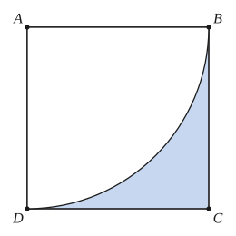

# Đề thi thử số 4

**Thời gian làm bài:** 90 phút. **Thang điểm:** mỗi câu 1 điểm, tổng 10 điểm.

## Đề bài

**Câu 1 (Tính nhanh).** Tính: $1{,}1 + 2{,}2 + 3{,}3 + \dots + 8{,}8 + 9{,}9$.

**Câu 2 (Cấu tạo số).** Tìm số có ba chữ số, biết rằng nếu viết thêm chữ số 5 vào bên trái số đó thì được số mới gấp 9 lần số đã cho.

**Câu 3 (Dirichlet).** Chứng tỏ rằng trong 100 người bất kỳ có ít nhất 9 người có sinh nhật trong cùng một tháng.

**Câu 4 (Phân số).** Tìm $x$ biết $x \times \left(1 + \dfrac{1}{2} + \dfrac{1}{4}\right) = 14$.

**Câu 5 (Tuổi).** Năm nay tổng số tuổi của ông và cháu là 70 tuổi. Sau 10 năm nữa, tuổi ông gấp 5 lần tuổi cháu. Tính tuổi mỗi người năm nay.

**Câu 6 (Phần trăm).** Giá một món hàng được tăng 20%, sau đó lại giảm 25%. Hỏi giá cuối cùng tăng hay giảm bao nhiêu phần trăm so với giá ban đầu?

**Câu 7 (Đoàn tàu).** Một đoàn tàu chạy qua một cột điện hết 8 giây, chạy qua một cây cầu dài 240 m hết 20 giây. Tính vận tốc và chiều dài đoàn tàu.

**Câu 8 (Vòi nước).** Một bể cạn có hai vòi chảy vào và một vòi tháo ra. Vòi thứ nhất chảy riêng thì đầy bể sau 4 giờ, vòi thứ hai sau 6 giờ. Vòi tháo tháo cạn bể đầy sau 12 giờ. Mở cả ba vòi cùng lúc thì sau bao lâu bể đầy?

**Câu 9 (Diện tích).** Hình vuông $ABCD$ có cạnh 10 cm. Vẽ phần tư hình tròn tâm $A$ bán kính 10 cm nằm trong hình vuông. Tính diện tích phần hình vuông nằm ngoài phần tư hình tròn.

**Câu 10 (Trò chơi).** Trên bàn có 2025 que diêm. Hai bạn lần lượt bốc, mỗi lượt bốc 1, 2 hoặc 3 que. Ai phải bốc que cuối cùng thì **thua**. Bạn đi trước hay bạn đi sau có cách chắc chắn thắng? Nêu cách chơi.

---

## Lời giải chi tiết

### Câu 1
$1{,}1 \times (1 + 2 + \dots + 9) = 1{,}1 \times 45 = 49{,}5$.

### Câu 2
Viết thêm chữ số 5 vào bên trái số có ba chữ số thì số đó tăng 5 000. Số mới gấp 9 lần số cũ nên 5 000 bằng 8 lần số cũ. Số cũ: $5\,000 : 8 = 625$.

**Đáp số:** 625. Thử lại: $5\,625 = 9 \times 625$.

### Câu 3
Nếu mỗi tháng có nhiều nhất 8 người sinh nhật thì có nhiều nhất $12 \times 8 = 96$ người, ít hơn 100. Vậy có tháng có ít nhất 9 người.

### Câu 4
$1 + \dfrac{1}{2} + \dfrac{1}{4} = \dfrac{7}{4}$. $x = 14 : \dfrac{7}{4} = 8$.

### Câu 5
Sau 10 năm, tổng tuổi hai ông cháu là $70 + 20 = 90$. Lúc đó cháu 1 phần, ông 5 phần, tổng 6 phần: cháu 15 tuổi, ông 75 tuổi.
Năm nay: cháu 5 tuổi, ông 65 tuổi.

### Câu 6
$120\% \times 75 : 100 = 90\%$. Giá cuối cùng giảm 10%.

### Câu 7
Qua cột điện tàu đi quãng đường bằng chiều dài tàu; qua cầu tàu đi thêm chiều dài cầu. Như vậy 240 m ứng với $20 - 8 = 12$ giây.
Vận tốc: $240 : 12 = 20$ (m/giây). Chiều dài tàu: $20 \times 8 = 160$ (m).

### Câu 8
Mỗi giờ bể tăng $\dfrac{1}{4} + \dfrac{1}{6} - \dfrac{1}{12} = \dfrac{3}{12} + \dfrac{2}{12} - \dfrac{1}{12} = \dfrac{1}{3}$ (bể). Bể đầy sau 3 giờ.

### Câu 9

*Hình: Hình vuông ABCD cạnh 10 cm và phần tư hình tròn tâm A bán kính 10 cm.*

Phần tư hình tròn: $10 \times 10 \times 3{,}14 : 4 = 78{,}5 \text{ (cm}^2)$. Phần còn lại: $100 - 78{,}5 = 21{,}5 \text{ (cm}^2)$.

### Câu 10
Người phải bốc que cuối thua, tức là người nào để lại cho đối phương **đúng 1 que** thì thắng. Các số que "để lại cho đối phương" có lợi là $1, 5, 9, 13, \dots$ (chia 4 dư 1): đối phương bốc $k$ que thì mình bốc $4 - k$ que, lại để lại số chia 4 dư 1, cuối cùng đối phương phải nhận 1 que.
$2025 = 4 \times 506 + 1$ chia 4 dư 1, nên người đi trước đang ở thế bất lợi. **Bạn đi sau** thắng: mỗi khi bạn đi trước bốc $k$ que, bạn đi sau bốc $4 - k$ que.
