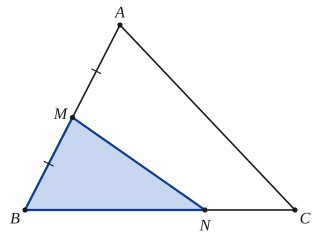

# Đề thi thử số 5

**Thời gian làm bài:** 90 phút. **Thang điểm:** mỗi câu 1 điểm, tổng 10 điểm.

## Đề bài

**Câu 1 (Tính nhanh).** Tính: $99 \times 0{,}25 + 0{,}25$.

**Câu 2 (Cấu tạo số).** Tìm số có hai chữ số, biết tổng của số đó và số viết theo thứ tự ngược lại bằng 143, và hai chữ số của nó hơn kém nhau 3.

**Câu 3 (Chia hết).** Tìm số tự nhiên $n$ để $n + 5$ chia hết cho $n + 1$.

**Câu 4 (Phân số).** Không tính tổng, chứng tỏ $\dfrac{1}{5} + \dfrac{1}{6} + \dfrac{1}{7} + \dfrac{1}{8} + \dfrac{1}{9} > \dfrac{1}{2}$.

**Câu 5 (Tỉ số thay đổi).** Hai kho có tất cả 450 tấn thóc. Nếu chuyển 50 tấn từ kho A sang kho B thì số thóc kho B bằng $\dfrac{4}{5}$ số thóc kho A. Hỏi lúc đầu mỗi kho có bao nhiêu tấn?

**Câu 6 (Lãi suất).** Gửi tiết kiệm 10 000 000 đồng với lãi suất 1% một tháng, lãi tháng trước nhập vào gốc. Hỏi sau 2 tháng có tất cả bao nhiêu tiền?

**Câu 7 (Dự định).** Một người đi xe đạp từ A đến B. Nếu đi với vận tốc 15 km/giờ thì đến sớm 20 phút so với dự định; nếu đi với vận tốc 12 km/giờ thì đến muộn 10 phút. Tính quãng đường $AB$.

**Câu 8 (Công việc).** Hai người cùng làm một công việc thì xong trong 8 ngày. Làm chung được 5 ngày thì người thứ nhất nghỉ, người thứ hai làm tiếp 6 ngày nữa thì xong. Hỏi người thứ hai làm một mình thì xong công việc trong bao nhiêu ngày?

**Câu 9 (Diện tích).** Tam giác $ABC$ có diện tích $60 \text{ cm}^2$. $M$ là trung điểm của $AB$, $N$ nằm trên $BC$ sao cho $BN = 2 \times NC$. Tính diện tích tam giác $BMN$.

**Câu 10 (Trường hợp xấu nhất).** Trong một ngăn kéo tối có 5 đôi tất có 5 màu khác nhau (10 chiếc, mỗi màu 2 chiếc). Không nhìn, phải lấy ra ít nhất bao nhiêu chiếc để chắc chắn có:
a) một đôi cùng màu? b) hai đôi cùng màu (hai màu khác nhau)?

---

## Lời giải chi tiết

### Câu 1
$0{,}25 \times (99 + 1) = 25$.

### Câu 2
$\overline{ab} + \overline{ba} = (a + b) \times 11 = 143$, nên $a + b = 13$. Hai chữ số hơn kém nhau 3: chữ số lớn $(13 + 3) : 2 = 8$, chữ số bé 5.

**Đáp số:** 85 hoặc 58.

### Câu 3
$n + 5 = (n + 1) + 4$. Để $n + 5$ chia hết cho $n + 1$ thì 4 phải chia hết cho $n + 1$, tức $n + 1 \in \{1; 2; 4\}$.

**Đáp số:** $n \in \{0; 1; 3\}$.

### Câu 4
Mỗi phân số trong tổng đều không bé hơn $\dfrac{1}{9}$, và có 5 phân số, nên tổng lớn hơn $\dfrac{5}{9}$ (dấu bằng không xảy ra vì có phân số lớn hơn $\dfrac{1}{9}$). Mà $\dfrac{5}{9} > \dfrac{5}{10} = \dfrac{1}{2}$. Vậy tổng lớn hơn $\dfrac{1}{2}$.

### Câu 5
Sau khi chuyển, tổng vẫn là 450 tấn: kho A 5 phần, kho B 4 phần, tổng 9 phần, một phần 50 tấn. Lúc sau kho A 250 tấn, kho B 200 tấn.
Lúc đầu: kho A $250 + 50 = 300$ (tấn), kho B $200 - 50 = 150$ (tấn).

### Câu 6
Sau tháng thứ nhất: $10\,000\,000 + 100\,000 = 10\,100\,000$ (đồng). Lãi tháng thứ hai: $101\,000$ đồng.
Sau 2 tháng: $10\,201\,000$ đồng.

### Câu 7
Hai cách đi chênh nhau $20 + 10 = 30$ phút $= \dfrac{1}{2}$ giờ.
Mỗi ki-lô-mét, đi 12 km/giờ lâu hơn đi 15 km/giờ là $\dfrac{1}{12} - \dfrac{1}{15} = \dfrac{1}{60}$ (giờ).
Quãng đường: $\dfrac{1}{2} : \dfrac{1}{60} = 30$ (km).

*Thử lại:* đi 15 km/giờ hết 2 giờ, đi 12 km/giờ hết 2 giờ 30 phút, chênh 30 phút.

### Câu 8
5 ngày làm chung được $\dfrac{5}{8}$ công việc, còn $\dfrac{3}{8}$ công việc người thứ hai làm trong 6 ngày.
Mỗi ngày người thứ hai làm $\dfrac{3}{8} : 6 = \dfrac{1}{16}$ công việc, nên làm một mình xong trong 16 ngày.

### Câu 9

*Hình: Tam giác ABC, M là trung điểm AB, N trên BC với BN gấp đôi NC.*

$S_{ABN} = \dfrac{2}{3} S_{ABC} = 40$ (chung chiều cao từ $A$). $S_{BMN} = \dfrac{1}{2} S_{ABN} = 20 \text{ (cm}^2)$ (chung chiều cao từ $N$, $BM = \dfrac{1}{2} AB$).

### Câu 10
a) Xấu nhất: 5 chiếc đầu có 5 màu khác nhau. Chiếc thứ sáu chắc chắn trùng màu một chiếc đã lấy. Cần ít nhất 6 chiếc.
b) Xấu nhất: có một đôi và mỗi màu còn lại một chiếc, tức là $2 + 4 = 6$ chiếc mà mới có một đôi. Chiếc thứ bảy thuộc một trong 4 màu còn lại (mỗi màu còn đúng 1 chiếc trong ngăn) nên tạo thành đôi thứ hai. Cần ít nhất 7 chiếc.
