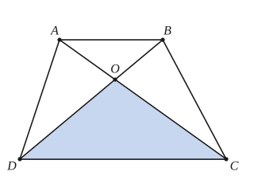

# Đề thi thử số 6

**Thời gian làm bài:** 90 phút. **Thang điểm:** mỗi câu 1 điểm, tổng 10 điểm.

## Đề bài

**Câu 1 (Tính nhanh).** Tính: $1 + \dfrac{1}{3} + \dfrac{1}{9} + \dfrac{1}{27} + \dfrac{1}{81}$.

**Câu 2 (Cấu tạo số).** Một số tự nhiên có chữ số hàng đơn vị là 4. Nếu xóa chữ số 4 đó đi thì số đó giảm 1 714 đơn vị. Tìm số đó.

**Câu 3 (Chia hết).** Tìm số nhỏ nhất có bốn chữ số chia hết cho cả 2, 3, 5 và 9.

**Câu 4 (Tổng phân số).** Tính: $\dfrac{3}{1 \times 4} + \dfrac{3}{4 \times 7} + \dfrac{3}{7 \times 10} + \dots + \dfrac{3}{97 \times 100}$.

**Câu 5 (Tuổi).** Năm nay bố 40 tuổi, hai con 8 tuổi và 6 tuổi. Hỏi sau bao nhiêu năm nữa thì tuổi bố bằng tổng số tuổi của hai con?

**Câu 6 (Phần trăm).** Trong một lớp, số học sinh nữ chiếm 40%. Nếu lớp nhận thêm 5 học sinh nữ thì số học sinh nữ chiếm 50%. Hỏi lúc đầu lớp có bao nhiêu học sinh?

**Câu 7 (Kim đồng hồ).** Bây giờ là 2 giờ đúng. Hỏi sau ít nhất bao nhiêu phút nữa thì kim phút và kim giờ trùng nhau?

**Câu 8 (Ba vòi).** Nếu mở vòi thứ nhất và vòi thứ hai thì bể cạn đầy sau 12 giờ; vòi thứ hai và vòi thứ ba: 15 giờ; vòi thứ nhất và vòi thứ ba: 20 giờ. Hỏi mở cả ba vòi thì bể đầy sau bao lâu?

**Câu 9 (Hình thang).** Hình thang $ABCD$ có đáy $AB$ bằng $\dfrac{1}{2}$ đáy $CD$. Hai đường chéo cắt nhau tại $O$. Diện tích tam giác $DOC$ là $40 \text{ cm}^2$. Tính diện tích hình thang.

**Câu 10 (Lập số).** Từ các chữ số 0, 1, 2, 3, 4, 5 lập được bao nhiêu số có bốn chữ số khác nhau và chia hết cho 5?

---

## Lời giải chi tiết

### Câu 1
Gọi tổng là $S$. $S \times 3 = 3 + 1 + \dfrac{1}{3} + \dfrac{1}{9} + \dfrac{1}{27}$. Lấy $S \times 3 - S$: $S \times 2 = 3 - \dfrac{1}{81} = \dfrac{242}{81}$, $S = \dfrac{121}{81}$.

### Câu 2
Xóa chữ số 4 cuối: số mới $x$, số cũ là $x \times 10 + 4$. Số cũ hơn số mới $x \times 9 + 4 = 1\,714$, nên $x = 190$.

**Đáp số:** 1 904.

### Câu 3
Chia hết cho 2, 5, 9 thì chia hết cho 90 (cũng chia hết cho 3). Bội nhỏ nhất của 90 có bốn chữ số: $90 \times 12 = 1\,080$.

### Câu 4
$\dfrac{3}{n \times (n + 3)} = \dfrac{1}{n} - \dfrac{1}{n + 3}$. Tổng: $1 - \dfrac{1}{100} = \dfrac{99}{100}$.

### Câu 5
Hiện nay tuổi bố hơn tổng tuổi hai con $40 - 14 = 26$. Mỗi năm, tuổi bố tăng 1, tổng tuổi hai con tăng 2, nên khoảng cách giảm 1.
Sau 26 năm thì bằng nhau.

**Đáp số:** 26 năm. Thử lại: bố 66 tuổi, hai con 34 và 32 tuổi.

### Câu 6
Số học sinh nam không đổi. Lúc đầu nam chiếm 60%, gấp $\dfrac{60}{40} = \dfrac{3}{2}$ số nữ. Lúc sau nữ bằng nam.
Coi số nữ lúc đầu 2 phần thì số nam 3 phần; thêm 5 bạn nữ thì nữ thành 3 phần, nên 1 phần là 5 bạn.
Lúc đầu: nữ 10, nam 15, cả lớp 25 học sinh.

### Câu 7
Lúc 2 giờ, kim giờ ở vạch 10, kim phút ở vạch 0, cách nhau 10 vạch.
Thời gian: $10 : \dfrac{11}{12} = \dfrac{120}{11} = 10\dfrac{10}{11}$ (phút).

### Câu 8
$\dfrac{1}{12} + \dfrac{1}{15} + \dfrac{1}{20} = \dfrac{5 + 4 + 3}{60} = \dfrac{1}{5}$ là 2 lần lượng nước ba vòi chảy mỗi giờ.
Ba vòi mỗi giờ chảy $\dfrac{1}{10}$ bể: đầy sau 10 giờ.

### Câu 9

*Hình: Hình thang ABCD có AB bằng nửa CD, hai đường chéo cắt nhau tại O.*

$OA : OC = AB : CD = 1 : 2$ (như đã học: so sánh hai tam giác $ABD$ và $CBD$ chung đáy $BD$).
- Tam giác $AOD$ và $COD$ chung đáy $OD$: $S_{AOD} = \dfrac{1}{2} S_{COD} = 20$.
- $S_{BOC} = S_{AOD} = 20$.
- Tam giác $AOB$ và $COB$ chung đáy $OB$: $S_{AOB} = \dfrac{1}{2} S_{COB} = 10$.

Diện tích hình thang: $40 + 20 + 20 + 10 = 90 \text{ (cm}^2)$.

### Câu 10
Số chia hết cho 5 tận cùng là 0 hoặc 5.
- Tận cùng 0: ba chữ số đầu chọn từ 1, 2, 3, 4, 5: $5 \times 4 \times 3 = 60$ số.
- Tận cùng 5: chữ số đầu khác 0 và khác 5 (4 cách), chữ số thứ hai 4 cách, thứ ba 3 cách: $4 \times 4 \times 3 = 48$ số.

Tổng: $60 + 48 = 108$ số.
