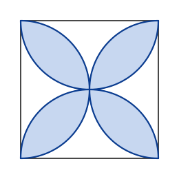

# Đề thi thử số 7

**Thời gian làm bài:** 90 phút. **Thang điểm:** mỗi câu 1 điểm, tổng 10 điểm.

## Đề bài

**Câu 1 (Tính nhanh).** Tính: $(2{,}4 \times 3{,}7 + 2{,}4 \times 6{,}3) : (1{,}2 \times 4)$.

**Câu 2 (Cấu tạo số).** Cho số thập phân $A$. Dời dấu phẩy của $A$ sang phải hai chữ số được số $B$. Biết $B - A = 198$. Tìm $A$.

**Câu 3 (Số liên tiếp).** Tìm năm số tự nhiên liên tiếp có tổng là 2 025.

**Câu 4 (Phân số).** Tìm hai phân số có tổng là $\dfrac{5}{6}$ và hiệu là $\dfrac{1}{6}$.

**Câu 5 (Tỉ số thay đổi).** Lúc đầu số bi của An bằng $\dfrac{3}{5}$ số bi của Bình. Sau khi An cho Bình 8 viên thì số bi của An bằng $\dfrac{1}{3}$ số bi của Bình. Hỏi lúc đầu mỗi bạn có bao nhiêu viên bi?

**Câu 6 (Doanh thu).** Một cửa hàng giảm giá bán 20%, nhờ đó số lượng hàng bán được tăng 50%. Hỏi doanh thu (tiền bán hàng) tăng hay giảm bao nhiêu phần trăm?

**Câu 7 (Dòng nước).** Một ca nô đi xuôi dòng 30 km hết $1{,}5$ giờ và đi ngược dòng 30 km hết 2 giờ. Tính vận tốc dòng nước và vận tốc ca nô khi nước lặng.

**Câu 8 (Công việc).** Người thứ nhất làm một mình xong công việc trong 10 ngày, người thứ hai trong 15 ngày. Người thứ nhất làm 3 ngày rồi nghỉ, người thứ hai làm tiếp cho đến khi xong. Hỏi người thứ hai đã làm bao nhiêu ngày?

**Câu 9 (Bông hoa).** Hình vuông cạnh 8 cm. Vẽ bốn nửa hình tròn có đường kính là bốn cạnh hình vuông, nằm phía trong hình vuông. Các nửa hình tròn chồng lên nhau tạo thành "bông hoa bốn cánh" (phần tô màu). Tính diện tích bông hoa.

**Câu 10 (Thi đấu).** Một giải bóng đá thi đấu vòng tròn một lượt (mỗi đội gặp mỗi đội khác đúng một trận) có tất cả 28 trận. Hỏi có bao nhiêu đội tham gia?

---

## Lời giải chi tiết

### Câu 1
$2{,}4 \times (3{,}7 + 6{,}3) = 24$; $1{,}2 \times 4 = 4{,}8$; $24 : 4{,}8 = 5$.

### Câu 2
$B = A \times 100$, nên $B - A = A \times 99 = 198$, $A = 2$.

### Câu 3
Số ở giữa bằng trung bình cộng: $2\,025 : 5 = 405$. Năm số: 403; 404; 405; 406; 407.

### Câu 4
Phân số lớn: $\left(\dfrac{5}{6} + \dfrac{1}{6}\right) : 2 = \dfrac{1}{2}$. Phân số bé: $\dfrac{1}{2} - \dfrac{1}{6} = \dfrac{1}{3}$.

### Câu 5
Tổng số bi không đổi. Lúc đầu An có $\dfrac{3}{8}$ tổng số bi; lúc sau An có $\dfrac{1}{4}$ tổng số bi.
8 viên bi ứng với $\dfrac{3}{8} - \dfrac{1}{4} = \dfrac{1}{8}$ tổng số bi. Tổng: 64 viên.
Lúc đầu An có $64 \times \dfrac{3}{8} = 24$ viên, Bình có 40 viên.

### Câu 6
Doanh thu = giá bán × số lượng. Doanh thu mới bằng $80\% \times 150 : 100 = 120\%$ doanh thu cũ. Tăng 20%.

### Câu 7
Vận tốc xuôi: $30 : 1{,}5 = 20$ (km/giờ). Vận tốc ngược: $30 : 2 = 15$ (km/giờ).
Dòng nước: $(20 - 15) : 2 = 2{,}5$ (km/giờ). Ca nô khi nước lặng: $(20 + 15) : 2 = 17{,}5$ (km/giờ).

### Câu 8
Người thứ nhất làm 3 ngày được $\dfrac{3}{10}$ công việc, còn $\dfrac{7}{10}$.
Người thứ hai mỗi ngày làm $\dfrac{1}{15}$: số ngày $\dfrac{7}{10} : \dfrac{1}{15} = \dfrac{21}{2} = 10{,}5$ (ngày).

### Câu 9

*Hình: Hình vuông cạnh 8 cm với bốn nửa hình tròn vẽ vào trong tạo thành bông hoa bốn cánh.*

Bốn nửa hình tròn bán kính 4 cm có tổng diện tích $4 \times (4 \times 4 \times 3{,}14 : 2) = 100{,}48 \text{ (cm}^2)$.
Bốn nửa hình tròn phủ kín hình vuông, trong đó phần cánh hoa bị phủ hai lần. Vậy tổng diện tích bốn nửa hình tròn bằng diện tích hình vuông cộng diện tích bông hoa.
Diện tích bông hoa: $100{,}48 - 64 = 36{,}48 \text{ (cm}^2)$.

### Câu 10
$n$ đội đấu $n \times (n - 1) : 2$ trận. $n \times (n - 1) = 56 = 8 \times 7$, nên $n = 8$.

**Đáp số:** 8 đội.
