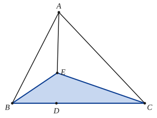

# Đề thi thử số 8

**Thời gian làm bài:** 90 phút. **Thang điểm:** mỗi câu 1 điểm, tổng 10 điểm.

## Đề bài

**Câu 1 (Tính nhanh).** Tính: $\left(1 - \dfrac{1}{4}\right) \times \left(1 - \dfrac{1}{9}\right) \times \left(1 - \dfrac{1}{16}\right) \times \dots \times \left(1 - \dfrac{1}{100}\right)$ (các mẫu số là $2 \times 2, 3 \times 3, \dots, 10 \times 10$).

**Câu 2 (Cấu tạo số).** Tìm số có ba chữ số $\overline{abc}$, biết $\overline{abc} - \overline{cba} = 594$, tổng ba chữ số bằng 15 và chữ số hàng chục là 5.

**Câu 3 (Chia có dư).** Số $A$ chia cho 12 dư 7. Hỏi $A$ chia cho 6 dư bao nhiêu? Chia cho 4 dư bao nhiêu?

**Câu 4 (Phân số).** Tìm $x$ biết $\dfrac{1}{x} + \dfrac{1}{x \times 2} + \dfrac{1}{x \times 3} = \dfrac{11}{12}$.

**Câu 5 (Tuổi).** Hiện nay tổng số tuổi của bố và hai con là 54 tuổi; tuổi bố gấp đôi tổng số tuổi của hai con. Hỏi sau bao nhiêu năm nữa thì tuổi bố bằng tổng số tuổi của hai con?

**Câu 6 (Pha dung dịch).** Có hai loại nước muối nồng độ 10% và 25%. Cần lấy mỗi loại bao nhiêu gam để được 600 g nước muối nồng độ 15%?

**Câu 7 (Gặp nhau).** Hai người đi bộ từ A và B ngược chiều nhau. Nếu cùng xuất phát thì sau 2 giờ họ gặp nhau. Nếu người từ A đi trước 1 giờ thì họ gặp nhau sau khi người từ B đi được 1 giờ 20 phút. Biết $AB = 24$ km. Tính vận tốc mỗi người.

**Câu 8 (Vòi chảy vào, vòi tháo).** Một bể có một vòi chảy vào, chảy riêng thì đầy bể sau 5 giờ. Khi bể đầy, người ta mở thêm vòi tháo (vòi chảy vào vẫn mở) thì sau 20 giờ bể cạn. Hỏi nếu chỉ mở vòi tháo thì bể đầy cạn sau bao lâu?

**Câu 9 (Diện tích).** Tam giác $ABC$ có diện tích $90 \text{ cm}^2$. $D$ nằm trên $BC$ với $BD = \dfrac{1}{3} BC$, $E$ nằm trên $AD$ với $AE = 2 \times ED$. Tính diện tích tam giác $EBC$.

**Câu 10 (Đường đi).** Một khu phố có các con đường tạo thành lưới 2 hàng, 4 cột ô vuông. Từ góc dưới bên trái đến góc trên bên phải, chỉ đi sang phải hoặc đi lên theo các con đường, có bao nhiêu đường đi khác nhau?

---

## Lời giải chi tiết

### Câu 1
$1 - \dfrac{1}{4} = \dfrac{3}{4} = \dfrac{1 \times 3}{2 \times 2}$, $1 - \dfrac{1}{9} = \dfrac{8}{9} = \dfrac{2 \times 4}{3 \times 3}$, …, $1 - \dfrac{1}{100} = \dfrac{9 \times 11}{10 \times 10}$.
Tích $= \dfrac{1 \times 2 \times \dots \times 9}{2 \times 3 \times \dots \times 10} \times \dfrac{3 \times 4 \times \dots \times 11}{2 \times 3 \times \dots \times 10} = \dfrac{1}{10} \times \dfrac{11}{2} = \dfrac{11}{20}$.

### Câu 2
$\overline{abc} - \overline{cba} = (a - c) \times 99 = 594$, nên $a - c = 6$. Mặt khác $a + c = 15 - 5 = 10$. Suy ra $a = 8$, $c = 2$.

**Đáp số:** 852. Thử lại: $852 - 258 = 594$.

### Câu 3
$A = 12 \times k + 7 = 6 \times (2 \times k + 1) + 1$: chia cho 6 dư 1.
$A = 4 \times (3 \times k + 1) + 3$: chia cho 4 dư 3.

### Câu 4
$\dfrac{1}{x} \times \left(1 + \dfrac{1}{2} + \dfrac{1}{3}\right) = \dfrac{1}{x} \times \dfrac{11}{6} = \dfrac{11}{12}$, nên $\dfrac{1}{x} = \dfrac{1}{2}$, $x = 2$.

### Câu 5
Tổng tuổi hai con: $54 : 3 = 18$; tuổi bố: 36. Bố hơn tổng hai con 18 tuổi. Mỗi năm khoảng cách giảm 1 (bố thêm 1, hai con thêm 2).
Sau 18 năm thì bằng nhau.

### Câu 6
Giả sử cả 600 g đều là loại 10%: có 60 g muối. Cần $600 \times 15 : 100 = 90$ g muối, thiếu 30 g.
Thay 100 g loại 10% bằng 100 g loại 25% thì muối tăng $25 - 10 = 15$ g. Cần thay $30 : 15 \times 100 = 200$ (g).
Loại 25%: 200 g; loại 10%: 400 g.

### Câu 7
Cùng xuất phát: tổng vận tốc $24 : 2 = 12$ (km/giờ).
Cách thứ hai: người A đi $2\dfrac{1}{3}$ giờ, người B đi $1\dfrac{1}{3}$ giờ, cũng đi hết 24 km. So với cách thứ nhất (mỗi người đi 2 giờ), người A đi thêm $\dfrac{1}{3}$ giờ, người B đi bớt $\dfrac{2}{3}$ giờ, mà tổng quãng đường không đổi.
Vậy quãng đường A đi trong $\dfrac{1}{3}$ giờ bằng quãng đường B đi trong $\dfrac{2}{3}$ giờ: vận tốc A gấp đôi vận tốc B.
Vận tốc B: $12 : 3 = 4$ (km/giờ); vận tốc A: 8 km/giờ.

### Câu 8
Mỗi giờ bể đầy giảm $\dfrac{1}{20}$ bể, tức là vòi tháo tháo nhiều hơn vòi chảy vào $\dfrac{1}{20}$ bể.
Vòi tháo mỗi giờ tháo $\dfrac{1}{5} + \dfrac{1}{20} = \dfrac{1}{4}$ bể: tháo cạn bể đầy sau 4 giờ.

### Câu 9

*Hình: Tam giác ABC, D trên BC, E trên AD.*

$S_{ABD} = \dfrac{1}{3} \times 90 = 30$, $S_{ADC} = 60$.
$ED = \dfrac{1}{3} AD$: $S_{EBD} = \dfrac{1}{3} S_{ABD} = 10$, $S_{EDC} = \dfrac{1}{3} S_{ADC} = 20$.
$S_{EBC} = 10 + 20 = 30 \text{ (cm}^2)$.

### Câu 10
Ghi số đường đi tại mỗi ngã tư (3 hàng, 5 cột ngã tư):

| 1 | 3 | 6 | 10 | 15 |
|---|---|---|---|---|
| 1 | 2 | 3 | 4 | 5 |
| 1 | 1 | 1 | 1 | 1 |

**Đáp số:** 15 đường đi.
