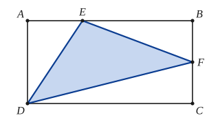

# Đề thi thử số 9

**Thời gian làm bài:** 90 phút. **Thang điểm:** mỗi câu 1 điểm, tổng 10 điểm.

## Đề bài

**Câu 1 (Tính nhanh).** Tính: $\dfrac{1}{1 \times 2} + \dfrac{1}{2 \times 3} + \dfrac{1}{3 \times 4} + \dots + \dfrac{1}{99 \times 100}$.

**Câu 2 (Cấu tạo số).** Tìm số tự nhiên lớn nhất có các chữ số khác nhau mà tích các chữ số của nó bằng 120.

**Câu 3 (Chia có dư).** Tìm số tự nhiên nhỏ nhất chia cho 7 dư 3 và chia cho 5 dư 2.

**Câu 4 (Tổng phân số).** Tính: $\dfrac{2}{3} + \dfrac{2}{15} + \dfrac{2}{35} + \dfrac{2}{63} + \dfrac{2}{99}$.

**Câu 5 (Tuổi).** Năm nay tuổi anh gấp 3 lần tuổi em. Sau 5 năm nữa, tổng số tuổi của hai anh em là 30 tuổi.
a) Tính tuổi mỗi người năm nay. b) Sau bao nhiêu năm nữa thì tuổi anh gấp đôi tuổi em?

**Câu 6 (Cỏ tươi, cỏ khô).** 100 kg cỏ tươi có tỉ lệ nước 70%. Phơi khô thì tỉ lệ nước còn 25%. Hỏi được bao nhiêu ki-lô-gam cỏ khô?

**Câu 7 (Dòng nước).** Một ca nô đi xuôi dòng từ A đến B hết 4 giờ, đi ngược dòng từ B về A hết 5 giờ. Vận tốc dòng nước là 2 km/giờ. Tính quãng sông $AB$.

**Câu 8 (Công việc).** Ba người làm một công việc. Làm một mình thì người thứ nhất mất 9 ngày, người thứ hai mất 18 ngày, người thứ ba mất 6 ngày. Người thứ nhất và người thứ hai cùng làm 2 ngày, sau đó người thứ ba cùng làm với họ. Hỏi công việc xong sau tất cả bao nhiêu ngày?

**Câu 9 (Diện tích).** Hình chữ nhật $ABCD$ có $AB = 12$ cm, $BC = 6$ cm. $E$ nằm trên $AB$ với $AE = \dfrac{1}{3} AB$; $F$ là trung điểm của $BC$. Tính diện tích tam giác $DEF$.

**Câu 10 (Dirichlet).** Lớp 5A có 40 học sinh. Điểm kiểm tra của mỗi bạn là một số tự nhiên từ 5 đến 10. Chứng tỏ rằng có ít nhất 7 bạn có điểm bằng nhau.

---

## Lời giải chi tiết

### Câu 1
$1 - \dfrac{1}{100} = \dfrac{99}{100}$.

### Câu 2
Muốn số lớn nhất, trước hết số phải có nhiều chữ số nhất. $120 = 1 \times 2 \times 3 \times 4 \times 5$ dùng được 5 chữ số khác nhau. Không thể có 6 chữ số khác nhau có tích 120 (tích sáu chữ số khác nhau khác 0 nhỏ nhất là $1 \times 2 \times 3 \times 4 \times 5 \times 6 = 720$; còn có chữ số 0 thì tích bằng 0).
Xếp từ lớn đến bé: 54 321.

### Câu 3
Các số chia 7 dư 3: 3, 10, 17, 24, … Số đầu tiên chia 5 dư 2 là 17.

**Đáp số:** 17.

### Câu 4
$\dfrac{2}{1 \times 3} + \dfrac{2}{3 \times 5} + \dots + \dfrac{2}{9 \times 11} = 1 - \dfrac{1}{11} = \dfrac{10}{11}$.

### Câu 5
a) Tổng tuổi năm nay: $30 - 10 = 20$. Em 1 phần, anh 3 phần, tổng 4 phần: em 5 tuổi, anh 15 tuổi.
b) Hiệu số tuổi luôn là 10. Khi anh gấp đôi em thì tuổi em bằng hiệu, tức là 10 tuổi. Sau $10 - 5 = 5$ năm.

### Câu 6
Chất khô: $100 \times 30 : 100 = 30$ (kg), chiếm 75% cỏ khô. Cỏ khô: $30 : 75 \times 100 = 40$ (kg).

### Câu 7
Xuôi hơn ngược $2 \times 2 = 4$ (km/giờ). Mỗi giờ xuôi đi $\dfrac{1}{4}$ quãng sông, ngược đi $\dfrac{1}{5}$ quãng sông, chênh $\dfrac{1}{20}$ quãng sông, ứng với 4 km.
Quãng sông: $4 \times 20 = 80$ (km).

### Câu 8
Người một và hai mỗi ngày làm $\dfrac{1}{9} + \dfrac{1}{18} = \dfrac{1}{6}$; 2 ngày được $\dfrac{1}{3}$, còn $\dfrac{2}{3}$.
Ba người mỗi ngày làm $\dfrac{1}{6} + \dfrac{1}{6} = \dfrac{1}{3}$; làm nốt trong $\dfrac{2}{3} : \dfrac{1}{3} = 2$ ngày.
Tổng cộng: 4 ngày.

### Câu 9

*Hình: Hình chữ nhật ABCD 12 cm × 6 cm, E trên AB, F trên BC.*

$AE = 4$, $EB = 8$, $BF = FC = 3$ (cm). $S_{ABCD} = 72$.
$S_{ADE} = 4 \times 6 : 2 = 12$; $S_{EBF} = 8 \times 3 : 2 = 12$; $S_{FCD} = 3 \times 12 : 2 = 18$.
$S_{DEF} = 72 - 12 - 12 - 18 = 30 \text{ (cm}^2)$.

### Câu 10
Có 6 mức điểm: 5, 6, 7, 8, 9, 10. Nếu mỗi mức có nhiều nhất 6 bạn thì lớp có nhiều nhất 36 bạn, ít hơn 40. Vậy có mức điểm có từ 7 bạn trở lên.
