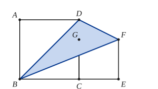

# Đề thi thử số 10

**Thời gian làm bài:** 90 phút. **Thang điểm:** mỗi câu 1 điểm, tổng 10 điểm.

## Đề bài

**Câu 1 (Tính nhanh).** Tính: $\left(1 + \dfrac{1}{2}\right) \times \left(1 + \dfrac{1}{3}\right) \times \left(1 + \dfrac{1}{4}\right) \times \dots \times \left(1 + \dfrac{1}{99}\right)$.

**Câu 2 (Cấu tạo số).** Tìm số $\overline{abc}$ biết $\overline{abc} + \overline{ab} + a = 543$.

**Câu 3 (Chữ số tận cùng).** Tích của 2 025 thừa số 2 (tức $2 \times 2 \times \dots \times 2$) có chữ số tận cùng là chữ số nào?

**Câu 4 (Phân số).** Tìm phân số $\dfrac{a}{b}$ có $a + b = 35$, biết rằng nếu cộng thêm 6 vào tử số và cộng thêm 8 vào mẫu số thì giá trị phân số không đổi.

**Câu 5 (Tuổi).** Tuổi con hiện nay bằng $\dfrac{1}{4}$ tuổi mẹ. Cách đây 4 năm, tuổi con bằng $\dfrac{1}{7}$ tuổi mẹ. Tính tuổi mỗi người hiện nay.

**Câu 6 (Góp vốn).** Hai người góp vốn kinh doanh theo tỉ lệ $3 : 2$. Sau một năm, tiền lãi bằng 25% tổng số vốn và bằng 10 000 000 đồng. Tính tổng số vốn và số tiền lãi mỗi người được chia (chia theo tỉ lệ góp vốn).

**Câu 7 (Vận tốc trung bình).** Hai người cùng đi từ A đến B. Người thứ nhất đi nửa **thời gian** đầu với vận tốc 5 km/giờ, nửa thời gian sau với vận tốc 4 km/giờ. Người thứ hai đi nửa **quãng đường** đầu với vận tốc 4 km/giờ, nửa quãng đường sau với vận tốc 5 km/giờ. Ai đến B trước?

**Câu 8 (Công việc).** Một đội 12 công nhân dự định làm xong một công việc trong 10 ngày. Làm được 4 ngày thì 4 người chuyển đi làm việc khác. Hỏi đội phải làm thêm bao nhiêu ngày nữa mới xong? (Năng suất mỗi người như nhau.)

**Câu 9 (Diện tích).** Hai hình vuông $ABCD$ cạnh 6 cm và $CEFG$ cạnh 4 cm đặt cạnh nhau sao cho $B, C, E$ thẳng hàng và $G$ nằm trên $CD$. Tính diện tích tam giác $BDF$.

**Câu 10 (Đếm).** Có bao nhiêu số có ba chữ số mà tổng các chữ số bằng 5?

---

## Lời giải chi tiết

### Câu 1
$\dfrac{3}{2} \times \dfrac{4}{3} \times \dfrac{5}{4} \times \dots \times \dfrac{100}{99} = \dfrac{100}{2} = 50$.

### Câu 2
$\overline{abc} + \overline{ab} + a = a \times 111 + b \times 11 + c = 543$.
Phần $b \times 11 + c$ không quá $9 \times 11 + 9 = 108$, nên $a = 4$, còn $543 - 444 = 99$. Khi đó $b \times 11 + c = 99$, với $c \le 9$ được $b = 9$, $c = 0$.

**Đáp số:** 490. Thử lại: $490 + 49 + 4 = 543$.

### Câu 3
Chữ số tận cùng của các tích $2, 2 \times 2, 2 \times 2 \times 2, \dots$ lần lượt là 2, 4, 8, 6, 2, 4, 8, 6, … lặp lại sau mỗi 4 thừa số.
$2\,025 = 4 \times 506 + 1$, nên tích có chữ số tận cùng giống tích của 1 thừa số 2.

**Đáp số:** chữ số 2.

### Câu 4
$\dfrac{a}{b} = \dfrac{a + 6}{b + 8}$. Phân số $\dfrac{6}{8}$ "thêm vào" không làm đổi giá trị nên $\dfrac{a}{b} = \dfrac{6}{8} = \dfrac{3}{4}$.
(Giải thích: nếu $\dfrac{a}{b} = \dfrac{3}{4}$, tức $a = 3k$, $b = 4k$, thì $\dfrac{3k + 6}{4k + 8} = \dfrac{3 \times (k + 2)}{4 \times (k + 2)} = \dfrac{3}{4}$.)
Với $a + b = 35$: tử 3 phần, mẫu 4 phần, một phần là 5. Phân số: $\dfrac{15}{20}$.

### Câu 5
Hiện nay hiệu số tuổi bằng 3 lần tuổi con. Cách đây 4 năm hiệu số tuổi bằng 6 lần tuổi con lúc đó. Hiệu không đổi, nên tuổi con hiện nay gấp đôi tuổi con cách đây 4 năm, tức là tăng thêm 4 tuổi đúng bằng tuổi con cách đây 4 năm.
Tuổi con cách đây 4 năm: 4 tuổi; hiện nay: 8 tuổi. Tuổi mẹ: 32 tuổi.

**Đáp số:** con 8 tuổi, mẹ 32 tuổi. Thử lại: 4 năm trước con 4 tuổi, mẹ 28 tuổi $= 7 \times 4$.

### Câu 6
Tổng số vốn: $10\,000\,000 : 25 \times 100 = 40\,000\,000$ (đồng).
Tiền lãi chia theo tỉ lệ $3 : 2$: người thứ nhất $10\,000\,000 : 5 \times 3 = 6\,000\,000$ đồng, người thứ hai $4\,000\,000$ đồng.

### Câu 7
Người thứ nhất: hai nửa thời gian bằng nhau nên vận tốc trung bình $(5 + 4) : 2 = 4{,}5$ km/giờ.
Người thứ hai: đi 1 km nửa đầu hết $\dfrac{1}{4}$ giờ, nửa sau hết $\dfrac{1}{5}$ giờ. Đi 2 km hết $\dfrac{9}{20}$ giờ, vận tốc trung bình $2 : \dfrac{9}{20} = \dfrac{40}{9} = 4\dfrac{4}{9}$ km/giờ, nhỏ hơn $4{,}5$.
Vậy **người thứ nhất** đến B trước.

### Câu 8
Công việc cần $12 \times 10 = 120$ (ngày công). Sau 4 ngày làm được 48 ngày công, còn 72 ngày công.
8 người làm nốt trong $72 : 8 = 9$ (ngày).

**Đáp số:** 9 ngày nữa.

### Câu 9

*Hình: Hình vuông ABCD cạnh 6 cm và hình vuông CEFG cạnh 4 cm đặt cạnh nhau.*

Bao tam giác $BDF$ bằng hình chữ nhật $BEKA$ có chiều dài $BE = 6 + 4 = 10$ cm và chiều cao $AB = 6$ cm ($K$ là điểm trên đường thẳng $AD$ kéo dài, thẳng phía trên $E$). Diện tích hình chữ nhật: $10 \times 6 = 60 \text{ (cm}^2)$.
Tam giác $BDF$ bằng hình chữ nhật đó bớt đi ba tam giác vuông ở ba góc:
- Tam giác $ABD$ (vuông tại $A$): $6 \times 6 : 2 = 18$.
- Tam giác $BEF$ (vuông tại $E$): $BE = 10$, $EF = 4$, diện tích $10 \times 4 : 2 = 20$.
- Tam giác $DKF$ (vuông tại $K$): $DK = 10 - 6 = 4$, $KF = 6 - 4 = 2$, diện tích $4 \times 2 : 2 = 4$.

$S_{BDF} = 60 - 18 - 20 - 4 = 18 \text{ (cm}^2)$.

**Đáp số:** $18 \text{ cm}^2$ (đúng bằng nửa diện tích hình vuông lớn).

### Câu 10
Gọi số đó là $\overline{abc}$, $a \ge 1$, $a + b + c = 5$.
- $a = 1$: $b + c = 4$ có 5 cách. $a = 2$: $b + c = 3$ có 4 cách. $a = 3$: 3 cách. $a = 4$: 2 cách. $a = 5$: 1 cách.

Tổng: $5 + 4 + 3 + 2 + 1 = 15$ (số).
