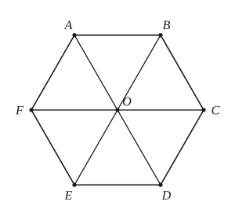
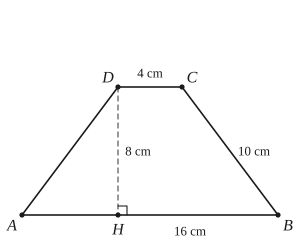
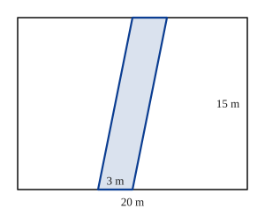
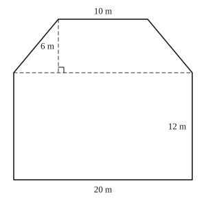
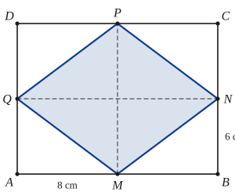

# Chủ đề 4. Các hình phẳng trong thực tiễn

> Chủ đề này giúp nhận biết các hình quen thuộc (tam giác đều, hình vuông, lục giác đều, hình chữ nhật, hình thoi, hình bình hành, hình thang cân), nắm đặc điểm về cạnh, góc, đường chéo và tính chu vi, diện tích. Trong đề kiểm tra thường có bài tính diện tích mảnh vườn, nền nhà, số viên gạch, số tiền làm hàng rào.

## I. Kiến thức cần nắm

### 1. Tam giác đều, hình vuông, lục giác đều
| Hình | Cạnh | Góc | Đường chéo |
|---|---|---|---|
| Tam giác đều $ABC$ | ba cạnh bằng nhau | ba góc bằng nhau, mỗi góc $60^\circ$ | không có |
| Hình vuông $ABCD$ | bốn cạnh bằng nhau, cạnh đối song song | bốn góc vuông | hai đường chéo bằng nhau |
| Lục giác đều $ABCDEF$ | sáu cạnh bằng nhau | sáu góc bằng nhau | ba đường chéo chính $AD, BE, CF$ bằng nhau, cắt nhau tại tâm $O$ |

- Lục giác đều được ghép từ **sáu tam giác đều** chung đỉnh $O$. Vì vậy đường chéo chính dài gấp đôi cạnh, và chu vi lục giác đều cạnh $a$ là $6a$.
- Vẽ bằng thước và compa: tam giác đều cạnh $a$ (vẽ đoạn $BC = a$, hai cung tròn tâm $B$, tâm $C$ bán kính $a$ cắt nhau tại $A$); hình vuông dùng ê ke để dựng góc vuông.

### 2. Hình chữ nhật, hình thoi, hình bình hành, hình thang cân
| Hình | Cạnh | Góc | Đường chéo |
|---|---|---|---|
| Hình chữ nhật | các cạnh đối song song và bằng nhau | bốn góc vuông | bằng nhau, cắt nhau tại điểm chính giữa mỗi đường |
| Hình thoi | bốn cạnh bằng nhau, cạnh đối song song | các góc đối bằng nhau | vuông góc với nhau, cắt nhau tại điểm chính giữa mỗi đường |
| Hình bình hành | các cạnh đối song song và bằng nhau | các góc đối bằng nhau | cắt nhau tại điểm chính giữa mỗi đường |
| Hình thang cân | hai đáy song song, hai cạnh bên bằng nhau | hai góc kề một đáy bằng nhau | hai đường chéo bằng nhau |

- Hình vuông vừa là hình chữ nhật, vừa là hình thoi. Hình chữ nhật và hình thoi đều là hình bình hành đặc biệt.

### 3. Công thức chu vi và diện tích
| Hình | Chu vi | Diện tích |
|---|---|---|
| Hình vuông cạnh $a$ | $C = 4a$ | $S = a^2$ |
| Hình chữ nhật dài $a$, rộng $b$ | $C = 2(a + b)$ | $S = a \cdot b$ |
| Hình bình hành cạnh $a, b$; đáy $a$, chiều cao $h$ | $C = 2(a + b)$ | $S = a \cdot h$ |
| Hình thoi cạnh $a$, đường chéo $m, n$ | $C = 4a$ | $S = \dfrac{m \cdot n}{2}$ |
| Hình thang đáy $a, b$, chiều cao $h$ | tổng bốn cạnh | $S = \dfrac{(a + b) \cdot h}{2}$ |
| Tam giác đáy $a$, chiều cao $h$ | tổng ba cạnh | $S = \dfrac{a \cdot h}{2}$ |

**Vì sao diện tích hình thoi bằng nửa tích hai đường chéo?** Vẽ hình chữ nhật có hai cạnh bằng hai đường chéo $m, n$, bao quanh hình thoi. Hai đường chéo chia hình chữ nhật thành bốn hình chữ nhật nhỏ, mỗi hình bị cạnh hình thoi cắt đôi. Do đó hình thoi chiếm đúng một nửa: $S = \dfrac{m \cdot n}{2}$.

**Ví dụ.** Hình thoi có hai đường chéo $10$ cm và $16$ cm: $S = \dfrac{10 \cdot 16}{2} = 80\ (\text{cm}^2)$.

### 4. Các dạng toán thực tế
- **Rào xung quanh:** chiều dài hàng rào bằng chu vi, trừ phần để cửa (nếu có).
- **Lát gạch, trải thảm:** số viên $=$ diện tích nền $:$ diện tích một viên (đổi cùng đơn vị). Nếu kích thước nền chia hết cho cạnh viên gạch thì có thể đếm theo hàng: (số viên theo chiều dài) $\times$ (số viên theo chiều rộng).
- **Hình ghép:** chia hình thành các hình quen thuộc (hoặc bù thêm rồi trừ đi), tính diện tích từng phần rồi cộng (trừ).
- **Tiền chi phí:** số tiền $=$ (số mét, số mét vuông hoặc số viên) $\times$ đơn giá.

**Đổi đơn vị diện tích:** $1\ \text{m}^2 = 100\ \text{dm}^2 = 10\,000\ \text{cm}^2$.

### 5. Sai lầm hay gặp
- Tính diện tích hình bình hành bằng tích hai cạnh. Đúng là **đáy nhân chiều cao** tương ứng.
- Quên chia $2$ trong công thức hình thoi, hình thang, tam giác.
- Nhân hai kích thước khác đơn vị (m với cm). Phải đổi về cùng đơn vị trước.
- Nhầm chu vi với diện tích: chu vi đo bằng m, cm; diện tích đo bằng $\text{m}^2$, $\text{cm}^2$.

## II. Bài tập vận dụng

**Bài 1 (lục giác đều).** Cho lục giác đều $ABCDEF$ có ba đường chéo chính $AD, BE, CF$ cắt nhau tại $O$.
a) Kể tên các tam giác đều có một đỉnh là $O$.
b) Biết $AB = 4$ cm. Tính độ dài đường chéo $AD$ và chu vi lục giác.

**Bài 2.** a) Tính chu vi và diện tích hình chữ nhật có chiều dài $12$ m, chiều rộng $7$ m.
b) Tính chu vi và diện tích hình vuông cạnh $9$ cm.
c) Một hình vuông có chu vi $48$ cm. Tính diện tích hình vuông đó.

**Bài 3.** a) Tính diện tích hình thoi có hai đường chéo dài $10$ cm và $16$ cm.
b) Tính diện tích hình bình hành có cạnh đáy $15$ cm và chiều cao tương ứng $8$ cm.

**Bài 4 (hình thang cân).** Hình thang cân $ABCD$ có đáy lớn $AB = 16$ cm, đáy nhỏ $CD = 4$ cm, cạnh bên $AD = BC = 10$ cm và chiều cao $8$ cm. Tính chu vi và diện tích hình thang.

**Bài 5 (thực tế, hàng rào).** Một mảnh vườn hình chữ nhật có chiều dài $25$ m, chiều rộng $16$ m. Người ta rào xung quanh vườn, chừa một cổng rộng $3$ m. Mỗi mét hàng rào giá $80\,000$ đồng. Tính diện tích mảnh vườn và số tiền làm hàng rào.

**Bài 6 (thực tế, lát gạch).** Nền một căn phòng hình chữ nhật dài $6$ m, rộng $4$ m được lát bằng gạch hình vuông cạnh $40$ cm. Hỏi cần bao nhiêu viên gạch? Mỗi viên giá $25\,000$ đồng thì tiền mua gạch là bao nhiêu?

**Bài 7 (thực tế, lối đi).** Một mảnh vườn hình chữ nhật dài $20$ m, rộng $15$ m. Người ta làm một lối đi hình bình hành cắt ngang vườn: hai cạnh đáy của lối đi nằm trên hai chiều dài của vườn, mỗi cạnh đáy dài $3$ m. Phần còn lại dùng để trồng hoa. Tính diện tích trồng hoa.

**Bài 8 (thực tế, cánh diều).** Bạn Nam làm một cánh diều hình thoi bằng hai thanh tre đặt vuông góc làm hai đường chéo, dài $60$ cm và $80$ cm. Mỗi cạnh của cánh diều dài $50$ cm.
a) Tính diện tích giấy cần dùng để dán kín cánh diều.
b) Nam dùng dây ruy băng viền quanh cánh diều. Cần bao nhiêu xăng-ti-mét ruy băng?

**Bài 9 (thực tế, lục giác đều).** Một viên gạch lát hình lục giác đều có cạnh $10$ cm, được ghép từ sáu tam giác đều. Mỗi tam giác đều có chiều cao khoảng $8{,}7$ cm. Tính gần đúng diện tích viên gạch.

**Bài 10 (hình ghép).** Một mảnh đất gồm một hình chữ nhật dài $20$ m, rộng $12$ m và một hình thang cân ghép phía trên, có đáy lớn là chiều dài $20$ m của hình chữ nhật, đáy nhỏ $10$ m, chiều cao $6$ m. Tính diện tích mảnh đất.

**Bài 11 (so sánh diện tích).** Một hình chữ nhật dài $15$ m, rộng $9$ m và một hình vuông có cùng chu vi với hình chữ nhật đó. Hình nào có diện tích lớn hơn và lớn hơn bao nhiêu mét vuông?

**Bài 12.** Một hình chữ nhật có chu vi $56$ cm. Nếu tăng chiều rộng thêm $4$ cm và giảm chiều dài đi $4$ cm thì được một hình vuông. Tính diện tích hình chữ nhật ban đầu.

**Bài 13.** Hình chữ nhật $ABCD$ có $AB = 8$ cm, $BC = 6$ cm. Gọi $M, N, P, Q$ lần lượt là điểm chính giữa các cạnh $AB, BC, CD, DA$. Tứ giác $MNPQ$ là hình thoi. Tính diện tích hình thoi $MNPQ$ và tổng diện tích bốn tam giác ở bốn góc hình chữ nhật.

## III. Lời giải chi tiết

### Bài 1

*Hình: Lục giác đều ABCDEF tâm O ghép từ sáu tam giác đều.*

a) Sáu tam giác đều có đỉnh $O$ là $OAB$, $OBC$, $OCD$, $ODE$, $OEF$, $OFA$.

b) Vì các tam giác $OAB$, $ODE$ đều nên $OA = OD = AB = 4$ cm. Do đó $AD = OA + OD = 8$ cm.
Chu vi lục giác: $6 \cdot 4 = 24$ (cm).

### Bài 2
a) $C = 2 \cdot (12 + 7) = 38$ (m); $\ S = 12 \cdot 7 = 84\ (\text{m}^2)$.

b) $C = 4 \cdot 9 = 36$ (cm); $\ S = 9^2 = 81\ (\text{cm}^2)$.

c) Cạnh hình vuông: $48 : 4 = 12$ (cm). Diện tích: $12^2 = 144\ (\text{cm}^2)$.

### Bài 3
a) $S = \dfrac{10 \cdot 16}{2} = 80\ (\text{cm}^2)$.

b) $S = 15 \cdot 8 = 120\ (\text{cm}^2)$.

### Bài 4

*Hình: Hình thang cân ABCD, đáy lớn AB = 16 cm, đáy nhỏ CD = 4 cm, chiều cao DH = 8 cm.*

Chu vi: $AB + BC + CD + DA = 16 + 10 + 4 + 10 = 40$ (cm).
Diện tích: $S = \dfrac{(16 + 4) \cdot 8}{2} = 80\ (\text{cm}^2)$.

*Nhận xét:* tính diện tích hình thang dùng **chiều cao** ($8$ cm), không dùng cạnh bên ($10$ cm).

### Bài 5
Diện tích vườn: $25 \cdot 16 = 400\ (\text{m}^2)$.
Chu vi vườn: $2 \cdot (25 + 16) = 82$ (m). Chiều dài hàng rào: $82 - 3 = 79$ (m).
Tiền làm hàng rào: $79 \cdot 80\,000 = 6\,320\,000$ (đồng).

### Bài 6
Đổi $6$ m $= 600$ cm, $4$ m $= 400$ cm.
Theo chiều dài xếp được $600 : 40 = 15$ viên, theo chiều rộng $400 : 40 = 10$ viên. Số viên gạch: $15 \cdot 10 = 150$ (viên).

*Cách khác:* diện tích nền $600 \cdot 400 = 240\,000\ (\text{cm}^2)$, diện tích một viên $40 \cdot 40 = 1\,600\ (\text{cm}^2)$, số viên $240\,000 : 1\,600 = 150$.

Tiền mua gạch: $150 \cdot 25\,000 = 3\,750\,000$ (đồng).

### Bài 7

*Hình: Mảnh vườn hình chữ nhật 20 m × 15 m có lối đi hình bình hành đáy 3 m.*

Diện tích vườn: $20 \cdot 15 = 300\ (\text{m}^2)$.
Hai cạnh đáy của lối đi nằm trên hai chiều dài của vườn, nên chiều cao của hình bình hành bằng chiều rộng vườn, $15$ m. Diện tích lối đi: $3 \cdot 15 = 45\ (\text{m}^2)$.
Diện tích trồng hoa: $300 - 45 = 255\ (\text{m}^2)$.

### Bài 8
a) Diện tích cánh diều: $S = \dfrac{60 \cdot 80}{2} = 2\,400\ (\text{cm}^2)$.

b) Chiều dài ruy băng bằng chu vi hình thoi: $4 \cdot 50 = 200$ (cm).

### Bài 9
Diện tích một tam giác đều: khoảng $\dfrac{10 \cdot 8{,}7}{2} = 43{,}5\ (\text{cm}^2)$.
Diện tích viên gạch: khoảng $6 \cdot 43{,}5 = 261\ (\text{cm}^2)$.

### Bài 10

*Hình: Mảnh đất gồm hình chữ nhật 20 m × 12 m và hình thang cân đáy 20 m, 10 m, cao 6 m.*

Diện tích phần hình chữ nhật: $20 \cdot 12 = 240\ (\text{m}^2)$.
Diện tích phần hình thang cân: $\dfrac{(20 + 10) \cdot 6}{2} = 90\ (\text{m}^2)$.
Diện tích mảnh đất: $240 + 90 = 330\ (\text{m}^2)$.

*Nhận xét:* với hình ghép, chia hình thành các hình đã biết công thức, tính từng phần rồi cộng lại.

### Bài 11
Chu vi hình chữ nhật: $2 \cdot (15 + 9) = 48$ (m). Cạnh hình vuông: $48 : 4 = 12$ (m).
Diện tích hình vuông: $12^2 = 144\ (\text{m}^2)$; diện tích hình chữ nhật: $15 \cdot 9 = 135\ (\text{m}^2)$.
Hình vuông có diện tích lớn hơn, lớn hơn $144 - 135 = 9\ (\text{m}^2)$.

*Nhận xét:* trong các hình chữ nhật có cùng chu vi, hình vuông có diện tích lớn nhất.

### Bài 12
Nửa chu vi (tổng chiều dài và chiều rộng): $56 : 2 = 28$ (cm).
Sau khi thay đổi được hình vuông, tức là chiều dài trừ $4$ bằng chiều rộng cộng $4$. Vậy chiều dài hơn chiều rộng $4 + 4 = 8$ (cm).
Bài toán tổng – hiệu: chiều dài $= (28 + 8) : 2 = 18$ (cm), chiều rộng $= 28 - 18 = 10$ (cm).
Diện tích hình chữ nhật ban đầu: $18 \cdot 10 = 180\ (\text{cm}^2)$.

*Thử lại:* $18 - 4 = 14$ và $10 + 4 = 14$, đúng là hình vuông.

### Bài 13

*Hình: Hình thoi MNPQ có các đỉnh là điểm chính giữa các cạnh của hình chữ nhật ABCD.*

Đường chéo $MP$ nối điểm chính giữa của $AB$ và $CD$ nên $MP = BC = 6$ cm. Đường chéo $QN$ nối điểm chính giữa của $DA$ và $BC$ nên $QN = AB = 8$ cm.
Diện tích hình thoi: $S = \dfrac{6 \cdot 8}{2} = 24\ (\text{cm}^2)$.
Diện tích hình chữ nhật: $8 \cdot 6 = 48\ (\text{cm}^2)$. Tổng diện tích bốn tam giác ở góc: $48 - 24 = 24\ (\text{cm}^2)$.

*Nhận xét:* hình thoi chiếm đúng một nửa hình chữ nhật, đúng như cách giải thích công thức $S = \dfrac{m \cdot n}{2}$ ở phần I.
