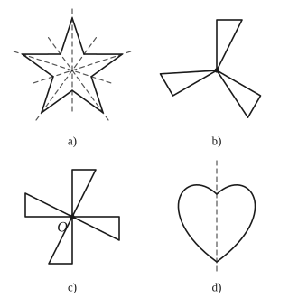
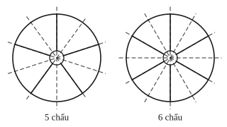
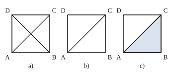

# Chủ đề 5. Tính đối xứng của hình phẳng

> Chủ đề này giúp nhận biết hình có trục đối xứng, hình có tâm đối xứng và đếm số trục đối xứng của các hình quen thuộc. Tính đối xứng xuất hiện khắp nơi: chữ cái, logo, bánh xe, hoa văn, kiến trúc. Trong đề kiểm tra thường có câu nhận biết trên chữ cái, hình học và câu vận dụng gấp giấy, tính độ dài, diện tích nhờ tính đối xứng.

## I. Kiến thức cần nắm

### 1. Hình có trục đối xứng
- Một hình có **trục đối xứng** $d$ nếu khi gấp hình theo đường thẳng $d$, hai phần của hình **chồng khít** lên nhau.
- Mỗi điểm của hình có một điểm "đối diện" qua $d$ cũng thuộc hình; hai phần hai bên trục có hình dạng và kích thước như nhau.
- Một hình có thể không có, có một, có nhiều hoặc có vô số trục đối xứng.

**Cách kiểm tra:** tưởng tượng (hoặc thực sự) gấp hình theo đường thẳng; nếu hai nửa trùng khít thì đó là trục đối xứng.

### 2. Số trục đối xứng của các hình quen thuộc
| Hình | Số trục đối xứng | Trục đối xứng là |
|---|---|---|
| Tam giác đều | $3$ | đường thẳng qua một đỉnh và điểm chính giữa cạnh đối diện |
| Hình vuông | $4$ | hai đường chéo và hai đường nối điểm chính giữa hai cạnh đối |
| Hình chữ nhật (không vuông) | $2$ | hai đường nối điểm chính giữa hai cạnh đối |
| Hình thoi (không vuông) | $2$ | hai đường chéo |
| Hình thang cân | $1$ | đường nối điểm chính giữa hai đáy |
| Hình bình hành (không phải hình chữ nhật, hình thoi) | $0$ | không có |
| Lục giác đều | $6$ | ba đường chéo chính và ba đường nối điểm chính giữa hai cạnh đối |
| Hình tròn | vô số | mọi đường thẳng đi qua tâm |

**Sai lầm hay gặp:** cho rằng đường chéo của hình chữ nhật là trục đối xứng. Gấp hình chữ nhật theo đường chéo, hai nửa **không** chồng khít.

### 3. Hình có tâm đối xứng
- Một hình có **tâm đối xứng** $O$ nếu khi quay hình **nửa vòng** ($180^\circ$) quanh điểm $O$, hình trùng với chính nó ở vị trí ban đầu.
- Mỗi điểm của hình có một điểm "đối diện" qua $O$ cũng thuộc hình, và $O$ nằm chính giữa hai điểm đó.
- Một hình có nhiều nhất **một** tâm đối xứng.

| Hình | Có tâm đối xứng? | Tâm đối xứng |
|---|---|---|
| Hình chữ nhật, hình vuông, hình thoi, hình bình hành | có | giao điểm hai đường chéo |
| Lục giác đều | có | giao điểm ba đường chéo chính |
| Hình tròn | có | tâm hình tròn |
| Tam giác đều, hình thang cân | không | |

**Hệ quả:** tâm đối xứng của hình bình hành (hình chữ nhật, hình thoi, hình vuông) là điểm chính giữa mỗi đường chéo, nên $OA = OC$, $OB = OD$.

### 4. Trục đối xứng và tâm đối xứng là hai tính chất khác nhau
- Hình bình hành có tâm đối xứng nhưng **không** có trục đối xứng.
- Tam giác đều, hình thang cân có trục đối xứng nhưng **không** có tâm đối xứng.
- Hình chữ nhật, hình vuông, hình thoi, lục giác đều, hình tròn có cả hai.
- Một hình có hai trục đối xứng vuông góc với nhau thì có tâm đối xứng là giao điểm hai trục (ví dụ chữ H, hình chữ nhật).

**Chữ cái in hoa (kiểu chữ thông thường):**
| Loại | Chữ cái |
|---|---|
| có trục đối xứng thẳng đứng | A, H, I, M, O, T, U, V, W, X, Y |
| có trục đối xứng nằm ngang | B, C, D, E, H, I, K, O, X |
| có tâm đối xứng | H, I, N, O, S, X, Z |

*Lưu ý:* kết quả có thể khác đi với kiểu chữ trang trí.

### 5. Đối xứng trong thực tiễn
- Gấp đôi tờ giấy rồi cắt, khi mở ra được hình nhận **nếp gấp làm trục đối xứng**. Gấp tư (hai nếp vuông góc) rồi cắt được hình có ít nhất hai trục đối xứng và có tâm đối xứng.
- Bánh xe có $n$ nan hoa đều nhau có $n$ trục đối xứng; có tâm đối xứng khi $n$ chẵn.
- Diện tích hai phần ở hai bên trục đối xứng bằng nhau; hai đoạn thẳng đối xứng với nhau thì bằng nhau.

## II. Bài tập vận dụng

**Bài 1.** Trong các chữ cái in hoa H, A, N, O, T, S, E, Z (kiểu chữ thông thường):
a) chữ nào có trục đối xứng?
b) chữ nào có tâm đối xứng?
c) chữ nào có cả trục đối xứng và tâm đối xứng?

**Bài 2.** Mỗi hình sau có bao nhiêu trục đối xứng: tam giác đều, hình vuông, hình chữ nhật (không vuông), hình thoi (không vuông), hình thang cân, hình bình hành (không phải hình chữ nhật, hình thoi), lục giác đều, hình tròn?

**Bài 3.** Trong các hình ở Bài 2, hình nào có tâm đối xứng? Chỉ ra tâm đối xứng của mỗi hình đó.

**Bài 4 (gấp hình).** a) Một tờ giấy hình chữ nhật có kích thước $6$ cm $\times$ $4$ cm. Gấp tờ giấy theo từng trục đối xứng của nó. Mỗi lần gấp được hình chữ nhật có kích thước bao nhiêu?
b) Gấp một tờ giấy hình vuông cạnh $6$ cm theo một đường chéo. Hình nhận được là hình gì và có diện tích bao nhiêu?

**Bài 5 (nhận biết qua hình vẽ).** Xét bốn hình: a) ngôi sao năm cánh đều; b) chong chóng ba cánh (ba cánh tam giác giống nhau, cùng xoay theo một chiều); c) chong chóng bốn cánh (bốn cánh tam giác giống nhau, cùng xoay theo một chiều, chung tâm $O$); d) hình trái tim. Hình nào có trục đối xứng (bao nhiêu trục)? Hình nào có tâm đối xứng?

**Bài 6 (đúng hay sai).** Mỗi khẳng định sau đúng hay sai? Giải thích.
a) Hình có tâm đối xứng thì có trục đối xứng.
b) Tam giác đều có tâm đối xứng.
c) Hình chữ nhật có bốn trục đối xứng.
d) Mỗi đường thẳng đi qua tâm của hình tròn là một trục đối xứng của hình tròn.

**Bài 7 (thực tế, cắt giấy).** a) Bạn An gấp đôi một tờ giấy rồi cắt theo một đường bất kì. Khi mở ra, hình cắt được có tính chất gì? Nếp gấp đóng vai trò gì?
b) Bạn Bình gấp tờ giấy làm tư bằng hai nếp gấp vuông góc với nhau, rồi cắt một đường đi từ nếp gấp này sang nếp gấp kia. Hình cắt được có những tính chất đối xứng nào?

**Bài 8 (thực tế, bánh xe).** Một bánh xe có $5$ nan hoa giống nhau, chia đều vòng tròn; một bánh xe khác có $6$ nan hoa như vậy. Mỗi bánh xe (chỉ xét vành, trục và các nan) có bao nhiêu trục đối xứng? Bánh xe nào có tâm đối xứng?

**Bài 9.** Hình bình hành $ABCD$ có tâm đối xứng $O$. Biết $OA = 5$ cm, $OB = 3$ cm. Tính độ dài hai đường chéo $AC$ và $BD$.

**Bài 10.** a) Một hình có trục đối xứng $d$, không có phần nào nằm trên $d$ ngoài các đường viền. Phần hình nằm bên trái $d$ có diện tích $35\ \text{cm}^2$. Tính diện tích cả hình.
b) Hình thoi $ABCD$ có $AC = 10$ cm, $BD = 6$ cm. Đường chéo $AC$ là một trục đối xứng của hình thoi. Tính diện tích hình thoi và diện tích tam giác $ABC$.

**Bài 11.** Cho hình vuông $ABCD$ ($A$ ở góc dưới bên trái, các đỉnh theo chiều ngược kim đồng hồ). Tìm số trục đối xứng và cho biết có tâm đối xứng hay không, trong mỗi trường hợp:
a) hình vuông có vẽ cả hai đường chéo;
b) hình vuông chỉ vẽ một đường chéo $AC$;
c) hình vuông vẽ đường chéo $AC$ và tô màu tam giác $ABC$.

**Bài 12 (vận dụng cao).** Khi xoay tờ giấy nửa vòng, chữ số $0, 1, 8$ vẫn là chính nó, chữ số $6$ thành $9$ và $9$ thành $6$; các chữ số khác không còn là chữ số. Có bao nhiêu số tự nhiên có ba chữ số mà khi xoay tờ giấy nửa vòng vẫn được chính số đó? Liệt kê các số đó.

## III. Lời giải chi tiết

### Bài 1
a) Có trục đối xứng: H, A, O, T, E (A, T có trục thẳng đứng; E có trục nằm ngang; H, O có cả hai trục).

b) Có tâm đối xứng: H, N, O, S, Z.

c) Có cả hai: H và O.

### Bài 2
| Hình | Số trục đối xứng |
|---|---|
| Tam giác đều | $3$ |
| Hình vuông | $4$ |
| Hình chữ nhật | $2$ |
| Hình thoi | $2$ |
| Hình thang cân | $1$ |
| Hình bình hành | $0$ |
| Lục giác đều | $6$ |
| Hình tròn | vô số |

### Bài 3
Các hình có tâm đối xứng:
- hình vuông, hình chữ nhật, hình thoi, hình bình hành: tâm là giao điểm hai đường chéo;
- lục giác đều: tâm là giao điểm ba đường chéo chính;
- hình tròn: tâm là tâm hình tròn.

Tam giác đều và hình thang cân không có tâm đối xứng.

### Bài 4
a) Hình chữ nhật $6 \times 4$ có hai trục đối xứng là hai đường nối điểm chính giữa các cạnh đối.
- Gấp theo trục song song với cạnh $4$ cm: cạnh $6$ cm bị gập đôi, được hình chữ nhật $3$ cm $\times$ $4$ cm.
- Gấp theo trục song song với cạnh $6$ cm: được hình chữ nhật $6$ cm $\times$ $2$ cm.

b) Đường chéo là trục đối xứng của hình vuông, nên hai nửa chồng khít, được một **tam giác** (tam giác vuông có hai cạnh góc vuông $6$ cm). Diện tích bằng một nửa hình vuông: $\dfrac{6 \cdot 6}{2} = 18\ (\text{cm}^2)$.

### Bài 5

*Hình: Các đường nét đứt là trục đối xứng.*

a) Ngôi sao năm cánh đều có $5$ trục đối xứng (mỗi trục đi qua một đỉnh cánh và điểm lõm đối diện); không có tâm đối xứng (quay nửa vòng thì đỉnh cánh hướng lên trở thành hướng xuống).

b) Chong chóng ba cánh không có trục đối xứng (các cánh cùng xoay một chiều, gấp lại thì cánh bị lệch) và không có tâm đối xứng (quay nửa vòng, cánh hướng lên chuyển sang hướng xuống, nơi không có cánh).

c) Chong chóng bốn cánh không có trục đối xứng, nhưng có tâm đối xứng $O$: quay nửa vòng, mỗi cánh chuyển vào đúng vị trí cánh đối diện.

d) Hình trái tim có $1$ trục đối xứng (đường thẳng đứng qua chỗ lõm và mũi nhọn), không có tâm đối xứng.

*Nhận xét:* hình c cho thấy một hình có thể có tâm đối xứng mà không có trục đối xứng.

### Bài 6
a) **Sai.** Hình bình hành (không phải hình chữ nhật, hình thoi) có tâm đối xứng nhưng không có trục đối xứng.

b) **Sai.** Quay tam giác đều nửa vòng quanh bất kì điểm nào, đỉnh hướng lên trở thành hướng xuống, hình không trùng với vị trí ban đầu.

c) **Sai.** Hình chữ nhật (không vuông) chỉ có $2$ trục đối xứng; hai đường chéo không phải trục đối xứng.

d) **Đúng.** Gấp hình tròn theo bất kì đường kính nào, hai nửa chồng khít.

### Bài 7
a) Khi gấp đôi rồi cắt, hai lớp giấy được cắt cùng lúc nên hai nửa giống hệt nhau. Mở ra, hình có **trục đối xứng** chính là nếp gấp.

b) Hình cắt được có **hai trục đối xứng** là hai nếp gấp (vuông góc với nhau). Hình còn có **tâm đối xứng** là giao điểm hai nếp gấp: lật qua nếp thứ nhất rồi lật qua nếp thứ hai thì cũng như quay nửa vòng quanh giao điểm.

### Bài 8

*Hình: Bánh xe 5 nan và 6 nan; nét đứt là trục đối xứng.*

- Bánh xe $5$ nan: có $5$ trục đối xứng, mỗi trục đi qua một nan và khe chính giữa hai nan đối diện. Không có tâm đối xứng: quay nửa vòng, nan hướng lên chuyển thành hướng xuống, mà ở đó không có nan.
- Bánh xe $6$ nan: có $6$ trục đối xứng ($3$ trục đi dọc theo các cặp nan đối diện, $3$ trục đi qua khe giữa hai nan). Có tâm đối xứng là tâm bánh xe, vì mỗi nan có một nan đối diện.

### Bài 9
Tâm đối xứng $O$ của hình bình hành là giao điểm hai đường chéo và là điểm chính giữa mỗi đường chéo. Do đó $OC = OA = 5$ cm, $OD = OB = 3$ cm.
$AC = OA + OC = 10$ (cm); $\ BD = OB + OD = 6$ (cm).

### Bài 10
a) Hai phần ở hai bên trục đối xứng chồng khít nên có diện tích bằng nhau. Diện tích cả hình: $35 \cdot 2 = 70\ (\text{cm}^2)$.

b) Diện tích hình thoi: $\dfrac{10 \cdot 6}{2} = 30\ (\text{cm}^2)$.
$AC$ là trục đối xứng nên hai tam giác $ABC$ và $ADC$ chồng khít, có diện tích bằng nhau. Diện tích tam giác $ABC$: $30 : 2 = 15\ (\text{cm}^2)$.

### Bài 11

*Hình: Ba trường hợp của hình vuông ABCD.*

a) Hai đường chéo không làm thay đổi tính đối xứng của hình vuông: vẫn có $4$ trục đối xứng và có tâm đối xứng (giao điểm hai đường chéo).

b) Chỉ còn những trục giữ nguyên đường chéo $AC$:
- trục $AC$: gấp theo $AC$, đường $AC$ nằm yên. Nhận.
- trục $BD$: gấp theo $BD$, $A$ chồng lên $C$, nên đoạn $AC$ chồng lên chính nó. Nhận.
- hai đường nối điểm chính giữa các cạnh đối: gấp lại thì $AC$ chồng lên $BD$, mà $BD$ không được vẽ. Loại.

Có $2$ trục đối xứng ($AC$ và $BD$). Có tâm đối xứng: quay nửa vòng quanh tâm hình vuông, $A$ chuyển đến $C$ và $C$ chuyển đến $A$, nên đoạn $AC$ trùng với chính nó.

c) Tam giác tô màu $ABC$ phải chồng lên chính nó.
- Trục $BD$: $A$ chồng lên $C$, $B$ giữ nguyên, nên tam giác $ABC$ chồng lên tam giác $CBA$, là chính nó. Nhận.
- Trục $AC$: $B$ chồng lên $D$, tam giác $ABC$ chuyển thành tam giác $ADC$ (không tô màu). Loại.
- Quay nửa vòng: tam giác $ABC$ chuyển thành tam giác $CDA$ (không tô màu). Không có tâm đối xứng.

Có đúng $1$ trục đối xứng ($BD$) và không có tâm đối xứng.

*Nhận xét:* thêm chi tiết vào một hình thường làm **giảm** số trục đối xứng. Hãy kiểm tra từng trục của hình ban đầu xem trục nào còn giữ được.

### Bài 12
Số $\overline{abc}$ xoay nửa vòng sẽ đọc thành: (ảnh của $c$)(ảnh của $b$)(ảnh của $a$). Để được chính số đó cần:
- chữ số giữa $b$ xoay thành chính nó: $b \in \{0; 1; 8\}$, có $3$ cách;
- $c$ là ảnh của $a$: chọn $a \in \{1; 6; 8; 9\}$ ($a \ne 0$ vì là chữ số hàng trăm), có $4$ cách, khi đó $c$ được xác định ($1 \to 1$, $6 \to 9$, $8 \to 8$, $9 \to 6$).

Số các số là $4 \cdot 3 = 12$:
$$101, 111, 181, 609, 619, 689, 808, 818, 888, 906, 916, 986.$$

*Nhận xét:* khi xoay nửa vòng, thứ tự các chữ số bị **đảo ngược** và mỗi chữ số cũng bị xoay. Vì vậy $609$ xoay thành $609$, còn $696$ xoay thành $969$.
