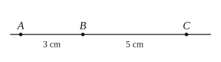
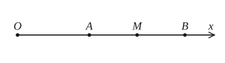
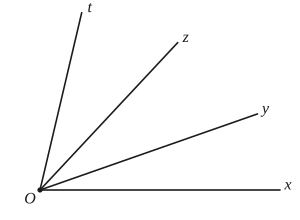
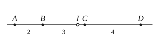

# Chủ đề 9. Những hình hình học cơ bản

> Điểm, đường thẳng, đoạn thẳng, tia, trung điểm và góc là những "viên gạch" đầu tiên của hình học. Chủ đề này dạy cách gọi tên, vẽ hình, tính độ dài đoạn thẳng, xác định trung điểm, đo và phân loại góc. Cách lập luận "điểm nằm giữa" ở đây sẽ dùng suốt các lớp sau.

## I. Kiến thức cần nắm

### 1. Điểm và đường thẳng

- Điểm đặt tên bằng chữ in hoa ($A, B, \dots$), đường thẳng bằng chữ thường ($a, d, \dots$) hoặc hai điểm thuộc nó ($AB$).
- Qua hai điểm phân biệt có **một và chỉ một** đường thẳng.
- Ba điểm cùng thuộc một đường thẳng gọi là **thẳng hàng**. Trong ba điểm thẳng hàng, có đúng một điểm **nằm giữa** hai điểm còn lại.
- Hai đường thẳng phân biệt hoặc **cắt nhau** (có một điểm chung) hoặc **song song** (không có điểm chung).

**Đếm đường thẳng:** có $n$ điểm, không có ba điểm nào thẳng hàng, thì vẽ được $\dfrac{n(n - 1)}{2}$ đường thẳng đi qua hai trong số các điểm đó.

### 2. Đoạn thẳng và độ dài

- Đoạn thẳng $AB$ gồm $A$, $B$ và tất cả các điểm nằm giữa $A$ và $B$.
- Nếu điểm $M$ nằm giữa $A$ và $B$ thì
$$AM + MB = AB.$$

### 3. Trung điểm của đoạn thẳng

$M$ là **trung điểm** của $AB$ khi $M$ nằm giữa $A$, $B$ và $MA = MB$. Khi đó
$$MA = MB = \frac{AB}{2}.$$

### 4. Tia

- Tia $Ox$ gồm điểm $O$ (gốc) và một phần đường thẳng bị chia ra bởi $O$.
- Hai tia chung gốc tạo thành đường thẳng là **hai tia đối nhau**.
- Trên tia $Ox$, nếu $OA < OB$ thì $A$ nằm giữa $O$ và $B$, nên $AB = OB - OA$.

### 5. Góc

- Góc là hình gồm hai tia chung gốc. Góc $xOy$ (kí hiệu $\widehat{xOy}$) có đỉnh $O$, hai cạnh $Ox$, $Oy$.
- Đo góc bằng thước đo góc, đơn vị là độ ($^\circ$).
- Phân loại: **nhọn** ($< 90^\circ$), **vuông** ($= 90^\circ$), **tù** (từ trên $90^\circ$ đến dưới $180^\circ$), **bẹt** ($= 180^\circ$, hai cạnh là hai tia đối nhau).
- Có $n$ tia chung gốc (không có hai tia nào trùng nhau) thì có $\dfrac{n(n - 1)}{2}$ góc.

**Góc giữa hai kim đồng hồ:** mỗi "số" trên mặt đồng hồ ứng với $30^\circ$; kim giờ mỗi phút quay $0{,}5^\circ$, kim phút mỗi phút quay $6^\circ$.

### 6. Sai lầm hay gặp

- Cộng độ dài $AM + MB = AB$ khi chưa chắc $M$ nằm giữa $A$ và $B$.
- Coi $M$ là trung điểm chỉ vì $MA = MB$ (cần thêm $M$ nằm giữa, tức là thẳng hàng).
- Lúc 3 giờ 30 phút cho rằng kim giờ vẫn chỉ đúng số 3.

## II. Bài tập vận dụng

**Bài 1.** Cho ba điểm $A, B, C$ thẳng hàng, $B$ nằm giữa $A$ và $C$, $AB = 3$ cm, $BC = 5$ cm. Tính $AC$.

**Bài 2.** Trên tia $Ox$ lấy hai điểm $A$, $B$ sao cho $OA = 3$ cm, $OB = 7$ cm.
a) Tính $AB$. b) Gọi $M$ là trung điểm của $AB$. Tính $OM$.

**Bài 3.** Cho 5 điểm, trong đó không có ba điểm nào thẳng hàng. Có bao nhiêu đường thẳng đi qua hai trong năm điểm đó?

**Bài 4.** Cho đoạn thẳng $AB = 10$ cm và $M$ là trung điểm của $AB$. Tính $MA$. Gọi $N$ là trung điểm của $MB$; tính $AN$.

**Bài 5.** Các góc có số đo $35^\circ$, $90^\circ$, $120^\circ$, $180^\circ$, $89^\circ$ là góc gì?

**Bài 6.** Lúc 4 giờ đúng, kim giờ và kim phút tạo thành góc bao nhiêu độ? Đó là góc gì?

**Bài 7.** Vẽ bốn tia chung gốc $Ox, Oy, Oz, Ot$ (không có hai tia nào trùng nhau hay đối nhau). Có bao nhiêu góc được tạo thành? Kể tên.

**Bài 8.** Trên đường thẳng $xy$ lấy điểm $O$. Vẽ tia $Om$ sao cho $\widehat{xOm} = 50^\circ$. Biết $\widehat{xOy}$ là góc bẹt và $\widehat{xOm} + \widehat{mOy} = \widehat{xOy}$. Tính $\widehat{mOy}$.

**Bài 9 (thực tế).** Quãng đường $AB$ dài 12 km. Trạm dừng $C$ là trung điểm của $AB$, trạm dừng $D$ là trung điểm của $CB$. Tính quãng đường từ $A$ đến $D$.

**Bài 10.** Trên một đường thẳng lấy bốn điểm $A, B, C, D$ theo thứ tự đó sao cho $AB = 2$ cm, $BC = 3$ cm, $CD = 4$ cm.
a) Tính $AC$, $BD$, $AD$. b) Gọi $I$ là trung điểm của $AD$. Điểm $I$ nằm giữa hai điểm nào trong bốn điểm đã cho? Tính $BI$.

**Bài 11 (vận dụng cao).** Cho $n$ điểm, không có ba điểm nào thẳng hàng. Vẽ các đường thẳng đi qua từng cặp điểm thì được tất cả 45 đường thẳng. Tìm $n$.

**Bài 12 (vận dụng cao).** Cho 20 điểm, trong đó có đúng 5 điểm thẳng hàng, ngoài ra không có ba điểm nào thẳng hàng. Có bao nhiêu đường thẳng đi qua ít nhất hai trong số 20 điểm đó?

**Bài 13 (vận dụng cao).** Lúc 3 giờ 30 phút, góc giữa kim giờ và kim phút là bao nhiêu độ?

---

## III. Lời giải chi tiết

### Bài 1

*Hình: Ba điểm A, B, C thẳng hàng, B nằm giữa A và C.*

$B$ nằm giữa $A$ và $C$ nên $AC = AB + BC = 3 + 5 = 8$ (cm).

### Bài 2

*Hình: Tia Ox với các điểm A, B, M.*

a) Trên tia $Ox$, $OA < OB$ nên $A$ nằm giữa $O$ và $B$: $AB = OB - OA = 7 - 3 = 4$ (cm).
b) $M$ là trung điểm của $AB$ nên $AM = 2$ cm. $M$ nằm giữa $A$ và $B$, mà $A$ nằm giữa $O$ và $B$, nên $A$ nằm giữa $O$ và $M$: $OM = OA + AM = 3 + 2 = 5$ (cm).

### Bài 3
Mỗi điểm nối với 4 điểm còn lại được 4 đường thẳng, 5 điểm được $5 \cdot 4 = 20$, nhưng mỗi đường thẳng được đếm hai lần. Số đường thẳng: $20 : 2 = 10$.

### Bài 4
$MA = MB = 10 : 2 = 5$ (cm). $N$ là trung điểm $MB$ nên $MN = 2{,}5$ cm. $M$ nằm giữa $A$ và $N$: $AN = AM + MN = 7{,}5$ (cm).

### Bài 5
$35^\circ$ và $89^\circ$: góc nhọn. $90^\circ$: góc vuông. $120^\circ$: góc tù. $180^\circ$: góc bẹt.

### Bài 6
Lúc 4 giờ, kim phút chỉ số 12, kim giờ chỉ số 4, cách nhau 4 khoảng: $4 \cdot 30^\circ = 120^\circ$, là góc tù.

### Bài 7

*Hình: Bốn tia chung gốc O tạo thành các góc.*

Mỗi góc ứng với một cặp tia: $\widehat{xOy}, \widehat{xOz}, \widehat{xOt}, \widehat{yOz}, \widehat{yOt}, \widehat{zOt}$. Có 6 góc ($= 4 \cdot 3 : 2$).

### Bài 8
$\widehat{mOy} = \widehat{xOy} - \widehat{xOm} = 180^\circ - 50^\circ = 130^\circ$.

### Bài 9
$AC = CB = 12 : 2 = 6$ (km). $CD = 6 : 2 = 3$ (km). $AD = AC + CD = 9$ (km).

### Bài 10

*Hình: Bốn điểm A, B, C, D trên một đường thẳng và trung điểm I của AD.*

a) $AC = 2 + 3 = 5$ (cm); $BD = 3 + 4 = 7$ (cm); $AD = 2 + 3 + 4 = 9$ (cm).
b) $AI = 9 : 2 = 4{,}5$ (cm). Vì $AB = 2 < 4{,}5 < 5 = AC$ nên $I$ nằm giữa $B$ và $C$.
$BI = AI - AB = 4{,}5 - 2 = 2{,}5$ (cm).

### Bài 11
Số đường thẳng là $\dfrac{n(n - 1)}{2} = 45$, nên $n(n - 1) = 90 = 10 \cdot 9$. Vậy $n = 10$.

### Bài 12
Nếu không có ba điểm nào thẳng hàng thì có $\dfrac{20 \cdot 19}{2} = 190$ đường thẳng.
Nhưng 5 điểm thẳng hàng chỉ tạo **một** đường thẳng, thay vì $\dfrac{5 \cdot 4}{2} = 10$ đường thẳng.
Số đường thẳng: $190 - 10 + 1 = 181$.

### Bài 13
Kim phút chỉ số 6, cách vị trí số 12 là $180^\circ$. Kim giờ đã đi qua số 3 thêm nửa khoảng: cách vị trí số 12 là $3{,}5 \cdot 30^\circ = 105^\circ$.
Góc giữa hai kim: $180^\circ - 105^\circ = 75^\circ$.

*Lưu ý:* đáp số $90^\circ$ là sai, vì kim giờ không đứng yên ở số 3.
