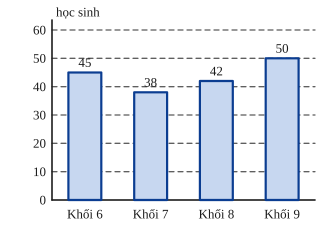
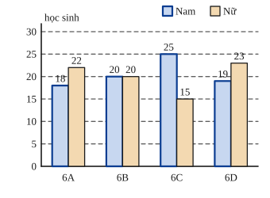

# Chủ đề 10. Dữ liệu và xác suất thực nghiệm

> Chủ đề này dạy thu thập và phân loại dữ liệu, lập bảng thống kê, đọc và vẽ biểu đồ tranh, biểu đồ cột, biểu đồ cột kép, và tính xác suất thực nghiệm từ kết quả các lần thử. Đề kiểm tra thường có một câu đọc biểu đồ kết hợp tính toán và một câu xác suất thực nghiệm.

## I. Kiến thức cần nắm

### 1. Dữ liệu

- **Dữ liệu là số** (số liệu): chiều cao, cân nặng, điểm số, số anh chị em…
- **Dữ liệu không phải là số**: màu sắc yêu thích, môn học, tên loài cây…
- Dữ liệu phải **hợp lý**: ví dụ tổng số người trả lời không được vượt quá số người được hỏi; điểm kiểm tra không thể là 12 (thang 10).

### 2. Bảng thống kê

Từ một dãy dữ liệu, đếm số lần xuất hiện của từng giá trị rồi ghi vào bảng (dùng vạch kiểm đếm nếu cần).

### 3. Biểu đồ tranh

Mỗi biểu tượng ứng với một số lượng nhất định (ghi ở chú thích). Số lượng $=$ số biểu tượng $\times$ giá trị một biểu tượng.

### 4. Biểu đồ cột và biểu đồ cột kép

- **Biểu đồ cột:** mỗi cột ứng với một đối tượng, chiều cao cột cho biết số liệu.
- **Biểu đồ cột kép:** mỗi đối tượng có **hai cột** cạnh nhau, biểu diễn hai loại số liệu (nam và nữ, năm trước và năm nay…), giúp **so sánh** hai loại số liệu đó.
- Đọc biểu đồ: xem tên, đơn vị trục đứng, chú thích màu, giá trị mỗi vạch.

### 5. Xác suất thực nghiệm

Thực hiện một hoạt động (tung đồng xu, gieo xúc xắc, lấy bóng…) $n$ lần, sự kiện A xảy ra $k$ lần. **Xác suất thực nghiệm** của sự kiện A là
$$\frac{k}{n} = \frac{\text{số lần A xảy ra}}{\text{tổng số lần thực hiện}}.$$
Xác suất thực nghiệm luôn nằm trong khoảng từ 0 đến 1. Có thể dùng nó để **dự đoán**: nếu làm thêm $N$ lần thì sự kiện A xảy ra khoảng $N \cdot \dfrac{k}{n}$ lần.

### 6. Sai lầm hay gặp

- Đọc nhầm màu cột trong biểu đồ cột kép.
- Lấy số lần A xảy ra chia cho số lần A **không** xảy ra.
- Không phát hiện dữ liệu vô lý (tổng vượt quá, giá trị ngoài thang đo).

## II. Bài tập vận dụng

**Bài 1.** Trong các dữ liệu sau, dữ liệu nào là số, dữ liệu nào không phải là số: chiều cao các bạn trong lớp; màu áo yêu thích; số anh chị em ruột; môn thể thao yêu thích?

**Bài 2.** Điểm kiểm tra Toán của 10 bạn là: 7; 8; 9; 7; 10; 8; 7; 9; 8; 7. Lập bảng thống kê số bạn đạt mỗi mức điểm. Điểm nào nhiều bạn đạt nhất?

**Bài 3.** Biểu đồ tranh về số cây ba lớp trồng được, mỗi biểu tượng 🌳 ứng với 10 cây: lớp 6A có 4 biểu tượng, lớp 6B có 5 biểu tượng, lớp 6C có 3 biểu tượng. Tính số cây mỗi lớp và cả ba lớp trồng được.

**Bài 4.** Biểu đồ dưới đây cho biết số học sinh giỏi của bốn khối trong một trường.

a) Khối nào có nhiều học sinh giỏi nhất? b) Cả trường có bao nhiêu học sinh giỏi? c) Khối 9 nhiều hơn khối 7 bao nhiêu học sinh giỏi?

**Bài 5.** Biểu đồ cột kép dưới đây cho biết số học sinh nam và nữ của bốn lớp khối 6.

a) Lớp nào có số nữ nhiều hơn số nam? b) Lớp nào đông nhất? c) Tổng số học sinh nữ của khối 6 là bao nhiêu?

**Bài 6.** Tung một đồng xu 40 lần, mặt ngửa xuất hiện 18 lần. Tính xác suất thực nghiệm của sự kiện "mặt ngửa xuất hiện".

**Bài 7.** Gieo một con xúc xắc 50 lần, mặt có số chấm chẵn xuất hiện 28 lần. Tính xác suất thực nghiệm của sự kiện "xuất hiện mặt chẵn" và của sự kiện "xuất hiện mặt lẻ".

**Bài 8.** Một hộp có bóng đỏ, xanh và vàng. Lấy một quả, ghi màu rồi trả lại, làm 30 lần: được 12 lần đỏ, 10 lần xanh, 8 lần vàng. Tính xác suất thực nghiệm của sự kiện "lấy được bóng đỏ" và "không lấy được bóng vàng".

**Bài 9 (thực tế).** Một cửa hàng ghi lại số áo bán được trong tuần theo cỡ: S: 15 chiếc, M: 35 chiếc, L: 30 chiếc, XL: 20 chiếc.
a) Tính xác suất thực nghiệm để một khách hàng mua áo cỡ M.
b) Cửa hàng định nhập thêm 200 chiếc áo. Nên nhập khoảng bao nhiêu chiếc cỡ M?

**Bài 10.** Lớp 6A có 40 học sinh. Khi khảo sát môn học yêu thích (mỗi bạn chọn một môn), bạn lớp trưởng ghi: Toán 15, Ngữ văn 12, Tiếng Anh 10, môn khác 5. Dữ liệu này có hợp lý không? Vì sao?

**Bài 11 (vận dụng cao).** Doanh thu (triệu đồng) theo quý của hai cửa hàng:

| Quý | I | II | III | IV |
|---|---|---|---|---|
| Cửa hàng A | 120 | 150 | 130 | 160 |
| Cửa hàng B | 140 | 120 | 150 | 150 |

a) Cửa hàng nào có tổng doanh thu cả năm lớn hơn? b) Quý nào hai cửa hàng chênh lệch doanh thu nhiều nhất?

**Bài 12 (vận dụng cao).** Tung cùng lúc hai đồng xu 50 lần: hai mặt sấp 12 lần, một sấp một ngửa 26 lần, hai mặt ngửa 12 lần. Tính xác suất thực nghiệm của sự kiện "một đồng sấp, một đồng ngửa". Kết quả gần với số nào trong các số $\dfrac{1}{4}$, $\dfrac{1}{3}$, $\dfrac{1}{2}$?

**Bài 13 (vận dụng cao).** Một xạ thủ bắn 40 phát: 12 phát trúng vòng 10, 16 phát trúng vòng 9, 8 phát trúng vòng 8, các phát còn lại trúng vòng 7.
a) Tính điểm trung bình mỗi phát bắn. b) Tính xác suất thực nghiệm của sự kiện "bắn được từ 9 điểm trở lên".

---

## III. Lời giải chi tiết

### Bài 1
Dữ liệu là số: chiều cao; số anh chị em ruột. Dữ liệu không phải là số: màu áo yêu thích; môn thể thao yêu thích.

### Bài 2

| Điểm | 7 | 8 | 9 | 10 |
|---|---|---|---|---|
| Số bạn | 4 | 3 | 2 | 1 |

Điểm 7 có nhiều bạn đạt nhất (4 bạn).

### Bài 3
6A: $4 \cdot 10 = 40$ cây; 6B: 50 cây; 6C: 30 cây. Cả ba lớp: 120 cây.

### Bài 4
a) Khối 9 (50 học sinh).
b) $45 + 38 + 42 + 50 = 175$ (học sinh).
c) $50 - 38 = 12$ (học sinh).

### Bài 5
Đọc biểu đồ: 6A: nam 18, nữ 22; 6B: 20 và 20; 6C: 25 và 15; 6D: 19 và 23.
a) Lớp 6A và 6D.
b) Sĩ số: 6A 40, 6B 40, 6C 40, 6D 42. Lớp 6D đông nhất.
c) $22 + 20 + 15 + 23 = 80$ (học sinh nữ).

### Bài 6
$\dfrac{18}{40} = \dfrac{9}{20}$.

### Bài 7
Mặt chẵn: $\dfrac{28}{50} = \dfrac{14}{25}$. Mặt lẻ xuất hiện $50 - 28 = 22$ lần: $\dfrac{22}{50} = \dfrac{11}{25}$.

### Bài 8
Đỏ: $\dfrac{12}{30} = \dfrac{2}{5}$. Không vàng (đỏ hoặc xanh): $\dfrac{12 + 10}{30} = \dfrac{11}{15}$.

### Bài 9
a) Tổng số áo bán: 100 chiếc. Xác suất thực nghiệm mua cỡ M: $\dfrac{35}{100} = 0{,}35$.
b) Khoảng $200 \cdot 0{,}35 = 70$ chiếc cỡ M.

### Bài 10
Tổng số lựa chọn: $15 + 12 + 10 + 5 = 42$, lớn hơn số học sinh (40), trong khi mỗi bạn chỉ chọn một môn. Dữ liệu **không hợp lý**, cần kiểm tra lại.

### Bài 11
a) A: $120 + 150 + 130 + 160 = 560$; B: $140 + 120 + 150 + 150 = 560$. Hai cửa hàng bằng nhau.
b) Chênh lệch từng quý: I: 20; II: 30; III: 20; IV: 10. Quý II chênh lệch nhiều nhất.

### Bài 12
$\dfrac{26}{50} = \dfrac{13}{25} = 0{,}52$, gần với $\dfrac{1}{2}$.

### Bài 13
Số phát trúng vòng 7: $40 - 12 - 16 - 8 = 4$.
a) Tổng điểm: $12 \cdot 10 + 16 \cdot 9 + 8 \cdot 8 + 4 \cdot 7 = 120 + 144 + 64 + 28 = 356$. Trung bình: $356 : 40 = 8{,}9$ (điểm).
b) Từ 9 điểm trở lên: $12 + 16 = 28$ phát. Xác suất thực nghiệm: $\dfrac{28}{40} = \dfrac{7}{10}$.
