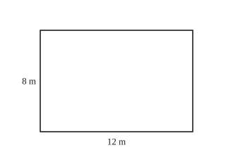
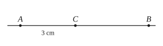

# Đề kiểm tra số 1

**Thời gian làm bài:** 90 phút. **Thang điểm:** mỗi câu 1 điểm, tổng 10 điểm.

## Đề bài

**Câu 1 (Tập hợp, thứ tự phép tính).** a) Viết tập hợp $A$ các số tự nhiên lớn hơn 5 và không vượt quá 10 bằng hai cách. b) Tính $2^3 \cdot 5 - 18 : 3^2$.

**Câu 2 (ƯCLN, BCNN).** a) Phân tích 120 ra thừa số nguyên tố. b) Tìm ƯCLN(24, 36) và BCNN(12, 18).

**Câu 3 (Số nguyên).** Tính: a) $(-15) + 27 - (-8)$; b) $(-6) \cdot (-7) - 50$.

**Câu 4 (Hình chữ nhật).** Một mảnh vườn hình chữ nhật dài 12 m, rộng 8 m. Tính chu vi và diện tích mảnh vườn.

**Câu 5 (Đối xứng).** Trong các chữ cái in hoa A, B, H, N, S, chữ nào có trục đối xứng? Chữ nào có tâm đối xứng?

**Câu 6 (Phân số).** a) Rút gọn $\dfrac{-24}{36}$. b) Tính $\dfrac{-3}{4} + \dfrac{5}{6}$.

**Câu 7 (Hai bài toán về phân số).** a) Tìm $\dfrac{3}{5}$ của 45. b) Tìm một số biết $\dfrac{2}{7}$ của nó bằng 12.

**Câu 8 (Số thập phân, phần trăm).** a) Làm tròn $3{,}14159$ đến hàng phần trăm. b) Tìm 15% của 240.

**Câu 9 (Đoạn thẳng).** Cho ba điểm $A, C, B$ thẳng hàng, $C$ nằm giữa $A$ và $B$, $AC = 3$ cm, $AB = 7$ cm. Tính $CB$.

**Câu 10 (Xác suất thực nghiệm).** Tung một đồng xu 30 lần, mặt sấp xuất hiện 13 lần. Tính xác suất thực nghiệm của sự kiện "mặt sấp xuất hiện".

---

## Lời giải chi tiết

### Câu 1
a) $A = \{6; 7; 8; 9; 10\}$; $A = \{x \in \mathbb{N} \mid 5 < x \le 10\}$.
b) $8 \cdot 5 - 18 : 9 = 40 - 2 = 38$.

### Câu 2
a) $120 = 2^3 \cdot 3 \cdot 5$.
b) $24 = 2^3 \cdot 3$, $36 = 2^2 \cdot 3^2$: ƯCLN $= 2^2 \cdot 3 = 12$. $12 = 2^2 \cdot 3$, $18 = 2 \cdot 3^2$: BCNN $= 2^2 \cdot 3^2 = 36$.

### Câu 3
a) $-15 + 27 + 8 = 20$. b) $42 - 50 = -8$.

### Câu 4

*Hình: Hình chữ nhật dài 12 m, rộng 8 m.*

Chu vi: $(12 + 8) \cdot 2 = 40$ (m). Diện tích: $12 \cdot 8 = 96 \text{ (m}^2)$.

### Câu 5
Có trục đối xứng: A (trục đứng), B (trục ngang), H (hai trục). Có tâm đối xứng: H, N, S.

### Câu 6
a) $\dfrac{-24}{36} = \dfrac{-2}{3}$. b) $\dfrac{-9}{12} + \dfrac{10}{12} = \dfrac{1}{12}$.

### Câu 7
a) $45 \cdot \dfrac{3}{5} = 27$. b) $12 : \dfrac{2}{7} = 42$.

### Câu 8
a) $3{,}14$. b) $240 \cdot \dfrac{15}{100} = 36$.

### Câu 9

*Hình: Ba điểm A, C, B thẳng hàng, C nằm giữa A và B.*

$C$ nằm giữa $A$ và $B$ nên $AC + CB = AB$, suy ra $CB = 7 - 3 = 4$ (cm).

### Câu 10
$\dfrac{13}{30}$.
