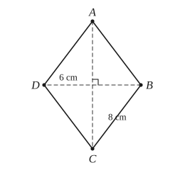
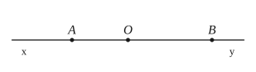

# Đề kiểm tra số 2

**Thời gian làm bài:** 90 phút. **Thang điểm:** mỗi câu 1 điểm, tổng 10 điểm.

## Đề bài

**Câu 1 (Lũy thừa, tìm x).** a) Tính hợp lý: $25 \cdot 37 \cdot 4$. b) Tính $2^5$. c) Tìm số tự nhiên $x$ biết $3x - 7 = 20$.

**Câu 2 (Chia hết, BCNN).** a) Tìm chữ số $a$ để $\overline{2a5}$ chia hết cho 9. b) Số học sinh khối 6 của một trường khoảng từ 100 đến 150 em. Khi xếp hàng 12 hoặc hàng 15 đều vừa đủ. Tính số học sinh khối 6.

**Câu 3 (Số nguyên).** a) Nhiệt độ buổi sáng là $-5\,^\circ\text{C}$, đến trưa tăng thêm $8\,^\circ\text{C}$. Nhiệt độ buổi trưa là bao nhiêu? b) Tính $125 - (-75) + (-200)$.

**Câu 4 (Hình thoi).** Một hình thoi có độ dài hai đường chéo là 6 cm và 8 cm. Tính diện tích hình thoi.

**Câu 5 (Đối xứng).** Hình vuông, tam giác đều, lục giác đều lần lượt có bao nhiêu trục đối xứng?

**Câu 6 (Phân số).** a) So sánh $\dfrac{-5}{6}$ và $\dfrac{-7}{9}$. b) Tính $\dfrac{-2}{3} \cdot \dfrac{9}{8}$.

**Câu 7 (Phân số của một số).** Lớp 6A có 36 học sinh, trong đó $\dfrac{5}{9}$ là học sinh nam. Tính số học sinh nam và nữ.

**Câu 8 (Số thập phân).** Tính: a) $(-2{,}4) + 3{,}75$; b) $0{,}25 \cdot (-8) \cdot 4$.

**Câu 9 (Tia đối nhau).** Cho hai tia đối nhau $Ox$ và $Oy$. Lấy $A$ trên tia $Ox$ với $OA = 2$ cm, $B$ trên tia $Oy$ với $OB = 3$ cm. Tính $AB$.

**Câu 10 (Thống kê).** Số sách thư viện lớp nhận được: Toán 20 quyển, Ngữ văn 15 quyển, Tiếng Anh 25 quyển, Khoa học 10 quyển. a) Tổng số sách là bao nhiêu? b) Loại sách nào nhiều nhất? c) Khi vẽ biểu đồ cột, cột nào cao nhất, cột nào thấp nhất?

---

## Lời giải chi tiết

### Câu 1
a) $(25 \cdot 4) \cdot 37 = 3\,700$. b) $32$. c) $3x = 27$, $x = 9$.

### Câu 2
a) $2 + a + 5 = 7 + a$ chia hết cho 9, nên $a = 2$.
b) Số học sinh là bội chung của 12 và 15. BCNN(12, 15) = 60; bội chung là 60, 120, 180, … Trong khoảng 100–150: 120 học sinh.

### Câu 3
a) $-5 + 8 = 3\,(^\circ\text{C})$. b) $125 + 75 - 200 = 0$.

### Câu 4

*Hình: Hình thoi có hai đường chéo 6 cm và 8 cm.*

$S = \dfrac{6 \cdot 8}{2} = 24 \text{ (cm}^2)$.

### Câu 5
Hình vuông: 4 trục; tam giác đều: 3 trục; lục giác đều: 6 trục.

### Câu 6
a) $\dfrac{-5}{6} = \dfrac{-15}{18}$, $\dfrac{-7}{9} = \dfrac{-14}{18}$. Vì $-15 < -14$ nên $\dfrac{-5}{6} < \dfrac{-7}{9}$.
b) $\dfrac{-18}{24} = \dfrac{-3}{4}$.

### Câu 7
Nam: $36 \cdot \dfrac{5}{9} = 20$ (em). Nữ: $36 - 20 = 16$ (em).

### Câu 8
a) $1{,}35$. b) $0{,}25 \cdot 4 \cdot (-8) = -8$.

### Câu 9

*Hình: Hai tia đối nhau Ox và Oy, A trên Ox, B trên Oy.*

$O$ nằm giữa $A$ và $B$ (vì $Ox$, $Oy$ là hai tia đối nhau), nên $AB = OA + OB = 5$ (cm).

### Câu 10
a) $20 + 15 + 25 + 10 = 70$ (quyển). b) Tiếng Anh. c) Cột Tiếng Anh cao nhất, cột Khoa học thấp nhất.
