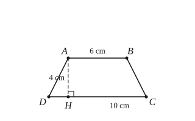
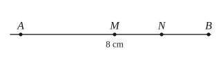

# Đề kiểm tra số 3

**Thời gian làm bài:** 90 phút. **Thang điểm:** mỗi câu 1 điểm, tổng 10 điểm.

## Đề bài

**Câu 1 (Tập hợp, lũy thừa).** a) Viết tập hợp các chữ số của số 2025. Tập hợp đó có mấy phần tử? b) Tính $4 \cdot 5^2 - 3 \cdot 2^3$.

**Câu 2 (ƯCLN).** Cô giáo có 48 bút bi và 72 quyển vở, muốn chia thành các phần thưởng như nhau (mỗi phần có cả bút và vở). Có thể chia được nhiều nhất bao nhiêu phần thưởng? Mỗi phần có bao nhiêu bút, bao nhiêu vở?

**Câu 3 (Tìm x).** Tìm số nguyên $x$: a) $x + 15 = -7$; b) $2x - (-4) = -10$.

**Câu 4 (Hình bình hành, hình thang cân).** a) Tính diện tích hình bình hành có độ dài đáy 10 cm, chiều cao 6 cm. b) Tính diện tích hình thang cân có hai đáy 10 cm và 6 cm, chiều cao 4 cm.

**Câu 5 (Tâm đối xứng).** Trong các hình sau, hình nào có tâm đối xứng: hình chữ nhật, tam giác đều, hình thoi, hình thang cân?

**Câu 6 (Phân số).** a) Tính $2\dfrac{1}{3} - \dfrac{3}{4}$. b) Tìm $x$: $x : \dfrac{2}{5} = \dfrac{-15}{4}$.

**Câu 7 (Bài toán phân số).** Một quyển truyện dày 120 trang. Ngày thứ nhất Minh đọc $\dfrac{1}{3}$ quyển, ngày thứ hai đọc $\dfrac{3}{8}$ số trang còn lại. Hỏi Minh còn bao nhiêu trang chưa đọc?

**Câu 8 (Tỉ số phần trăm).** a) Tìm tỉ số phần trăm của 12 và 48. b) Ước lượng kết quả phép tính $49{,}7 \cdot 2{,}1$.

**Câu 9 (Trung điểm).** Cho đoạn thẳng $AB = 8$ cm. Gọi $M$ là trung điểm của $AB$, $N$ là trung điểm của $MB$. Tính $AN$.

**Câu 10 (Xác suất thực nghiệm).** Gieo một con xúc xắc 40 lần, mặt 6 chấm xuất hiện 7 lần. Tính xác suất thực nghiệm của các sự kiện "xuất hiện mặt 6 chấm" và "không xuất hiện mặt 6 chấm".

---

## Lời giải chi tiết

### Câu 1
a) $\{2; 0; 5\}$, có 3 phần tử (chữ số 2 chỉ viết một lần). b) $100 - 24 = 76$.

### Câu 2
Số phần thưởng nhiều nhất là ƯCLN(48, 72) = 24. Mỗi phần có $48 : 24 = 2$ bút và $72 : 24 = 3$ quyển vở.

### Câu 3
a) $x = -7 - 15 = -22$. b) $2x + 4 = -10$, $2x = -14$, $x = -7$.

### Câu 4

*Hình: Hình thang cân có hai đáy 10 cm và 6 cm, chiều cao 4 cm.*

a) $S = 10 \cdot 6 = 60 \text{ (cm}^2)$. b) $S = \dfrac{(10 + 6) \cdot 4}{2} = 32 \text{ (cm}^2)$.

### Câu 5
Hình chữ nhật và hình thoi có tâm đối xứng (giao điểm hai đường chéo). Tam giác đều và hình thang cân không có tâm đối xứng.

### Câu 6
a) $\dfrac{7}{3} - \dfrac{3}{4} = \dfrac{28}{12} - \dfrac{9}{12} = \dfrac{19}{12}$. b) $x = \dfrac{-15}{4} \cdot \dfrac{2}{5} = \dfrac{-3}{2}$.

### Câu 7
Ngày thứ nhất: $120 \cdot \dfrac{1}{3} = 40$ (trang), còn 80 trang. Ngày thứ hai: $80 \cdot \dfrac{3}{8} = 30$ (trang). Còn lại $80 - 30 = 50$ (trang).

### Câu 8
a) $\dfrac{12}{48} \cdot 100\% = 25\%$. b) $49{,}7 \cdot 2{,}1 \approx 50 \cdot 2 = 100$.

### Câu 9

*Hình: Đoạn thẳng AB với trung điểm M và trung điểm N của MB.*

$AM = MB = 4$ cm; $MN = 2$ cm. $M$ nằm giữa $A$ và $N$: $AN = AM + MN = 6$ (cm).

### Câu 10
Mặt 6: $\dfrac{7}{40}$. Không phải mặt 6: $\dfrac{33}{40}$.
