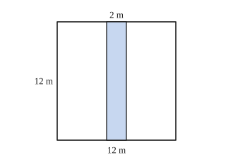
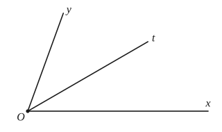

# Đề kiểm tra số 4

**Thời gian làm bài:** 90 phút. **Thang điểm:** mỗi câu 1 điểm, tổng 10 điểm.

## Đề bài

**Câu 1 (Số La Mã, lũy thừa).** a) Đọc các số La Mã XIV và XXIX. b) Tính $3^4 : 3^2 + 2^3$.

**Câu 2 (Dấu hiệu chia hết).** Tìm chữ số $x$ để số $\overline{34x}$ chia hết cho cả 2 và 3.

**Câu 3 (Số nguyên).** Tính tổng các số nguyên $x$ thỏa mãn $-5 < x < 6$.

**Câu 4 (Diện tích).** Một mảnh vườn hình vuông cạnh 12 m. Người ta làm một lối đi hình chữ nhật rộng 2 m chạy dọc giữa vườn (dài bằng cạnh vườn). Tính diện tích phần đất còn lại để trồng rau.

**Câu 5 (Đối xứng).** Trong các hình: hình vuông, hình chữ nhật, hình thoi, lục giác đều, tam giác đều, hình nào vừa có trục đối xứng vừa có tâm đối xứng?

**Câu 6 (Phân số).** a) Tính $\dfrac{-5}{12} + \dfrac{7}{18}$. b) Tìm $x$: $\dfrac{3}{4}x - \dfrac{1}{2} = \dfrac{1}{4}$.

**Câu 7 (Tìm một số).** Sau khi giảm $\dfrac{1}{4}$ giá, một đôi giày có giá 180 000 đồng. Tính giá ban đầu.

**Câu 8 (Số thập phân).** Giá một lít xăng là 23 500 đồng. Một người đổ $4{,}2$ lít xăng. Hỏi phải trả bao nhiêu tiền?

**Câu 9 (Góc).** Cho $\widehat{xOy} = 70^\circ$ và tia $Ot$ nằm giữa hai tia $Ox$, $Oy$ sao cho $\widehat{xOt} = 30^\circ$. Tính $\widehat{tOy}$.

**Câu 10 (Dữ liệu, xác suất).** a) Một bảng điểm kiểm tra (thang điểm 10) có ghi một bạn được 11 điểm. Dữ liệu này có hợp lý không? b) Lấy bóng từ một hộp 50 lần (có trả lại), được bóng xanh 18 lần. Tính xác suất thực nghiệm của sự kiện "lấy được bóng xanh".

---

## Lời giải chi tiết

### Câu 1
a) XIV = 14; XXIX = 29. b) $81 : 9 + 8 = 9 + 8 = 17$.

### Câu 2
Chia hết cho 2: $x$ chẵn. Chia hết cho 3: $3 + 4 + x = 7 + x$ chia hết cho 3, nên $x \in \{2; 5; 8\}$. Kết hợp: $x \in \{2; 8\}$ (số 342 và 348).

### Câu 3
Các số nguyên: $-4, -3, \dots, 4, 5$. Các cặp đối nhau có tổng 0, còn lại 5. Tổng bằng 5.

### Câu 4

*Hình: Mảnh vườn hình vuông cạnh 12 m có lối đi rộng 2 m ở giữa.*

Diện tích vườn: $12 \cdot 12 = 144 \text{ (m}^2)$. Lối đi: $12 \cdot 2 = 24 \text{ (m}^2)$. Phần trồng rau: $120 \text{ m}^2$.

### Câu 5
Hình vuông, hình chữ nhật, hình thoi, lục giác đều. (Tam giác đều có trục đối xứng nhưng không có tâm đối xứng.)

### Câu 6
a) $\dfrac{-15}{36} + \dfrac{14}{36} = \dfrac{-1}{36}$. b) $\dfrac{3}{4}x = \dfrac{3}{4}$, $x = 1$.

### Câu 7
Giá mới bằng $\dfrac{3}{4}$ giá cũ. Giá ban đầu: $180\,000 : \dfrac{3}{4} = 240\,000$ (đồng).

### Câu 8
$23\,500 \cdot 4{,}2 = 98\,700$ (đồng).

### Câu 9

*Hình: Góc xOy và tia Ot nằm giữa.*

Tia $Ot$ nằm giữa nên $\widehat{tOy} = 70^\circ - 30^\circ = 40^\circ$.

### Câu 10
a) Không hợp lý, vì thang điểm 10 thì điểm không vượt quá 10. b) $\dfrac{18}{50} = \dfrac{9}{25}$.
