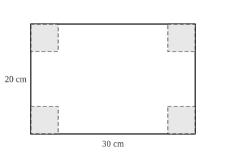
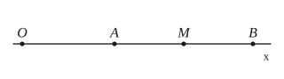

# Đề kiểm tra số 5

**Thời gian làm bài:** 90 phút. **Thang điểm:** mỗi câu 1 điểm, tổng 10 điểm.

## Đề bài

**Câu 1 (Lũy thừa).** Tìm số tự nhiên $x$: a) $2^x = 32$; b) $5^{x - 1} = 125$.

**Câu 2 (BCNN).** Số học sinh khối 6 của một trường trong khoảng từ 200 đến 250. Khi xếp hàng 4, hàng 5, hàng 6 đều thiếu 1 bạn. Tính số học sinh.

**Câu 3 (Số nguyên).** Tính: a) $(-3) \cdot (-4) \cdot (-5)$; b) $18 - 2 \cdot (-5) \cdot 3$.

**Câu 4 (Diện tích, chu vi).** Một tấm bìa hình chữ nhật 30 cm × 20 cm. Người ta cắt bỏ bốn hình vuông cạnh 5 cm ở bốn góc. Tính diện tích phần còn lại. Chu vi phần còn lại có thay đổi so với chu vi tấm bìa ban đầu không?

**Câu 5 (Đối xứng tâm).** a) Điểm $A'$ đối xứng với điểm $A$ qua điểm $O$, biết $OA = 3$ cm. Tính $AA'$. b) Trong các chữ cái H, N, S, Z, E, chữ nào có tâm đối xứng?

**Câu 6 (Phân số).** a) So sánh $\dfrac{2023}{2024}$ và $\dfrac{2024}{2025}$. b) Tính $\dfrac{4}{5} : \dfrac{-8}{15}$.

**Câu 7 (Bài toán phân số).** Ba lớp quyên góp sách. Lớp 6A góp $\dfrac{1}{3}$ tổng số sách, lớp 6B góp $\dfrac{2}{5}$ tổng số sách, lớp 6C góp 64 quyển. Tính tổng số sách ba lớp quyên góp.

**Câu 8 (Lãi suất).** Bác Hà gửi tiết kiệm 10 000 000 đồng với lãi suất 5% một năm. Sau một năm bác nhận được cả gốc và lãi bao nhiêu tiền?

**Câu 9 (Trung điểm).** Trên tia $Ox$ lấy hai điểm $A$, $B$ sao cho $OA = 4$ cm, $OB = 10$ cm. Gọi $M$ là trung điểm của $AB$. Tính $OM$.

**Câu 10 (Xác suất thực nghiệm).** Một xạ thủ bắn 50 phát, có 42 phát trúng đích. Tính xác suất thực nghiệm của sự kiện "bắn trúng đích" (dạng phân số tối giản và dạng phần trăm).

---

## Lời giải chi tiết

### Câu 1
a) $32 = 2^5$, $x = 5$. b) $125 = 5^3$, nên $x - 1 = 3$, $x = 4$.

### Câu 2
Số học sinh thêm 1 thì chia hết cho 4, 5, 6, tức là là bội của BCNN(4, 5, 6) = 60. Trong khoảng 201–251, bội của 60 là 240. Số học sinh: $240 - 1 = 239$.

### Câu 3
a) $-60$. b) $18 - (-30) = 48$.

### Câu 4

*Hình: Tấm bìa hình chữ nhật 30 cm × 20 cm bị cắt bốn hình vuông cạnh 5 cm ở bốn góc.*

Diện tích còn lại: $30 \cdot 20 - 4 \cdot 5 \cdot 5 = 600 - 100 = 500 \text{ (cm}^2)$.
Chu vi không đổi: ở mỗi góc, hai đoạn 5 cm bị cắt đi được thay bằng hai đoạn 5 cm mới. Chu vi vẫn là $(30 + 20) \cdot 2 = 100$ (cm).

### Câu 5
a) $O$ là trung điểm của $AA'$ nên $AA' = 6$ cm. b) H, N, S, Z.

### Câu 6
a) Phần bù đến 1: $\dfrac{1}{2024} > \dfrac{1}{2025}$, nên $\dfrac{2023}{2024} < \dfrac{2024}{2025}$.
b) $\dfrac{4}{5} \cdot \dfrac{15}{-8} = \dfrac{-3}{2}$.

### Câu 7
Lớp 6C góp $1 - \dfrac{1}{3} - \dfrac{2}{5} = \dfrac{4}{15}$ tổng số sách. Tổng: $64 : \dfrac{4}{15} = 240$ (quyển).

### Câu 8
Lãi: $10\,000\,000 \cdot 5\% = 500\,000$ (đồng). Cả gốc và lãi: $10\,500\,000$ đồng.

### Câu 9

*Hình: Tia Ox với các điểm A, M, B.*

$A$ nằm giữa $O$ và $B$: $AB = 10 - 4 = 6$ (cm), $AM = 3$ cm. $A$ nằm giữa $O$ và $M$: $OM = 4 + 3 = 7$ (cm).

### Câu 10
$\dfrac{42}{50} = \dfrac{21}{25} = 84\%$.
