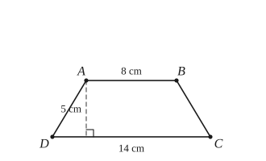
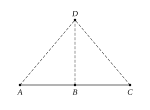

# Đề kiểm tra số 6

**Thời gian làm bài:** 90 phút. **Thang điểm:** mỗi câu 1 điểm, tổng 10 điểm.

## Đề bài

**Câu 1 (Tính hợp lý).** a) Tính $2^0 + 2^1 + 2^2 + 2^3$. b) Tính nhanh $47 \cdot 53 + 47 \cdot 47$.

**Câu 2 (Ước, số nguyên tố).** a) Tính tổng các ước của 28. b) Có bao nhiêu số nguyên tố nhỏ hơn 20?

**Câu 3 (Tìm x).** Tìm số nguyên $x$ biết $(x - 4)(x + 2) = 0$.

**Câu 4 (Hình thang cân).** Một hình thang cân có đáy lớn 14 cm, đáy nhỏ 8 cm, chiều cao 5 cm. Tính diện tích hình thang.

**Câu 5 (Trục đối xứng).** Hình thang cân, hình bình hành (không phải hình chữ nhật, không phải hình thoi), hình tròn lần lượt có bao nhiêu trục đối xứng?

**Câu 6 (Phân số).** Tìm các số nguyên $n$ để $\dfrac{6}{n - 1}$ là số nguyên.

**Câu 7 (Bài toán phân số).** An có một số tiền. An tiêu $\dfrac{2}{5}$ số tiền, sau đó tiêu $\dfrac{1}{3}$ số tiền còn lại thì còn 60 000 đồng. Hỏi lúc đầu An có bao nhiêu tiền?

**Câu 8 (Phần trăm).** Giá một mặt hàng tăng 20%, sau đó giảm 20%. Hỏi giá cuối cùng tăng hay giảm bao nhiêu phần trăm so với ban đầu?

**Câu 9 (Đường thẳng).** a) Cho 4 điểm, không có ba điểm nào thẳng hàng. Vẽ được bao nhiêu đường thẳng đi qua hai trong bốn điểm đó? b) Nếu trong 4 điểm $A, B, C, D$ có đúng ba điểm $A, B, C$ thẳng hàng thì vẽ được bao nhiêu đường thẳng?

**Câu 10 (Xác suất thực nghiệm).** Gieo một con xúc xắc 60 lần: mặt 1 chấm 8 lần, 2 chấm 12 lần, 3 chấm 9 lần, 4 chấm 11 lần, 5 chấm 10 lần, 6 chấm 10 lần. Tính xác suất thực nghiệm của các sự kiện: a) "xuất hiện mặt lẻ"; b) "xuất hiện mặt có số chấm lớn hơn 4".

---

## Lời giải chi tiết

### Câu 1
a) $1 + 2 + 4 + 8 = 15$. b) $47 \cdot (53 + 47) = 47 \cdot 100 = 4\,700$.

### Câu 2
a) Ước của 28: 1, 2, 4, 7, 14, 28; tổng bằng 56. b) 2, 3, 5, 7, 11, 13, 17, 19: có 8 số.

### Câu 3
$x - 4 = 0$ hoặc $x + 2 = 0$: $x = 4$ hoặc $x = -2$.

### Câu 4

*Hình: Hình thang cân có đáy lớn 14 cm, đáy nhỏ 8 cm, chiều cao 5 cm.*

$S = \dfrac{(14 + 8) \cdot 5}{2} = 55 \text{ (cm}^2)$.

### Câu 5
Hình thang cân: 1 trục; hình bình hành (thông thường): không có trục đối xứng; hình tròn: vô số trục (mọi đường thẳng qua tâm).

### Câu 6
$n - 1$ là ước của 6: $n - 1 \in \{\pm 1; \pm 2; \pm 3; \pm 6\}$.

**Đáp số:** $n \in \{2; 0; 3; -1; 4; -2; 7; -5\}$.

### Câu 7
Sau lần đầu còn $\dfrac{3}{5}$ số tiền. Lần sau tiêu $\dfrac{1}{3}$ của phần đó, còn $\dfrac{3}{5} \cdot \dfrac{2}{3} = \dfrac{2}{5}$ số tiền, ứng với 60 000 đồng.
Số tiền lúc đầu: $60\,000 : \dfrac{2}{5} = 150\,000$ (đồng).

### Câu 8
$120\% \cdot 80\% = 96\%$. Giảm 4%.

### Câu 9

*Hình: Bốn điểm A, B, C, D trong đó A, B, C thẳng hàng.*

a) $\dfrac{4 \cdot 3}{2} = 6$ (đường thẳng).
b) Ba điểm $A, B, C$ chỉ tạo một đường thẳng thay vì ba. Số đường thẳng: $6 - 3 + 1 = 4$ (đường $AC$, $DA$, $DB$, $DC$).

### Câu 10
a) Mặt lẻ: $8 + 9 + 10 = 27$ lần, $\dfrac{27}{60} = \dfrac{9}{20}$.
b) Mặt 5 và 6: $10 + 10 = 20$ lần, $\dfrac{20}{60} = \dfrac{1}{3}$.
