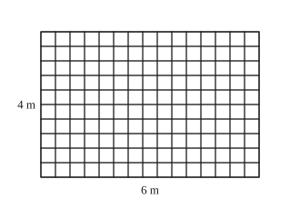
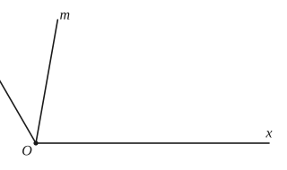

# Đề kiểm tra số 7

**Thời gian làm bài:** 90 phút. **Thang điểm:** mỗi câu 1 điểm, tổng 10 điểm.

## Đề bài

**Câu 1 (Tìm x).** Tìm số tự nhiên $x$ biết $2x - 3 = 5^2 - 2 \cdot 3$.

**Câu 2 (BCNN thực tế).** Hai bánh răng ăn khớp với nhau, bánh thứ nhất có 18 răng, bánh thứ hai có 24 răng. Lúc đầu hai răng A (bánh thứ nhất) và B (bánh thứ hai) khớp nhau. Hỏi mỗi bánh phải quay ít nhất bao nhiêu vòng thì hai răng A và B lại khớp nhau?

**Câu 3 (Tổng số nguyên).** Tính $S = 1 - 3 + 5 - 7 + \dots + 97 - 99$.

**Câu 4 (Lát gạch).** Một nền nhà hình chữ nhật dài 6 m, rộng 4 m được lát bằng gạch hình vuông cạnh 40 cm. Hỏi cần bao nhiêu viên gạch (không tính mạch vữa)?

**Câu 5 (Tâm đối xứng).** Trong các hình: tam giác đều, hình vuông, hình thang cân, hình bình hành, lục giác đều, hình nào có tâm đối xứng?

**Câu 6 (Phân số).** Tính $A = \left(\dfrac{-3}{4} + \dfrac{2}{3}\right) : \left(\dfrac{5}{6} - \dfrac{1}{2}\right)$.

**Câu 7 (Hai bài toán).** a) Tìm một số biết 40% của nó bằng 24. b) Tìm $\dfrac{3}{8}$ của 64.

**Câu 8 (Số thập phân).** a) Dân số một nước là 98 456 789 người. Làm tròn số đó đến hàng triệu. b) Tính $(-4{,}5) \cdot 2 + 3{,}2 : 0{,}8$.

**Câu 9 (Góc).** Cho $\widehat{xOy} = 120^\circ$, tia $Om$ nằm giữa hai tia $Ox$, $Oy$ sao cho $\widehat{xOm} = 2 \cdot \widehat{mOy}$. Tính $\widehat{xOm}$ và $\widehat{mOy}$.

**Câu 10 (Xác suất thực nghiệm).** Một quán khảo sát 50 khách: 18 người chọn cà phê, 20 người chọn trà sữa, 12 người chọn nước cam. a) Tính xác suất thực nghiệm để một khách chọn trà sữa. b) Nếu có 200 khách, quán nên chuẩn bị trà sữa cho khoảng bao nhiêu người?

---

## Lời giải chi tiết

### Câu 1
$2x - 3 = 25 - 6 = 19$, $2x = 22$, $x = 11$.

### Câu 2
Hai răng A, B khớp lại khi số răng đã quay qua chỗ ăn khớp là bội chung của 18 và 24. Nhỏ nhất là BCNN(18, 24) = 72.
Bánh thứ nhất quay $72 : 18 = 4$ vòng; bánh thứ hai quay $72 : 24 = 3$ vòng.

### Câu 3
$(1 - 3) + (5 - 7) + \dots + (97 - 99)$: có 25 cặp, mỗi cặp bằng $-2$. $S = -50$.

### Câu 4

*Hình: Nền nhà hình chữ nhật 6 m × 4 m lát gạch vuông cạnh 40 cm.*

Đổi 40 cm = 0,4 m. Mỗi chiều dài xếp được $6 : 0{,}4 = 15$ viên, mỗi chiều rộng xếp được $4 : 0{,}4 = 10$ viên. Số viên: $15 \cdot 10 = 150$.

### Câu 5
Hình vuông, hình bình hành, lục giác đều.

### Câu 6
$\dfrac{-3}{4} + \dfrac{2}{3} = \dfrac{-1}{12}$; $\dfrac{5}{6} - \dfrac{1}{2} = \dfrac{1}{3}$. $A = \dfrac{-1}{12} \cdot 3 = \dfrac{-1}{4}$.

### Câu 7
a) $24 : \dfrac{40}{100} = 60$. b) $64 \cdot \dfrac{3}{8} = 24$.

### Câu 8
a) $98\,000\,000$ (chữ số hàng trăm nghìn là 4). b) $-9 + 4 = -5$.

### Câu 9

*Hình: Góc xOy và tia Om nằm giữa.*

$\widehat{xOm} + \widehat{mOy} = 120^\circ$ và $\widehat{xOm} = 2 \cdot \widehat{mOy}$, nên $3 \cdot \widehat{mOy} = 120^\circ$: $\widehat{mOy} = 40^\circ$, $\widehat{xOm} = 80^\circ$.

### Câu 10
a) $\dfrac{20}{50} = \dfrac{2}{5}$. b) Khoảng $200 \cdot \dfrac{2}{5} = 80$ người.
