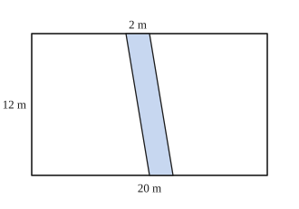
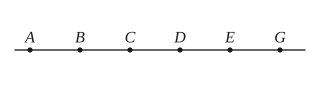

# Đề kiểm tra số 8

**Thời gian làm bài:** 90 phút. **Thang điểm:** mỗi câu 1 điểm, tổng 10 điểm.

## Đề bài

**Câu 1 (Tổng dãy).** Tính $1 + 2 + 3 + \dots + 50$.

**Câu 2 (ƯCLN, BCNN).** a) Tìm số tự nhiên $a$ lớn nhất sao cho $120$ và $180$ đều chia hết cho $a$. b) Tìm BCNN(8, 12, 15).

**Câu 3 (Chia hết số nguyên).** Tìm số nguyên $n$ để $n + 3$ chia hết cho $n - 1$.

**Câu 4 (Diện tích).** Một mảnh vườn hình chữ nhật dài 20 m, rộng 12 m. Người ta làm một lối đi hình bình hành có đáy 2 m nằm dọc theo chiều dài và cắt ngang vườn (chiều cao bằng chiều rộng vườn 12 m). Tính diện tích lối đi và diện tích phần còn lại.

**Câu 5 (Đối xứng tâm).** Cho đoạn thẳng $AB$ và $O$ là trung điểm của $AB$. Điểm đối xứng với $A$ qua $O$ là điểm nào? Vì sao?

**Câu 6 (Phân số).** Rút gọn $\dfrac{(-12) \cdot 15}{36 \cdot (-5)}$.

**Câu 7 (Bài toán phân số).** Kết quả học tập của lớp 6B: số học sinh xuất sắc bằng $\dfrac{1}{5}$ cả lớp, số học sinh giỏi bằng $\dfrac{1}{2}$ cả lớp, còn lại 12 học sinh khá. Tính số học sinh lớp 6B.

**Câu 8 (Giảm giá).** Một chiếc xe đạp giá 2 500 000 đồng được giảm giá 12%. Tính giá xe sau khi giảm.

**Câu 9 (Đoạn thẳng).** Trên một đường thẳng lấy 6 điểm phân biệt $A, B, C, D, E, G$. Có bao nhiêu đoạn thẳng có hai đầu mút là hai trong sáu điểm đó?

**Câu 10 (Biểu đồ cột kép).** Điểm trung bình môn Toán của hai lớp qua bốn bài kiểm tra:

| Bài kiểm tra | 1 | 2 | 3 | 4 |
|---|---|---|---|---|
| Lớp 6A | 7,0 | 7,5 | 8,0 | 8,5 |
| Lớp 6B | 7,5 | 7,0 | 8,0 | 9,5 |

a) Ở bài kiểm tra nào hai lớp có điểm trung bình bằng nhau? b) Từ bài 1 đến bài 4, lớp nào tiến bộ nhiều hơn?

---

## Lời giải chi tiết

### Câu 1
$\dfrac{(1 + 50) \cdot 50}{2} = 1\,275$.

### Câu 2
a) $a$ = ƯCLN(120, 180) = 60. b) $8 = 2^3$, $12 = 2^2 \cdot 3$, $15 = 3 \cdot 5$: BCNN $= 2^3 \cdot 3 \cdot 5 = 120$.

### Câu 3
$n + 3 = (n - 1) + 4$. Cần $n - 1$ là ước của 4: $n - 1 \in \{\pm 1; \pm 2; \pm 4\}$.

**Đáp số:** $n \in \{2; 0; 3; -1; 5; -3\}$.

### Câu 4

*Hình: Mảnh vườn hình chữ nhật 20 m × 12 m có lối đi hình bình hành.*

Diện tích lối đi: $2 \cdot 12 = 24 \text{ (m}^2)$. Diện tích vườn: $20 \cdot 12 = 240 \text{ (m}^2)$. Phần còn lại: $216 \text{ m}^2$.

### Câu 5
Điểm đối xứng với $A$ qua $O$ là điểm $A'$ sao cho $O$ là trung điểm của $AA'$. Vì $O$ là trung điểm của $AB$ nên $A' = B$.

### Câu 6
Tử: $-180$; mẫu: $-180$. Phân số bằng 1.

### Câu 7
Số học sinh khá chiếm $1 - \dfrac{1}{5} - \dfrac{1}{2} = \dfrac{3}{10}$ cả lớp. Sĩ số: $12 : \dfrac{3}{10} = 40$ (học sinh).

### Câu 8
Giá còn $100\% - 12\% = 88\%$: $2\,500\,000 \cdot 0{,}88 = 2\,200\,000$ (đồng).

### Câu 9

*Hình: Sáu điểm trên một đường thẳng.*

$\dfrac{6 \cdot 5}{2} = 15$ (đoạn thẳng).

### Câu 10
a) Bài kiểm tra 3 (cùng 8,0). b) Lớp 6A tăng $8{,}5 - 7{,}0 = 1{,}5$ điểm; lớp 6B tăng $9{,}5 - 7{,}5 = 2{,}0$ điểm. Lớp 6B tiến bộ nhiều hơn.
