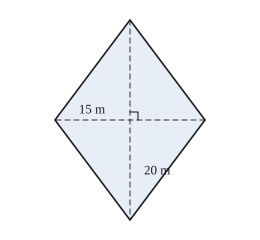
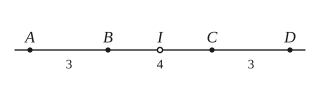

# Đề kiểm tra số 9

**Thời gian làm bài:** 90 phút. **Thang điểm:** mỗi câu 1 điểm, tổng 10 điểm.

## Đề bài

**Câu 1 (Lũy thừa).** Tìm số tự nhiên $x$ biết $(x - 5)^3 = 8$.

**Câu 2 (Chia hết).** Chứng tỏ rằng tổng của ba số tự nhiên liên tiếp luôn chia hết cho 3.

**Câu 3 (Tính hợp lý).** Tính $(-37) + 14 + 26 + 37$.

**Câu 4 (Hình thoi).** Một mảnh vườn hình thoi có hai đường chéo dài 20 m và 15 m. Người ta trồng hoa trên $\dfrac{3}{5}$ diện tích vườn. Tính diện tích trồng hoa.

**Câu 5 (Đối xứng).** Lục giác đều có bao nhiêu trục đối xứng? Có tâm đối xứng không?

**Câu 6 (Tổng phân số).** Tính $S = \dfrac{1}{2} + \dfrac{1}{6} + \dfrac{1}{12} + \dfrac{1}{20} + \dfrac{1}{30}$.

**Câu 7 (Bài toán phân số).** Một người bán $\dfrac{3}{7}$ số trứng, rồi bán tiếp $\dfrac{1}{4}$ số trứng còn lại thì còn 18 quả. Hỏi lúc đầu người đó có bao nhiêu quả trứng?

**Câu 8 (Giảm giá hai lần).** Một mặt hàng được giảm giá 10%, sau đó giảm tiếp 10% trên giá mới. Hỏi giá cuối cùng bằng bao nhiêu phần trăm giá ban đầu?

**Câu 9 (Trung điểm).** Trên một đường thẳng lấy bốn điểm $A, B, C, D$ theo thứ tự đó sao cho $AB = CD = 3$ cm, $BC = 4$ cm. Gọi $I$ là trung điểm của $BC$. Chứng tỏ $I$ cũng là trung điểm của $AD$.

**Câu 10 (Xác suất thực nghiệm).** Tung cùng lúc hai đồng xu 40 lần: hai mặt sấp 9 lần, một sấp một ngửa 21 lần, hai mặt ngửa 10 lần. Tính xác suất thực nghiệm của sự kiện "có ít nhất một đồng xu sấp".

---

## Lời giải chi tiết

### Câu 1
$8 = 2^3$, nên $x - 5 = 2$, $x = 7$.

### Câu 2
Ba số tự nhiên liên tiếp là $n, n + 1, n + 2$. Tổng: $3n + 3 = 3(n + 1)$ chia hết cho 3.

### Câu 3
$[(-37) + 37] + (14 + 26) = 0 + 40 = 40$.

### Câu 4

*Hình: Mảnh vườn hình thoi có hai đường chéo 20 m và 15 m.*

Diện tích vườn: $\dfrac{20 \cdot 15}{2} = 150 \text{ (m}^2)$. Trồng hoa: $150 \cdot \dfrac{3}{5} = 90 \text{ (m}^2)$.

### Câu 5
6 trục đối xứng; có tâm đối xứng (tâm của lục giác).

### Câu 6
$S = \left(1 - \dfrac{1}{2}\right) + \left(\dfrac{1}{2} - \dfrac{1}{3}\right) + \dots + \left(\dfrac{1}{5} - \dfrac{1}{6}\right) = 1 - \dfrac{1}{6} = \dfrac{5}{6}$.

### Câu 7
Sau lần đầu còn $\dfrac{4}{7}$ số trứng. Lần hai bán $\dfrac{1}{4}$ của phần đó, còn $\dfrac{4}{7} \cdot \dfrac{3}{4} = \dfrac{3}{7}$ số trứng, ứng với 18 quả.
Số trứng lúc đầu: $18 : \dfrac{3}{7} = 42$ (quả).

### Câu 8
$90\% \cdot 90\% = 81\%$ giá ban đầu (tức là giảm tất cả 19%).

### Câu 9

*Hình: Bốn điểm A, B, C, D trên một đường thẳng và trung điểm I của BC.*

$BI = IC = 2$ cm. $AI = AB + BI = 3 + 2 = 5$ (cm); $ID = IC + CD = 2 + 3 = 5$ (cm).
$I$ nằm giữa $A$ và $D$ và $IA = ID$, nên $I$ là trung điểm của $AD$.

### Câu 10
"Ít nhất một sấp" gồm hai sấp và một sấp một ngửa: $9 + 21 = 30$ lần. Xác suất thực nghiệm: $\dfrac{30}{40} = \dfrac{3}{4}$.
