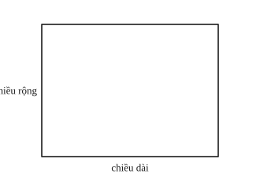
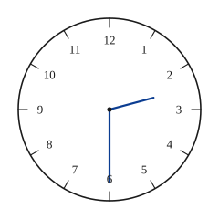

# Đề kiểm tra số 10

**Thời gian làm bài:** 90 phút. **Thang điểm:** mỗi câu 1 điểm, tổng 10 điểm.

## Đề bài

**Câu 1 (Tập hợp, lũy thừa).** a) Tập hợp các số chẵn có ba chữ số có bao nhiêu phần tử? b) Tính $2^{2025} : 2^{2023}$.

**Câu 2 (Bội chung).** Tìm các số tự nhiên $x$ là bội chung của 12 và 18, với $100 < x < 200$.

**Câu 3 (Tổng số nguyên).** Tính $S = -1 + 2 - 3 + 4 - \dots - 99 + 100$.

**Câu 4 (Hình chữ nhật).** Một mảnh đất hình chữ nhật có chu vi 56 m, chiều dài hơn chiều rộng 4 m. Tính diện tích mảnh đất.

**Câu 5 (Trục đối xứng).** Hình nào có đúng hai trục đối xứng: hình vuông, hình chữ nhật (không vuông), hình thoi (không vuông), tam giác đều?

**Câu 6 (Phân số).** Tìm các số nguyên $n$ để $\dfrac{2n + 7}{n + 1}$ là số nguyên.

**Câu 7 (Phân số).** Hai thùng dầu có tất cả 135 lít. Biết $\dfrac{3}{4}$ số dầu ở thùng thứ nhất bằng $\dfrac{3}{5}$ số dầu ở thùng thứ hai. Tính số dầu ở mỗi thùng.

**Câu 8 (Phần trăm).** Giá điện tăng 10% nhưng một gia đình giảm lượng điện tiêu thụ đi 10%. Tiền điện của gia đình tăng hay giảm bao nhiêu phần trăm?

**Câu 9 (Góc trên mặt đồng hồ).** Lúc 2 giờ 30 phút, góc nhỏ tạo bởi kim giờ và kim phút là bao nhiêu độ? Đó là góc gì?

**Câu 10 (Xác suất thực nghiệm).** Khảo sát 40 học sinh về thời gian tự học mỗi ngày: dưới 1 giờ: 6 bạn; từ 1 đến dưới 2 giờ: 18 bạn; từ 2 giờ trở lên: 16 bạn. Tính xác suất thực nghiệm để chọn ngẫu nhiên một bạn thì bạn đó tự học từ 1 giờ trở lên.

---

## Lời giải chi tiết

### Câu 1
a) Các số chẵn từ 100 đến 998: $\dfrac{998 - 100}{2} + 1 = 450$ phần tử. b) $2^2 = 4$.

### Câu 2
BCNN(12, 18) = 36. Bội chung trong khoảng: 108, 144, 180.

### Câu 3
$(-1 + 2) + (-3 + 4) + \dots + (-99 + 100)$: 50 cặp, mỗi cặp bằng 1. $S = 50$.

### Câu 4

*Hình: Hình chữ nhật có chu vi 56 m, chiều dài hơn chiều rộng 4 m.*

Nửa chu vi: 28 m. Chiều dài: $(28 + 4) : 2 = 16$ (m); chiều rộng: 12 m. Diện tích: $16 \cdot 12 = 192 \text{ (m}^2)$.

### Câu 5
Hình chữ nhật (không vuông) và hình thoi (không vuông) có đúng hai trục đối xứng. Hình vuông có 4 trục, tam giác đều có 3 trục.

### Câu 6
$\dfrac{2n + 7}{n + 1} = 2 + \dfrac{5}{n + 1}$. Cần $n + 1 \in \{\pm 1; \pm 5\}$.

**Đáp số:** $n \in \{0; -2; 4; -6\}$.

### Câu 7
$\dfrac{3}{4}$ thùng một bằng $\dfrac{3}{5}$ thùng hai, tức là $\dfrac{1}{4}$ thùng một bằng $\dfrac{1}{5}$ thùng hai. Thùng một 4 phần, thùng hai 5 phần, tổng 9 phần ứng với 135 lít, một phần 15 lít.
Thùng một: 60 lít; thùng hai: 75 lít.

### Câu 8
$110\% \cdot 90\% = 99\%$: tiền điện giảm 1%.

### Câu 9

*Hình: Mặt đồng hồ lúc 2 giờ 30 phút.*

Kim phút chỉ số 6, cách vị trí số 12 là $180^\circ$. Kim giờ ở giữa số 2 và số 3, cách vị trí số 12 là $2{,}5 \cdot 30^\circ = 75^\circ$.
Góc giữa hai kim: $180^\circ - 75^\circ = 105^\circ$, là góc tù.

### Câu 10
Tự học từ 1 giờ trở lên: $18 + 16 = 34$ bạn. Xác suất thực nghiệm: $\dfrac{34}{40} = \dfrac{17}{20}$.
