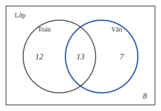

# Chủ đề 1. Tập hợp, đếm số phần tử, dãy số và tổng dãy

> Đếm số phần tử, đếm chữ số và tính tổng dãy là câu mở đầu quen thuộc trong đề HSG lớp 6. Nắm vững hai công thức "số số hạng" và "tổng dãy cách đều" cùng cách lập luận đếm là đủ để giải phần lớn các bài loại này.

## I. Kiến thức cần nắm

### 1. Tập hợp và tập con
- Tập hợp được viết bằng cách **liệt kê** các phần tử, ví dụ $A = \{1; 2; 3\}$, hoặc **chỉ ra tính chất đặc trưng**, ví dụ $B = \{x \in \mathbb{N} \mid x < 4\}$.
- $a \in A$: $a$ là phần tử của $A$; $a \notin A$: $a$ không thuộc $A$.
- Nếu mọi phần tử của $A$ đều thuộc $B$ thì $A$ là **tập con** của $B$, viết $A \subset B$. Tập rỗng $\varnothing$ là tập con của mọi tập hợp.
- **Số tập con:** một tập hợp có $n$ phần tử thì có $2^n$ tập con (kể cả $\varnothing$ và chính nó).

*Vì sao:* khi lập một tập con, với mỗi phần tử ta có đúng 2 cách chọn: lấy hoặc không lấy. Có $n$ phần tử nên số cách là $2 \cdot 2 \cdots 2 = 2^n$.

**Ví dụ.** $A = \{a; b; c\}$ có $2^3 = 8$ tập con: $\varnothing$, $\{a\}$, $\{b\}$, $\{c\}$, $\{a; b\}$, $\{a; c\}$, $\{b; c\}$, $\{a; b; c\}$.

### 2. Đếm số số hạng của dãy cách đều
Dãy cách đều là dãy mà hai số hạng liên tiếp hơn kém nhau cùng một số $d$ (khoảng cách). Khi đó
$$\boxed{\text{Số số hạng} = \frac{\text{Số cuối} - \text{Số đầu}}{d} + 1}$$

*Vì sao:* từ số đầu đến số cuối có $\frac{\text{Số cuối} - \text{Số đầu}}{d}$ "bước nhảy". Số số hạng nhiều hơn số bước nhảy là 1 (giống như trồng cây hai đầu đường: số cây hơn số khoảng là 1).

**Số hạng thứ $n$:** $\text{Số đầu} + (n - 1)\cdot d$.

**Ví dụ.** Dãy $5; 8; 11; \dots; 302$ có $\frac{302 - 5}{3} + 1 = 100$ số hạng. Số hạng thứ $50$ là $5 + 49 \cdot 3 = 152$.

### 3. Tổng của dãy cách đều
$$\boxed{\text{Tổng} = \frac{(\text{Số đầu} + \text{Số cuối}) \times \text{Số số hạng}}{2}}$$

*Vì sao (cách của Gauss):* viết tổng $S$ theo thứ tự xuôi, rồi viết lại theo thứ tự ngược ngay bên dưới. Cộng từng cột, cột nào cũng bằng $\text{Số đầu} + \text{Số cuối}$. Có bao nhiêu số hạng thì có bấy nhiêu cột, nên $2S = (\text{Số đầu} + \text{Số cuối}) \times \text{Số số hạng}$.

**Ví dụ.** $1 + 2 + 3 + \dots + 100 = \frac{(1 + 100)\cdot 100}{2} = 5050$.

**Tổng đan dấu:** với $1 - 2 + 3 - 4 + \dots$, hãy **nhóm từng cặp** để mỗi cặp có cùng giá trị.

### 4. Đếm chữ số
- Từ $1$ đến $9$: $9$ số có một chữ số, dùng $9$ chữ số.
- Từ $10$ đến $99$: $90$ số có hai chữ số, dùng $180$ chữ số.
- Từ $100$ đến $999$: $900$ số có ba chữ số, dùng $2700$ chữ số.

**Hai bài toán ngược nhau:**
- *Biết số trang, tìm số chữ số:* cộng số chữ số của từng nhóm.
- *Biết số chữ số, tìm số trang (hoặc tìm chữ số thứ $k$ của dãy $123456789101112\dots$):* trừ dần số chữ số của các nhóm đã dùng hết, phần còn lại chia cho số chữ số của nhóm tiếp theo.

**Ví dụ.** Đánh số trang từ $1$ đến $120$ cần $9 + 180 + 21 \cdot 3 = 252$ chữ số (từ $100$ đến $120$ có $21$ số).

### 5. Đếm bằng bù trừ (biểu đồ Ven)
Với hai tập hợp $A$, $B$, gọi $n(A)$ là số phần tử của $A$. Số phần tử thuộc **ít nhất một** trong hai tập là
$$n(A) + n(B) - n(\text{cả } A \text{ và } B).$$
*Vì sao:* khi cộng $n(A) + n(B)$, những phần tử thuộc cả hai tập bị đếm **hai lần**, nên phải trừ đi một lần.

**Ví dụ.** Từ $1$ đến $100$ có $50$ số chẵn, $33$ số chia hết cho $3$, và $16$ số chia hết cho cả $2$ và $3$ (tức chia hết cho $6$). Số chia hết cho $2$ hoặc $3$ là $50 + 33 - 16 = 67$.

### 6. Một số tổng đặc biệt
- **Tổng các số lẻ liên tiếp:** $1 + 3 + 5 + \dots + (2n - 1) = n \cdot n$. Ví dụ $1 + 3 + 5 + 7 = 16$.
- **Số tam giác:** $1;\ 3;\ 6;\ 10;\ 15;\ \dots$, số hạng thứ $n$ là $1 + 2 + \dots + n = \frac{n(n + 1)}{2}$.
- **Tổng tích hai số liên tiếp:** $S = 1\cdot 2 + 2 \cdot 3 + \dots + n(n + 1)$. Nhân $S$ với $3$ và tách $3 = (k + 2) - (k - 1)$:
$$k(k + 1)\cdot 3 = k(k + 1)(k + 2) - (k - 1)k(k + 1).$$
Cộng lại, các số hạng triệt tiêu dần, còn $3S = n(n + 1)(n + 2)$.

**Ví dụ.** $1 \cdot 2 + 2 \cdot 3 + 3 \cdot 4 = \frac{3 \cdot 4 \cdot 5}{3} = 20$. Kiểm tra: $2 + 6 + 12 = 20$.

### 7. Sai lầm hay gặp
- Quên "$+1$" khi đếm số số hạng: từ $10$ đến $20$ có $11$ số, không phải $10$ số.
- Tính số số hạng của dãy cách đều $d$ mà quên chia cho $d$.
- Khi đếm "chia hết cho $2$ hoặc $3$", cộng thẳng $50 + 33$ mà không trừ phần chung.
- Ở bài "chữ số thứ $k$": nếu phép chia hết thì chữ số cần tìm là **chữ số cuối** của số cuối cùng, nếu còn dư $r$ thì là chữ số thứ $r$ của **số tiếp theo**.

---

## II. Bài tập vận dụng

**Bài 1.** Cho dãy số $13;\ 17;\ 21;\ \dots;\ 2025$.
a) Dãy có bao nhiêu số hạng?
b) Tính tổng các số hạng của dãy.

**Bài 2.** Cho tập hợp $A = \{1; 2; 3; 4; 5\}$.
a) Tập $A$ có bao nhiêu tập con?
b) Có bao nhiêu tập con của $A$ chứa phần tử $1$ nhưng không chứa phần tử $5$?

**Bài 3 (đánh số trang).**
a) Để đánh số trang một cuốn sách dày $256$ trang (bắt đầu từ trang $1$) cần bao nhiêu chữ số?
b) Để đánh số trang một cuốn sách khác cần dùng tất cả $2025$ chữ số. Cuốn sách đó có bao nhiêu trang?

**Bài 4.**
a) Tính $S = 1 - 2 + 3 - 4 + \dots + 2023 - 2024 + 2025$.
b) Tìm số tự nhiên $x$ biết $(x + 1) + (x + 4) + (x + 7) + \dots + (x + 28) = 155$.

**Bài 5 (biểu đồ Ven).** Lớp 6A có $40$ học sinh. Có $25$ bạn thích môn Toán, $20$ bạn thích môn Văn và $8$ bạn không thích môn nào trong hai môn đó. Hỏi có bao nhiêu bạn thích cả hai môn? Bao nhiêu bạn chỉ thích môn Văn?

**Bài 6.** Viết liên tiếp các số tự nhiên từ $1$ trở đi thành một dãy chữ số: $1234567891011121314\dots$ Chữ số thứ $2026$ (tính từ trái sang) là chữ số nào?

**Bài 7.** Trong các số tự nhiên từ $1$ đến $1000$:
a) Có bao nhiêu số không chia hết cho $2$ và cũng không chia hết cho $5$?
b) Có bao nhiêu số chia hết cho $3$ hoặc chia hết cho $5$?

**Bài 8 (số tam giác).** Cho dãy số $1;\ 3;\ 6;\ 10;\ 15;\ \dots$
a) Tìm số hạng thứ $100$ của dãy.
b) Các số $2016$ và $2025$ có thuộc dãy không? Nếu có, đó là số hạng thứ mấy?

**Bài 9.** Tính $S = 1\cdot 2 + 2 \cdot 3 + 3 \cdot 4 + \dots + 99 \cdot 100$.

**Bài 10.** Cho dãy số $1;\ 2;\ 2;\ 3;\ 3;\ 3;\ 4;\ 4;\ 4;\ 4;\ \dots$ (số $n$ được viết đúng $n$ lần liên tiếp). Số hạng thứ $2025$ của dãy là số nào?

**Bài 11.** Viết các số tự nhiên khác $0$ không chia hết cho $3$ theo thứ tự tăng dần: $1;\ 2;\ 4;\ 5;\ 7;\ 8;\ 10;\ \dots$
a) Tìm số hạng thứ $2025$ của dãy.
b) Tính tổng $100$ số hạng đầu tiên của dãy.

**Bài 12.** Cho tập hợp $A = \{1; 2; 3; \dots; 20\}$. Có bao nhiêu tập con của $A$ gồm đúng hai phần tử mà tổng hai phần tử đó là số chẵn?

**Bài 13 (đề HSG).** Tính tổng tất cả các chữ số của các số tự nhiên từ $1$ đến $999$.

---

## III. Lời giải chi tiết

### Bài 1
a) Dãy cách đều với khoảng cách $4$. Số số hạng là $\frac{2025 - 13}{4} + 1 = 503 + 1 = 504$.

b) Tổng là $\frac{(13 + 2025)\cdot 504}{2} = 2038 \cdot 252 = 513\,576$.

**Đáp số:** a) $504$ số hạng; b) $513\,576$.

### Bài 2
a) $A$ có $5$ phần tử nên có $2^5 = 32$ tập con.

b) Phần tử $1$ bắt buộc lấy, phần tử $5$ bắt buộc không lấy. Mỗi phần tử $2$, $3$, $4$ có hai cách (lấy hoặc không lấy). Số tập con là $2 \cdot 2 \cdot 2 = 8$.
Đó là: $\{1\}$, $\{1; 2\}$, $\{1; 3\}$, $\{1; 4\}$, $\{1; 2; 3\}$, $\{1; 2; 4\}$, $\{1; 3; 4\}$, $\{1; 2; 3; 4\}$.

**Đáp số:** a) $32$; b) $8$.

### Bài 3
a) Trang $1$ đến $9$: $9$ chữ số. Trang $10$ đến $99$: $90 \cdot 2 = 180$ chữ số. Trang $100$ đến $256$ có $256 - 100 + 1 = 157$ trang, dùng $157 \cdot 3 = 471$ chữ số.
Tổng cộng: $9 + 180 + 471 = 660$ chữ số.

b) Các trang $1$ đến $99$ dùng hết $9 + 180 = 189$ chữ số. Còn lại $2025 - 189 = 1836$ chữ số dùng cho các trang có ba chữ số, tức là $1836 : 3 = 612$ trang (từ trang $100$).
Trang cuối là $100 + 612 - 1 = 711$.

**Đáp số:** a) $660$ chữ số; b) $711$ trang.

### Bài 4
a) Từ $1$ đến $2024$ có $2024$ số, ghép thành $1012$ cặp $(1 - 2), (3 - 4), \dots, (2023 - 2024)$. Viết lại theo thứ tự khác cho dễ tính:
$$S = 1 + (3 - 2) + (5 - 4) + \dots + (2025 - 2024).$$
Từ $3$ đến $2025$ có $1012$ số lẻ, nên có $1012$ cặp, mỗi cặp bằng $1$. Vậy $S = 1 + 1012 = 1013$.

b) Các số $1; 4; 7; \dots; 28$ có $\frac{28 - 1}{3} + 1 = 10$ số, tổng là $\frac{(1 + 28)\cdot 10}{2} = 145$.
Vế trái có $10$ số hạng chứa $x$, nên bằng $10x + 145$. Ta có $10x + 145 = 155$, suy ra $10x = 10$, $x = 1$.

**Đáp số:** a) $S = 1013$; b) $x = 1$.

### Bài 5

*Hình: Biểu đồ Ven của lớp 6A.*

Số bạn thích ít nhất một môn là $40 - 8 = 32$.
Nếu cộng $25 + 20 = 45$ thì những bạn thích cả hai môn bị đếm hai lần. Do đó số bạn thích cả hai môn là $45 - 32 = 13$.
Số bạn chỉ thích Văn là $20 - 13 = 7$ (và số bạn chỉ thích Toán là $25 - 13 = 12$; kiểm tra: $12 + 13 + 7 + 8 = 40$).

**Đáp số:** $13$ bạn thích cả hai môn; $7$ bạn chỉ thích Văn.

### Bài 6
Các số từ $1$ đến $99$ dùng $189$ chữ số. Còn lại $2026 - 189 = 1837$ chữ số thuộc các số có ba chữ số.
$1837 = 3 \cdot 612 + 1$. Vậy $612$ số có ba chữ số đầu tiên (từ $100$ đến $711$) được viết hết, và chữ số thứ $2026$ là **chữ số đầu tiên của số tiếp theo**, tức số $712$.

**Đáp số:** chữ số $7$.

*Nhận xét:* Nếu phép chia không dư, chữ số cần tìm là chữ số cuối của số cuối cùng. Chẳng hạn chữ số thứ $2025$ là chữ số cuối của $711$, tức là $1$.

### Bài 7
a) Từ $1$ đến $1000$ có $500$ số chia hết cho $2$, $200$ số chia hết cho $5$ và $100$ số chia hết cho cả $2$ và $5$ (tức là chia hết cho $10$).
Số chia hết cho $2$ hoặc $5$: $500 + 200 - 100 = 600$. Số không chia hết cho $2$ và không chia hết cho $5$: $1000 - 600 = 400$.

b) Số chia hết cho $3$: các số $3; 6; \dots; 999$, có $\frac{999 - 3}{3} + 1 = 333$ số. Số chia hết cho $5$: $200$ số. Số chia hết cho cả $3$ và $5$ (tức chia hết cho $15$): $15; 30; \dots; 990$, có $\frac{990 - 15}{15} + 1 = 66$ số.
Số chia hết cho $3$ hoặc $5$: $333 + 200 - 66 = 467$.

**Đáp số:** a) $400$; b) $467$.

### Bài 8
Ta thấy $1 = 1$, $3 = 1 + 2$, $6 = 1 + 2 + 3$, $10 = 1 + 2 + 3 + 4$, ... Số hạng thứ $n$ là $1 + 2 + \dots + n = \frac{n(n + 1)}{2}$.

a) Số hạng thứ $100$ là $\frac{100 \cdot 101}{2} = 5050$.

b) Số $a$ thuộc dãy khi $2a$ bằng tích hai số tự nhiên liên tiếp $n(n + 1)$.
- $2 \cdot 2016 = 4032 = 63 \cdot 64$. Vậy $2016$ là số hạng thứ $63$.
- $2 \cdot 2025 = 4050$. Ta có $63 \cdot 64 = 4032 < 4050 < 4160 = 64 \cdot 65$, nên $4050$ không là tích hai số tự nhiên liên tiếp. Vậy $2025$ không thuộc dãy.

**Đáp số:** a) $5050$; b) $2016$ là số hạng thứ $63$; $2025$ không thuộc dãy.

### Bài 9
Nhân $S$ với $3$. Với mỗi $k$, viết $3 = (k + 2) - (k - 1)$:
$$3k(k + 1) = k(k + 1)(k + 2) - (k - 1)k(k + 1).$$
Do đó
$$\begin{aligned}3S &= 1\cdot 2 \cdot 3 + (2 \cdot 3 \cdot 4 - 1 \cdot 2 \cdot 3) + (3 \cdot 4 \cdot 5 - 2 \cdot 3 \cdot 4) + \dots + (99 \cdot 100 \cdot 101 - 98 \cdot 99 \cdot 100)\\ &= 99 \cdot 100 \cdot 101.\end{aligned}$$
Suy ra $S = 33 \cdot 100 \cdot 101 = 333\,300$.

**Đáp số:** $S = 333\,300$.

*Nhận xét:* Kỹ thuật "nhân thêm rồi tách thành hiệu" làm các số hạng triệt tiêu liên tiếp. Tương tự, $1 \cdot 2 \cdot 3 + 2 \cdot 3 \cdot 4 + \dots + n(n + 1)(n + 2)$ nhân với $4$ sẽ thu gọn được.

### Bài 10
Số $n$ cuối cùng xuất hiện ở vị trí thứ $1 + 2 + \dots + n = \frac{n(n + 1)}{2}$.
- Với $n = 63$: vị trí cuối của số $63$ là $\frac{63 \cdot 64}{2} = 2016$.
- Với $n = 64$: vị trí cuối của số $64$ là $2016 + 64 = 2080$.

Vì $2016 < 2025 \le 2080$ nên số hạng thứ $2025$ là $64$.

**Đáp số:** $64$.

### Bài 11
a) Chia dãy thành từng cặp: $(1; 2), (4; 5), (7; 8), \dots$ Cặp thứ $k$ là $(3k - 2;\ 3k - 1)$. Số hạng thứ $2k - 1$ là $3k - 2$, số hạng thứ $2k$ là $3k - 1$.
$2025 = 2 \cdot 1013 - 1$, nên số hạng thứ $2025$ là số đầu của cặp thứ $1013$: $3 \cdot 1013 - 2 = 3037$.

b) $100$ số hạng đầu gồm $50$ cặp. Tổng cặp thứ $k$ là $(3k - 2) + (3k - 1) = 6k - 3$. Các tổng $3; 9; 15; \dots; 297$ là dãy cách đều $6$, có $50$ số hạng, nên tổng là $\frac{(3 + 297)\cdot 50}{2} = 7500$.

*Cách khác cho b):* $100$ số hạng đầu là các số từ $1$ đến $149$ bỏ đi các bội của $3$. Tổng từ $1$ đến $149$ là $11\,175$; tổng các bội của $3$ là $3 + 6 + \dots + 147 = 3675$; hiệu là $7500$.

**Đáp số:** a) $3037$; b) $7500$.

### Bài 12
Tổng hai số là số chẵn khi hai số **cùng chẵn** hoặc **cùng lẻ**.
- $A$ có $10$ số chẵn. Chọn hai số chẵn khác nhau: mỗi số ghép được với $9$ số còn lại, được $10 \cdot 9 = 90$ cách, nhưng mỗi tập $\{a; b\}$ được đếm hai lần, nên có $90 : 2 = 45$ tập.
- Tương tự, có $45$ tập gồm hai số lẻ.

Tổng cộng: $45 + 45 = 90$ tập con.

**Đáp số:** $90$.

### Bài 13
Thêm số $0$ (không làm thay đổi tổng) và viết mọi số từ $0$ đến $999$ dưới dạng đủ ba chữ số: $000; 001; \dots; 999$. Có tất cả $1000$ số, dùng $3000$ chữ số.
Ở **hàng đơn vị**, mỗi chữ số $0; 1; \dots; 9$ xuất hiện như nhau, tức $1000 : 10 = 100$ lần. Hàng chục và hàng trăm cũng vậy.
Tổng các chữ số ở một hàng là $100 \cdot (0 + 1 + \dots + 9) = 100 \cdot 45 = 4500$. Ba hàng cho tổng $3 \cdot 4500 = 13\,500$.

**Đáp số:** $13\,500$.

*Nhận xét:* Viết thêm chữ số $0$ ở đầu để các số "đủ chữ số" giúp đếm đều theo từng hàng. Đây là mẹo rất hay dùng trong bài đếm chữ số.
