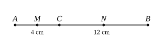
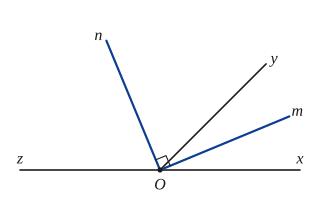
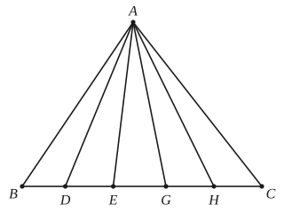
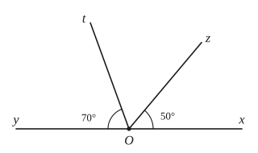

# Chủ đề 9. Hình học: đoạn thẳng, góc, tia phân giác, đếm hình

> Hình học trong đề học sinh giỏi lớp 6 gồm tính độ dài đoạn thẳng (với lập luận điểm nằm giữa, trung điểm), tính số đo góc (tia nằm giữa, tia phân giác, góc kề bù) và đếm hình (đoạn thẳng, góc, tam giác, giao điểm). Điều quan trọng là **lập luận chặt chẽ** vì sao một điểm (một tia) nằm giữa.

## I. Kiến thức cần nắm

### 1. Đoạn thẳng, trung điểm

- $M$ nằm giữa $A$ và $B$ thì $AM + MB = AB$.
- Trên tia $Ox$, nếu $OA < OB$ thì $A$ nằm giữa $O$ và $B$.
- Hai tia đối nhau $Ox$, $Oy$, $A \in Ox$, $B \in Oy$ (khác $O$) thì $O$ nằm giữa $A$ và $B$.
- $M$ là trung điểm của $AB$: $MA = MB = \dfrac{AB}{2}$.
- **Kết quả hay dùng:** $C$ nằm giữa $A$, $B$; $M$, $N$ lần lượt là trung điểm của $AC$, $CB$ thì $MN = \dfrac{AB}{2}$ (không phụ thuộc vị trí của $C$).

### 2. Góc

- Tia $Oz$ nằm giữa hai tia $Ox$, $Oy$ thì $\widehat{xOz} + \widehat{zOy} = \widehat{xOy}$.
- Trên cùng một nửa mặt phẳng bờ chứa tia $Ox$, nếu $\widehat{xOz} < \widehat{xOy}$ thì tia $Oz$ nằm giữa $Ox$, $Oy$.
- **Hai góc kề bù:** có chung một cạnh, hai cạnh còn lại là hai tia đối nhau; tổng bằng $180^\circ$.
- **Tia phân giác** $Ot$ của $\widehat{xOy}$: nằm giữa $Ox$, $Oy$ và $\widehat{xOt} = \widehat{tOy} = \dfrac{\widehat{xOy}}{2}$.
- **Hai tia phân giác của hai góc kề bù vuông góc với nhau** (tạo góc $90^\circ$).

### 3. Đếm hình

| Hình | Số lượng |
|---|---|
| Đoạn thẳng từ $n$ điểm | $\dfrac{n(n - 1)}{2}$ |
| Góc từ $n$ tia chung gốc | $\dfrac{n(n - 1)}{2}$ |
| Tam giác từ $n$ điểm, không có 3 điểm thẳng hàng | $\dfrac{n(n - 1)(n - 2)}{6}$ |
| Giao điểm của $n$ đường thẳng, không có 2 đường song song, không có 3 đường đồng quy | $\dfrac{n(n - 1)}{2}$ |

Nếu có các trường hợp đặc biệt (điểm thẳng hàng, đường song song, góc bẹt), đếm như trường hợp tổng quát rồi **trừ bớt** phần đếm thừa.

### 4. Sai lầm hay gặp

- Cộng góc khi chưa chứng tỏ tia nằm giữa.
- Đếm góc từ $n$ đường thẳng đồng quy mà quên trừ các góc bẹt.
- Quên trường hợp các tia nằm ở hai nửa mặt phẳng khác nhau.

## II. Bài tập vận dụng

**Bài 1.** Trên một đường thẳng lấy 10 điểm phân biệt. Có bao nhiêu đoạn thẳng có hai đầu mút là hai trong 10 điểm đó?

**Bài 2.** Trên tia $Ox$ lấy ba điểm $A, B, C$ sao cho $OA = 2$ cm, $OB = 5$ cm, $OC = 8$ cm. Điểm $B$ có phải là trung điểm của đoạn $AC$ không? Vì sao?

**Bài 3.** Cho đoạn thẳng $AB = 12$ cm, điểm $C$ nằm giữa $A$ và $B$ với $AC = 4$ cm. Gọi $M$, $N$ lần lượt là trung điểm của $AC$ và $CB$. Tính $MN$. Nếu $C$ là một điểm bất kỳ nằm giữa $A$ và $B$ thì $MN$ bằng bao nhiêu?

**Bài 4.** Cho hai tia đối nhau $Ox$ và $Oy$. Lấy $A$ trên tia $Ox$ với $OA = 3$ cm, $B$ trên tia $Oy$ với $OB = 5$ cm. Gọi $I$ là trung điểm của $AB$. Tính $AB$ và $OI$.

**Bài 5.** Tia $Oz$ nằm giữa hai tia $Ox$ và $Oy$, $\widehat{xOz} = 40^\circ$, $\widehat{xOy} = 110^\circ$. Tính $\widehat{zOy}$.

**Bài 6.** Cho $\widehat{xOy} = 120^\circ$, $Ot$ là tia phân giác của $\widehat{xOy}$. Tính $\widehat{xOt}$. Vẽ tia $Om$ là tia phân giác của $\widehat{xOt}$; tính $\widehat{mOy}$.

**Bài 7.** Cho hai góc kề bù $\widehat{xOy}$ và $\widehat{yOz}$, biết $\widehat{xOy} = 3 \cdot \widehat{yOz}$.
a) Tính số đo mỗi góc. b) Gọi $Om$, $On$ lần lượt là tia phân giác của $\widehat{xOy}$ và $\widehat{yOz}$. Tính $\widehat{mOn}$.

**Bài 8.** Vẽ 6 tia chung gốc $O$ (không có hai tia nào trùng nhau). Có bao nhiêu góc được tạo thành?

**Bài 9.** Cho tam giác $ABC$. Trên cạnh $BC$ lấy 4 điểm $D, E, G, H$ (khác $B$, $C$) rồi nối $A$ với mỗi điểm đó. Hỏi trong hình có bao nhiêu tam giác?

**Bài 10.** Cho 8 điểm, trong đó không có ba điểm nào thẳng hàng. Có bao nhiêu tam giác có ba đỉnh là ba trong tám điểm đó?

**Bài 11.** Trên đường thẳng $xy$ lấy điểm $O$. Trên cùng một nửa mặt phẳng bờ $xy$ vẽ hai tia $Oz$, $Ot$ sao cho $\widehat{xOz} = 50^\circ$, $\widehat{yOt} = 70^\circ$. Tính $\widehat{zOt}$.

**Bài 12.** Vẽ 5 đường thẳng phân biệt cùng đi qua điểm $O$. Có bao nhiêu góc (không kể góc bẹt) có đỉnh $O$ được tạo thành?

**Bài 13 (khó).** Có 20 đường thẳng, trong đó có đúng hai đường thẳng song song với nhau, ngoài ra không có hai đường nào song song và không có ba đường nào cùng đi qua một điểm. Hỏi có bao nhiêu giao điểm?

---

## III. Lời giải chi tiết

### Bài 1
$\dfrac{10 \cdot 9}{2} = 45$ (đoạn thẳng).

### Bài 2
Trên tia $Ox$: $OA < OB$ nên $A$ nằm giữa $O$ và $B$, $AB = 5 - 2 = 3$ (cm). $OB < OC$ nên $B$ nằm giữa $O$ và $C$, $BC = 8 - 5 = 3$ (cm).
Vì $OA < OB < OC$ nên $B$ nằm giữa $A$ và $C$; lại có $AB = BC = 3$ cm. Vậy $B$ là trung điểm của $AC$.

### Bài 3

*Hình: Đoạn thẳng AB, điểm C và trung điểm M của AC, N của CB.*

$CB = 12 - 4 = 8$ (cm). $MC = 2$ cm, $CN = 4$ cm. $C$ nằm giữa $M$ và $N$ nên $MN = 2 + 4 = 6$ (cm).
Tổng quát: $MN = MC + CN = \dfrac{AC}{2} + \dfrac{CB}{2} = \dfrac{AB}{2} = 6$ (cm), không phụ thuộc vị trí của $C$.

### Bài 4
$O$ nằm giữa $A$ và $B$ nên $AB = 3 + 5 = 8$ (cm). $IA = 4$ cm.
Vì $OA = 3 < 4 = IA$ nên $O$ nằm giữa $A$ và $I$ (cùng nằm trên tia $AB$): $OI = IA - OA = 1$ (cm). Điểm $I$ nằm trên tia $Oy$.

### Bài 5
$Oz$ nằm giữa $Ox$, $Oy$ nên $\widehat{zOy} = 110^\circ - 40^\circ = 70^\circ$.

### Bài 6
$\widehat{xOt} = 120^\circ : 2 = 60^\circ$. $\widehat{xOm} = \widehat{mOt} = 30^\circ$.
Tia $Ot$ nằm giữa $Om$ và $Oy$: $\widehat{mOy} = \widehat{mOt} + \widehat{tOy} = 30^\circ + 60^\circ = 90^\circ$.

### Bài 7

*Hình: Hai góc kề bù xOy và yOz với hai tia phân giác Om và On.*

a) $\widehat{xOy} + \widehat{yOz} = 180^\circ$ và $\widehat{xOy} = 3 \cdot \widehat{yOz}$, nên $4 \cdot \widehat{yOz} = 180^\circ$: $\widehat{yOz} = 45^\circ$, $\widehat{xOy} = 135^\circ$.
b) $\widehat{mOy} = 67{,}5^\circ$, $\widehat{yOn} = 22{,}5^\circ$. Tia $Oy$ nằm giữa $Om$ và $On$: $\widehat{mOn} = 67{,}5^\circ + 22{,}5^\circ = 90^\circ$.

*Nhận xét:* $\widehat{mOn} = \dfrac{\widehat{xOy} + \widehat{yOz}}{2} = 90^\circ$ với mọi cặp góc kề bù.

### Bài 8
$\dfrac{6 \cdot 5}{2} = 15$ (góc).

### Bài 9

*Hình: Tam giác ABC với bốn điểm trên BC nối với A.*

Mỗi tam giác có đỉnh $A$ và cạnh đối diện là một đoạn thẳng trên $BC$. Trên $BC$ có 6 điểm $B, D, E, G, H, C$ tạo $\dfrac{6 \cdot 5}{2} = 15$ đoạn thẳng.

**Đáp số:** 15 tam giác.

### Bài 10
Chọn có thứ tự 3 điểm: $8 \cdot 7 \cdot 6 = 336$ cách; mỗi tam giác được đếm $3 \cdot 2 \cdot 1 = 6$ lần. Số tam giác: $336 : 6 = 56$.

### Bài 11

*Hình: Trên đường thẳng xy, hai tia Oz và Ot cùng phía.*

$\widehat{xOt} = 180^\circ - 70^\circ = 110^\circ$ (kề bù với $\widehat{yOt}$). Trên cùng nửa mặt phẳng bờ chứa $Ox$: $\widehat{xOz} = 50^\circ < 110^\circ = \widehat{xOt}$ nên $Oz$ nằm giữa $Ox$ và $Ot$.
$\widehat{zOt} = 110^\circ - 50^\circ = 60^\circ$.

### Bài 12
5 đường thẳng qua $O$ tạo thành 10 tia chung gốc, cho $\dfrac{10 \cdot 9}{2} = 45$ góc. Trong đó có 5 góc bẹt (mỗi đường thẳng một góc).
Số góc không kể góc bẹt: $45 - 5 = 40$.

### Bài 13
Nếu không có hai đường nào song song thì có $\dfrac{20 \cdot 19}{2} = 190$ giao điểm. Hai đường song song không cắt nhau, nên mất đúng 1 giao điểm.
Số giao điểm: $190 - 1 = 189$.
