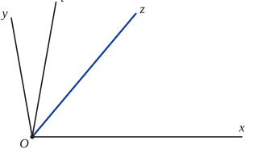

# Đề thi thử số 1

**Thời gian làm bài:** 120 phút. **Thang điểm:** mỗi câu 1 điểm, tổng 10 điểm.

## Đề bài

**Câu 1 (Tập hợp, dãy số).** Cho $A = \{x \in \mathbb{N} \mid x = 3k + 1,\ k \in \mathbb{N},\ x < 50\}$. Tập $A$ có bao nhiêu phần tử? Tính tổng các phần tử của $A$.

**Câu 2 (Lũy thừa).** So sánh $2^{300}$ và $3^{200}$.

**Câu 3 (Chia hết).** Chứng minh rằng tích của ba số tự nhiên liên tiếp luôn chia hết cho 6.

**Câu 4 (Số nguyên tố).** Tìm số nguyên tố $p$ sao cho $p + 10$ và $p + 14$ cũng là số nguyên tố.

**Câu 5 (ƯCLN, BCNN).** Tìm hai số tự nhiên $a \le b$ biết ƯCLN$(a, b) = 6$ và BCNN$(a, b) = 72$.

**Câu 6 (Số nguyên).** Tìm các số nguyên $x$ sao cho $(x + 3)(x - 4) < 0$.

**Câu 7 (Tổng phân số).** Tính $A = \dfrac{1}{1 \cdot 3} + \dfrac{1}{3 \cdot 5} + \dots + \dfrac{1}{19 \cdot 21}$.

**Câu 8 (Chuyển động).** Một người đi từ A đến B. Trên $\dfrac{1}{3}$ quãng đường đầu người đó đi với vận tốc 15 km/h, quãng đường còn lại đi với vận tốc 10 km/h. Tổng thời gian đi là 4 giờ. Tính quãng đường $AB$.

**Câu 9 (Góc).** Cho $\widehat{xOy} = 100^\circ$, $Oz$ là tia phân giác của $\widehat{xOy}$. Vẽ tia $Ot$ nằm trong $\widehat{yOz}$ sao cho $\widehat{yOt} = 20^\circ$. Tính $\widehat{xOt}$.

**Câu 10 (Đếm, bù trừ).** Có bao nhiêu số tự nhiên từ 1 đến 1 000 chia hết cho 2 hoặc chia hết cho 5?

---

## Lời giải chi tiết

### Câu 1
$A = \{1; 4; 7; \dots; 49\}$, dãy cách đều 3. Số phần tử: $(49 - 1) : 3 + 1 = 17$. Tổng: $(1 + 49) \cdot 17 : 2 = 425$.

### Câu 2
$2^{300} = (2^3)^{100} = 8^{100}$, $3^{200} = (3^2)^{100} = 9^{100}$. Vì $8 < 9$ nên $2^{300} < 3^{200}$.

### Câu 3
Trong ba số tự nhiên liên tiếp có ít nhất một số chẵn, nên tích chia hết cho 2; có đúng một số chia hết cho 3, nên tích chia hết cho 3. Vì ƯCLN(2, 3) = 1 nên tích chia hết cho 6.

### Câu 4
Xét số dư của $p$ khi chia cho 3:
- $p = 3$: $p + 10 = 13$, $p + 14 = 17$ đều nguyên tố. Thỏa mãn.
- $p = 3k + 1$: $p + 14 = 3(k + 5)$ chia hết cho 3 và lớn hơn 3, là hợp số.
- $p = 3k + 2$: $p + 10 = 3(k + 4)$ là hợp số.

**Đáp số:** $p = 3$.

### Câu 5
$a = 6m$, $b = 6n$ với ƯCLN$(m, n) = 1$, $m \le n$. BCNN$(a, b) = 6mn = 72$ nên $mn = 12$: $(m, n) \in \{(1, 12), (3, 4)\}$ (cặp $(2, 6)$ bị loại vì không nguyên tố cùng nhau).

**Đáp số:** $(6; 72)$ và $(18; 24)$.

### Câu 6
Hai thừa số trái dấu, mà $x - 4 < x + 3$, nên $x - 4 < 0 < x + 3$: $-3 < x < 4$.

**Đáp số:** $x \in \{-2; -1; 0; 1; 2; 3\}$.

### Câu 7
$\dfrac{1}{(2k - 1)(2k + 1)} = \dfrac{1}{2}\left(\dfrac{1}{2k - 1} - \dfrac{1}{2k + 1}\right)$. $A = \dfrac{1}{2}\left(1 - \dfrac{1}{21}\right) = \dfrac{10}{21}$.

### Câu 8
Gọi quãng đường là $s$ (km). Thời gian: $\dfrac{s}{3} : 15 + \dfrac{2s}{3} : 10 = \dfrac{s}{45} + \dfrac{s}{15} = \dfrac{4s}{45} = 4$, nên $s = 45$.

**Đáp số:** 45 km.

### Câu 9

*Hình: Góc xOy, tia phân giác Oz và tia Ot.*

$\widehat{xOz} = \widehat{zOy} = 50^\circ$. Tia $Ot$ nằm trong $\widehat{yOz}$ nên $\widehat{zOt} = 50^\circ - 20^\circ = 30^\circ$. Tia $Oz$ nằm giữa $Ox$ và $Ot$: $\widehat{xOt} = 50^\circ + 30^\circ = 80^\circ$.

### Câu 10
Chia hết cho 2: 500 số; cho 5: 200 số; cho 10 (cả 2 và 5): 100 số. Chia hết cho 2 hoặc 5: $500 + 200 - 100 = 600$ (số).
