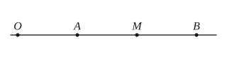

# Đề thi thử số 2

**Thời gian làm bài:** 120 phút. **Thang điểm:** mỗi câu 1 điểm, tổng 10 điểm.

## Đề bài

**Câu 1 (Tổng dãy).** Tính $S = 1 + 4 + 7 + \dots + 100$.

**Câu 2 (Lũy thừa).** Tìm số tự nhiên $x$ biết $2^{x + 1} + 2^x = 96$.

**Câu 3 (Chia hết).** Tìm các chữ số $a, b$ để số $\overline{12a4b}$ chia hết cho 45.

**Câu 4 (Số chính phương).** Tìm số tự nhiên $n$ để $n^2 + 12$ là số chính phương.

**Câu 5 (BCNN).** Số học sinh khối 6 của một trường trong khoảng từ 300 đến 400. Khi xếp hàng 12, hàng 15, hàng 18 đều thừa 5 em. Tính số học sinh khối 6.

**Câu 6 (Nghiệm nguyên).** Tìm các cặp số nguyên $(x; y)$ thỏa mãn $xy - 2x + y = 5$.

**Câu 7 (So sánh phân số).** So sánh $A = \dfrac{2025}{2026} + \dfrac{2026}{2027}$ và $B = \dfrac{2025 + 2026}{2026 + 2027}$.

**Câu 8 (Phần trăm).** Trong một lớp, số học sinh nữ chiếm 40%. Nếu có 5 học sinh nam chuyển đi thì số học sinh nữ chiếm 50%. Hỏi lớp có bao nhiêu học sinh nữ?

**Câu 9 (Trung điểm).** Trên tia $Ox$ lấy hai điểm $A$, $B$ sao cho $OA = 3$ cm, $OB = 9$ cm. Gọi $M$ là trung điểm của $AB$. Tính $OM$. Chứng tỏ rằng nói chung, nếu $OA = a < OB = b$ thì $OM = \dfrac{a + b}{2}$.

**Câu 10 (Dirichlet).** Chọn ra 51 số bất kỳ trong các số tự nhiên từ 1 đến 100. Chứng tỏ rằng trong các số đã chọn luôn có hai số tự nhiên liên tiếp.

---

## Lời giải chi tiết

### Câu 1
Dãy cách đều 3, có $(100 - 1) : 3 + 1 = 34$ số hạng. $S = (1 + 100) \cdot 34 : 2 = 1\,717$.

### Câu 2
$2^x \cdot 2 + 2^x = 3 \cdot 2^x = 96$, nên $2^x = 32 = 2^5$, $x = 5$.

### Câu 3
$45 = 5 \cdot 9$. Chia hết cho 5: $b \in \{0; 5\}$.
- $b = 0$: $1 + 2 + a + 4 = 7 + a$ chia hết cho 9, $a = 2$: số 12 240.
- $b = 5$: $12 + a$ chia hết cho 9, $a = 6$: số 12 645.

### Câu 4
Đặt $n^2 + 12 = m^2$ ($m \in \mathbb{N}$), suy ra $(m - n)(m + n) = 12$. Hai thừa số cùng tính chẵn lẻ (tổng $2m$ chẵn) và tích chẵn, nên cả hai chẵn: $m - n = 2$, $m + n = 6$. Suy ra $m = 4$, $n = 2$.

**Đáp số:** $n = 2$ (khi đó $4 + 12 = 16 = 4^2$).

### Câu 5
Số học sinh bớt 5 thì chia hết cho 12, 15, 18, tức là là bội của BCNN = 180. Trong khoảng 295–395 chỉ có 360. Số học sinh: 365.

### Câu 6
$x(y - 2) + (y - 2) = 5 - 2$, tức là $(x + 1)(y - 2) = 3$.
$(x + 1; y - 2) \in \{(1; 3), (3; 1), (-1; -3), (-3; -1)\}$.

**Đáp số:** $(0; 5)$, $(2; 3)$, $(-2; -1)$, $(-4; 1)$.

### Câu 7
$B = \dfrac{2025}{4053} + \dfrac{2026}{4053}$. Vì $\dfrac{2025}{2026} > \dfrac{2025}{4053}$ và $\dfrac{2026}{2027} > \dfrac{2026}{4053}$ (cùng tử, mẫu nhỏ hơn) nên $A > B$.

### Câu 8
Số nữ không đổi. Lúc đầu nữ chiếm 40% nên nam gấp $\dfrac{3}{2}$ nữ; lúc sau nữ chiếm 50% nên nam bằng nữ. Coi nữ là 2 phần thì nam lúc đầu 3 phần, lúc sau 2 phần; 5 bạn ứng với 1 phần.
Số học sinh nữ: $2 \cdot 5 = 10$.

### Câu 9

*Hình: Tia Ox với các điểm A, M, B.*

Trên tia $Ox$, $OA < OB$ nên $A$ nằm giữa $O$ và $B$: $AB = b - a$, $AM = \dfrac{b - a}{2}$. $A$ nằm giữa $O$ và $M$: $OM = a + \dfrac{b - a}{2} = \dfrac{a + b}{2}$.
Với $a = 3$, $b = 9$: $OM = 6$ cm.

### Câu 10
Chia 100 số thành 50 cặp: $(1; 2), (3; 4), \dots, (99; 100)$. Chọn 51 số vào 50 cặp nên có hai số thuộc cùng một cặp. Hai số đó là hai số tự nhiên liên tiếp.
