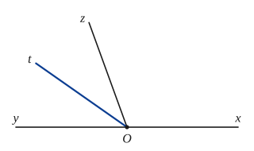

# Đề thi thử số 3

**Thời gian làm bài:** 120 phút. **Thang điểm:** mỗi câu 1 điểm, tổng 10 điểm.

## Đề bài

**Câu 1 (Dãy số).** Cho dãy số $1, 5, 9, 13, \dots$ a) Tìm số hạng thứ 100. b) Số 2 025 có thuộc dãy không? Nếu có, đó là số hạng thứ mấy?

**Câu 2 (Chữ số tận cùng).** Tìm chữ số tận cùng của $7^{2025}$.

**Câu 3 (Chia hết).** Cho $A = 2 + 2^2 + 2^3 + \dots + 2^{60}$. Chứng minh $A$ chia hết cho 3 và chia hết cho 7.

**Câu 4 (Số nguyên tố).** Tìm số nguyên tố $p$ sao cho $2p + 1$ và $4p + 1$ đều là số nguyên tố.

**Câu 5 (ƯCLN).** Tìm hai số tự nhiên có tổng bằng 84 và ƯCLN bằng 6.

**Câu 6 (Tổng số nguyên).** Tính $S = 1 - 2 - 3 + 4 + 5 - 6 - 7 + 8 + \dots + 97 - 98 - 99 + 100$.

**Câu 7 (Tìm x).** Tìm $x$ biết $\left(\dfrac{1}{2} + \dfrac{1}{6} + \dfrac{1}{12} + \dots + \dfrac{1}{90}\right) \cdot x = 3$.

**Câu 8 (Vòi nước).** Vòi thứ nhất chảy đầy bể cạn trong 6 giờ, vòi thứ hai trong 9 giờ. Mở vòi thứ nhất trong 2 giờ, sau đó mở thêm vòi thứ hai. Hỏi sau bao lâu nữa bể đầy?

**Câu 9 (Góc).** Cho hai góc kề bù $\widehat{xOz}$ và $\widehat{zOy}$, biết $\widehat{xOz} - \widehat{zOy} = 40^\circ$. Gọi $Ot$ là tia phân giác của $\widehat{zOy}$. Tính $\widehat{xOt}$.

**Câu 10 (Đếm).** Lớp có 10 học sinh ứng cử. a) Có bao nhiêu cách chọn một lớp trưởng, một lớp phó và một thủ quỹ (ba bạn khác nhau)? b) Có bao nhiêu cách chọn 3 bạn đi dự đại hội?

---

## Lời giải chi tiết

### Câu 1
a) $1 + 99 \cdot 4 = 397$. b) $2\,025 - 1 = 2\,024$ chia hết cho 4, nên 2 025 thuộc dãy, là số hạng thứ $2\,024 : 4 + 1 = 507$.

### Câu 2
Chữ số tận cùng của $7^1, 7^2, 7^3, 7^4$ là 7, 9, 3, 1 rồi lặp lại theo chu kỳ 4. $2\,025 = 4 \cdot 506 + 1$ nên $7^{2025}$ tận cùng là 7.

### Câu 3
- Nhóm 2 số hạng: $A = 2(1 + 2) + 2^3(1 + 2) + \dots + 2^{59}(1 + 2) = 3(2 + 2^3 + \dots + 2^{59})$ chia hết cho 3.
- Nhóm 3 số hạng (60 chia hết cho 3): $A = 2(1 + 2 + 4) + 2^4(1 + 2 + 4) + \dots + 2^{58}(1 + 2 + 4) = 7(2 + 2^4 + \dots + 2^{58})$ chia hết cho 7.

### Câu 4
- $p = 2$: $4p + 1 = 9$ là hợp số. Loại.
- $p = 3$: $2p + 1 = 7$, $4p + 1 = 13$ đều nguyên tố. Thỏa mãn.
- $p > 3$: $p = 3k + 1$ thì $2p + 1 = 6k + 3$ chia hết cho 3; $p = 3k + 2$ thì $4p + 1 = 12k + 9$ chia hết cho 3. Đều là hợp số.

**Đáp số:** $p = 3$.

### Câu 5
$a = 6m$, $b = 6n$, ƯCLN$(m, n) = 1$, $m + n = 14$. Các cặp $(m, n)$ nguyên tố cùng nhau: $(1; 13), (3; 11), (5; 9)$ (và đổi chỗ).

**Đáp số:** $(6; 78)$, $(18; 66)$, $(30; 54)$ (và đổi chỗ).

### Câu 6
Nhóm 4 số hạng: $(1 - 2 - 3 + 4) + (5 - 6 - 7 + 8) + \dots + (97 - 98 - 99 + 100)$, mỗi nhóm bằng 0. $S = 0$.

### Câu 7
Tổng trong ngoặc: $1 - \dfrac{1}{10} = \dfrac{9}{10}$. $x = 3 : \dfrac{9}{10} = \dfrac{10}{3}$.

### Câu 8
Sau 2 giờ vòi một chảy được $\dfrac{1}{3}$ bể, còn $\dfrac{2}{3}$. Hai vòi mỗi giờ chảy $\dfrac{1}{6} + \dfrac{1}{9} = \dfrac{5}{18}$ bể. Thời gian: $\dfrac{2}{3} : \dfrac{5}{18} = \dfrac{12}{5}$ (giờ) = 2 giờ 24 phút.

### Câu 9

*Hình: Hai góc kề bù xOz, zOy và tia phân giác Ot của góc zOy.*

$\widehat{xOz} + \widehat{zOy} = 180^\circ$, $\widehat{xOz} - \widehat{zOy} = 40^\circ$: $\widehat{xOz} = 110^\circ$, $\widehat{zOy} = 70^\circ$.
$\widehat{zOt} = 35^\circ$. Tia $Oz$ nằm giữa $Ox$ và $Ot$: $\widehat{xOt} = 110^\circ + 35^\circ = 145^\circ$.

### Câu 10
a) $10 \cdot 9 \cdot 8 = 720$ (cách). b) Mỗi nhóm 3 bạn được đếm $3 \cdot 2 \cdot 1 = 6$ lần ở câu a: $720 : 6 = 120$ (cách).
