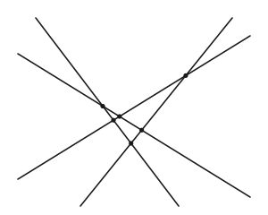

# Đề thi thử số 4

**Thời gian làm bài:** 120 phút. **Thang điểm:** mỗi câu 1 điểm, tổng 10 điểm.

## Đề bài

**Câu 1 (Tổng dãy).** Tính $S = 1 \cdot 2 + 2 \cdot 3 + 3 \cdot 4 + \dots + 9 \cdot 10$.

**Câu 2 (So sánh lũy thừa).** So sánh $31^{11}$ và $17^{14}$.

**Câu 3 (Chia hết).** Tìm số tự nhiên $n$ để $n + 6$ chia hết cho $n + 2$.

**Câu 4 (Số nguyên tố).** Có hay không hai số nguyên tố có tổng bằng 2 025?

**Câu 5 (Chia có dư).** Tìm số tự nhiên nhỏ nhất chia cho 5 dư 3 và chia cho 7 dư 4.

**Câu 6 (Tìm x).** Tìm số nguyên $x$ biết $3(x - 2) - 2(x + 1) = -5$.

**Câu 7 (Bất đẳng thức phân số).** Chứng minh rằng $\dfrac{1}{101} + \dfrac{1}{102} + \dots + \dfrac{1}{200} > \dfrac{7}{12}$.

**Câu 8 (Tuổi).** Hiện nay tuổi anh gấp 3 lần tuổi em. Sau 6 năm nữa, tuổi anh gấp đôi tuổi em. Tính tuổi mỗi người hiện nay.

**Câu 9 (Giao điểm).** Có $n$ đường thẳng, không có hai đường nào song song và không có ba đường nào cùng đi qua một điểm. Biết số giao điểm là 66. Tìm $n$.

**Câu 10 (Bất biến).** Trên bảng ghi các số $1, 2, 3, \dots, 2\,025$. Mỗi lần xóa hai số bất kỳ và viết thêm hiệu của chúng (số lớn trừ số bé). Sau 2 024 lần thì trên bảng còn một số. Số đó có thể bằng 0 không?

---

## Lời giải chi tiết

### Câu 1
$3 \cdot k(k + 1) = k(k + 1)(k + 2) - (k - 1)k(k + 1)$. Cộng với $k = 1, \dots, 9$ thì các số hạng triệt tiêu: $3S = 9 \cdot 10 \cdot 11 = 990$, $S = 330$.

### Câu 2
$31^{11} < 32^{11} = 2^{55}$ và $17^{14} > 16^{14} = 2^{56}$. Vì $2^{55} < 2^{56}$ nên $31^{11} < 17^{14}$.

### Câu 3
$n + 6 = (n + 2) + 4$. Cần $n + 2$ là ước của 4 và $n + 2 \ge 2$: $n + 2 \in \{2; 4\}$.

**Đáp số:** $n \in \{0; 2\}$.

### Câu 4
2 025 là số lẻ, nên một trong hai số phải là 2 (số nguyên tố chẵn duy nhất). Số còn lại là $2\,023 = 7 \cdot 17^2$, là hợp số. Vậy **không có**.

### Câu 5
Các số chia 5 dư 3: 3, 8, 13, 18, … Số đầu tiên chia 7 dư 4 là 18.

**Đáp số:** 18.

### Câu 6
$3x - 6 - 2x - 2 = -5$, $x - 8 = -5$, $x = 3$.

### Câu 7
Chia tổng thành hai nhóm, mỗi nhóm 50 số hạng:
- Từ $\dfrac{1}{101}$ đến $\dfrac{1}{150}$: mỗi số hạng không nhỏ hơn $\dfrac{1}{150}$ (và có số lớn hơn), tổng lớn hơn $\dfrac{50}{150} = \dfrac{1}{3}$.
- Từ $\dfrac{1}{151}$ đến $\dfrac{1}{200}$: tổng lớn hơn $\dfrac{50}{200} = \dfrac{1}{4}$.

Cộng lại: tổng lớn hơn $\dfrac{1}{3} + \dfrac{1}{4} = \dfrac{7}{12}$.

### Câu 8
Hiệu tuổi không đổi. Hiện nay hiệu bằng 2 lần tuổi em; sau 6 năm hiệu bằng tuổi em lúc đó. Vậy tuổi em sau 6 năm gấp đôi tuổi em hiện nay: tuổi em hiện nay là 6, tuổi anh 18.

### Câu 9

*Hình: Bốn đường thẳng đôi một cắt nhau, không có ba đường nào đồng quy.*

Mỗi giao điểm ứng với một cặp đường thẳng: $\dfrac{n(n - 1)}{2} = 66$, $n(n - 1) = 132 = 12 \cdot 11$. Vậy $n = 12$.

### Câu 10
Thay $a, b$ bằng $a - b$ thì tổng các số giảm $2b$, một số chẵn. Tính chẵn lẻ của tổng không đổi.
Tổng ban đầu $1 + 2 + \dots + 2\,025 = 2\,025 \cdot 1\,013$ là số lẻ. Số cuối cùng là số lẻ, nên **không thể bằng 0**.
