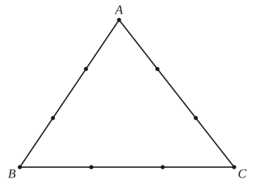

# Đề thi thử số 5

**Thời gian làm bài:** 120 phút. **Thang điểm:** mỗi câu 1 điểm, tổng 10 điểm.

## Đề bài

**Câu 1 (Tập hợp).** Cho $A = \{1; 2; 3; \dots; 10\}$. Tập $A$ có bao nhiêu tập con gồm đúng 2 phần tử?

**Câu 2 (Lũy thừa).** Tìm số tự nhiên $x$ biết $3^x + 3^{x + 2} = 810$.

**Câu 3 (Chia hết).** Chứng minh rằng với mọi số $\overline{ab}$ có hai chữ số, hiệu $\overline{ab} - \overline{ba}$ luôn chia hết cho 9.

**Câu 4 (Số chính phương).** Tìm số tự nhiên $x$ nhỏ nhất (khác 0) để $180x$ là số chính phương.

**Câu 5 (BCNN thực tế).** Ba tuyến xe buýt cùng xuất phát tại một bến lúc 6 giờ. Tuyến thứ nhất cứ 10 phút có một chuyến, tuyến thứ hai 12 phút, tuyến thứ ba 15 phút. Hỏi lúc mấy giờ thì ba tuyến lại cùng xuất phát lần tiếp theo?

**Câu 6 (Tổng số nguyên).** Tính $S = 2 - 4 + 6 - 8 + \dots + 98 - 100$.

**Câu 7 (So sánh phân số).** So sánh $A = \dfrac{10^8 + 2}{10^8 - 1}$ và $B = \dfrac{10^8}{10^8 - 3}$.

**Câu 8 (Vòi nước).** Một bể cạn có hai vòi chảy vào và một vòi tháo ra. Vòi thứ nhất chảy riêng thì đầy bể sau 4 giờ, vòi thứ hai sau 6 giờ; vòi tháo riêng thì tháo cạn bể đầy sau 3 giờ. Mở cả ba vòi cùng lúc thì sau bao lâu bể đầy?

**Câu 9 (Đếm tam giác).** Cho tam giác $ABC$. Trên mỗi cạnh lấy thêm hai điểm (khác các đỉnh). Có bao nhiêu tam giác có ba đỉnh là ba trong 9 điểm (gồm 3 đỉnh và 6 điểm mới)?

**Câu 10 (Nói thật, nói dối).** Trên một hòn đảo, mỗi người hoặc luôn nói thật, hoặc luôn nói dối. Ba người A, B, C nói: A: "B nói dối". B: "C nói dối". C: "A và B đều nói dối". Hỏi ai nói thật, ai nói dối?

---

## Lời giải chi tiết

### Câu 1
Mỗi tập con 2 phần tử ứng với một cặp số: $\dfrac{10 \cdot 9}{2} = 45$.

### Câu 2
$3^x + 9 \cdot 3^x = 10 \cdot 3^x = 810$, $3^x = 81 = 3^4$, $x = 4$.

### Câu 3
$\overline{ab} - \overline{ba} = (10a + b) - (10b + a) = 9(a - b)$ chia hết cho 9.

### Câu 4
$180 = 2^2 \cdot 3^2 \cdot 5$. Số chính phương có mọi số mũ trong phân tích là chẵn, nên $x$ nhỏ nhất là 5 ($180 \cdot 5 = 900 = 30^2$).

### Câu 5
BCNN(10, 12, 15) = 60 (phút). Ba tuyến lại cùng xuất phát lúc 7 giờ.

### Câu 6
$(2 - 4) + (6 - 8) + \dots + (98 - 100)$: 25 cặp, mỗi cặp $-2$. $S = -50$.

### Câu 7
$A = 1 + \dfrac{3}{10^8 - 1}$, $B = 1 + \dfrac{3}{10^8 - 3}$. Vì $10^8 - 1 > 10^8 - 3$ nên $\dfrac{3}{10^8 - 1} < \dfrac{3}{10^8 - 3}$, tức $A < B$.

### Câu 8
Mỗi giờ bể tăng $\dfrac{1}{4} + \dfrac{1}{6} - \dfrac{1}{3} = \dfrac{3 + 2 - 4}{12} = \dfrac{1}{12}$ bể. Bể đầy sau 12 giờ.

### Câu 9

*Hình: Tam giác ABC, trên mỗi cạnh lấy thêm hai điểm.*

Chọn 3 điểm trong 9 điểm: $\dfrac{9 \cdot 8 \cdot 7}{6} = 84$ cách. Trên mỗi cạnh có 4 điểm thẳng hàng; mỗi bộ 3 điểm thẳng hàng không tạo tam giác. Mỗi cạnh có $\dfrac{4 \cdot 3 \cdot 2}{6} = 4$ bộ như vậy, ba cạnh có 12 bộ.
Số tam giác: $84 - 12 = 72$.

### Câu 10
- Nếu C nói thật thì A và B đều nói dối. A nói dối nghĩa là "B nói dối" sai, tức B nói thật: mâu thuẫn. Vậy **C nói dối**.
- B nói "C nói dối" là đúng, nên **B nói thật**.
- A nói "B nói dối" là sai, nên **A nói dối**.

Kiểm tra: C nói "A và B đều nói dối" là sai (vì B nói thật), khớp với C nói dối.
