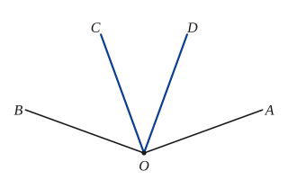

# Đề thi thử số 6

**Thời gian làm bài:** 120 phút. **Thang điểm:** mỗi câu 1 điểm, tổng 10 điểm.

## Đề bài

**Câu 1 (Đếm, bù trừ).** Có bao nhiêu số có ba chữ số chia hết cho 3 hoặc chia hết cho 5?

**Câu 2 (Chữ số tận cùng).** Tìm chữ số tận cùng của $2^{2024} + 3^{2024}$.

**Câu 3 (Chia có dư).** Tìm các số có hai chữ số chia hết cho 3, chia cho 4 dư 1 và chia cho 5 dư 1.

**Câu 4 (Số nguyên tố).** Chứng minh rằng nếu $p$ là số nguyên tố lớn hơn 3 thì $p^2 - 1$ chia hết cho 24.

**Câu 5 (ƯCLN).** Chứng minh rằng ƯCLN$(2n + 3, 3n + 4) = 1$ với mọi số tự nhiên $n$.

**Câu 6 (Nghiệm nguyên).** Tìm các cặp số nguyên $(x; y)$ thỏa mãn $2xy - x + 2y = 13$.

**Câu 7 (Tích phân số).** Tính $B = \left(1 - \dfrac{1}{2}\right) \cdot \left(1 - \dfrac{1}{3}\right) \cdot \left(1 - \dfrac{1}{4}\right) \cdots \left(1 - \dfrac{1}{2025}\right)$.

**Câu 8 (Đoàn tàu).** Một đoàn tàu dài 120 m chạy qua một cây cầu dài 380 m hết 25 giây (từ lúc đầu tàu lên cầu đến lúc đuôi tàu rời cầu). Tính vận tốc đoàn tàu theo m/s và km/h.

**Câu 9 (Góc).** Cho $\widehat{AOB} = 140^\circ$. Vẽ hai tia $OC$, $OD$ nằm trong góc đó sao cho $\widehat{AOC} = \widehat{BOD} = 90^\circ$. Tính $\widehat{COD}$.

**Câu 10 (Xếp hàng).** Có 5 bạn, trong đó có An và Bình, xếp thành một hàng dọc. a) Có bao nhiêu cách xếp mà An đứng đầu hàng? b) Có bao nhiêu cách xếp mà An và Bình **không** đứng cạnh nhau?

---

## Lời giải chi tiết

### Câu 1
Số có ba chữ số: 900 số. Chia hết cho 3: 300 số; cho 5: 180 số; cho 15: 60 số. Chia hết cho 3 hoặc 5: $300 + 180 - 60 = 420$.

### Câu 2
$2^{2024} = (2^4)^{506} = 16^{506}$ tận cùng 6. $3^{2024} = (3^4)^{506} = 81^{506}$ tận cùng 1. Tổng tận cùng là 7.

### Câu 3
Số đó bớt 1 thì chia hết cho 4 và 5, tức là chia hết cho 20: số đó thuộc $\{21; 41; 61; 81\}$. Chia hết cho 3: 21 và 81.

### Câu 4
$p^2 - 1 = (p - 1)(p + 1)$.
- $p$ lẻ nên $p - 1$, $p + 1$ là hai số chẵn liên tiếp, một trong hai số chia hết cho 4. Tích chia hết cho $2 \cdot 4 = 8$.
- Trong ba số liên tiếp $p - 1, p, p + 1$ có một số chia hết cho 3, mà $p$ không chia hết cho 3, nên tích $(p - 1)(p + 1)$ chia hết cho 3.

Vì ƯCLN(8, 3) = 1 nên $p^2 - 1$ chia hết cho 24.

### Câu 5
Gọi $d$ là ước chung. $d$ là ước của $3(2n + 3) - 2(3n + 4) = 1$, nên $d = 1$.

### Câu 6
$x(2y - 1) + (2y - 1) = 13 - 1$, tức $(x + 1)(2y - 1) = 12$. $2y - 1$ là số lẻ, ước lẻ của 12 là $\pm 1, \pm 3$.

| $2y - 1$ | 1 | $-1$ | 3 | $-3$ |
|---|---|---|---|---|
| $x + 1$ | 12 | $-12$ | 4 | $-4$ |
| $(x; y)$ | $(11; 1)$ | $(-13; 0)$ | $(3; 2)$ | $(-5; -1)$ |

### Câu 7
$B = \dfrac{1}{2} \cdot \dfrac{2}{3} \cdot \dfrac{3}{4} \cdots \dfrac{2024}{2025} = \dfrac{1}{2025}$.

### Câu 8
Quãng đường: $120 + 380 = 500$ (m). Vận tốc: $500 : 25 = 20$ m/s $= 20 \cdot 3{,}6 = 72$ km/h.

### Câu 9

*Hình: Góc AOB và hai tia OC, OD nằm trong góc.*

$\widehat{BOC} = 140^\circ - 90^\circ = 50^\circ$ (tia $OC$ nằm giữa $OA$, $OB$). Vì $\widehat{BOC} = 50^\circ < 90^\circ = \widehat{BOD}$ nên tia $OC$ nằm giữa $OB$ và $OD$:
$\widehat{COD} = 90^\circ - 50^\circ = 40^\circ$.

### Câu 10
a) An đứng đầu, 4 bạn còn lại xếp vào 4 chỗ: $4 \cdot 3 \cdot 2 \cdot 1 = 24$ (cách).
b) Tổng số cách xếp 5 bạn: 120. Số cách An và Bình đứng cạnh nhau: coi hai bạn là một khối, xếp 4 "phần tử" được 24 cách, trong khối đổi chỗ 2 cách: 48. Không cạnh nhau: $120 - 48 = 72$.
