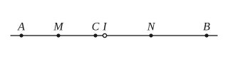

# Đề thi thử số 7

**Thời gian làm bài:** 120 phút. **Thang điểm:** mỗi câu 1 điểm, tổng 10 điểm.

## Đề bài

**Câu 1 (Tổng lũy thừa).** Tính $A = 1 + 3 + 3^2 + \dots + 3^{10}$.

**Câu 2 (Lũy thừa).** Tìm số tự nhiên $x \ge 1$ biết $(x - 1)^{x + 2} = (x - 1)^{x + 4}$.

**Câu 3 (Chia hết).** Cho các số tự nhiên $a, b$ thỏa mãn $a + 5b$ chia hết cho 7. Chứng minh $10a + b$ chia hết cho 7.

**Câu 4 (Số chính phương).** Tìm số tự nhiên $n$ để $n^2 + n + 1$ là số chính phương.

**Câu 5 (ƯCLN, BCNN).** Tìm hai số tự nhiên $a < b$ biết $a + b = 60$ và BCNN$(a, b) = 72$.

**Câu 6 (Chia hết số nguyên).** Tìm số nguyên $n$ để $n^2 - 7$ là bội của $n + 3$.

**Câu 7 (Tổng phân số).** Chứng minh $S = \dfrac{1}{3} + \dfrac{1}{3^2} + \dots + \dfrac{1}{3^{100}} < \dfrac{1}{2}$.

**Câu 8 (Chuyển động).** Một xe máy đi từ A đến B hết 3 giờ, một ô tô đi từ B đến A hết 2 giờ. Ô tô khởi hành sau xe máy 30 phút. Hỏi sau khi ô tô đi được bao lâu thì hai xe gặp nhau?

**Câu 9 (Trung điểm).** Cho đoạn thẳng $AB = 10$ cm, điểm $C$ nằm giữa $A$, $B$ với $AC = 4$ cm. Gọi $M$, $N$ lần lượt là trung điểm của $AC$, $CB$ và $I$ là trung điểm của $MN$. Tính $AI$.

**Câu 10 (Giải đấu).** Sáu đội bóng thi đấu vòng tròn một lượt; thắng được 2 điểm, hòa 1 điểm, thua 0 điểm. Chứng minh rằng kết thúc giải có ít nhất một đội được từ 5 điểm trở lên.

---

## Lời giải chi tiết

### Câu 1
$3A = 3 + 3^2 + \dots + 3^{11}$. $3A - A = 3^{11} - 1$, nên $A = \dfrac{3^{11} - 1}{2} = \dfrac{177\,147 - 1}{2} = 88\,573$.

### Câu 2
$(x - 1)^{x + 2}\left[(x - 1)^2 - 1\right] = 0$. Vậy $x - 1 = 0$ hoặc $(x - 1)^2 = 1$. Với $x \ge 1$: $x = 1$ hoặc $x - 1 = 1$, $x = 2$.

**Đáp số:** $x \in \{1; 2\}$.

### Câu 3
$10a + b = 10(a + 5b) - 49b$. Cả $10(a + 5b)$ và $49b$ đều chia hết cho 7, nên $10a + b$ chia hết cho 7.

### Câu 4
Với $n = 0$: $1 = 1^2$. Với $n \ge 1$: $n^2 < n^2 + n + 1 < n^2 + 2n + 1 = (n + 1)^2$, nằm giữa hai số chính phương liên tiếp nên không là số chính phương.

**Đáp số:** $n = 0$.

### Câu 5
Đặt $d$ = ƯCLN, $a = dm$, $b = dn$, ƯCLN$(m, n) = 1$. Ta có $d(m + n) = 60$, $dmn = 72$. $d$ là ước chung của 60 và 72, tức là ước của 12.
Thử: $d = 12$ cho $m + n = 5$, $mn = 6$, nên $m = 2$, $n = 3$. Các giá trị $d$ khác không cho nghiệm (ví dụ $d = 6$: $m + n = 10$, $mn = 12$, không có số tự nhiên).

**Đáp số:** $a = 24$, $b = 36$.

### Câu 6
$n^2 - 7 = (n + 3)(n - 3) + 2$. Cần $n + 3$ là ước của 2: $n + 3 \in \{\pm 1; \pm 2\}$.

**Đáp số:** $n \in \{-2; -4; -1; -5\}$.

### Câu 7
$3S = 1 + \dfrac{1}{3} + \dots + \dfrac{1}{3^{99}}$. $3S - S = 1 - \dfrac{1}{3^{100}}$, nên $S = \dfrac{1}{2} - \dfrac{1}{2 \cdot 3^{100}} < \dfrac{1}{2}$.

### Câu 8
Mỗi giờ xe máy đi $\dfrac{1}{3}$, ô tô đi $\dfrac{1}{2}$ quãng đường. Trong 30 phút xe máy đi $\dfrac{1}{6}$, còn $\dfrac{5}{6}$. Mỗi giờ hai xe gần nhau $\dfrac{5}{6}$ quãng đường. Gặp nhau sau 1 giờ (tính từ lúc ô tô đi).

### Câu 9

*Hình: Đoạn thẳng AB, điểm C, trung điểm M của AC, N của CB và trung điểm I của MN.*

$AM = 2$ cm; $CB = 6$ cm, $CN = 3$ cm. $MN = MC + CN = 2 + 3 = 5$ (cm), $MI = 2{,}5$ cm.
$AI = AM + MI = 2 + 2{,}5 = 4{,}5$ (cm).

### Câu 10
Có $\dfrac{6 \cdot 5}{2} = 15$ trận, mỗi trận phát ra đúng 2 điểm (thắng thua 2 + 0, hòa 1 + 1). Tổng điểm: 30. Nếu mọi đội đều được ít hơn 5 điểm (tức tối đa 4) thì tổng không quá $6 \cdot 4 = 24 < 30$: vô lý. Vậy có đội được ít nhất 5 điểm.
