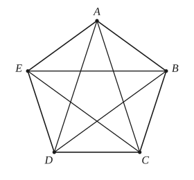

# Đề thi thử số 8

**Thời gian làm bài:** 120 phút. **Thang điểm:** mỗi câu 1 điểm, tổng 10 điểm.

## Đề bài

**Câu 1 (Đếm chữ số).** Viết liên tiếp các số tự nhiên từ 1 đến 2 025. Phải dùng tất cả bao nhiêu chữ số?

**Câu 2 (So sánh lũy thừa).** So sánh $5^{217}$ và $119 \cdot 5^{214}$.

**Câu 3 (Chia hết).** Chứng minh $A = 1 + 3 + 3^2 + \dots + 3^{11}$ chia hết cho 40.

**Câu 4 (Số nguyên tố).** Tìm số nguyên tố $p$ sao cho $p + 10$ và $p + 14$ đều là số nguyên tố.

**Câu 5 (ƯCLN, BCNN).** Tìm hai số tự nhiên $a \le b$ có tích bằng 2 700 và BCNN bằng 900.

**Câu 6 (Nghiệm nguyên).** Tìm các cặp số nguyên $(x; y)$ sao cho $(x + 2)(y - 3) = -5$.

**Câu 7 (Giá trị lớn nhất).** Tìm số nguyên $n$ để $B = \dfrac{2n - 1}{n - 3}$ có giá trị lớn nhất. Tìm giá trị đó.

**Câu 8 (Giả thiết tạm).** Lớp 6A được giao trồng một số cây. Nếu mỗi bạn trồng 3 cây thì còn thừa 20 cây chưa trồng; nếu mỗi bạn trồng 4 cây thì thiếu 20 cây. Hỏi lớp có bao nhiêu học sinh và được giao bao nhiêu cây?

**Câu 9 (Đếm hình).** Cho 5 điểm, không có ba điểm nào thẳng hàng. Có bao nhiêu đoạn thẳng nối hai trong năm điểm? Có bao nhiêu tam giác có đỉnh là ba trong năm điểm?

**Câu 10 (Trò chơi).** Có hai đống sỏi: 15 viên và 20 viên. Hai bạn lần lượt lấy, mỗi lượt lấy bao nhiêu viên tùy ý (ít nhất 1) nhưng chỉ từ một đống. Ai lấy viên cuối cùng thì thắng. Người đi trước có cách thắng không? Nêu cách chơi.

---

## Lời giải chi tiết

### Câu 1
1–9: 9 chữ số; 10–99: $90 \cdot 2 = 180$; 100–999: $900 \cdot 3 = 2\,700$; 1 000–2 025: $1\,026 \cdot 4 = 4\,104$.
Tổng: $9 + 180 + 2\,700 + 4\,104 = 6\,993$.

### Câu 2
$5^{217} = 5^3 \cdot 5^{214} = 125 \cdot 5^{214} > 119 \cdot 5^{214}$.

### Câu 3
$A$ có 12 số hạng, nhóm 4 số hạng: $A = (1 + 3 + 9 + 27) + 3^4(1 + 3 + 9 + 27) + 3^8(1 + 3 + 9 + 27) = 40(1 + 3^4 + 3^8)$ chia hết cho 40.

### Câu 4
- $p = 3$: $13$ và $17$ đều nguyên tố. Thỏa mãn.
- $p = 3k + 1$: $p + 14 = 3(k + 5)$ là hợp số. $p = 3k + 2$: $p + 10 = 3(k + 4)$ là hợp số. ($p = 2$: $p + 10 = 12$ hợp số.)

**Đáp số:** $p = 3$.

### Câu 5
ƯCLN $= 2\,700 : 900 = 3$. $a = 3m$, $b = 3n$, $mn = 300$, ƯCLN$(m, n) = 1$: $(m, n) \in \{(1; 300), (3; 100), (4; 75), (12; 25)\}$.

**Đáp số:** $(3; 900)$, $(9; 300)$, $(12; 225)$, $(36; 75)$.

### Câu 6
$-5 = 1 \cdot (-5) = (-1) \cdot 5 = 5 \cdot (-1) = (-5) \cdot 1$.

**Đáp số:** $(-1; -2)$, $(-3; 8)$, $(3; 2)$, $(-7; 4)$.

### Câu 7
$B = 2 + \dfrac{5}{n - 3}$. $B$ lớn nhất khi $n - 3$ là số nguyên dương nhỏ nhất: $n - 3 = 1$, $n = 4$, $B = 7$.

### Câu 8
Mỗi bạn trồng thêm 1 cây thì lớp trồng thêm được $20 + 20 = 40$ cây (từ thừa 20 chuyển sang thiếu 20). Vậy lớp có 40 học sinh. Số cây: $40 \cdot 3 + 20 = 140$.

### Câu 9

*Hình: Năm điểm, không có ba điểm nào thẳng hàng, với các đoạn thẳng nối chúng.*

Đoạn thẳng: $\dfrac{5 \cdot 4}{2} = 10$. Tam giác: $\dfrac{5 \cdot 4 \cdot 3}{6} = 10$.

### Câu 10
Có. Người đi trước lấy 5 viên ở đống 20 viên, để lại hai đống bằng nhau (15 và 15). Sau đó, người kia lấy bao nhiêu viên ở đống nào thì người đi trước lấy đúng bấy nhiêu viên ở đống kia. Hai đống luôn bằng nhau sau lượt của người đi trước, nên người đi trước lấy được viên cuối cùng.
