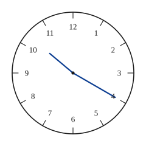

# Đề thi thử số 9

**Thời gian làm bài:** 120 phút. **Thang điểm:** mỗi câu 1 điểm, tổng 10 điểm.

## Đề bài

**Câu 1 (Tổng dãy).** Tính $S = (2 + 4 + 6 + \dots + 200) - (1 + 3 + 5 + \dots + 199)$.

**Câu 2 (So sánh lũy thừa).** So sánh $2^{100}$ và $10^{30}$.

**Câu 3 (Chia hết).** Tìm số có ba chữ số chia hết cho 99, biết chữ số hàng trăm gấp đôi chữ số hàng đơn vị.

**Câu 4 (Số chính phương).** Chứng minh rằng tích của bốn số tự nhiên liên tiếp cộng thêm 1 luôn là một số chính phương.

**Câu 5 (ƯCLN).** Tìm ƯCLN$(n, n + 2)$ theo $n$ ($n$ là số tự nhiên khác 0).

**Câu 6 (Số nguyên).** Tìm các số nguyên $x$ sao cho $(x^2 - 4)(x^2 - 25) < 0$.

**Câu 7 (Tổng phân số).** Tính $S = \dfrac{1}{2 \cdot 4} + \dfrac{1}{4 \cdot 6} + \dots + \dfrac{1}{98 \cdot 100}$.

**Câu 8 (Tuổi).** Hiện nay tổng số tuổi của hai anh em là 30. Khi tuổi anh bằng tuổi em hiện nay thì tuổi anh gấp đôi tuổi em. Tính tuổi mỗi người hiện nay.

**Câu 9 (Góc trên đồng hồ).** Lúc 10 giờ 20 phút, góc nhỏ tạo bởi kim giờ và kim phút là bao nhiêu độ?

**Câu 10 (Dirichlet).** Trong một nhóm 6 người, hai người bất kỳ hoặc quen nhau hoặc không quen nhau. Chứng minh rằng luôn có 3 người đôi một quen nhau hoặc 3 người đôi một không quen nhau.

---

## Lời giải chi tiết

### Câu 1
Ghép từng cặp: $(2 - 1) + (4 - 3) + \dots + (200 - 199)$, có 100 cặp, mỗi cặp bằng 1. $S = 100$.

### Câu 2
$2^{100} = (2^{10})^{10} = 1\,024^{10}$ và $10^{30} = (10^3)^{10} = 1\,000^{10}$. Vì $1\,024 > 1\,000$ nên $2^{100} > 10^{30}$.

### Câu 3
Số có ba chữ số chia hết cho 99: 198, 297, 396, 495, 594, 693, 792, 891, 990. Chỉ có 693 có chữ số hàng trăm (6) gấp đôi chữ số hàng đơn vị (3).

**Đáp số:** 693.

### Câu 4
$n(n + 1)(n + 2)(n + 3) + 1 = [n(n + 3)][(n + 1)(n + 2)] + 1 = (n^2 + 3n)(n^2 + 3n + 2) + 1$.
Đặt $t = n^2 + 3n + 1$: biểu thức bằng $(t - 1)(t + 1) + 1 = t^2$, là số chính phương.

### Câu 5
Gọi $d$ là ước chung, $d$ là ước của $(n + 2) - n = 2$, nên $d \in \{1; 2\}$. Nếu $n$ chẵn thì cả hai số chẵn, ƯCLN = 2; nếu $n$ lẻ thì ƯCLN = 1.

### Câu 6
Hai thừa số trái dấu; vì $x^2 - 25 < x^2 - 4$ nên $x^2 - 25 < 0 < x^2 - 4$, tức $4 < x^2 < 25$: $x^2 \in \{9; 16\}$.

**Đáp số:** $x \in \{-4; -3; 3; 4\}$.

### Câu 7
$\dfrac{1}{2k(2k + 2)} = \dfrac{1}{2}\left(\dfrac{1}{2k} - \dfrac{1}{2k + 2}\right)$. $S = \dfrac{1}{2}\left(\dfrac{1}{2} - \dfrac{1}{100}\right) = \dfrac{1}{2} \cdot \dfrac{49}{100} = \dfrac{49}{200}$.

### Câu 8
Gọi hiệu tuổi là $d$. Khi anh bằng tuổi em hiện nay (tức là cách đây $d$ năm), em kém tuổi hiện nay $d$ năm. Lúc đó anh gấp đôi em, nên tuổi em lúc đó bằng $d$; em hiện nay $2d$, anh hiện nay $3d$.
$5d = 30$, $d = 6$: em 12 tuổi, anh 18 tuổi.

### Câu 9

*Hình: Mặt đồng hồ lúc 10 giờ 20 phút.*

Kim phút chỉ số 4: cách số 12 là $120^\circ$ (theo chiều kim đồng hồ). Kim giờ đi qua số 10 thêm $20 \cdot 0{,}5^\circ = 10^\circ$: cách số 12 là $310^\circ$.
Hiệu: $310^\circ - 120^\circ = 190^\circ$. Góc nhỏ: $360^\circ - 190^\circ = 170^\circ$.

### Câu 10
Xét một người A. Năm người còn lại chia làm hai nhóm: quen A và không quen A. Theo Dirichlet, có một nhóm có ít nhất 3 người. Giả sử có 3 người B, C, D cùng quen A (trường hợp không quen làm tương tự).
- Nếu trong B, C, D có hai người quen nhau, chẳng hạn B và C, thì A, B, C đôi một quen nhau.
- Nếu B, C, D đôi một không quen nhau thì đó là 3 người đôi một không quen nhau.

Trong mọi trường hợp đều có điều cần chứng minh.
