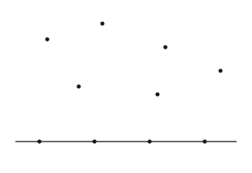

# Đề thi thử số 10

**Thời gian làm bài:** 120 phút. **Thang điểm:** mỗi câu 1 điểm, tổng 10 điểm.

## Đề bài

**Câu 1 (Tập hợp).** Có bao nhiêu số có bốn chữ số mà tổng các chữ số bằng 4?

**Câu 2 (Chia hết lũy thừa).** Chứng minh $2^{4n} - 1$ chia hết cho 15 với mọi số tự nhiên $n$.

**Câu 3 (Chia hết).** Tìm tất cả các số tự nhiên $n$ để $2^n + 1$ chia hết cho 3.

**Câu 4 (Số chính phương).** Chứng minh rằng tổng của 2 025 số lẻ đầu tiên $1 + 3 + 5 + \dots + 4\,049$ là một số chính phương.

**Câu 5 (ƯCLN thực tế).** Có 96 kẹo chanh, 120 kẹo cam và 144 kẹo dâu. Muốn chia đều mỗi loại vào các túi sao cho các túi giống nhau và số túi nhiều nhất. Có bao nhiêu túi? Mỗi túi có bao nhiêu kẹo mỗi loại?

**Câu 6 (Tổng số nguyên).** Tính $S = 1 - 2 + 3 - 4 + \dots - 2\,024 + 2\,025$.

**Câu 7 (Bất đẳng thức).** Chứng minh rằng $\dfrac{1}{2^2} + \dfrac{1}{4^2} + \dfrac{1}{6^2} + \dots + \dfrac{1}{100^2} < \dfrac{1}{2}$.

**Câu 8 (Phần trăm).** Hai cửa hàng bán cùng một mặt hàng với cùng giá. Cửa hàng A giảm giá 20% rồi tăng giá 20%. Cửa hàng B tăng giá 15% rồi giảm giá 15%. Hỏi cuối cùng cửa hàng nào bán rẻ hơn?

**Câu 9 (Đếm tam giác).** Cho 10 điểm, trong đó có đúng 4 điểm thẳng hàng, ngoài ra không có ba điểm nào thẳng hàng. Có bao nhiêu tam giác có ba đỉnh là ba trong 10 điểm đó?

**Câu 10 (Trò chơi).** Có 2 025 viên sỏi. Hai bạn lần lượt bốc, mỗi lượt được bốc từ 1 đến 5 viên. Ai bốc được viên cuối cùng thì thắng. Người đi trước có cách thắng không? Nêu cách chơi.

---

## Lời giải chi tiết

### Câu 1
Chữ số hàng nghìn $a \ge 1$, ba chữ số còn lại có tổng $4 - a$.
- $a = 1$: ba chữ số có tổng 3: 10 cách. $a = 2$: tổng 2: 6 cách. $a = 3$: tổng 1: 3 cách. $a = 4$: tổng 0: 1 cách.

Tổng: $10 + 6 + 3 + 1 = 20$ số.

### Câu 2
$2^{4n} - 1 = 16^n - 1$. $16^n$ chia cho 15 dư 1 (vì 16 chia 15 dư 1), nên $16^n - 1$ chia hết cho 15.

### Câu 3
$2$ chia 3 dư 2 (hay "dư $-1$"). $2^n$ chia 3 dư 2 khi $n$ lẻ, dư 1 khi $n$ chẵn. $2^n + 1$ chia hết cho 3 khi $2^n$ chia 3 dư 2.

**Đáp số:** $n$ là số lẻ.

### Câu 4
Có 2 025 số hạng. Tổng: $\dfrac{(1 + 4\,049) \cdot 2\,025}{2} = 2\,025 \cdot 2\,025 = 2\,025^2$, là số chính phương.

### Câu 5
Số túi nhiều nhất = ƯCLN(96, 120, 144) = 24. Mỗi túi: 4 kẹo chanh, 5 kẹo cam, 6 kẹo dâu.

### Câu 6
$(1 - 2) + (3 - 4) + \dots + (2\,023 - 2\,024) + 2\,025 = 1\,012 \cdot (-1) + 2\,025 = 1\,013$.

### Câu 7
$\dfrac{1}{(2k)^2} = \dfrac{1}{4} \cdot \dfrac{1}{k^2}$. Do đó tổng bằng $\dfrac{1}{4}\left(1 + \dfrac{1}{2^2} + \dots + \dfrac{1}{50^2}\right)$.
Với $k \ge 2$: $\dfrac{1}{k^2} < \dfrac{1}{k - 1} - \dfrac{1}{k}$, nên $\dfrac{1}{2^2} + \dots + \dfrac{1}{50^2} < 1 - \dfrac{1}{50} < 1$.
Vậy tổng nhỏ hơn $\dfrac{1}{4} \cdot (1 + 1) = \dfrac{1}{2}$.

### Câu 8
A: $80\% \cdot 120\% = 96\%$. B: $115\% \cdot 85\% = 97{,}75\%$. Cửa hàng A rẻ hơn.

### Câu 9

*Hình: Mười điểm, trong đó có bốn điểm thẳng hàng.*

Chọn 3 điểm từ 10 điểm: $\dfrac{10 \cdot 9 \cdot 8}{6} = 120$ cách. Các bộ 3 điểm nằm trong 4 điểm thẳng hàng không tạo tam giác: $\dfrac{4 \cdot 3 \cdot 2}{6} = 4$ bộ.
Số tam giác: $120 - 4 = 116$.

### Câu 10
Có. Vì mỗi lượt bốc 1 đến 5 viên, ta xét bội của 6. $2\,025 = 6 \cdot 337 + 3$. Người đi trước bốc 3 viên, còn 2 022 viên (bội của 6). Sau đó, người kia bốc $k$ viên thì người đi trước bốc $6 - k$ viên. Số sỏi luôn là bội của 6 sau lượt của người đi trước; cuối cùng người đi trước bốc viên cuối.
