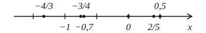

# Chủ đề 1. Số hữu tỉ

> Số hữu tỉ là nền tảng của toàn bộ phần đại số lớp 7. Đề kiểm tra hay có câu tính giá trị biểu thức (tính hợp lý), câu lũy thừa và câu tìm $x$ bằng quy tắc chuyển vế.

## I. Kiến thức cần nắm

### 1. Số hữu tỉ và tập hợp $\mathbb{Q}$
- **Số hữu tỉ** là số viết được dưới dạng phân số $\frac{a}{b}$ với $a, b \in \mathbb{Z}$, $b \ne 0$. Tập hợp các số hữu tỉ kí hiệu là $\mathbb{Q}$.
- Mỗi số nguyên, mỗi phân số, mỗi hỗn số, mỗi số thập phân hữu hạn đều là số hữu tỉ. Ví dụ: $-3 = \frac{-3}{1}$, $\ 0{,}25 = \frac14$, $\ -1\frac{2}{3} = \frac{-5}{3}$.
- Ta có $\mathbb{N} \subset \mathbb{Z} \subset \mathbb{Q}$.
- **Biểu diễn trên trục số:** muốn biểu diễn $\frac{a}{b}$ (với $b > 0$), chia đoạn đơn vị thành $b$ phần bằng nhau rồi lấy $\lvert a\rvert$ phần về bên phải gốc $O$ nếu $a > 0$, về bên trái nếu $a < 0$.
- **Số đối** của $x$ là $-x$; hai số đối nhau có tổng bằng $0$. Ví dụ: số đối của $-\frac{2}{7}$ là $\frac{2}{7}$.

### 2. So sánh hai số hữu tỉ
- Viết hai số dưới dạng phân số **cùng mẫu dương** rồi so sánh tử: với $b > 0$ thì $\frac{a}{b} < \frac{c}{b} \iff a < c$.
- Số hữu tỉ dương lớn hơn $0$, số hữu tỉ âm nhỏ hơn $0$. Trên trục số nằm ngang, số nhỏ hơn nằm bên trái.
- Hai số âm: số nào có phần "không dấu" lớn hơn thì nhỏ hơn. Ví dụ $-\frac34 < -\frac{5}{7}$ vì $\frac34 = \frac{21}{28} > \frac{20}{28} = \frac57$.
- Mẹo: có thể so sánh qua số trung gian ($0$, $1$, $-1$, $\frac12$, ...).

*Ví dụ:* So sánh $-0{,}6$ và $-\frac{2}{3}$. Ta có $-0{,}6 = -\frac{9}{15}$, $-\frac23 = -\frac{10}{15}$, mà $-9 > -10$ nên $-0{,}6 > -\frac{2}{3}$.

### 3. Cộng, trừ, nhân, chia số hữu tỉ
Viết các số về dạng phân số rồi làm như với phân số:
$$\frac ab + \frac cb = \frac{a + c}{b}, \qquad \frac ab \cdot \frac cd = \frac{ac}{bd}, \qquad \frac ab : \frac cd = \frac ab \cdot \frac dc \ (c \ne 0).$$
- Phép cộng và phép nhân có tính chất **giao hoán, kết hợp**, cộng với $0$, nhân với $1$, và tính chất **phân phối**: $x(y + z) = xy + xz$.
- **Quy tắc dấu ngoặc:** bỏ ngoặc có dấu "$-$" đằng trước thì đổi dấu mọi số hạng trong ngoặc: $x - (y - z + t) = x - y + z - t$.
- **Tính hợp lý:** nhóm các số hạng có cùng mẫu, các số đối nhau; đặt thừa số chung.

*Ví dụ:* $\frac{-3}{8}\cdot\frac{5}{9} + \frac{-3}{8}\cdot\frac{4}{9} = \frac{-3}{8}\cdot\left(\frac59 + \frac49\right) = \frac{-3}{8}\cdot 1 = \frac{-3}{8}$.

### 4. Lũy thừa với số mũ tự nhiên
$x^n = \underbrace{x \cdot x \cdots x}_{n \text{ thừa số}}$ ($n \ge 1$), quy ước $x^0 = 1$ ($x \ne 0$), $x^1 = x$.

| Quy tắc | Công thức |
|---|---|
| Tích hai lũy thừa cùng cơ số | $x^m \cdot x^n = x^{m + n}$ |
| Thương hai lũy thừa cùng cơ số | $x^m : x^n = x^{m - n}$ ($x \ne 0$, $m \ge n$) |
| Lũy thừa của lũy thừa | $\left(x^m\right)^n = x^{m\cdot n}$ |
| Lũy thừa của một tích | $(x y)^n = x^n y^n$ |
| Lũy thừa của một thương | $\left(\frac xy\right)^n = \frac{x^n}{y^n}$ ($y \ne 0$) |

- Lũy thừa bậc chẵn của số âm là số dương, bậc lẻ của số âm là số âm: $(-2)^4 = 16$, $(-2)^3 = -8$.
- Muốn rút gọn biểu thức có nhiều lũy thừa: **phân tích các cơ số ra thừa số nguyên tố** ($4 = 2^2$, $6 = 2\cdot3$, $8 = 2^3$, $9 = 3^2$, ...).

*Ví dụ:* $\frac{8^2 \cdot 3^5}{6^5} = \frac{2^6\cdot 3^5}{2^5\cdot 3^5} = 2$.

### 5. Thứ tự thực hiện phép tính
- Biểu thức không có ngoặc: **lũy thừa → nhân, chia → cộng, trừ**; các phép cùng cấp làm từ trái sang phải.
- Biểu thức có ngoặc: làm trong ngoặc tròn $(\ )$ trước, rồi ngoặc vuông $[\ ]$, rồi ngoặc nhọn $\{\ \}$.

### 6. Quy tắc chuyển vế và bài toán tìm $x$
- **Quy tắc chuyển vế:** khi chuyển một số hạng từ vế này sang vế kia của một đẳng thức, ta phải đổi dấu số hạng đó: $x + a = b \iff x = b - a$.
- Các dạng thường gặp:
  - $x + a = b \Rightarrow x = b - a$; $\quad a - x = b \Rightarrow x = a - b$;
  - $a x = b$ ($a \ne 0$) $\Rightarrow x = \frac ba$;
  - $x^2 = a^2 \Rightarrow x = a$ hoặc $x = -a$; $\quad x^3 = a^3 \Rightarrow x = a$;
  - $a^{x} = a^{n}$ (với $a \ne 0, \pm 1$) $\Rightarrow x = n$.

*Ví dụ:* $\frac{3}{4}x - \frac{1}{2} = 1 \Rightarrow \frac34x = \frac32 \Rightarrow x = \frac32 : \frac34 = 2$.

### 7. Sai lầm hay gặp
- Quên đổi dấu khi bỏ ngoặc có dấu trừ, hoặc khi chuyển vế.
- Viết $(-3)^2 = -9$. Đúng là $(-3)^2 = 9$, còn $-3^2 = -9$.
- Cộng số mũ khi **khác cơ số**: $2^3 \cdot 3^2 \ne 6^5$.
- Giải $x^2 = \frac{9}{16}$ chỉ được $x = \frac34$, bỏ sót $x = -\frac34$.
- Chia cho hỗn số mà không đổi ra phân số: $-1\frac15$ là $-\frac65$, không phải $-1 + \frac15$.

---

## II. Bài tập vận dụng

**Bài 1.** Sắp xếp các số hữu tỉ sau theo thứ tự tăng dần:
$$-\frac34;\quad 0{,}5;\quad -1\frac13;\quad \frac25;\quad -0{,}7;\quad 0.$$

**Bài 2.** Tính:
a) $\frac{-2}{3} + \frac56$;
b) $-0{,}75 - \frac{5}{12}$;
c) $\frac{-4}{9}\cdot\frac{15}{8}$;
d) $-1\frac15 : \frac{9}{10}$.

**Bài 3 (tính hợp lý).** Tính một cách hợp lý:
a) $A = \frac{-5}{7}\cdot\frac{2}{11} + \frac{-5}{7}\cdot\frac{9}{11} + 1\frac57$;
b) $B = \left(\frac34 - \frac25\right) - \left(\frac{-1}{4} + \frac35\right)$;
c) $C = 0{,}25\cdot(-7{,}3)\cdot 40$.

**Bài 4 (lũy thừa).** Tính:
a) $\left(-\frac23\right)^3$;
b) $(-0{,}5)^2\cdot(-0{,}5)^3$;
c) $\frac{4^5\cdot 9^3}{6^6\cdot 8}$;
d) $(0{,}125)^3\cdot 8^3$.

**Bài 5 (tìm $x$).** Tìm $x$, biết:
a) $x + \frac14 = \frac{-2}{3}$;
b) $\frac35 - x = -\frac12$;
c) $\frac23x - \frac12 = \frac56$;
d) $\left(x - \frac12\right)^2 = \frac{9}{16}$.

**Bài 6 (thứ tự thực hiện phép tính).** Tính giá trị các biểu thức:
a) $A = \left(-\frac12\right)^2 : \frac14 - 2\cdot\left(\frac34 - 1\frac12\right) + (-1)^{2025}$;
b) $B = \frac23 - \left[\frac14 + \left(\frac{-5}{6}\right)\cdot\frac{3}{10}\right] : \frac12$.

**Bài 7 (thực tế: nhiệt độ).** Lúc 6 giờ sáng, nhiệt độ ở một thị trấn vùng núi là $-1{,}5^\circ$C. Đến trưa, nhiệt độ tăng thêm $6\frac14{}^\circ$C. Từ trưa đến tối, nhiệt độ giảm đi $3{,}75^\circ$C. Hỏi nhiệt độ lúc tối là bao nhiêu độ C?

**Bài 8 (thực tế: bán vải).** Một tấm vải dài $24$ m. Lần thứ nhất cửa hàng bán $\frac38$ tấm vải. Lần thứ hai bán $\frac25$ số vải còn lại.
a) Sau hai lần bán, tấm vải còn lại bao nhiêu mét?
b) Số vải còn lại bằng bao nhiêu phần tấm vải ban đầu?

**Bài 9 (thực tế: đọc sách).** Bạn An đọc một cuốn sách trong ba ngày. Ngày thứ nhất An đọc $\frac13$ số trang. Ngày thứ hai An đọc $\frac38$ số trang còn lại. Ngày thứ ba An đọc nốt $75$ trang. Hỏi cuốn sách có bao nhiêu trang?

**Bài 10.** Tìm $x$, biết:
a) $\frac12x + \frac34x = -\frac58$;
b) $2^{x + 1} + 2^x = 96$ (với $x$ là số tự nhiên).

**Bài 11 (vận dụng cao).** Tính tổng
$$S = \frac{1}{1\cdot2} + \frac{1}{2\cdot3} + \frac{1}{3\cdot4} + \dots + \frac{1}{99\cdot100}.$$

**Bài 12 (vận dụng cao).**
a) So sánh $2^{300}$ và $3^{200}$.
b) Rút gọn $M = \frac{2^{10}\cdot3^{10} - 2^{10}\cdot3^9}{2^9\cdot3^{10}}$.

**Bài 13 (vận dụng cao).** Tính tổng
$$A = \frac13 + \frac{1}{3^2} + \frac{1}{3^3} + \dots + \frac{1}{3^8}.$$

---

## III. Lời giải chi tiết

### Bài 1

*Hình: Vị trí sáu số trên trục số.*

Đổi ra số thập phân (hoặc phân số cùng mẫu) để so sánh:
$-1\frac13 = -1{,}333\ldots$; $\ -\frac34 = -0{,}75$; $\ -0{,}7$; $\ 0$; $\ \frac25 = 0{,}4$; $\ 0{,}5$.

- Các số âm: $1{,}333\ldots > 0{,}75 > 0{,}7$ nên $-1\frac13 < -\frac34 < -0{,}7$.
- Các số dương: $0{,}4 < 0{,}5$.

Thứ tự tăng dần: $\boxed{-1\frac13;\ -\frac34;\ -0{,}7;\ 0;\ \frac25;\ 0{,}5}$.

### Bài 2
a) $\frac{-2}{3} + \frac56 = \frac{-4}{6} + \frac56 = \frac16$.

b) $-0{,}75 - \frac{5}{12} = -\frac34 - \frac5{12} = -\frac{9}{12} - \frac{5}{12} = -\frac{14}{12} = -\frac76$.

c) $\frac{-4}{9}\cdot\frac{15}{8} = \frac{-4\cdot15}{9\cdot8} = \frac{-60}{72} = -\frac56$.

d) $-1\frac15 : \frac{9}{10} = -\frac65\cdot\frac{10}{9} = -\frac{60}{45} = -\frac43$.

### Bài 3
a) Đặt $\frac{-5}{7}$ làm thừa số chung:
$$A = \frac{-5}{7}\cdot\left(\frac{2}{11} + \frac{9}{11}\right) + \frac{12}{7} = \frac{-5}{7}\cdot1 + \frac{12}{7} = \frac{7}{7} = 1.$$

b) Bỏ ngoặc, nhóm các số cùng mẫu:
$$B = \frac34 - \frac25 + \frac14 - \frac35 = \left(\frac34 + \frac14\right) - \left(\frac25 + \frac35\right) = 1 - 1 = 0.$$

c) Đổi chỗ để nhân $0{,}25$ với $40$ trước:
$$C = (0{,}25\cdot40)\cdot(-7{,}3) = 10\cdot(-7{,}3) = -73.$$

*Nhận xét:* trước khi tính, hãy quan sát xem có thừa số chung, số cùng mẫu hay cặp số nhân với nhau ra số tròn ($0{,}25\cdot4 = 1$, $0{,}125\cdot8 = 1$) không.

### Bài 4
a) $\left(-\frac23\right)^3 = \frac{(-2)^3}{3^3} = -\frac{8}{27}$.

b) $(-0{,}5)^2\cdot(-0{,}5)^3 = (-0{,}5)^5 = \left(-\frac12\right)^5 = -\frac{1}{32}$.

c) Phân tích ra thừa số nguyên tố: $4^5 = 2^{10}$, $9^3 = 3^6$, $6^6 = 2^6\cdot3^6$, $8 = 2^3$.
$$\frac{4^5\cdot9^3}{6^6\cdot8} = \frac{2^{10}\cdot3^6}{2^6\cdot3^6\cdot2^3} = \frac{2^{10}}{2^9} = 2.$$

d) $(0{,}125)^3\cdot8^3 = (0{,}125\cdot8)^3 = 1^3 = 1$.

### Bài 5
a) $x = \frac{-2}{3} - \frac14 = \frac{-8}{12} - \frac{3}{12} = -\frac{11}{12}$.

b) $x = \frac35 - \left(-\frac12\right) = \frac35 + \frac12 = \frac{6}{10} + \frac{5}{10} = \frac{11}{10}$.

c) $\frac23x = \frac56 + \frac12 = \frac56 + \frac36 = \frac43$, nên $x = \frac43 : \frac23 = \frac43\cdot\frac32 = 2$.

d) $\frac{9}{16} = \left(\frac34\right)^2 = \left(-\frac34\right)^2$ nên $x - \frac12 = \frac34$ hoặc $x - \frac12 = -\frac34$.
- $x - \frac12 = \frac34 \Rightarrow x = \frac54$;
- $x - \frac12 = -\frac34 \Rightarrow x = -\frac14$.

Vậy $x = \frac54$ hoặc $x = -\frac14$.

*Nhận xét:* bình phương của hai số đối nhau thì bằng nhau, nên dạng $(\dots)^2 = a^2$ với $a \ne 0$ luôn có **hai** trường hợp.

### Bài 6
a) Tính từng phần:
- $\left(-\frac12\right)^2 : \frac14 = \frac14 : \frac14 = 1$;
- $\frac34 - 1\frac12 = \frac34 - \frac64 = -\frac34$, nên $-2\cdot\left(-\frac34\right) = \frac32$;
- $(-1)^{2025} = -1$ (số mũ lẻ).

Do đó $A = 1 + \frac32 - 1 = \frac32$.

b) Trong ngoặc vuông: $\left(\frac{-5}{6}\right)\cdot\frac{3}{10} = \frac{-15}{60} = -\frac14$, nên $\frac14 + \left(-\frac14\right) = 0$.
Do đó $B = \frac23 - 0 : \frac12 = \frac23 - 0 = \frac23$.

### Bài 7
Nhiệt độ lúc trưa: $-1{,}5 + 6\frac14 = -1{,}5 + 6{,}25 = 4{,}75$ ($^\circ$C).

Nhiệt độ lúc tối: $4{,}75 - 3{,}75 = 1$ ($^\circ$C).

Vậy nhiệt độ lúc tối là $1^\circ$C.

### Bài 8
a) Lần thứ nhất bán: $24\cdot\frac38 = 9$ (m). Còn lại: $24 - 9 = 15$ (m).
Lần thứ hai bán: $15\cdot\frac25 = 6$ (m). Còn lại: $15 - 6 = 9$ (m).

b) Số vải còn lại bằng $\frac{9}{24} = \frac38$ tấm vải ban đầu.

### Bài 9
Coi cả cuốn sách là $1$ (đơn vị).
- Sau ngày thứ nhất, số trang còn lại bằng $1 - \frac13 = \frac23$ cuốn sách.
- Ngày thứ hai An đọc $\frac38\cdot\frac23 = \frac14$ cuốn sách.
- Ngày thứ ba An đọc $\frac23 - \frac14 = \frac{8}{12} - \frac{3}{12} = \frac{5}{12}$ cuốn sách.

$\frac{5}{12}$ cuốn sách ứng với $75$ trang, nên cuốn sách có $75 : \frac{5}{12} = 75\cdot\frac{12}{5} = 180$ (trang).

*Nhận xét:* "$\frac38$ số trang **còn lại**" phải nhân với phần còn lại $\frac23$, không phải với cả cuốn sách.

### Bài 10
a) Đặt $x$ làm thừa số chung: $\left(\frac12 + \frac34\right)x = -\frac58$, tức là $\frac54x = -\frac58$.
Suy ra $x = -\frac58 : \frac54 = -\frac58\cdot\frac45 = -\frac12$.

b) $2^{x + 1} = 2\cdot2^x$, nên $2^{x + 1} + 2^x = 2\cdot2^x + 2^x = 3\cdot2^x$.
Do đó $3\cdot2^x = 96$, suy ra $2^x = 32 = 2^5$, vậy $x = 5$.

*Nhận xét:* khi các lũy thừa cùng cơ số chỉ khác nhau số mũ, hãy đặt lũy thừa có số mũ nhỏ nhất làm thừa số chung.

### Bài 11
Với mọi số nguyên dương $k$: $\frac{1}{k(k + 1)} = \frac{(k + 1) - k}{k(k + 1)} = \frac1k - \frac1{k + 1}$.
Áp dụng với $k = 1, 2, \dots, 99$:
$$S = \left(1 - \frac12\right) + \left(\frac12 - \frac13\right) + \dots + \left(\frac1{99} - \frac1{100}\right).$$
Các số hạng ở giữa triệt tiêu từng cặp, còn lại $S = 1 - \frac{1}{100} = \frac{99}{100}$.

*Nhận xét:* đây là kĩ thuật **tách phân số thành hiệu** để khử liên tiếp. Tổng quát: $\frac{d}{k(k + d)} = \frac1k - \frac1{k + d}$.

### Bài 12
a) Đưa về cùng số mũ $100$:
$$2^{300} = \left(2^3\right)^{100} = 8^{100}, \qquad 3^{200} = \left(3^2\right)^{100} = 9^{100}.$$
Vì $8 < 9$ nên $8^{100} < 9^{100}$, tức là $2^{300} < 3^{200}$.

b) Đặt $2^{10}\cdot3^9$ làm thừa số chung ở tử:
$$M = \frac{2^{10}\cdot3^9\cdot(3 - 1)}{2^9\cdot3^{10}} = \frac{2^{11}\cdot3^9}{2^9\cdot3^{10}} = \frac{2^2}{3} = \frac43.$$

*Nhận xét:* muốn so sánh hai lũy thừa khác cơ số, khác số mũ, hãy biến đổi về **cùng số mũ** (rồi so sánh cơ số) hoặc **cùng cơ số** (rồi so sánh số mũ).

### Bài 13
Nhân hai vế với $3$:
$$3A = 1 + \frac13 + \frac{1}{3^2} + \dots + \frac{1}{3^7}.$$
Lấy $3A$ trừ $A$, các số hạng từ $\frac13$ đến $\frac{1}{3^7}$ triệt tiêu:
$$3A - A = 1 - \frac{1}{3^8}, \quad\text{tức là}\quad 2A = 1 - \frac{1}{6561} = \frac{6560}{6561}.$$
Vậy $A = \frac{3280}{6561}$.

*Nhận xét:* với tổng mà mỗi số hạng bằng số hạng trước nhân với cùng một số $q$, ta nhân tổng với $q$ (hoặc $\frac1q$) rồi trừ đi tổng ban đầu để khử các số hạng giống nhau.
