# Chủ đề 3. Góc và đường thẳng song song

> Chủ đề mở đầu hình học lớp 7: tính góc dựa vào góc kề bù, góc đối đỉnh, tia phân giác và các góc tạo bởi hai đường thẳng song song. Đây cũng là nơi học sinh tập viết giả thiết, kết luận và trình bày một chứng minh hình học.

## I. Kiến thức cần nắm

### 1. Hai góc kề bù, hai góc đối đỉnh
- **Hai góc kề bù** là hai góc có một cạnh chung, hai cạnh còn lại là hai tia đối nhau. **Tổng hai góc kề bù bằng $180^\circ$.**
- **Hai góc đối đỉnh** là hai góc mà mỗi cạnh của góc này là tia đối của một cạnh của góc kia. **Hai góc đối đỉnh thì bằng nhau.**
  > *Vì sao:* hai đường thẳng $xx'$ và $yy'$ cắt nhau tại $O$. Ta có $\widehat{xOy} + \widehat{yOx'} = 180^\circ$ và $\widehat{x'Oy'} + \widehat{yOx'} = 180^\circ$ (các cặp góc kề bù), nên $\widehat{xOy} = \widehat{x'Oy'}$.
- Hai đường thẳng cắt nhau tạo thành bốn góc: hai cặp góc đối đỉnh bằng nhau, hai góc cạnh nhau thì kề bù. Nếu một góc bằng $90^\circ$ thì cả bốn góc bằng $90^\circ$, ta nói hai đường thẳng **vuông góc**.

*Ví dụ:* $xx'$ cắt $yy'$ tại $O$, $\widehat{xOy} = 40^\circ$ thì $\widehat{x'Oy'} = 40^\circ$ và $\widehat{x'Oy} = \widehat{xOy'} = 140^\circ$.

### 2. Tia phân giác của một góc
- Tia $Oz$ là **tia phân giác** của góc $xOy$ nếu $Oz$ nằm giữa hai tia $Ox$, $Oy$ và $\widehat{xOz} = \widehat{zOy}$.
- Khi đó $\widehat{xOz} = \widehat{zOy} = \frac12\widehat{xOy}$.
- Nếu tia $Oz$ nằm giữa hai tia $Ox$, $Oy$ thì $\widehat{xOz} + \widehat{zOy} = \widehat{xOy}$ (cộng góc).
- Vẽ tia phân giác bằng thước đo góc, hoặc bằng cách gấp giấy.

### 3. Các góc tạo bởi một đường thẳng cắt hai đường thẳng
Đường thẳng $c$ cắt hai đường thẳng $a$, $b$ lần lượt tại $A$, $B$. Tại mỗi điểm có bốn góc.
- **Cặp góc so le trong:** nằm "bên trong" dải giữa $a$ và $b$, ở **hai phía** của $c$.
- **Cặp góc đồng vị:** ở cùng vị trí tương ứng tại $A$ và tại $B$ (cùng phía đối với $c$, một góc trong và một góc ngoài dải).
- **Cặp góc trong cùng phía:** nằm bên trong dải, ở **cùng một phía** của $c$.

**Dấu hiệu nhận biết hai đường thẳng song song.** Nếu đường thẳng $c$ cắt hai đường thẳng $a$, $b$ và trong các góc tạo thành có
- một cặp góc **so le trong bằng nhau**, hoặc
- một cặp góc **đồng vị bằng nhau**, hoặc
- một cặp góc **trong cùng phía bù nhau** (tổng $180^\circ$),

thì $a \parallel b$.

*Hệ quả:* hai đường thẳng phân biệt cùng vuông góc với một đường thẳng thứ ba thì song song với nhau.

### 4. Tiên đề Euclid và tính chất của hai đường thẳng song song
- **Tiên đề Euclid:** qua một điểm nằm ngoài một đường thẳng, **chỉ có một** đường thẳng song song với đường thẳng đó.
- **Tính chất:** nếu một đường thẳng cắt hai đường thẳng song song thì
  - hai góc so le trong bằng nhau;
  - hai góc đồng vị bằng nhau;
  - hai góc trong cùng phía bù nhau.
- **Hệ quả:**
  - Nếu một đường thẳng vuông góc với một trong hai đường thẳng song song thì nó vuông góc với đường thẳng kia.
  - Hai đường thẳng phân biệt cùng song song với một đường thẳng thứ ba thì song song với nhau.
  - Nếu một đường thẳng cắt một trong hai đường thẳng song song thì nó cũng cắt đường thẳng kia.

> **Phân biệt:** *dấu hiệu* dùng để **chứng minh** hai đường thẳng song song (biết góc, suy ra song song). *Tính chất* dùng khi **đã biết** hai đường thẳng song song (biết song song, suy ra góc).

### 5. Định lý và chứng minh định lý
- **Định lý** là một khẳng định được suy ra từ những khẳng định đã biết là đúng. Định lý thường phát biểu dưới dạng "Nếu ... thì ...": phần sau "nếu" là **giả thiết** (GT), phần sau "thì" là **kết luận** (KL).
- **Chứng minh định lý** là dùng lập luận để từ giả thiết suy ra kết luận. Mỗi bước phải có căn cứ (định nghĩa, tính chất, định lý đã biết), ghi trong ngoặc.
- Cách trình bày: vẽ hình, ghi GT và KL bằng kí hiệu, rồi chứng minh từng bước.

*Ví dụ:* Định lý "Hai góc đối đỉnh thì bằng nhau".
GT: $\widehat{O_1}$ và $\widehat{O_3}$ đối đỉnh. KL: $\widehat{O_1} = \widehat{O_3}$. Chứng minh như ở mục 1.

### 6. Phương pháp: kẻ thêm đường thẳng song song
Gặp bài cho hai đường thẳng song song và một "góc gấp khúc" có đỉnh $O$ nằm giữa (hoặc nằm ngoài) hai đường thẳng đó: **qua $O$ kẻ đường thẳng song song** với hai đường thẳng đã cho. Góc tại $O$ bị chia thành hai phần, mỗi phần bằng (hoặc bù với) một góc đã biết nhờ tính chất so le trong, trong cùng phía.

Ví dụ điển hình: $Ax \parallel By$, hai tia cùng hướng, điểm $O$ nằm giữa hai đường thẳng và cùng phía với $x, y$ đối với $AB$ thì $\widehat{AOB} = \widehat{xAO} + \widehat{yBO}$ (xem Bài 7).

### 7. Sai lầm hay gặp
- Dùng tính chất "so le trong bằng nhau" khi **chưa biết** hai đường thẳng song song.
- Nhầm cặp góc trong cùng phía (bù nhau) với cặp góc so le trong (bằng nhau).
- Cộng góc $\widehat{xOz} + \widehat{zOy} = \widehat{xOy}$ mà không kiểm tra tia $Oz$ có nằm giữa $Ox$, $Oy$ hay không.
- Cho rằng hai góc bằng nhau thì đối đỉnh. Điều ngược lại không đúng: hai góc bằng nhau chưa chắc đối đỉnh.

---

## II. Bài tập vận dụng

**Bài 1.** Hai đường thẳng $xx'$ và $yy'$ cắt nhau tại $O$, biết $\widehat{xOy} = 50^\circ$. Tính các góc $\widehat{x'Oy}$, $\widehat{x'Oy'}$, $\widehat{xOy'}$.

**Bài 2.** Cho hai góc kề bù $\widehat{xOy}$ và $\widehat{yOz}$, biết $\widehat{xOy} - \widehat{yOz} = 40^\circ$.
a) Tính số đo mỗi góc.
b) Vẽ tia $Om$ là tia phân giác của góc $xOy$. Tính $\widehat{mOz}$.

**Bài 3.** Cho góc $\widehat{xOy} = 120^\circ$. Vẽ tia $Oz$ là tia phân giác của góc $xOy$ và tia $Ot$ là tia đối của tia $Ox$.
a) Tính $\widehat{zOt}$ và $\widehat{yOt}$.
b) Tia $Oy$ có phải là tia phân giác của góc $zOt$ không? Vì sao?

**Bài 4.** Đường thẳng $c$ cắt hai đường thẳng song song $a$ và $b$ lần lượt tại $A$ và $B$. Trên $a$ lấy hai điểm $M$, $N$ nằm khác phía đối với $c$; trên $b$ lấy hai điểm $P$, $Q$ sao cho $P$ cùng phía với $M$ đối với $c$. Lấy điểm $D$ thuộc tia đối của tia $BA$. Biết $\widehat{NAB} = 70^\circ$. Tính $\widehat{ABP}$, $\widehat{ABQ}$ và $\widehat{QBD}$.

**Bài 5.** Đường thẳng $c$ cắt hai đường thẳng $a$, $b$ lần lượt tại $A$ và $B$. Điểm $M$ thuộc $a$ và điểm $Q$ thuộc $b$ nằm khác phía đối với $c$. Biết $\widehat{MAB} = \widehat{ABQ} = 115^\circ$.
a) Chứng minh $a \parallel b$.
b) Đường thẳng $d$ vuông góc với $a$. Chứng minh $d \perp b$.

**Bài 6 (định lý và chứng minh).** Viết giả thiết, kết luận và chứng minh định lý: "Hai tia phân giác của hai góc kề bù thì vuông góc với nhau."

**Bài 7.** Cho hai đường thẳng song song $a$ và $b$. Lấy $A \in a$, $B \in b$. Tia $Ax$ nằm trên $a$, tia $By$ nằm trên $b$, hai tia nằm cùng phía đối với đường thẳng $AB$. Điểm $O$ nằm giữa hai đường thẳng $a$, $b$ và cùng phía với $x$, $y$ đối với đường thẳng $AB$. Biết $\widehat{xAO} = 40^\circ$, $\widehat{yBO} = 30^\circ$. Tính $\widehat{AOB}$.

**Bài 8.** Cho hai tia $Ax$, $By$ nằm cùng phía đối với đường thẳng $AB$ và điểm $O$ nằm khác phía với hai tia đó đối với đường thẳng $AB$. Biết $\widehat{xAO} = 130^\circ$, $\widehat{AOB} = 100^\circ$, $\widehat{OBy} = 130^\circ$. Chứng minh $Ax \parallel By$.

**Bài 9 (thực tế: con đường gấp khúc).** Một con đường gồm ba đoạn thẳng $AB$, $BC$, $CD$, trong đó hai đoạn $AB$ và $CD$ song song với nhau, $A$ và $D$ nằm khác phía đối với đường thẳng $BC$. Biết $\widehat{ABC} = 125^\circ$.
a) Tính $\widehat{BCD}$.
b) Khi đi từ $A$ đến $B$, người đi đường phải rẽ một góc bằng góc giữa tia $BC$ và tia đối của tia $BA$. Tính góc rẽ đó.

**Bài 10 (vận dụng cao).** Cho tam giác $ABC$. Qua $A$ kẻ đường thẳng $xy$ song song với $BC$ (tia $Ax$ và điểm $B$ nằm cùng phía đối với đường thẳng $AC$). Chứng minh $\widehat{BAC} + \widehat{ABC} + \widehat{ACB} = 180^\circ$.

**Bài 11 (vận dụng cao).** Hai đường thẳng $xx'$ và $yy'$ cắt nhau tại $O$. Tia $Om$ là tia phân giác của góc $xOy$, tia $On$ là tia phân giác của góc $x'Oy'$. Chứng minh $Om$ và $On$ là hai tia đối nhau.

**Bài 12 (vận dụng cao).** Đường thẳng $c$ cắt hai đường thẳng song song $a$, $b$ lần lượt tại $A$ và $B$. Lấy $N \in a$, $Q \in b$ nằm cùng phía đối với $c$. Tia phân giác của góc $NAB$ và tia phân giác của góc $ABQ$ cắt nhau tại $M$. Tính $\widehat{AMB}$.

---

## III. Lời giải chi tiết

### Bài 1
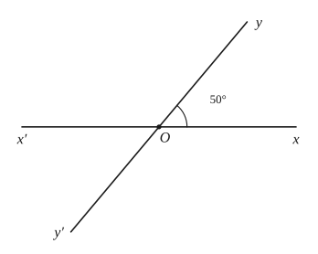
*Hình: Hai đường thẳng xx′ và yy′ cắt nhau tại O.*

- $\widehat{x'Oy}$ và $\widehat{xOy}$ kề bù nên $\widehat{x'Oy} = 180^\circ - 50^\circ = 130^\circ$.
- $\widehat{x'Oy'}$ và $\widehat{xOy}$ đối đỉnh nên $\widehat{x'Oy'} = 50^\circ$.
- $\widehat{xOy'}$ và $\widehat{x'Oy}$ đối đỉnh nên $\widehat{xOy'} = 130^\circ$.

### Bài 2
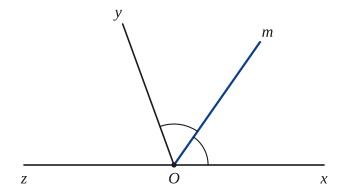
*Hình: Hai góc kề bù xOy, yOz và tia phân giác Om.*

a) Hai góc kề bù nên $\widehat{xOy} + \widehat{yOz} = 180^\circ$. Kết hợp với $\widehat{xOy} - \widehat{yOz} = 40^\circ$:
$$\widehat{xOy} = \frac{180^\circ + 40^\circ}{2} = 110^\circ, \qquad \widehat{yOz} = 110^\circ - 40^\circ = 70^\circ.$$

b) $Om$ là tia phân giác của góc $xOy$ nên $\widehat{mOy} = \frac{110^\circ}{2} = 55^\circ$.
Tia $Oy$ nằm giữa hai tia $Om$ và $Oz$ nên $\widehat{mOz} = \widehat{mOy} + \widehat{yOz} = 55^\circ + 70^\circ = 125^\circ$.

*Cách khác:* $\widehat{xOm} = 55^\circ$ và $\widehat{xOm}$, $\widehat{mOz}$ kề bù, nên $\widehat{mOz} = 180^\circ - 55^\circ = 125^\circ$.

### Bài 3
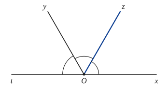
*Hình: Góc xOy = 120°, Oz là phân giác, Ot là tia đối của tia Ox.*

a) $Oz$ là tia phân giác của góc $xOy$ nên $\widehat{xOz} = \widehat{zOy} = 60^\circ$.
- $\widehat{zOt}$ kề bù với $\widehat{xOz}$ nên $\widehat{zOt} = 180^\circ - 60^\circ = 120^\circ$.
- $\widehat{yOt}$ kề bù với $\widehat{xOy}$ nên $\widehat{yOt} = 180^\circ - 120^\circ = 60^\circ$.

b) Tia $Oy$ nằm giữa hai tia $Oz$ và $Ot$, và $\widehat{zOy} = \widehat{yOt} = 60^\circ$. Vậy $Oy$ là tia phân giác của góc $zOt$.

### Bài 4
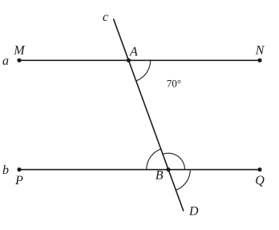
*Hình: Đường thẳng c cắt hai đường thẳng song song a, b.*

Vì $a \parallel b$:
- $\widehat{ABP}$ và $\widehat{NAB}$ là hai góc so le trong nên $\widehat{ABP} = \widehat{NAB} = 70^\circ$.
- $\widehat{ABQ}$ và $\widehat{NAB}$ là hai góc trong cùng phía nên $\widehat{ABQ} = 180^\circ - 70^\circ = 110^\circ$.
- $\widehat{QBD}$ và $\widehat{ABP}$ là hai góc đối đỉnh nên $\widehat{QBD} = 70^\circ$. (Cũng có thể thấy $\widehat{QBD}$ và $\widehat{NAB}$ là hai góc đồng vị.)

### Bài 5
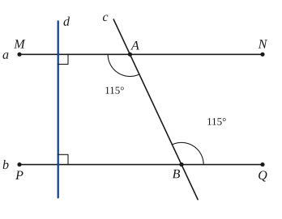
*Hình: Hai góc so le trong bằng nhau; đường thẳng d vuông góc với a.*

a) $M$ và $Q$ nằm khác phía đối với $c$, nên $\widehat{MAB}$ và $\widehat{ABQ}$ là hai góc so le trong. Hai góc này bằng nhau ($= 115^\circ$), nên theo dấu hiệu nhận biết, $a \parallel b$.

b) $d \perp a$ và $a \parallel b$. Đường thẳng $d$ cắt $a$ nên cũng cắt $b$. Theo tính chất hai đường thẳng song song, góc đồng vị tạo bởi $d$ với $b$ bằng góc tạo bởi $d$ với $a$, tức là bằng $90^\circ$. Vậy $d \perp b$.

### Bài 6
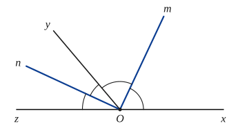
*Hình: Om, On là phân giác của hai góc kề bù xOy, yOz.*

**GT:** $\widehat{xOy}$ và $\widehat{yOz}$ kề bù; $Om$ là tia phân giác của $\widehat{xOy}$; $On$ là tia phân giác của $\widehat{yOz}$.
**KL:** $Om \perp On$.

**Chứng minh.**
- $Om$ là tia phân giác của $\widehat{xOy}$ nên $\widehat{mOy} = \frac12\widehat{xOy}$.
- $On$ là tia phân giác của $\widehat{yOz}$ nên $\widehat{yOn} = \frac12\widehat{yOz}$.
- Tia $Oy$ nằm giữa hai tia $Om$ và $On$, nên
$$\widehat{mOn} = \widehat{mOy} + \widehat{yOn} = \frac12\left(\widehat{xOy} + \widehat{yOz}\right) = \frac12\cdot180^\circ = 90^\circ$$
(vì hai góc kề bù có tổng $180^\circ$).

Vậy $Om \perp On$.

### Bài 7
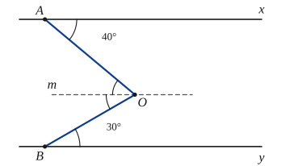
*Hình: Ax ∥ By; kẻ thêm qua O đường thẳng song song với Ax.*

Qua $O$ kẻ đường thẳng song song với $a$; trên đó lấy tia $Om$ nằm khác phía với $x$ đối với đường thẳng $AO$ (tia $Om$ hướng ngược với tia $Ax$). Vì $a \parallel b$ nên đường thẳng này cũng song song với $b$.
- $Om \parallel Ax$, $\widehat{AOm}$ và $\widehat{xAO}$ là hai góc so le trong nên $\widehat{AOm} = \widehat{xAO} = 40^\circ$.
- $Om \parallel By$, $\widehat{mOB}$ và $\widehat{yBO}$ là hai góc so le trong nên $\widehat{mOB} = \widehat{yBO} = 30^\circ$.
- Tia $Om$ nằm giữa hai tia $OA$ và $OB$, nên $\widehat{AOB} = \widehat{AOm} + \widehat{mOB} = 40^\circ + 30^\circ = 70^\circ$.

*Nhận xét:* kết quả tổng quát: $\widehat{AOB} = \widehat{xAO} + \widehat{yBO}$. Chìa khóa là **kẻ thêm đường thẳng song song** qua đỉnh của góc cần tính.

### Bài 8
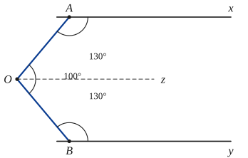
*Hình: Kẻ tia Oz song song với Ax.*

Qua $O$ kẻ tia $Oz$ song song với $Ax$ ($Oz$ và $Ax$ cùng hướng, $Oz$ nằm giữa hai đường thẳng chứa $Ax$ và $By$).
- $Oz \parallel Ax$ nên hai góc trong cùng phía $\widehat{xAO}$ và $\widehat{AOz}$ bù nhau: $\widehat{AOz} = 180^\circ - 130^\circ = 50^\circ$.
- Vì $\widehat{AOz} = 50^\circ < 100^\circ = \widehat{AOB}$, tia $Oz$ nằm giữa hai tia $OA$, $OB$, nên $\widehat{zOB} = 100^\circ - 50^\circ = 50^\circ$.
- Ta có $\widehat{zOB} + \widehat{OBy} = 50^\circ + 130^\circ = 180^\circ$. Hai góc này ở vị trí trong cùng phía (đối với hai đường thẳng chứa $Oz$, $By$ và cát tuyến $OB$), nên $Oz \parallel By$.

Hai đường thẳng $Ax$ và $By$ phân biệt, cùng song song với đường thẳng chứa $Oz$, nên $Ax \parallel By$.

*Nhận xét:* với hình này, $Ax \parallel By$ khi và chỉ khi $\widehat{xAO} + \widehat{AOB} + \widehat{OBy} = 360^\circ$.

### Bài 9
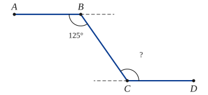
*Hình: Con đường gấp khúc ABCD với AB ∥ CD.*

a) $AB \parallel CD$, $A$ và $D$ nằm khác phía đối với $BC$, nên $\widehat{ABC}$ và $\widehat{BCD}$ là hai góc so le trong. Do đó $\widehat{BCD} = \widehat{ABC} = 125^\circ$.

b) Gọi $Bm$ là tia đối của tia $BA$. Góc $\widehat{mBC}$ kề bù với $\widehat{ABC}$ nên góc rẽ là $\widehat{mBC} = 180^\circ - 125^\circ = 55^\circ$.

*Nhận xét:* tại $C$ người đi đường cũng rẽ một góc $55^\circ$ nhưng theo chiều ngược lại, nên đoạn $CD$ lại song song với đoạn $AB$.

### Bài 10
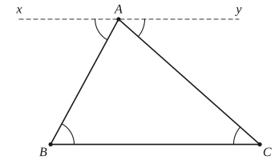
*Hình: Qua A kẻ đường thẳng xy song song với BC.*

**GT:** tam giác $ABC$; $xy$ đi qua $A$, $xy \parallel BC$. **KL:** $\widehat{BAC} + \widehat{ABC} + \widehat{ACB} = 180^\circ$.

**Chứng minh.**
- $xy \parallel BC$, $\widehat{xAB}$ và $\widehat{ABC}$ là hai góc so le trong nên $\widehat{xAB} = \widehat{ABC}$.
- $xy \parallel BC$, $\widehat{yAC}$ và $\widehat{ACB}$ là hai góc so le trong nên $\widehat{yAC} = \widehat{ACB}$.
- Ba góc $\widehat{xAB}$, $\widehat{BAC}$, $\widehat{CAy}$ ghép lại thành góc bẹt $xAy$, nên
$$\widehat{xAB} + \widehat{BAC} + \widehat{CAy} = 180^\circ.$$

Thay hai đẳng thức trên vào, được $\widehat{ABC} + \widehat{BAC} + \widehat{ACB} = 180^\circ$.

*Nhận xét:* đây chính là định lý **tổng ba góc của một tam giác**, sẽ dùng thường xuyên ở Chủ đề 4.

### Bài 11
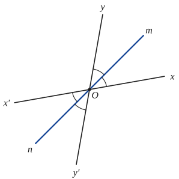
*Hình: Om, On là phân giác của hai góc đối đỉnh xOy, x′Oy′.*

Ta chứng minh $\widehat{mOn} = 180^\circ$, tức là các góc $\widehat{mOy}$, $\widehat{yOx'}$, $\widehat{x'On}$ ghép lại thành một góc bẹt.
- $\widehat{xOy} = \widehat{x'Oy'}$ (đối đỉnh). Gọi số đo chung là $\alpha$.
- $\widehat{mOy} = \frac{\alpha}{2}$ (vì $Om$ là phân giác của $\widehat{xOy}$), $\widehat{x'On} = \frac{\alpha}{2}$ (vì $On$ là phân giác của $\widehat{x'Oy'}$).
- $\widehat{yOx'} = 180^\circ - \alpha$ (kề bù với $\widehat{xOy}$).

Do đó
$$\widehat{mOy} + \widehat{yOx'} + \widehat{x'On} = \frac{\alpha}{2} + (180^\circ - \alpha) + \frac{\alpha}{2} = 180^\circ.$$
Vậy $Om$ và $On$ là hai tia đối nhau.

### Bài 12
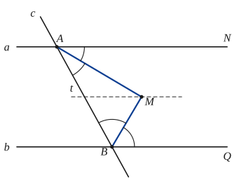
*Hình: Hai tia phân giác AM, BM của hai góc trong cùng phía.*

- $a \parallel b$ nên hai góc trong cùng phía bù nhau: $\widehat{NAB} + \widehat{ABQ} = 180^\circ$.
- Do $AM$, $BM$ là các tia phân giác: $\widehat{MAN} = \frac12\widehat{NAB}$, $\widehat{MBQ} = \frac12\widehat{ABQ}$, nên
$$\widehat{MAN} + \widehat{MBQ} = \frac12\cdot180^\circ = 90^\circ.$$
- Qua $M$ kẻ tia $Mt$ song song với $a$, hướng ngược với tia $AN$ (tức là về phía đường thẳng $c$). Khi đó $Mt$ cũng song song với $b$.
  - $\widehat{AMt} = \widehat{MAN}$ (so le trong, $Mt \parallel AN$);
  - $\widehat{tMB} = \widehat{MBQ}$ (so le trong, $Mt \parallel BQ$).
- Tia $Mt$ nằm giữa hai tia $MA$, $MB$, nên $\widehat{AMB} = \widehat{AMt} + \widehat{tMB} = \widehat{MAN} + \widehat{MBQ} = 90^\circ$.

Vậy $\widehat{AMB} = 90^\circ$.

*Nhận xét:* kết quả không phụ thuộc vào góc giữa $c$ và $a$. Đây là bài "hai phân giác của hai góc trong cùng phía thì vuông góc", rất hay gặp.
