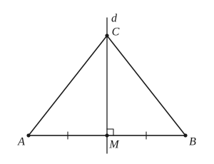
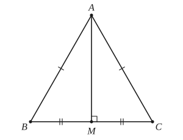
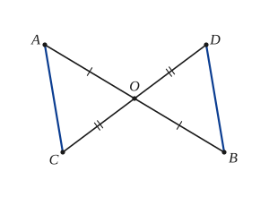
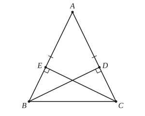
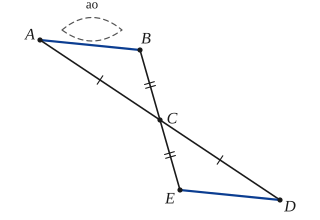
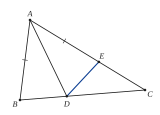
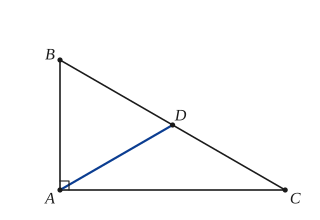
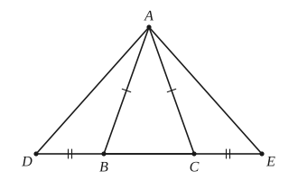

# Chủ đề 4. Tam giác bằng nhau

> Tam giác bằng nhau là công cụ chứng minh quan trọng nhất của hình học lớp 7: muốn chứng minh hai đoạn thẳng bằng nhau, hai góc bằng nhau, ta thường tìm hai tam giác bằng nhau chứa chúng. Chủ đề này gồm tổng ba góc của tam giác, ba trường hợp bằng nhau, các trường hợp của tam giác vuông, tam giác cân và đường trung trực.

## I. Kiến thức cần nắm

### 1. Tổng ba góc của tam giác

- Trong mọi tam giác: $\widehat{A} + \widehat{B} + \widehat{C} = 180^\circ$.
- Tam giác vuông: hai góc nhọn **phụ nhau** (tổng $90^\circ$).
- **Góc ngoài** của tam giác bằng tổng hai góc trong không kề với nó.

*Vì sao tổng bằng $180^\circ$:* qua $A$ kẻ đường thẳng song song với $BC$; hai góc so le trong bằng $\widehat{B}$ và $\widehat{C}$, cùng với $\widehat{A}$ tạo thành góc bẹt.

### 2. Hai tam giác bằng nhau

$\triangle ABC = \triangle DEF$ khi các cạnh tương ứng bằng nhau và các góc tương ứng bằng nhau. **Thứ tự đỉnh** cho biết sự tương ứng: $A \leftrightarrow D$, $B \leftrightarrow E$, $C \leftrightarrow F$.

### 3. Ba trường hợp bằng nhau

- **Cạnh – cạnh – cạnh (c.c.c):** ba cạnh tương ứng bằng nhau.
- **Cạnh – góc – cạnh (c.g.c):** hai cạnh và **góc xen giữa** bằng nhau.
- **Góc – cạnh – góc (g.c.g):** một cạnh và **hai góc kề** cạnh đó bằng nhau.

### 4. Trường hợp bằng nhau của tam giác vuông

- Hai cạnh góc vuông (c.g.c).
- Một cạnh góc vuông và một góc nhọn kề (g.c.g).
- **Cạnh huyền – góc nhọn.**
- **Cạnh huyền – cạnh góc vuông.**

### 5. Tam giác cân, tam giác đều

- Tam giác cân tại $A$ ($AB = AC$) thì $\widehat{B} = \widehat{C}$; ngược lại tam giác có hai góc bằng nhau là tam giác cân.
- Trong tam giác cân tại $A$: $\widehat{B} = \widehat{C} = \dfrac{180^\circ - \widehat{A}}{2}$.
- Tam giác đều: ba cạnh bằng nhau, ba góc đều bằng $60^\circ$. Tam giác cân có một góc bằng $60^\circ$ là tam giác đều.

### 6. Đường trung trực của đoạn thẳng

Đường thẳng vuông góc với đoạn thẳng tại trung điểm gọi là đường trung trực. **Mọi điểm trên đường trung trực cách đều hai đầu mút** của đoạn thẳng, và ngược lại.

### 7. Cách trình bày một bài chứng minh

1. Chỉ ra hai tam giác chứa các yếu tố cần chứng minh.
2. Liệt kê ba yếu tố bằng nhau, mỗi yếu tố kèm lý do (giả thiết, cạnh chung, góc đối đỉnh…).
3. Kết luận hai tam giác bằng nhau theo trường hợp nào, suy ra các yếu tố tương ứng bằng nhau.

### 8. Sai lầm hay gặp

- Viết sai thứ tự đỉnh tương ứng.
- Dùng "cạnh – cạnh – góc" (góc không xen giữa): **không** phải trường hợp bằng nhau.
- Dùng "góc – góc – góc": hai tam giác có ba góc bằng nhau chưa chắc bằng nhau.

## II. Bài tập vận dụng

**Bài 1.** Tính số đo góc $C$ của tam giác $ABC$ biết $\widehat{A} = 70^\circ$, $\widehat{B} = 50^\circ$.

**Bài 2.** a) Một tam giác vuông có một góc nhọn bằng $35^\circ$. Tính góc nhọn còn lại.
b) Tam giác $ABC$ có $\widehat{A} = 60^\circ$, $\widehat{B} = 45^\circ$. Tính góc ngoài tại đỉnh $C$.

**Bài 3.** Cho $\triangle ABC = \triangle DEF$, biết $AB = 5$ cm, $\widehat{B} = 60^\circ$. Tìm cạnh và góc tương ứng bằng chúng trong $\triangle DEF$. Viết các cặp cạnh, góc tương ứng.

**Bài 4.** Cho đoạn thẳng $AB$, $M$ là trung điểm. Đường thẳng $d$ vuông góc với $AB$ tại $M$. Lấy điểm $C$ trên $d$ ($C \ne M$). Chứng minh $CA = CB$.

**Bài 5.** Cho tam giác $ABC$ có $AB = AC$, $M$ là trung điểm của $BC$. Chứng minh $\triangle ABM = \triangle ACM$ và $AM \perp BC$.

**Bài 6.** Hai đoạn thẳng $AB$ và $CD$ cắt nhau tại $O$, $O$ là trung điểm của mỗi đoạn. Chứng minh $AC = BD$ và $AC \parallel BD$.

**Bài 7.** Tam giác $ABC$ cân tại $A$ có $\widehat{A} = 40^\circ$. Tính $\widehat{B}$ và $\widehat{C}$.

**Bài 8.** Cho tam giác $ABC$ cân tại $A$. Kẻ $BD \perp AC$ ($D \in AC$), $CE \perp AB$ ($E \in AB$). Chứng minh $BD = CE$.

**Bài 9.** a) Tam giác đều có các góc bằng bao nhiêu độ? b) Tam giác cân $ABC$ có $\widehat{B} = 60^\circ$. Chứng minh tam giác $ABC$ đều.

**Bài 10 (thực tế).** Hai điểm $A$, $B$ ở hai bờ một cái ao, không đo trực tiếp được. Người ta chọn điểm $C$ ngoài ao, kéo dài $AC$ một đoạn $CD = AC$, kéo dài $BC$ một đoạn $CE = BC$, rồi đo $DE$. Giải thích vì sao $AB = DE$.

**Bài 11 (vận dụng cao).** Cho tam giác $ABC$ có $AB < AC$, tia phân giác của góc $A$ cắt $BC$ tại $D$. Trên cạnh $AC$ lấy điểm $E$ sao cho $AE = AB$. Chứng minh $\triangle ABD = \triangle AED$ và $DB = DE$.

**Bài 12 (vận dụng cao).** Cho tam giác $ABC$ vuông tại $A$, $\widehat{B} = 60^\circ$. Trên cạnh $BC$ lấy điểm $D$ sao cho $BD = BA$. Chứng minh tam giác $ABD$ đều và tính $\widehat{DAC}$.

**Bài 13 (vận dụng cao).** Cho tam giác $ABC$ cân tại $A$. Trên tia đối của tia $BC$ lấy điểm $D$, trên tia đối của tia $CB$ lấy điểm $E$ sao cho $BD = CE$. Chứng minh tam giác $ADE$ cân.

---

## III. Lời giải chi tiết

### Bài 1
$\widehat{C} = 180^\circ - 70^\circ - 50^\circ = 60^\circ$.

### Bài 2
a) $90^\circ - 35^\circ = 55^\circ$.
b) Góc ngoài tại $C$ bằng $\widehat{A} + \widehat{B} = 105^\circ$.

### Bài 3
$DE = AB = 5$ cm; $\widehat{E} = \widehat{B} = 60^\circ$.
Các cặp tương ứng: $AB = DE$, $BC = EF$, $CA = FD$; $\widehat{A} = \widehat{D}$, $\widehat{B} = \widehat{E}$, $\widehat{C} = \widehat{F}$.

### Bài 4

*Hình: Đường thẳng d vuông góc với AB tại trung điểm M, C thuộc d.*

Xét $\triangle CMA$ và $\triangle CMB$: $MA = MB$ (giả thiết); $\widehat{CMA} = \widehat{CMB} = 90^\circ$; $CM$ là cạnh chung.
Vậy $\triangle CMA = \triangle CMB$ (c.g.c), suy ra $CA = CB$.

*Nhận xét:* đây là tính chất của đường trung trực: mọi điểm trên đường trung trực cách đều hai đầu đoạn thẳng.

### Bài 5

*Hình: Tam giác ABC có AB = AC, M là trung điểm BC.*

Xét $\triangle ABM$ và $\triangle ACM$: $AB = AC$; $BM = CM$; $AM$ chung. Vậy $\triangle ABM = \triangle ACM$ (c.c.c).
Suy ra $\widehat{AMB} = \widehat{AMC}$. Hai góc này kề bù nên mỗi góc bằng $90^\circ$, tức $AM \perp BC$.

### Bài 6

*Hình: Hai đoạn thẳng AB và CD cắt nhau tại trung điểm O của mỗi đoạn.*

Xét $\triangle OAC$ và $\triangle OBD$: $OA = OB$; $\widehat{AOC} = \widehat{BOD}$ (đối đỉnh); $OC = OD$. Vậy $\triangle OAC = \triangle OBD$ (c.g.c).
Suy ra $AC = BD$ và $\widehat{OAC} = \widehat{OBD}$. Hai góc này ở vị trí so le trong (đối với hai đường thẳng $AC$, $BD$ và cát tuyến $AB$), nên $AC \parallel BD$.

### Bài 7
$\widehat{B} = \widehat{C} = \dfrac{180^\circ - 40^\circ}{2} = 70^\circ$.

### Bài 8

*Hình: Tam giác ABC cân tại A, BD vuông góc AC, CE vuông góc AB.*

Xét hai tam giác vuông $BDC$ (vuông tại $D$) và $CEB$ (vuông tại $E$): cạnh huyền $BC$ chung; $\widehat{DCB} = \widehat{EBC}$ (hai góc ở đáy của tam giác cân).
Vậy $\triangle BDC = \triangle CEB$ (cạnh huyền – góc nhọn), suy ra $BD = CE$.

### Bài 9
a) Mỗi góc bằng $180^\circ : 3 = 60^\circ$.
b) Nếu tam giác cân tại $A$: $\widehat{C} = \widehat{B} = 60^\circ$, nên $\widehat{A} = 60^\circ$. Nếu cân tại $B$: $\widehat{A} = \widehat{C} = \dfrac{180^\circ - 60^\circ}{2} = 60^\circ$. Nếu cân tại $C$: $\widehat{A} = \widehat{B} = 60^\circ$, nên $\widehat{C} = 60^\circ$. Trong mọi trường hợp ba góc đều bằng $60^\circ$, tam giác có ba góc bằng nhau nên ba cạnh bằng nhau: tam giác đều.

### Bài 10

*Hình: Đo khoảng cách AB qua ao bằng cách dựng hai tam giác bằng nhau.*

Xét $\triangle CAB$ và $\triangle CDE$: $CA = CD$; $\widehat{ACB} = \widehat{DCE}$ (đối đỉnh); $CB = CE$. Vậy $\triangle CAB = \triangle CDE$ (c.g.c), suy ra $AB = DE$. Đo $DE$ là biết $AB$.

### Bài 11

*Hình: Tam giác ABC, AD là tia phân giác, E trên AC với AE = AB.*

Xét $\triangle ABD$ và $\triangle AED$: $AB = AE$ (giả thiết); $\widehat{BAD} = \widehat{EAD}$ ($AD$ là tia phân giác); $AD$ chung.
Vậy $\triangle ABD = \triangle AED$ (c.g.c), suy ra $DB = DE$.

### Bài 12

*Hình: Tam giác ABC vuông tại A có góc B bằng 60 độ, D trên BC với BD = BA.*

Tam giác $ABD$ có $BA = BD$ nên cân tại $B$, lại có $\widehat{B} = 60^\circ$, nên là tam giác đều (bài 9). Do đó $\widehat{BAD} = 60^\circ$.
$\widehat{DAC} = \widehat{BAC} - \widehat{BAD} = 90^\circ - 60^\circ = 30^\circ$.

### Bài 13

*Hình: Tam giác ABC cân tại A, D và E trên đường thẳng BC với BD = CE.*

$\widehat{ABC} = \widehat{ACB}$ nên hai góc kề bù với chúng bằng nhau: $\widehat{ABD} = \widehat{ACE}$.
Xét $\triangle ABD$ và $\triangle ACE$: $AB = AC$; $\widehat{ABD} = \widehat{ACE}$; $BD = CE$. Vậy $\triangle ABD = \triangle ACE$ (c.g.c), suy ra $AD = AE$: tam giác $ADE$ cân tại $A$.
