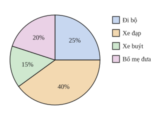
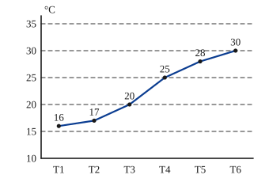

# Chủ đề 5. Thống kê và xác suất

> Lớp 7 học phân loại dữ liệu, đọc và vẽ biểu đồ hình quạt tròn và biểu đồ đoạn thẳng, làm quen với biến cố và **xác suất của biến cố** trong các trò chơi đơn giản (gieo xúc xắc, tung đồng xu, rút thẻ). Khác với xác suất thực nghiệm ở lớp 6, xác suất ở đây được tính bằng lý luận khi các kết quả **đồng khả năng**.

## I. Kiến thức cần nắm

### 1. Phân loại dữ liệu

- **Dữ liệu định tính** (không phải số): màu sắc, môn học, xếp loại (có thể có thứ tự: tốt, khá, đạt…).
- **Dữ liệu định lượng** (là số): số anh chị em (rời rạc), chiều cao, cân nặng (liên tục).
- Kiểm tra **tính hợp lý** và **tính đại diện**: mẫu khảo sát phải đủ lớn và chọn ngẫu nhiên.

### 2. Biểu đồ hình quạt tròn

- Cả hình tròn ứng với 100%; mỗi hình quạt ứng với một phần, ghi tỉ số phần trăm.
- Số lượng phần A $=$ tổng $\times$ phần trăm của A.
- Tỉ số phần trăm của phần A $=$ số lượng A $:$ tổng $\times 100\%$.

### 3. Biểu đồ đoạn thẳng

Biểu diễn sự **thay đổi** của một đại lượng theo thời gian. Đoạn đi lên là tăng, đi xuống là giảm; đoạn càng dốc thì thay đổi càng nhiều.

### 4. Biến cố

- **Biến cố chắc chắn:** luôn xảy ra.
- **Biến cố không thể:** không bao giờ xảy ra.
- **Biến cố ngẫu nhiên:** có thể xảy ra hoặc không.

### 5. Xác suất của biến cố

Khi các kết quả có thể **đồng khả năng** (xúc xắc cân đối, đồng xu cân đối, các thẻ giống nhau…):
$$P(A) = \frac{\text{số kết quả thuận lợi cho } A}{\text{tổng số kết quả có thể}}.$$
- $0 \le P(A) \le 1$; biến cố chắc chắn có xác suất 1, biến cố không thể có xác suất 0.
- $P(\text{không } A) = 1 - P(A)$.

**Ví dụ.** Gieo một xúc xắc cân đối: 6 kết quả đồng khả năng. Biến cố "xuất hiện mặt chẵn" có 3 kết quả thuận lợi (2, 4, 6), nên xác suất là $\dfrac{3}{6} = \dfrac{1}{2}$.

### 6. Sai lầm hay gặp

- Tung hai đồng xu mà coi "hai sấp", "một sấp một ngửa", "hai ngửa" là ba kết quả đồng khả năng (sai: "một sấp một ngửa" gồm hai kết quả SN và NS).
- Đếm thiếu kết quả thuận lợi.
- Đọc biểu đồ đoạn thẳng mà nhầm giá trị với mức thay đổi.

## II. Bài tập vận dụng

**Bài 1.** Phân loại các dữ liệu sau thành định tính hay định lượng: chiều cao (cm) của học sinh; số anh chị em ruột; màu sắc yêu thích; xếp loại học lực (tốt, khá, đạt, chưa đạt).

**Bài 2.** Biểu đồ dưới đây cho biết phương tiện đến trường của 40 học sinh lớp 7A.

Tính số học sinh sử dụng mỗi loại phương tiện.

**Bài 3.** Biểu đồ đoạn thẳng dưới đây cho biết nhiệt độ trung bình sáu tháng đầu năm ở một địa phương.

a) Tháng nào nóng nhất, tháng nào lạnh nhất? b) Nhiệt độ tăng nhiều nhất giữa hai tháng liên tiếp nào?

**Bài 4.** Gieo một con xúc xắc. Mỗi biến cố sau là chắc chắn, không thể hay ngẫu nhiên?
a) "Số chấm xuất hiện không vượt quá 6". b) "Xuất hiện mặt 7 chấm". c) "Xuất hiện mặt có số chấm chẵn".

**Bài 5.** Gieo một con xúc xắc cân đối. Tính xác suất của các biến cố: a) "xuất hiện mặt 5 chấm"; b) "xuất hiện mặt chẵn"; c) "số chấm xuất hiện là số nguyên tố".

**Bài 6.** Một hộp có 3 viên bi đỏ, 5 viên bi xanh và 2 viên bi vàng có cùng kích thước. Lấy ngẫu nhiên một viên. Tính xác suất của các biến cố: a) "lấy được bi xanh"; b) "không lấy được bi đỏ".

**Bài 7.** Chọn ngẫu nhiên một số trong các số tự nhiên từ 1 đến 20. Tính xác suất của các biến cố: a) "số được chọn chia hết cho 3"; b) "số được chọn là số chính phương".

**Bài 8 (thực tế).** Lớp 7B có 18 bạn nam và 22 bạn nữ. Cô giáo chọn ngẫu nhiên một bạn lên bảng. Tính xác suất bạn được chọn là bạn nữ.

**Bài 9.** Khảo sát 200 người về loại nước uống yêu thích: 50 người chọn A, 70 người chọn B, 80 người chọn C. Tính tỉ số phần trăm mỗi loại để vẽ biểu đồ hình quạt.

**Bài 10 (thực tế).** Doanh thu (triệu đồng) của một cửa hàng trong 5 tháng: 120; 135; 130; 150; 170. Nếu vẽ biểu đồ đoạn thẳng thì đoạn nào đi xuống? Doanh thu tháng 5 tăng bao nhiêu phần trăm so với tháng 1?

**Bài 11 (vận dụng cao).** Tung đồng thời hai đồng xu cân đối. Liệt kê các kết quả có thể và tính xác suất của biến cố "một đồng xu sấp, một đồng xu ngửa".

**Bài 12 (vận dụng cao).** Chọn ngẫu nhiên một số có hai chữ số. Tính xác suất để tổng các chữ số của số đó bằng 5.

**Bài 13 (vận dụng cao).** Một hộp có 4 viên bi đỏ và một số viên bi xanh. Lấy ngẫu nhiên một viên, xác suất lấy được bi đỏ là $\dfrac{1}{3}$. Hỏi trong hộp có bao nhiêu viên bi xanh?

---

## III. Lời giải chi tiết

### Bài 1
Định lượng: chiều cao (liên tục); số anh chị em (rời rạc). Định tính: màu sắc yêu thích; xếp loại học lực (có thứ tự).

### Bài 2
Đi bộ: $40 \cdot 25\% = 10$; xe đạp: $40 \cdot 40\% = 16$; xe buýt: $40 \cdot 15\% = 6$; bố mẹ đưa: $40 \cdot 20\% = 8$.

### Bài 3
a) Tháng 6 nóng nhất ($30\,^\circ$C), tháng 1 lạnh nhất ($16\,^\circ$C).
b) Mức tăng: T1→T2: 1; T2→T3: 3; T3→T4: 5; T4→T5: 3; T5→T6: 2. Tăng nhiều nhất từ tháng 3 sang tháng 4 ($5\,^\circ$C).

### Bài 4
a) Chắc chắn. b) Không thể. c) Ngẫu nhiên.

### Bài 5
Có 6 kết quả đồng khả năng.
a) $\dfrac{1}{6}$. b) Mặt 2, 4, 6: $\dfrac{3}{6} = \dfrac{1}{2}$. c) Số nguyên tố 2, 3, 5: $\dfrac{3}{6} = \dfrac{1}{2}$.

### Bài 6
Có 10 viên bi.
a) $\dfrac{5}{10} = \dfrac{1}{2}$. b) Không đỏ (xanh hoặc vàng): $\dfrac{7}{10}$.

### Bài 7
a) Các số chia hết cho 3: 3, 6, 9, 12, 15, 18 (6 số): $\dfrac{6}{20} = \dfrac{3}{10}$.
b) Các số chính phương: 1, 4, 9, 16 (4 số): $\dfrac{4}{20} = \dfrac{1}{5}$.

### Bài 8
$\dfrac{22}{40} = \dfrac{11}{20}$.

### Bài 9
A: $\dfrac{50}{200} = 25\%$; B: $35\%$; C: $40\%$.

### Bài 10
Từ tháng 2 sang tháng 3 doanh thu giảm (135 xuống 130), nên đoạn nối hai điểm đó đi xuống.
Tháng 5 so với tháng 1: tăng $170 - 120 = 50$ (triệu), bằng $\dfrac{50}{120} \cdot 100\% \approx 41{,}7\%$.

### Bài 11
Các kết quả: SS, SN, NS, NN (4 kết quả đồng khả năng). Biến cố "một sấp một ngửa" gồm SN và NS.
Xác suất: $\dfrac{2}{4} = \dfrac{1}{2}$.

### Bài 12
Có 90 số có hai chữ số. Các số có tổng chữ số bằng 5: 14, 23, 32, 41, 50 (5 số).
Xác suất: $\dfrac{5}{90} = \dfrac{1}{18}$.

### Bài 13
Xác suất lấy được bi đỏ là $\dfrac{4}{\text{tổng số bi}} = \dfrac{1}{3}$, nên tổng số bi là 12. Số bi xanh: $12 - 4 = 8$.
