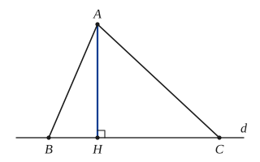
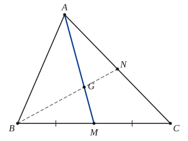
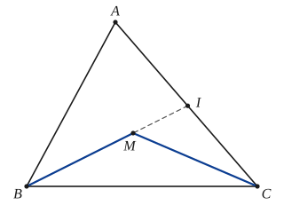

# Chủ đề 9. Quan hệ giữa các yếu tố trong tam giác

> Chủ đề này so sánh các cạnh và các góc trong một tam giác, đường vuông góc và đường xiên, bất đẳng thức tam giác, và các đường đồng quy (trung tuyến, phân giác, trung trực, đường cao). Đây là các công cụ để so sánh độ dài và giải thích những hiện tượng thực tế như "đường thẳng là ngắn nhất".

## I. Kiến thức cần nắm

### 1. Góc và cạnh đối diện

Trong một tam giác: **góc đối diện với cạnh lớn hơn thì lớn hơn**, và ngược lại cạnh đối diện với góc lớn hơn thì lớn hơn.
Trong tam giác vuông, cạnh huyền là cạnh lớn nhất; trong tam giác tù, cạnh đối diện góc tù lớn nhất.

### 2. Đường vuông góc và đường xiên

Từ điểm $A$ nằm ngoài đường thẳng $d$, kẻ $AH \perp d$ ($H \in d$) và các đường xiên $AB$, $AC$:
- $AH < AB$: **đường vuông góc ngắn hơn mọi đường xiên**.
- $HB < HC \Leftrightarrow AB < AC$: đường xiên nào có hình chiếu lớn hơn thì lớn hơn.

### 3. Bất đẳng thức tam giác

Với ba cạnh $a, b, c$ của một tam giác:
$$\lvert b - c\rvert < a < b + c.$$
Ngược lại, ba số dương thỏa mãn số lớn nhất **nhỏ hơn** tổng hai số kia thì là độ dài ba cạnh của một tam giác.

### 4. Các đường đồng quy trong tam giác

| Đường | Điểm đồng quy | Tính chất |
|---|---|---|
| Ba trung tuyến | Trọng tâm $G$ | $AG = \dfrac{2}{3}AM$, $GM = \dfrac{1}{3}AM$ |
| Ba phân giác | Tâm $I$ | Cách đều ba cạnh |
| Ba trung trực | Điểm $O$ | Cách đều ba đỉnh |
| Ba đường cao | Trực tâm $H$ | |

Trong tam giác cân tại $A$, đường trung tuyến xuất phát từ $A$ đồng thời là đường cao, đường phân giác và đường trung trực.

**Tính chất thêm:** trọng tâm $G$ chia tam giác thành ba tam giác $GAB$, $GBC$, $GCA$ có diện tích bằng nhau, mỗi tam giác bằng $\dfrac{1}{3}$ diện tích tam giác $ABC$.

### 5. Sai lầm hay gặp

- Kiểm tra bất đẳng thức tam giác mà chỉ thử một cặp (cần kiểm tra số lớn nhất nhỏ hơn tổng hai số kia).
- Nhầm trọng tâm chia trung tuyến theo tỉ lệ $1 : 1$ (đúng là $2 : 1$ tính từ đỉnh).
- Nhầm giao điểm ba trung trực (cách đều ba **đỉnh**) với giao điểm ba phân giác (cách đều ba **cạnh**).

## II. Bài tập vận dụng

**Bài 1.** Tam giác $ABC$ có $AB = 5$ cm, $BC = 7$ cm, $AC = 6$ cm. So sánh các góc của tam giác.

**Bài 2.** Tam giác $ABC$ có $\widehat{A} = 80^\circ$, $\widehat{B} = 45^\circ$. Cạnh nào lớn nhất, cạnh nào nhỏ nhất?

**Bài 3.** Bộ ba độ dài nào sau đây là độ dài ba cạnh của một tam giác: a) 3 cm, 4 cm, 8 cm; b) 5 cm, 6 cm, 10 cm; c) 2 cm, 3 cm, 5 cm?

**Bài 4.** Một tam giác cân có hai cạnh dài 4 cm và 9 cm. Tính chu vi tam giác đó.

**Bài 5.** Một tam giác có hai cạnh dài 2 cm và 7 cm, độ dài cạnh thứ ba là một số nguyên lẻ (cm). Tính cạnh thứ ba và chu vi tam giác.

**Bài 6.** Cho điểm $A$ nằm ngoài đường thẳng $d$, $AH \perp d$ tại $H$. Trên $d$ lấy hai điểm $B$, $C$ ở hai phía của $H$ sao cho $HB < HC$. So sánh $AH$, $AB$, $AC$.

**Bài 7.** Cho tam giác $ABC$ có trung tuyến $AM = 9$ cm, $G$ là trọng tâm. Tính $AG$ và $GM$.

**Bài 8 (thực tế).** Ba khu dân cư nằm ở ba vị trí $A$, $B$, $C$ không thẳng hàng. Cần đặt một trạm bơm nước cách đều ba khu dân cư. Nêu cách xác định vị trí trạm bơm.

**Bài 9.** Cho tam giác $ABC$ cân tại $A$, $AM$ là đường trung tuyến. Chứng minh $AM$ cũng là đường cao và đường phân giác của tam giác.

**Bài 10 (thực tế).** Thành phố A cách thành phố B 60 km, thành phố C cách thành phố A 25 km. Thành phố C có thể cách thành phố B 30 km được không? Vì sao?

**Bài 11 (vận dụng cao).** Cho điểm $M$ nằm trong tam giác $ABC$. Chứng minh $MB + MC < AB + AC$.

**Bài 12 (vận dụng cao).** Cho tam giác $ABC$ có $AB < AC$, $AD$ là tia phân giác của góc $A$ ($D \in BC$). So sánh $\widehat{ADB}$ và $\widehat{ADC}$.

**Bài 13 (vận dụng cao).** Cho tam giác $ABC$ có diện tích $36 \text{ cm}^2$, $G$ là trọng tâm. Tính diện tích tam giác $GBC$.

---

## III. Lời giải chi tiết

### Bài 1
$AB < AC < BC$ nên góc đối diện: $\widehat{C} < \widehat{B} < \widehat{A}$.

### Bài 2
$\widehat{C} = 180^\circ - 80^\circ - 45^\circ = 55^\circ$. Ta có $\widehat{B} < \widehat{C} < \widehat{A}$ nên $AC < AB < BC$. Cạnh lớn nhất $BC$, nhỏ nhất $AC$.

### Bài 3
a) $8 > 3 + 4$: không phải. b) $10 < 5 + 6$: là ba cạnh tam giác. c) $5 = 2 + 3$: không phải.

### Bài 4
Nếu cạnh bên là 4 cm thì ba cạnh 4, 4, 9 với $9 > 4 + 4$: vô lý. Vậy cạnh bên là 9 cm, ba cạnh 9, 9, 4. Chu vi: 22 cm.

### Bài 5
$7 - 2 < c < 7 + 2$, tức $5 < c < 9$. $c$ lẻ nên $c = 7$. Chu vi: $2 + 7 + 7 = 16$ (cm).

### Bài 6

*Hình: Đường vuông góc AH và hai đường xiên AB, AC.*

$AH$ là đường vuông góc nên $AH < AB$ và $AH < AC$. $HB < HC$ nên $AB < AC$. Vậy $AH < AB < AC$.

### Bài 7

*Hình: Tam giác ABC với trung tuyến AM và trọng tâm G.*

$AG = \dfrac{2}{3} \cdot 9 = 6$ (cm), $GM = 9 - 6 = 3$ (cm).

### Bài 8
Điểm cách đều $A$ và $B$ nằm trên đường trung trực của $AB$; cách đều $B$ và $C$ nằm trên đường trung trực của $BC$. Vậy trạm bơm đặt tại giao điểm các đường trung trực của tam giác $ABC$ (cũng là giao điểm của ba đường trung trực).

### Bài 9
$\triangle ABM = \triangle ACM$ (c.c.c: $AB = AC$, $BM = CM$, $AM$ chung). Suy ra $\widehat{AMB} = \widehat{AMC} = 90^\circ$ (kề bù và bằng nhau), nên $AM$ là đường cao; và $\widehat{BAM} = \widehat{CAM}$, nên $AM$ là đường phân giác.

### Bài 10
Nếu $A, B, C$ là ba đỉnh của một tam giác thì $AB < AC + CB$. Nếu $CB = 30$ thì $AC + CB = 55 < 60 = AB$: vô lý (kể cả khi ba điểm thẳng hàng, tổng hai khoảng cách cũng không nhỏ hơn khoảng cách còn lại).
Vậy C **không thể** cách B 30 km.

### Bài 11

*Hình: Điểm M nằm trong tam giác ABC, BM cắt AC tại I.*

Kéo dài $BM$ cắt $AC$ tại $I$.
- Tam giác $MIC$: $MC < MI + IC$. Cộng $MB$ hai vế: $MB + MC < MB + MI + IC = BI + IC$.
- Tam giác $ABI$: $BI < AB + AI$. Cộng $IC$: $BI + IC < AB + AI + IC = AB + AC$.

Vậy $MB + MC < AB + AC$.

### Bài 12
$AB < AC$ nên $\widehat{C} < \widehat{B}$. Trong tam giác $ABD$: $\widehat{ADB} = 180^\circ - \dfrac{\widehat{A}}{2} - \widehat{B}$. Trong tam giác $ADC$: $\widehat{ADC} = 180^\circ - \dfrac{\widehat{A}}{2} - \widehat{C}$.
Vì $\widehat{B} > \widehat{C}$ nên $\widehat{ADB} < \widehat{ADC}$.

### Bài 13
Gọi $AM$ là trung tuyến. $GM = \dfrac{1}{3}AM$. Tam giác $GBC$ và $ABC$ chung đáy $BC$, chiều cao từ $G$ bằng $\dfrac{1}{3}$ chiều cao từ $A$ (vì $GM = \dfrac{1}{3}AM$ và hai đoạn cùng nằm trên một đường thẳng cắt $BC$ tại $M$).
$S_{GBC} = \dfrac{1}{3} \cdot 36 = 12 \text{ (cm}^2)$.
