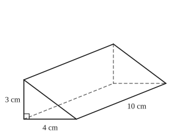
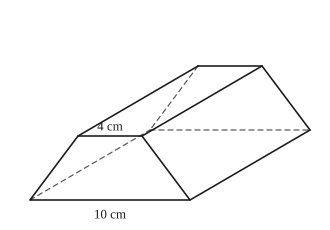
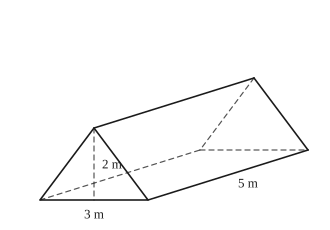

# Chủ đề 10. Một số hình khối trong thực tiễn

> Hộp sữa, bể cá, viên gạch có dạng hình hộp chữ nhật; cái lều, tấm lịch để bàn có dạng hình lăng trụ đứng tam giác. Chủ đề này ôn hình hộp chữ nhật, hình lập phương và học hình lăng trụ đứng tam giác, tứ giác: nhận biết các yếu tố, tính diện tích xung quanh và thể tích.

## I. Kiến thức cần nắm

### 1. Hình hộp chữ nhật và hình lập phương

- Hình hộp chữ nhật kích thước $a, b, c$: $S_{xq} = 2(a + b)c$, $V = abc$.
- Hình lập phương cạnh $a$: $S_{xq} = 4a^2$, $S_{tp} = 6a^2$, $V = a^3$.

### 2. Hình lăng trụ đứng tam giác, tứ giác

- Có **hai mặt đáy** song song, bằng nhau (tam giác hoặc tứ giác) và các **mặt bên là hình chữ nhật**.
- **Chiều cao** là độ dài cạnh bên (khoảng cách giữa hai đáy).
- Lăng trụ đứng tam giác: 5 mặt, 6 đỉnh, 9 cạnh. Lăng trụ đứng tứ giác: 6 mặt, 8 đỉnh, 12 cạnh.

### 3. Công thức

$$S_{xq} = C_{\text{đáy}} \cdot h, \qquad V = S_{\text{đáy}} \cdot h,$$
với $C_{\text{đáy}}$ là chu vi đáy, $S_{\text{đáy}}$ là diện tích đáy, $h$ là chiều cao.
$S_{tp} = S_{xq} + 2S_{\text{đáy}}$.

*Vì sao $S_{xq} = C \cdot h$:* trải các mặt bên ra thành một hình chữ nhật có chiều dài bằng chu vi đáy, chiều rộng bằng chiều cao.

### 4. Thể tích và đơn vị

$1 \text{ m}^3 = 1\,000 \text{ dm}^3$, $1 \text{ dm}^3 = 1\,000 \text{ cm}^3 = 1$ lít.

### 5. Sai lầm hay gặp

- Nhầm chiều cao lăng trụ với chiều cao của tam giác đáy.
- Thể tích lăng trụ tam giác mà quên chia 2 khi tính diện tích tam giác đáy.
- Hộp không nắp mà tính cả hai đáy.

## II. Bài tập vận dụng

**Bài 1.** Tính diện tích xung quanh và thể tích hình hộp chữ nhật có kích thước 5 cm, 4 cm, 3 cm (chiều cao 3 cm).

**Bài 2.** Tính diện tích xung quanh, diện tích toàn phần và thể tích hình lập phương cạnh 6 cm.

**Bài 3.** Một hình lăng trụ đứng tam giác có đáy là tam giác vuông với hai cạnh góc vuông 3 cm, 4 cm và cạnh huyền 5 cm; chiều cao lăng trụ 10 cm. Tính diện tích xung quanh và thể tích.

**Bài 4.** Một hình lăng trụ đứng tứ giác có đáy là hình thang cân với hai đáy 4 cm và 10 cm, cạnh bên 5 cm, chiều cao hình thang 4 cm; chiều cao lăng trụ 8 cm. Tính diện tích xung quanh và thể tích.

**Bài 5.** Hình lăng trụ đứng tam giác và hình lăng trụ đứng tứ giác lần lượt có bao nhiêu mặt, bao nhiêu đỉnh, bao nhiêu cạnh?

**Bài 6 (thực tế).** Một bể cá hình hộp chữ nhật có kích thước trong lòng 80 cm × 50 cm × 45 cm. Người ta đổ nước vào bể đến độ cao 40 cm. Tính lượng nước trong bể (lít).

**Bài 7 (thực tế).** Một cái lều có dạng hình lăng trụ đứng tam giác: đáy là tam giác cân có cạnh đáy 3 m, chiều cao 2 m, cạnh bên 2,5 m; chiều dài lều 5 m. Tính thể tích không khí trong lều và diện tích vải cần dùng để làm hai mái và hai đầu lều (không có tấm trải đáy).

**Bài 8.** Một hình lập phương có diện tích toàn phần $150 \text{ cm}^2$. Tính thể tích hình lập phương đó.

**Bài 9.** Một hình hộp chữ nhật có thể tích $240 \text{ cm}^3$, đáy là hình chữ nhật 8 cm × 6 cm. Tính chiều cao và diện tích xung quanh.

**Bài 10 (thực tế).** Người ta làm một cái thùng không nắp hình hộp chữ nhật bằng tôn, dài 60 cm, rộng 40 cm, cao 50 cm. Tính diện tích tôn cần dùng (không tính mép hàn).

**Bài 11 (vận dụng cao).** Một khối gỗ hình lập phương cạnh 10 cm. Người ta khoét xuyên qua khối gỗ một lỗ có dạng lăng trụ đứng đáy là hình vuông cạnh 4 cm (lỗ vuông góc với hai mặt đối diện). Tính thể tích phần gỗ còn lại.

**Bài 12 (vận dụng cao).** Một hình hộp chữ nhật có ba kích thước tỉ lệ với 2, 3, 4 và thể tích $192 \text{ cm}^3$. Tính ba kích thước và diện tích toàn phần.

**Bài 13 (vận dụng cao).** Một bể hình hộp chữ nhật có đáy 1,2 m × 0,8 m đang cạn. Người ta mở một vòi chảy vào bể mỗi phút 20 lít. Hỏi sau 30 phút, mực nước trong bể cao bao nhiêu?

---

## III. Lời giải chi tiết

### Bài 1
$S_{xq} = 2(5 + 4) \cdot 3 = 54 \text{ (cm}^2)$; $V = 5 \cdot 4 \cdot 3 = 60 \text{ (cm}^3)$.

### Bài 2
$S_{xq} = 4 \cdot 36 = 144 \text{ (cm}^2)$; $S_{tp} = 6 \cdot 36 = 216 \text{ (cm}^2)$; $V = 216 \text{ (cm}^3)$.

### Bài 3

*Hình: Lăng trụ đứng tam giác có đáy là tam giác vuông với hai cạnh góc vuông 3 cm, 4 cm, chiều cao 10 cm.*

Chu vi đáy: $3 + 4 + 5 = 12$ (cm). $S_{xq} = 12 \cdot 10 = 120 \text{ (cm}^2)$.
Diện tích đáy: $\dfrac{3 \cdot 4}{2} = 6 \text{ (cm}^2)$. $V = 6 \cdot 10 = 60 \text{ (cm}^3)$.

### Bài 4

*Hình: Lăng trụ đứng tứ giác có đáy là hình thang cân.*

Chu vi đáy: $4 + 10 + 5 + 5 = 24$ (cm). $S_{xq} = 24 \cdot 8 = 192 \text{ (cm}^2)$.
Diện tích đáy: $\dfrac{(4 + 10) \cdot 4}{2} = 28 \text{ (cm}^2)$. $V = 28 \cdot 8 = 224 \text{ (cm}^3)$.

### Bài 5
Lăng trụ đứng tam giác: 5 mặt, 6 đỉnh, 9 cạnh. Lăng trụ đứng tứ giác: 6 mặt, 8 đỉnh, 12 cạnh.

### Bài 6
$V = 80 \cdot 50 \cdot 40 = 160\,000 \text{ (cm}^3) = 160 \text{ dm}^3 = 160$ lít.

### Bài 7

*Hình: Cái lều có dạng hình lăng trụ đứng tam giác.*

Diện tích đáy: $\dfrac{3 \cdot 2}{2} = 3 \text{ (m}^2)$. Thể tích: $3 \cdot 5 = 15 \text{ (m}^3)$.
Hai mái: $2 \cdot 2{,}5 \cdot 5 = 25 \text{ (m}^2)$; hai đầu lều: $2 \cdot 3 = 6 \text{ (m}^2)$. Diện tích vải: $31 \text{ m}^2$.

### Bài 8
Một mặt: $150 : 6 = 25 \text{ (cm}^2)$, cạnh 5 cm. $V = 125 \text{ cm}^3$.

### Bài 9
Chiều cao: $240 : (8 \cdot 6) = 5$ (cm). $S_{xq} = 2(8 + 6) \cdot 5 = 140 \text{ (cm}^2)$.

### Bài 10
$S_{xq} = 2(60 + 40) \cdot 50 = 10\,000 \text{ (cm}^2)$; đáy: $60 \cdot 40 = 2\,400 \text{ (cm}^2)$. Tổng: $12\,400 \text{ cm}^2$.

### Bài 11
Thể tích khối gỗ: $10^3 = 1\,000 \text{ (cm}^3)$. Phần khoét là lăng trụ đáy $4 \cdot 4 = 16 \text{ cm}^2$, cao 10 cm: $160 \text{ cm}^3$.
Phần còn lại: $1\,000 - 160 = 840 \text{ (cm}^3)$.

### Bài 12
Đặt ba kích thước $2k, 3k, 4k$: $24k^3 = 192$, $k^3 = 8$, $k = 2$. Ba kích thước: 4 cm, 6 cm, 8 cm.
$S_{tp} = 2(4 \cdot 6 + 6 \cdot 8 + 4 \cdot 8) = 2(24 + 48 + 32) = 208 \text{ (cm}^2)$.

### Bài 13
Lượng nước sau 30 phút: $20 \cdot 30 = 600$ lít $= 0{,}6 \text{ m}^3$. Diện tích đáy: $1{,}2 \cdot 0{,}8 = 0{,}96 \text{ (m}^2)$.
Mực nước: $0{,}6 : 0{,}96 = 0{,}625$ (m).
